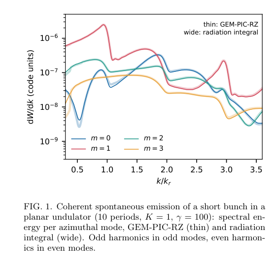
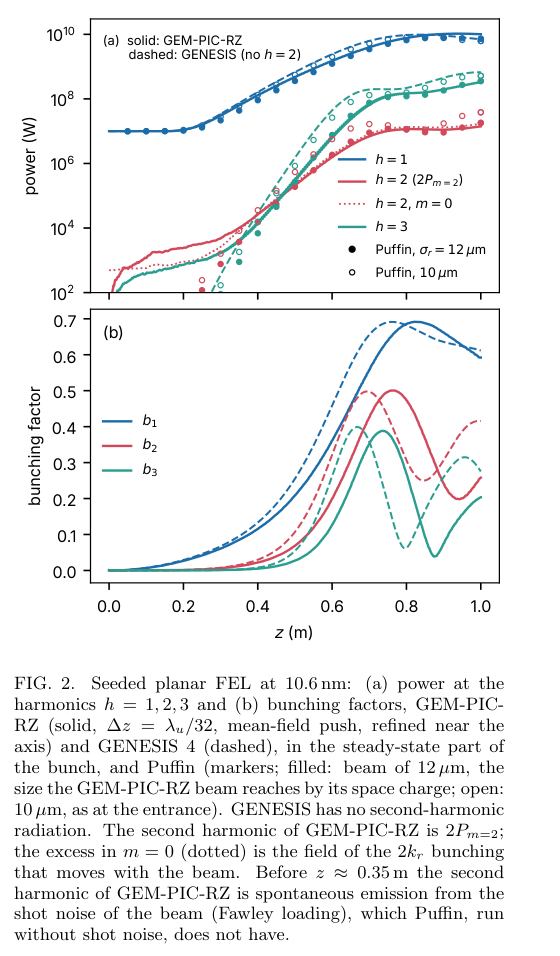
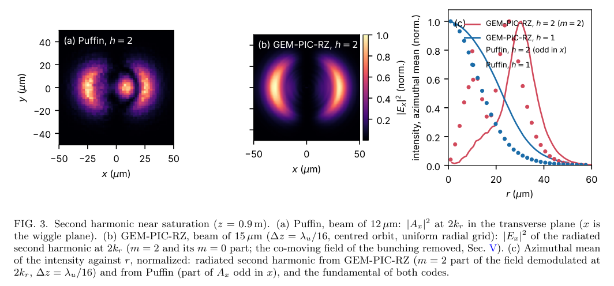

# GEM-PIC 自由电子激光：偶次谐波、空间电荷与数值诊断

## 0. 身份与证据

原题 *First-principles simulation of free-electron lasers with the Galilean electromagnetic particle-in-cell method: even harmonics of planar undulators*，Alexander Pukhov。[arXiv 2611.01640v1](https://arxiv.org/abs/2611.01640v1)，2026-11-01 06:42:53 UTC 提交、11-03 公告；PDF 内文日期为 11-03，8 页。[本地全文](../pdfs/Pukhov%20-%202026%20-%20GEM%20PIC%20FEL%20even%20harmonics.pdf)。精确标题 Crossref 前三未核实同作期刊版，按作者预印本入库。

证据为作者的数值方法、辐射积分及 GENESIS/Puffin 交叉基准，**不是新 FEL 实验**。本作引用既有 GEM-PIC-RZ 方法论文 [2610.31622](https://arxiv.org/abs/2610.31622)，研究任务是 FEL 偶次谐波与诊断基准，属于相关续作，不是旧论文的版本替换或独立代码复现。本轮未运行作者代码。

## 1. 摘要与引言：缺失的是哪一部分物理

常用平均 FEL 模型把电子运动按波荡器周期平均，将辐射写为谐振包络，再通过轴上耦合因子加入谐波。平面波荡器偶次谐波在轴上为零，因此仅使用该耦合的模型不产生其离轴辐射；这不意味着束流没有二次谐波微聚束，也不意味着实验中不存在二次谐波。

GEM-PIC 用随光移动坐标保留前向辐射载波与周期内电子轨道，空间电荷来自同一场系统。标题中的 first-principles 受场模型限定：后向辐射的慢导数被舍去，不能据此称它是覆盖振荡器或任意反向传播的完整 Maxwell 求解。

## 2. 模型与离散：解除 CFL 不是解除分辨率要求

纵向演化坐标取实验室位置 s=z，快坐标为 ζ=z−ct。方位模展开后，前向场随 s 演化，后向组合场及纵场在每层解 ζ 方程。电子用 Vay 推进器经历波荡器场、自场和入口/出口一周期斜坡。s 步长仍须解析波荡器周期，ζ 网格仍须解析辐射波长。

作者加入波荡器冲量的 sinc 平均和与位置同时间层的电流沉积，修正原有一阶步长误差。螺旋 10 nm 放大器的功率增益长度依次从 9.5 cm 变为 8.7、8.3 cm；之后步长减半变化小于 1%。对平面波荡器，还在解下一层场后以两层平均场重新推进并重新沉积电流，避免相对论电场/磁场抵消被一阶误差破坏。

噪声加载采用 Fawley beamlets，重现真实电子的散粒微聚束功率，而非宏粒子数对应的过大噪声。轴附近以更多低电荷宏粒子降低小径向网格噪声；不能把普通随机宏粒子加载与真实 shot noise 混用。

## 3. 方位模与谐波：为何需要分开辐射和随束场

对圆形、居中的束流和平面波荡器，旋转横截面 π 等价于轨道平移半周期。第 h 谐波因时间平移获得符号，第 m 方位模因旋转获得符号，两者一致要求

$$
(-1)^h=(-1)^m.
$$

因此奇次谐波只进入奇数方位模，偶次只进入偶数模。h 是辐射谐波序号，m 是柱坐标方位模序号，不是同一个变量。偏心轨道会破坏这一对称条件。

对二次谐波主要辐射场，设横向笛卡尔分量正比于 x 乘径向函数。利用 x=r cosφ，投影到柱坐标得

$$
E_x=x f(r),\qquad
E_r=\frac{rf(r)}{2}(1+\cos2\phi),\qquad
E_\phi=-\frac{rf(r)}{2}\sin2\phi.
$$

在作者的模功率归一化下，辐射的 m=0 与 m=2 功率相等。但二次微聚束携带的随束近场也在 m=0，直接把该模解调场当辐射会高估。因此作者以

$$
P_2^{\rm rad}=2P_{m=2}
$$

提取二次谐波。它依赖对称性及 m=2 的近场泄漏足够小，饱和后近场与微聚束平方的比例不再保持，作者明确说该阶段提取更不确定。

## 4. 验证：相干自发辐射与高增益放大器

**Figure 1，PDF 第 3 页**：横轴 k/kr 无量纲，纵轴 dW/dk 为代码单位、对数刻度；颜色是 m=0—3，细线为 GEM-PIC-RZ，宽线为同轨道远场辐射积分。奇偶峰按方位模分离。Table I 的模积分能量相差 0.3—1.8%；积分参考仍有约总能量 4% 位于未保留的 m≥4，故“各保留模误差小于 2%”不是全辐射总误差小于 2%。表中一个能量代码单位为 2.94×10⁻⁷ J。

该算例为 γ=100、K=1、10 周期，纵横束宽分别 20 nm、5 μm，M=3、Δζ=λr/64、Δz=λu/40。网格变化两倍引起各模能量小于 0.5% 的差别属于收敛检查，不是测量不确定度。离轴辐射沿 ζ 前移，需要为传播留窗口；只留 1.3 μm 时高阶模能量低估 12—14%，充分余量约需 11 μm。

两组螺旋种子放大器在 10 nm 和 0.8 nm 的增益长度分别 8.33、38.7 cm；补齐空间电荷等相同物理的 GENESIS 为 7.92、38.4 cm。普通无相应空间电荷的 GENESIS 数值不同，不能把跨物理差别全部归为离散误差。

螺旋 SASE 算例中，随机宏粒子噪声相对真实电子噪声大 541 倍；线性段功率高 440—500 倍，饱和位置从真实噪声的 1.62 m 提前至 1.15 m。真实噪声跑的 8.3 GW 只有初始束参数 Ming Xie 估计约 45%，束半径与局域 Pierce 参数在演化，不能据此声称任意 SASE 已精确符合简单标度。

## 5. 平面种子 FEL：12 MW 的定义与横向结构

基准为 γ=1000、4 kA、初始横向 rms 尺寸 10 μm 的冷束，λu=1 cm、K=1.5、100 周期，谐振波长 10.625 nm、Pierce 参数 8.5×10⁻³，10 MW 种子、束腰 30 μm。束流平顶长度 1.9 μm，加各 0.1 μm 边缘，大于 1.06 μm 的滑移；所有比较关闭自然聚焦。均匀径向参考网格有 1000 个 1 μm 单元，壁在 1 mm，入口轨道居中。

**Figure 2，PDF 第 5 页**：横轴 z 为米；上图纵轴功率 W、对数刻度，下图为无量纲微聚束因子。实线是 GEM-PIC，虚线 GENESIS，点为两种初始束宽的 Puffin。红色实线是按 m=2 提取的辐射，红点线 m=0 多含随束场；GENESIS 虽有二次微聚束，却没有该辐射源项。早期 GEM-PIC 二次辐射包含 shot noise，自静噪声起步的 Puffin 不含这一项。

饱和取基频功率最大的步，并在稳态束段三片平均：GEM-PIC 基频 10.6 GW、二次约 11.6 MW（文中圆整为 12 MW）、三次 0.24 GW，二次/基频约 1.1×10⁻³。GENESIS 基频 9.8 GW、三次 0.27 GW；Puffin 为 8.3 GW、二次 11 MW、三次 0.22 GW。三片间二次功率约 5% rms 变化不是完整系统误差。

Puffin 无空间电荷，束宽不随同样方式演化；用 12 μm 而非 10 μm 束时二次功率降至 9.1 MW。因此其 9—11 MW 是不同束宽设置的交叉检查，不是对 GEM-PIC 12 MW 的等条件百分比精度认证。M=2 时三次谐波主要只有轴上 m=1 分量；增加 M=3、加密 ζ 后三次功率改变约 6%，其分辨率比基频更敏感。

**Figure 3，PDF 第 6 页**：横向坐标与径向坐标均为 μm；色标和右侧曲线各自归一化，不能直接比较绝对光子通量。左图 Puffin 用矢势模平方，中央 GEM-PIC 用已去随束场的电场模平方；二者是形状比较。二次谐波呈沿摆动方向的双瓣、轴上为零，方位平均为环；约 25 与 30 μm 环峰分别对应不同代码/演化束宽。

偏心轨道和拉伸网格会将红移三次谐波耦合入偶数模并反射高横向波数，在环内制造细纹。纠正轨道并用均匀网格后，相关锥带占 m=2 功率从 16—18% 降至 1.5—1.9%，主要功率变动小于 5%。正文先在 Figure 3 讨论处写 y 偏振份额 1.6%，随后明确写纠正后为 0.2%；保留两种运行条件，不把前一数字当作最终均匀网格的独立结论。

平均场双推进使 Δz=λu/16 可用：同参考 λu/32 比，增益长度 7.99/7.89 cm、基频 10.7/10.6 GW、二次 11.8/11.6 MW。不做该修正时束流出现非物理横向膨胀，增益长度可高 1.8 倍；二次功率对网格、推进和近轴噪声处理尤其敏感。

## 6. 周期平均何时失效

作者用一维稳态单频模型，RK4 每周期 96 步、每桶 256 粒子，只改变电子轨道是否周期平均，**没有测试宽带辐射或短束滑移**。低 Pierce 参数时回到

$$
L_{g,1D}=\frac{\lambda_u}{4\pi\sqrt3\,\rho},\qquad
P_{\rm sat}=1.36\rho P_b.
$$

这里 Lg 为功率增益长度、λu 为波荡器周期，ρ 无量纲、Pb 为束功率。线性场振幅指数增长的长度是功率长度的两倍，不能混用定义。到 ρ=0.15，两种模型增益长度差仍小于 3%；平均模型饱和功率约低 1.2ρ，在 ρ=0.04 约为 5%。这一受控试验说明该场景中周期平均本身未必是主误差，而非证明任意三维、超辐射或短束平均模型都足够。

## 7. 成本、适用范围和接续

作者成本基准使用较便宜的拉伸径向网格，功率/增益与均匀网格相差小于 5%，但精细二次横向结构需要后者。18,372 纵片、122 径向节点、三方位模、640,000 宏粒子、Δz=λu/16，双 CPU 核约 58 min、5.6 GB；近轴粒子细化约 91 min。GENESIS 同束长时域运行在收敛的 201×201 横网格约 28 min，401×401 约 67 min。所谓“2—3 倍成本”比较的是前者；不是普适加速比，也不是 64 核、44 GB、9.1 h 均匀网格参考运行的成本。

0.1 nm 硬 X 射线下 10 μm 束长约需 300 万纵片，作者明确归入集群任务。后向辐射、振荡器不适用；方位模截断须覆盖目标谐波；不能关闭空间电荷使跨代码等物理比较更难。源码与输入 decks 指向 [GEM-PIC-RZ 仓库](https://github.com/AlexMPukhov/GEM-PIC-RZ) 的 benchmarks/fel_paper，本轮未核实下载或运行代码。

对本库的价值是提供从 PIC 出发检查“谐波辐射还是随束场、物理模还是网格伪纹”的具体方法。激光加速器出口束流、输运/解压和 FEL 的串联在本文仍属后续；未给转换靶 γ、中子、核素、剂量或防护验收。

## 8. 本轮核验

本地 PDF、全页文本、三种页数读取及 SHA-256 已核验；目视第 2—7 页与三幅最终完整原图摘录，出处/裁框见[记录](../research/fel-visual.json)。本次唯一公开 URL MinerU 请求在认证处失败，HTTP 401/A0211、user token expired，未产生解析结果；使用布局全文与原页渲染回退，未用其他镜像绕过认证。见[解析记录](../research/mineru-attempts.json)、[PDF 核验](../pdf_validation.json)、[版本核对](../research/version-checks.json)。原图为 Pukhov 2026 作者预印本的有限学术分析摘录，arXiv 非独占分发许可不等于 CC BY。
