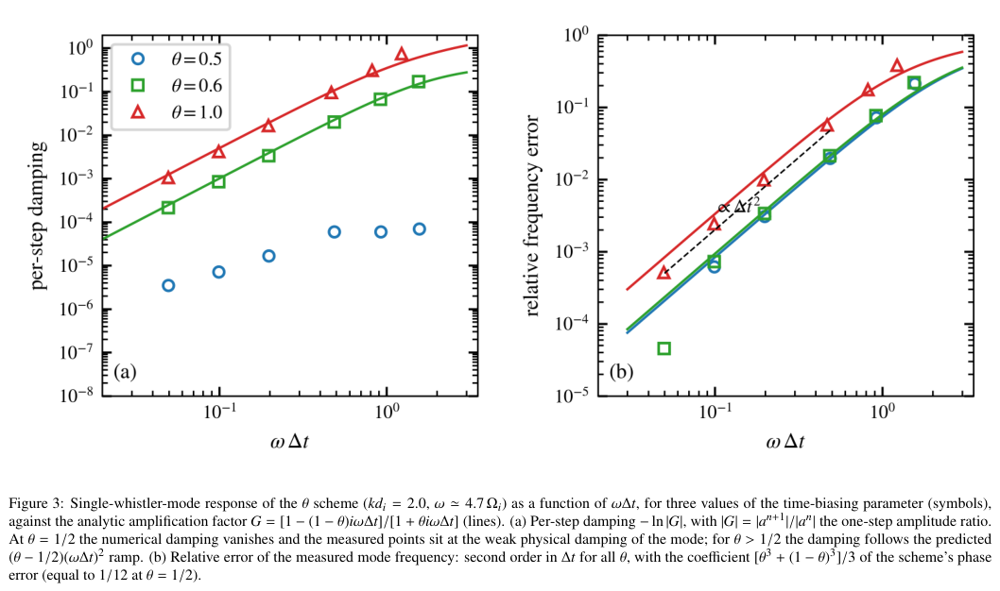
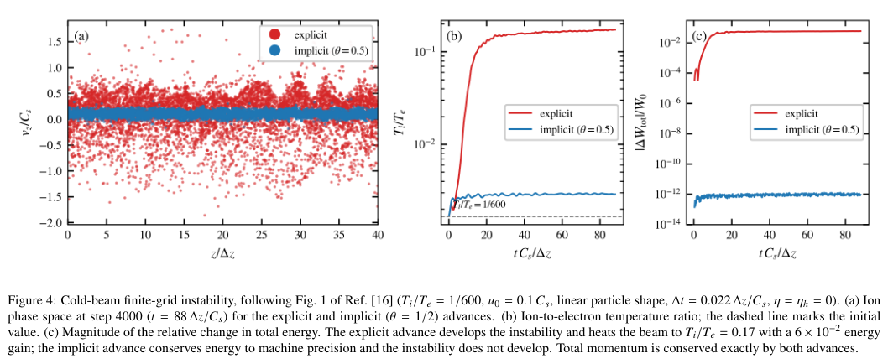
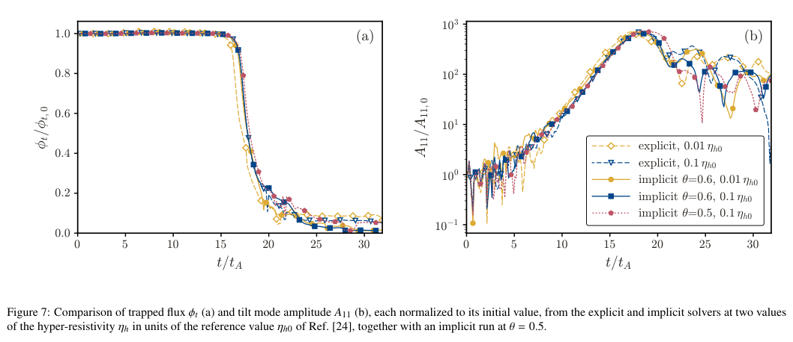
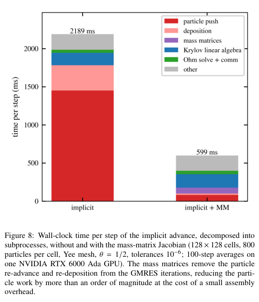

# WarpX θ 隐式混合 PIC：离子尺度能量账本、线性求解成本与 FRC 倾斜模

## 0. 论文身份与阅读证据

原题 *A θ-implicit hybrid particle-in-cell algorithm for kinetic simulations of magnetized plasmas*，Prabhat Kumar、William J. White、Stephen E. Clark，Helion Energy。[官方 arXiv 2611.00127v1](https://arxiv.org/abs/2611.00127v1)，2026-10-29 17:37:27 UTC 提交，15 页。[本地 PDF](../pdfs/Kumar%20et%20al.%20-%202026%20-%20Theta%20implicit%20hybrid%20PIC.pdf)。本轮按作者预印本阅读；版本核对记录见 [version-checks.json](../research/version-checks.json)，不能把 WarpX 软件背景或期刊式排版当成此作已正式发表的证据。

已读全文、附录 A 和参考文献，按原文顺序组织下文。本轮 MinerU 公开 URL 实际返回 **HTTP 401 / A0211 / user token expired**，没有成功解析；采用本地布局文本和原 PDF 渲染回退，关键公式、数值、图注以原页面核对。目视页码与摘录哈希见 [hybrid-visual.json](../research/hybrid-visual.json)。这些是文献核验，**没有本地运行 WarpX、作者输入文件、JFNK、FRC 模拟或性能基准**。

## 1. 摘要与引言：消除哪一种时间尺度

摘要给出三层贡献：将离子粒子与无惯性电子流体作为一个非线性系统推进；用匹配的离散功项构造离子、磁场和电子内能账本；用质量矩阵减少 Krylov 线性迭代中的粒子操作。验证对象是波色散、冷漂移束的有限网格不稳定性、Bennett 箍缩和三维 FRC，全部属于作者数值证据。

引言以高 β FRC 的长时间演化为动机：离子回旋半径与梯度尺度可比，离子动理学仍重要，但逐一解析电子等离子体频率、Debye 长度和光速传播过于昂贵。混合模型先删去电子惯性与位移电流，再处理剩余的 whistler 刚性；它不是以隐式算法恢复已经从模型中删去的电子尺度物理。

显式模型常用场子步、密度下限与超电阻维持计算，这些方法分别增加成本、改变稀薄区闭合或引入人工耗散。作者关注长期累积的能量和磁通误差，并与既有保守混合 PIC、ECSIM 质量矩阵和粒子消元 JFNK 方法衔接，不能把各组成思想都称为首次提出。

## 2. 混合模型与 θ 离散（原 §2）

### 2.1 物理排序与电子压力

离子按非相对论 Lorentz 力推进，电子是准中性、无惯性、标量压力流体；模型适用于远慢于电子等离子体／回旋频率、相速度远小于光速的现象。忽略位移电流后，总电流由磁场旋度给出，扣除离子和外加电流得到电子电流。广义 Ohm 定律可简写为

$$
\mu_0\mathbf J=\nabla\times\mathbf B,\qquad
\mathbf J_e=\mathbf J-\mathbf J_i-\mathbf J_{\rm ext},\qquad
\mathbf E=\frac{\mathbf J_e\times\mathbf B-\nabla P_e}{e n_e}+\mathbf D.
$$

这里电子电荷为负，e 是正的元电荷量，n_e 是电子数密度，P_e 是电子压力，D 汇集物种相关电阻摩擦与超电阻项，单位与电场相同。由无惯性电子动量平衡先解出电场，再用 Faraday 定律更新磁场；电场本身没有独立场能项。

电子压力采用含源项的标量内能方程：绝热输运之外，D·J 将耗散功送入电子内能，电子—离子温度松弛在两者之间等量交换能量。当前实现忽略热传导。只有初始熵均匀且没有熵源时，才退化为全局多方闭合

$$
P_e=n_0 k_B T_{e0}\left(\frac{n_e}{n_0}\right)^{\gamma}.
$$

其中 n_0、T_e0 是参考密度和电子温度，γ 是绝热指数；从沿电子流特征线保持 P_e n_e^{-γ} 不变直接得到该式。等温极限与绝热极限分别采用 γ=1 与 5/3；有加热或交换时，不能继续强制一条全局绝热线。

短波 whistler 的频率与显式稳定步长为

$$
\omega\simeq v_A d_i k^2,\qquad
\Delta t\leq\frac{\Delta x^2}{\pi d_i v_A}.
$$

v_A 是 Alfvén 速度，d_i 是离子惯性长度，k 是角波数，Δx 是网格间距。把 Nyquist 波数代入二次色散得到步长随网格平方缩小，说明这里只移除了 whistler 稳定性限制，时间分辨率和非线性收敛限制仍存在。

### 2.2 同一迭代中的场、粒子与压力

作者用时间偏置 θ 在中点与后向推进之间插值：

$$
h^{n+\theta}=(1-\theta)h^n+\theta h^{n+1},\qquad
\frac12\leq\theta\leq1,\qquad
\mathbf E^*=\mathbf E^{n+\theta}-\mathbf D.
$$

h 是任意场量；E* 是实际推离子的电场。离子位置和速度用中点值；同样的形函数、同样的粒子中点用于 gather 与 deposit。电子摩擦项 D 不直接再加给离子，否则会造成错误加速；但完整电场仍用于 Faraday 更新和非线性残差。

给定电场迭代，可分别解每个粒子的中点轨道，再沉积离子电流／密度、更新电子压力和磁场；这样粒子与磁场都被消元，只剩电场固定点条件：

$$
\mathbf F(\mathbf E^{n+\theta})
=\mathbf E^{n+\theta}-\mathbf E_{\rm Ohm}
\bigl(\mathbf B^{n+\theta},\mathbf J_i^{n+1/2},\rho^{n+1/2},P_e^{n+\theta}\bigr)=0.
$$

这里所有括号内量都依赖当前电场，并非从上一步冻结得到。压力方程也在每次残差评价中推进；其输运项采用守恒通量形式，并与离子和磁场使用完全一致的离散功。原文还施加压力正值下限，实际下限触发时的修正量应独立记账，不能只凭理想恒等式假设其影响为零。

中点 θ=1/2 的整体时间精度为二阶；固定 θ>1/2 时整体为一阶且具有数值阻尼。电子—离子温度松弛在一步结束后实施，通过电子压力损失和离子热速度变化配对，不是另一个不受约束的能量源。

### 2.3 外场分裂

外加压缩线圈等用给定矢势及时间波形产生：

$$
\mathbf B_{\rm ext}=f(t)\nabla\times\mathbf A,\qquad
\mathbf E_{\rm ext}=-\mathbf A\frac{df}{dt}.
$$

A 是空间矢势，f 是时间系数。对时间求导便得到外场对满足 Faraday 定律，因此内部磁场可继续用原离散更新。离子受到总场，Hall 项采用总磁场，而线圈电流与等离子体内部电流分开。外场输入功和边界通量必须列入开系统账本；不能把有吸收边界或受驱动系统的总能量变化直接称为数值误差。

### 2.4 能量恒等式：守恒依赖什么

离子动能、磁能和电子内能分别定义为

$$
W_i=\sum_p\frac{m_p|\mathbf v_p|^2}{2},\qquad
W_B=\sum_g\frac{|\mathbf B_g|^2}{2\mu_0}\Delta V,\qquad
W_e=\sum_g\frac{P_{e,g}}{\gamma-1}\Delta V.
$$

m_p 包括宏粒子权重，g 表示网格，ΔV 是控制体体积。用中点速度点乘粒子动量更新，磁力不做功；匹配的 gather/deposit 把粒子功转成网格上的离子电流功。对磁更新使用离散分部积分，得到负的总电流功及一个时间偏置余项；电子压力方程接收互补功。三项相加，闭合、无驱动的 Cartesian 系统得到原式(25)：

$$
\frac{W_{\rm tot}^{n+1}-W_{\rm tot}^{n}}{\Delta t}
=-\frac{\theta-1/2}{\mu_0\Delta t}
\sum_g\left|\mathbf B_g^{n+1}-\mathbf B_g^n\right|^2\Delta V,
\qquad W_{\rm tot}=W_i+W_B+W_e.
$$

变量与原式保持一致。推导的关键是三个通道中的离子电流功、总电流功和 D 功逐项抵消，电场没有动态场能可加入。θ=1/2 时右边恒为零；θ>1/2 时为非正，表示时间离散损失，不能解释为物理电阻加热。后者仍在各物理能量通道之间转移。

成立条件包括 gather/deposit 一致、离散旋度互为伴随、功项位置和体积权重一致。原文认为这种代数抵消可在接受的迭代量上达到舍入误差，而不由 Newton 容差设置；这并不意味着场方程残差或相位误差也达到舍入误差。附录 A.6 另指出 **RZ 的径向度量／插值权重只在插值精度上相容，存在残差**，因此不能把 Cartesian 的机器精度结论扩展到所有几何。

## 3. 非线性求解和质量矩阵（原 §3）

### 3.1 JFNK 与轨道自适应

Newton 每步解电场残差的线性修正，GMRES 只需 Jacobian 对向量的作用。基线实现用有限差分残差计算该作用；每次都要重新推粒子、沉积并更新压力，所以“粒子已从未知量中消去”并不表示线性迭代自动免除粒子计算。

给定中点位置与磁场，速度的中点方程可代数求解，位置则用 Picard 迭代保持自洽。多数粒子需 2—3 次迭代；不能收敛或跨越多单元的少量粒子改用局部子轨道，并在本步后续残差评价中保持相同标记。全局无需场子步，不等于任何粒子都无需细分轨道。

### 3.2 质量矩阵实际改变的是线性阶段

冻结粒子位置和 Lorentz 力中的磁场时，中点速度对电场是线性的，沉积电流可写为

$$
\mathbf J_{i,g}^{n+1/2}=\widehat{\mathbf J}_g
+\sum_{g'}\mathbf M_{gg'}\mathbf E_{g'}^{n+\theta}.
$$

M 是由粒子形函数确定稀疏带宽的张量系数，Ĵ 是与电场无关的部分。每次 Newton 迭代先从粒子沉积一次，GMRES 中再用纯网格运算构造线性电流响应。密度响应通过离散连续性恢复，不能简单冻结 1/n_e 与压力响应。需要子轨道的粒子从矩阵响应中排除，其直接沉积电流保留在 Ĵ 中。

质量矩阵只近似计算 Newton 修正所用的 Jacobian；非线性残差仍采用完整自洽粒子更新。所以其目标是以便宜的线性阶段接近同一非线性解，而不是把物理模型替换成线性化粒子模型。原文所有结果使用原生 JFNK，PETSc 后端只是另一个可用接口。

## 4. 验证与数值结果（原 §4）

### 4.1 电磁色散、能量和选择性阻尼

平行／垂直传播基准采用 Δz=0.1 d_i、每单元 1024 粒子、背景场 0.25 T。平行情况质量比取 100，垂直取 400；这是离子尺度混合模型基准参数，不是实验质量比实测。频谱跟随左右旋分支、离子回旋展宽及最高约 7Ω_i 的 Bernstein 谐波。垂直情况必须使用更小时间步，限制来自 Newton 收敛，已经表明无 whistler 稳定性 CFL 不等于任意步长可用。

去掉电阻与超电阻后，显式推进即使用 40 个场子步保持 whistler CFL 稳定，仍出现长期数值加热；隐式中点在该基准保持总能量相对误差小于 10⁻¹³。Fig. 2 图注给显式在 0.4 μs 的相对变化 ΔW/W_0=19；正文写“达到初始能量的十九倍”，两者相差一个初始能量，笔记保留图注定义而不混写为同一倍率。该结果比较的是此处零电阻配置，不是所有显式算法的普遍不稳定定理。

原图横轴是无量纲 ωΔt；左轴为单步振幅对数损失，右轴是相对频率误差。对单频模，θ 格式的放大因子为

$$
G=\frac{1-(1-\theta)i\omega\Delta t}{1+\theta i\omega\Delta t},\qquad
|G|^2=\frac{1+(1-\theta)^2(\omega\Delta t)^2}
{1+\theta^2(\omega\Delta t)^2}.
$$

G 是下一步／本步复振幅之比。直接取模后，小参数展开得到单步损失为 (θ−1/2)(ωΔt)²，除以 Δt 后数值阻尼率与 (θ−1/2)ω²Δt 成正比。θ=1/2 时模长恒为一，但相位仍有误差；图中所有 θ 的频率误差为二阶，只说明相位误差，不推翻 θ>1/2 整体一阶精度。称其选择性阻尼，是因为高频损失更强；低频也会有较小的非零损失，不能理解为理想锐截止滤波器。

### 4.2 冷漂移束有限网格不稳定性

该基准为 T_i/T_e=1/600、漂移 0.1 C_s、40 单元周期域、每单元 200 粒子、线性形函数。两种推进采用同一零电阻模型，跑 4000 步。

相空间横轴为 z/Δz、纵轴为 v_z/C_s；中图温度比与右图总能量相对变化均用于判断数值加热。显式束温升至 T_i/T_e≈0.17，总能量增约 6%；隐式束温保持在初始值两倍以内，能量误差约 9×10⁻¹³，未形成显式的俘获涡旋。两者动量均守恒；动量守恒本身不能排除有限网格加热。这里“未出现”只覆盖指定冷束算例。

### 4.3 RZ Bennett 箍缩

原文以径向 Bennett 密度与自磁场建立平衡，中心密度 2×10²⁰ m⁻³，离子、电子温度均 500 eV，箍缩半径 10 d_i；128×512 网格、每单元 250 粒子。采用有限电阻与网格尺度超电阻，隐式时间步超过密度下限区 whistler 稳定步约一个数量级。

从粒子噪声长出的 m=0 香肠模进入非线性饱和。拟合增长率为 0.371±0.020／τ_ci，锐边界带有限 β 修正的 MHD 参考为 0.363／τ_ci，显式参考为 0.406±0.019／τ_ci。Bennett 剖面不是锐界面，有限电阻和有限回旋半径也存在；因此接近 MHD 斜率是有限基准支持，不能当作模型与解析解逐点完全一致。拟合窗口移动可改变增长率约 ±15%，不能只阅读小的拟合误差。

### 4.4 三维 FRC 倾斜模

初始态是 Grad–Shafranov 椭圆 FRC，S*=r_s/d_i=7.9、延伸比 1.66、T_i0=4 keV、T_e0=400 eV、外场 0.35 T。网格为 96×96×360，平均每单元约 40 粒子；显式与隐式均用 Δt/τ_ci=2.5×10⁻³，目的是隔离时间离散影响，不是在这组比较中展示增大步长后的端到端加速。

电子承担平衡电流，离子平衡流剪切被移除；这一初始化会影响有限 Larmor 半径稳定性，不能直接映射成某台 FRC 实验的寿命。导体圆柱壁、吸收粒子边界和轴向场 Neumann 边界也应与闭合周期能量基准分开。

左轴为俘获磁通／初值，右轴为 A_11／初值（对数轴），横轴为 t/t_A；t_A=0.471 μs。倾斜振幅来自对称轴向离子速度的二维 Fourier 分量，不是直接测量的装置振幅。磁通损失与模饱和同期发生，约 t/t_A=15—20 进入快速损失阶段。

原 Table 1 的增长率由 t/t_A∈[12,16] 拟合得到：

| 超电阻 | 显式 γt_A | 隐式 θ=0.6 | 隐式 θ=0.5 |
|---|---:|---:|---:|
| 0.01 η_h0 | 0.501±0.056 | 0.497±0.025 | 未给 |
| 0.1 η_h0 | 0.580±0.019 | 0.559±0.041 | 0.549±0.020 |

误差是将拟合窗口改为至少 3t_A 子窗口时的最大偏移，**不是独立粒子种子重复得到的 SEM 或置信区间**。同超电阻下两种推进在此误差范围内一致，解体／饱和时刻差约一个 t_A；超电阻提高十倍导致约 16% 增长率变化，比此处求解器差异大。作者据此支持当前分辨率下没有可辨认的伪扰动，未证明所有网格、噪声种子或 FRC 参数均独立于时间推进。

## 5. 求解器性能（原 §5）

纵轴是毫秒／步，两根柱分别为基线隐式与增加质量矩阵的隐式；不是显式和隐式比较。参数是二维 128×128 力自由螺箍缩、每单元 800 粒子、约 1300 万粒子、Yee 网格、双精度、Newton／GMRES 相对容差 10⁻⁶，在单张 NVIDIA RTX 6000 Ada 上取 100 步均值。

原图标注 2189 ms 与 599 ms，比例约 3.65，正文四舍五入称 3.7 倍。质量矩阵降低线性阶段重复推粒子和沉积成本，但组装／应用本身也占新耗时约 13%；剩余主要瓶颈转为 Krylov 正交化。

另一个单 whistler 模配置中，步长增加 40 倍，Newton 维持每步约 2 次，而每 Newton 的 GMRES 从 8.5 增至 177 次。它支持非线性求解仍可运行，却没有说明固定物理时长总成本或等误差成本必定更低。物理预条件器尚未实现；本作没有测多 GPU 缩放，不能把引用文献中的核函数并行性能移作本算法实测。

## 6. 总结、附录与可复现边界（原 §6、附录 A）

作者总结的是一个带可调时间耗散、电子功项一致配对和质量矩阵加速的混合离子尺度实现。后续工作包括比较同位／交错网格、构造物理预条件器、加入电子热流和韧致辐射损失。当前结果没有包含这些未来项，也没有产生激光束流、γ／中子／同位素或诊疗应用的验收结论。

附录从磁能、离子动能、电子内能逐项推导，再加入 Poynting 通量、电子焓流及外场功。Cartesian 交错网格要求逐分量功项与压力节点分摊的权重严格匹配；RZ 径向控制体与插值只在插值阶相容。因此能量证明的适用条件比摘要的简写更具体。

数据声明为“按请求提供”，当前笔记没有下载对应输入文件或固定作者代码提交。软件使用 WarpX 不等于已经核对公开主线中存在可一键复现该实现；若开展复现，需要先获得具体版本、输入参数、预处理／诊断代码与容差设置。

## 7. 原文疑点与接续检查

1. **网格成本的文字不符。** 第 1 页称网格间距减半导致时间步数增加八倍；但式(11)的平方标度在固定物理时长给四倍。三维总单元数增加八倍也不是“时间步数八倍”。此处只做显示式的算术／量纲核对，不推断作者本想表达哪种总成本。
2. **压力电场旋度的条件。** 第 4 页称压力梯度在连续层面无旋、不影响 Faraday 更新，但 Ohm 定律中的项实际含变密度系数。由乘积法则有

$$
\nabla\times\left(-\frac{\nabla P_e}{e n_e}\right)
=-\nabla\left(\frac{1}{e n_e}\right)\times\nabla P_e.
$$

   一般演化压力并不保证该项为零；只有梯度平行或适当的 barotropic 闭合等条件才可消失。这是对文字泛化的静态核对，未检查实现是否误删该项，不能据此宣告作者代码存在同样错误。
3. **能量守恒与准确性分开。** 需分别报告场方程残差、离散能量闭合、相位／增长率误差、正值下限修正和边界能流；机器精度账本不能替代物理解收敛。
4. **阻尼与性能的可迁移性。** 选择 θ>1/2 同时引入一阶耗散，应该按相同可观测量误差比较总运行成本；需补多网格、独立噪声种子、预条件器和多 GPU 数据，才能判断实际长期 FRC 收益。

复习要点：该方法用一致的功项账本消除中点数值加热，再把重复粒子成本从 GMRES 中移走；其优势受离子尺度模型、离散权重、θ 耗散和未预条件线性求解成本共同约束。
