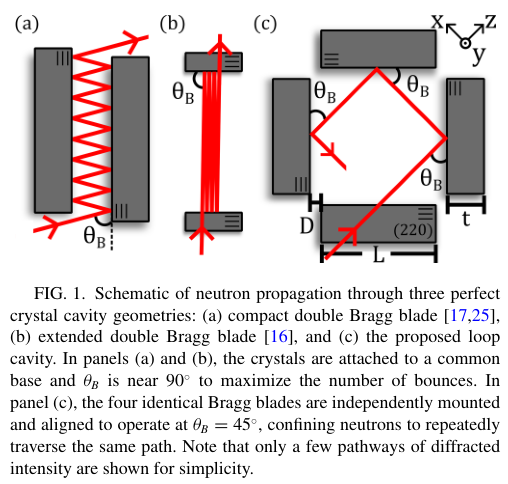
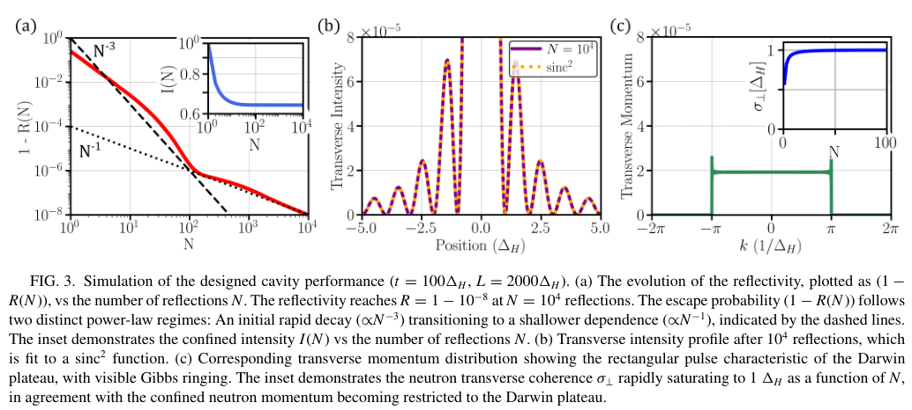
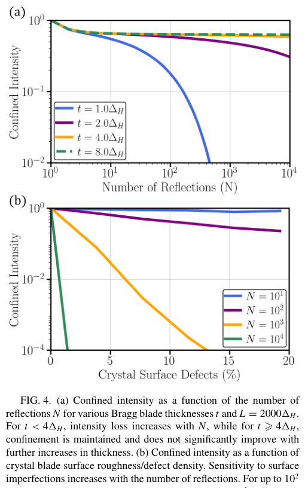
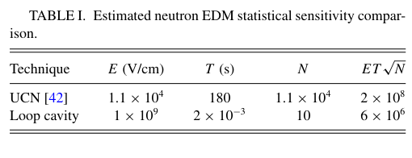

# 完美硅晶体中子环形腔：相干存活、实际损失与核物理测量边界

## 0. 论文身份与证据

Owen Lailey、Dusan Sarenac、David G. Cory、Michael G. Huber、Dmitry A. Pushin，*Perfect crystal neutron loop cavity*，**Physical Review Research 8, 043124 (2026)**，[正式 DOI](https://doi.org/10.1103/vqvb-4vgw)。正式 PDF 首页明确：2026-04-07 收稿、10-02 接收、**11-03 发表**；本轮 11-05 入库，不能把接收日或本轮归档日当发表日。[本地正式全文](../pdfs/Lailey%20et%20al.%20-%202026%20-%20Perfect%20crystal%20neutron%20loop%20cavity.pdf)，11 页，来自 [APS 官方全文接口](https://harvest.aps.org/v2/journals/articles/10.1103/vqvb-4vgw/fulltext)。相关作者预印本为 [arXiv 2604.02541](https://arxiv.org/abs/2604.02541)，按同一作品合并身份，不另计数。

本文是**装置设计、量子信息动力学衍射模拟与应用估算**，没有建成新环形腔或实测其储存率。引用的双晶体反射实验是外部既有证据。本文也不研究激光光核产中子、快中子慢化效率或屏蔽工程。MinerU 本轮共享凭据实际测试返回 401/A0211（令牌过期），本篇未重复提交；采用已验证的本地布局文本、独立页数与页面渲染。没有复跑作者 QI 模型或实验。

## 1. 摘要和引言：为什么要把反射路径闭合

引言先回顾完美晶体中子干涉仪中的自旋、引力相位和相干控制，再讨论双 Bragg 晶片储存腔。既有装置在晶片间多次反射，但有限晶片长度、长导管损失和对准稳定性共同限制作用时间。论文的新设计让四块晶片以 45° Bragg 角排列，重复经过同一路径，在紧凑装置内累积微弱相互作用。

摘要中的“约 64%、一万次反射”是理想幺正模型的存活概率。吸收、热漫散射、导管、装载和自旋分析损失另算。摘要提出 Schwinger 自旋旋转、nEDM、宇称破坏、中子寿命和量子 Zeno 的可能应用；这些是不同成熟度的测量方案，不能视为五项已完成实验。

## 2. 第二节：动力学衍射模型与接受度

QI 模型把晶体内中子传播写为节点上的量子随机行走，每个节点施加幺正操作。模型与动力学衍射的关系及早期装置验证来自所引文献，本篇沿用模型设计新几何。

论文式(1)的 Pendellösung 长度，在 Bragg 几何下为

$$
\Delta_H=\frac{\pi V_{\rm cell}\sin\theta_B}{\lambda|F_H|}.
$$

这里晶胞体积以体积计，波长与含散射长度的结构因子都以长度计，因而结果是长度；Bragg 角决定几何投影。Laue 几何的相应因子是余弦。其物理意义是透射和衍射分支相互交换强度的特征尺度，而非中子在腔中的自由飞行距离。本文采用硅(220)、波长 2.72 Å、Bragg 角约 45°，该长度约 40 μm。

完全反射的 Darwin 接受宽度为式(2)：

$$
\delta\theta=\frac{|F_H|}{\pi V_{\rm cell}}
\frac{\lambda^2}{\sin(2\theta_B)}\approx5\ \mu{\rm rad}.
$$

把衍射耦合强度投影到角度偏离量即可得到这个尺度：结构因子越大耦合越强，角接受越宽；它不是仪器的整体散角。硅(111)、4.4 Å 条件可把宽度近似加倍，但会改变中子参数和其他约束。

## 3. 第三节：环形腔、波函数和损失

### 3.1 几何与相干过滤

原图来自正式论文 p2，CC BY 4.0，作者、文献和 DOI 见第 0 节。图(a)(b)是既有双晶片几何，图(c)才是本文四晶片闭合路径；四次 Bragg 反射构成一圈。晶片长度、厚度和片间空隙分别控制通光区域、晶体模式和飞行时间。图为方案图，没有实测坐标或产额。

随后原 Figure 2 用较小晶体展示第一、第二、第十圈后的强度：不满足接受条件的分量逐步透射离开，留下窄动量带。它用来显示模式形成，并非最终长腔尺寸扫描。

正式论文 p3，晶片厚度为 100 个特征长度、长度为 2000 个特征长度。(a)横轴是**反射次数**，纵轴是单次逃逸概率，双对数坐标；约第 100 次附近从陡降转为较缓下降，插图给累计强度。(b)横向位置以特征长度归一化，强度近似 sinc 平方；(c)横向动量带近似矩形，对应 Darwin 过滤，边缘有 Gibbs 振铃。横向相干长度插图也按特征长度归一化，不能把图上 1 解释为 1 米。

用每次反射前后的积分强度定义单次反射率，连乘得到幺正存活率：

$$
R_i=\frac{I_i}{I_{i-1}},\qquad
P_{\rm QI}(N)=\prod_{i=1}^{N}R_i.
$$

这是由相邻强度比连乘后中间项消去得到的，不需要重跑随机行走即可理解其定义。第 10000 次时单次损失已到约十亿分之十，但**此前损失已经累计**，所以最终约 64% 不等于把最后一次反射率直接取一万次幂。

### 3.2 非幺正损失应另列

论文式(3)把吸收和热漫散射的平均反射率近似写为

$$
\langle R\rangle=1-\Delta_e n(\sigma_{\rm abs}+\sigma_{\rm therm}),\qquad
\eta(N)\approx\epsilon\exp[-N(1-\langle R\rangle)].
$$

消光深度、原子数密度和截面相乘是小的单次损失概率；将独立小损失的连乘展开为指数，得到第二式。作者采用吸收截面 0.26 barn、热散射截面 0.161 barn、效率因子 0.9，平均反射率 0.999975，一万次后约 70%。它与 QI 的相干泄漏是不同损失机制。

若只为演示损失账本，把 0.64 与 0.70 视作相互独立的条件因子，相乘约 0.45；再乘文中导管的约 0.84，则约 0.38。**这只是本笔记的分因子算术示例，不是作者完成的联合输运预测**，更不是实测效率。实际装载、角谱、表面和过滤器还会影响计数。

### 3.3 对准、装载、重力和表面

对准要求由约 5 μrad 的接受宽度决定。论文区分本装置保持反射的要求与两臂干涉仪保持相位的更严要求，但这不代表四晶片动态调节已经实现。

在零间隙几何中，一圈约 0.15 ms，作者要求一个晶片转动约 5 μrad 后在约 100 μs 内返回并稳定，明确承认这是专用执行器挑战。增加间距可以放宽开关时间，但会延长输运路径。局域约 3.6 T 磁脉冲是另一装载设想，来自波矢的 Zeeman 位移；不是已建成的快速开关。

一万次反射的路径约 570 m，自由下落约 0.75 m，需要导管或其他重力补偿。作者按约 17 次导管反射、每次 99% 反射率估计约 16% 损失；该估算不覆盖一般入射角、表面分布和工程误差。

正式论文 p5。(a)横轴反射次数、纵轴归一化腔内强度：厚度从一个特征长度增至四个后明显改善，再增厚的收益小。四个特征长度约为 160 μm，是此模型条件下的下限。(b)横轴为模型中的表面缺陷百分比，纵轴为归一化存活强度；反射次数越多，重复遇到同一区域的缺陷损失越严重。这个“缺陷百分比”由表面附近节点随机移除来模拟，不能直接等同于工艺粗糙度的 nm 指标。

## 4. 第四节：基础物理应用的逐项边界

### 4.1 从入射通量到可用计数

作者用每平方厘米每秒十万个中子、1 cm² 束斑、1 mrad 散角和 5 μrad 接受宽度估算约 500 个中子／秒被接受；只乘理想 64% 时约 300 个／秒。把对准、输运、时序及自旋器件损失加入后，作者给出 **1—10 Hz** 的保守计数设想。几步中的分母不同，不能把 64% 直接乘任意宽带激光中子源总产额。

### 4.2 Schwinger 自旋旋转与 nEDM

中子磁矩在原子电场的运动变换有效磁场中进动。原式(5)写作叉乘除以光速，是作者所用电磁单位约定；若移植到 SI，低速场变换相应含光速平方，不能混用数值。

本文实际用于估算的单次旋转式(7)为

$$
\theta_i=2\left|\frac{b_{\rm so}}{b_c}\right|,
\qquad \Theta_N\approx N\theta_i.
$$

自旋轨道散射长度与相干核散射长度的比值无量纲；在小旋转、同方向累积且导场不引起抵消时，各次转角相加。45°、硅(220)条件下单次约 0.00396 rad，因此约 800 **次反射**可到 π。它是估算，不是新测量。环几何使有效磁场方向保持一致，但仍须用导场维持自旋。

正式论文 p6。列分别为电场（V/cm）、有效电场作用时间（s）、计数和统计性能因子；不是腔的总飞行时间。其尺度可由相位不确定度随计数平方根下降得到：

$$
\delta d\propto\frac{1}{E T\sqrt{N_{\rm det}}}.
$$

文中环形腔采用一万次反射、每次晶体电场作用约 0.2 μs，总作用时间 0.002 s、仅 10 个计数。表内性能因子约六百万，低于 UCN 基准约两亿，约弱 33 倍。摘要／结论的十的负二十七次方 e·cm 是远期目标；现有表内假设并不支持已经优于 UCN。

### 4.3 液氦宇称破坏

旋转角随有效液氦路径长度累积，但散射使计数衰减。把初始计数、数密度、总截面和单位长度旋转系数记清楚，可写出用于解释作者最优长度的关系：

$$
N(z)=N_0e^{-\rho\sigma z},\qquad
{\rm SNR}(z)\propto z e^{-\rho\sigma z/2},\qquad
\frac{d\ln{\rm SNR}}{dz}=\frac1z-\frac{\rho\sigma}{2}=0
\Rightarrow z_{\rm opt}=\frac{2}{\rho\sigma}.
$$

这是泊松计数和均匀介质模型的推导。把 1 cm 样品穿越 200 次可实现 2 m 有效路径，但窄接受度导致计数远低于既有强束实验，因此不能把有效路径增加写为总体灵敏度优势。整体转腔改变传播方向的背景控制也仍需实验验证。

### 4.4 中子寿命

作者提出改变晶片间距以改变反射频率、从储存衰减中分离 β 衰变。一个解释用的独立损失模型是

$$
N(t)=N_0\exp\{-t[\tau_\beta^{-1}+\nu_b\ell_b+\nu_g\ell_g]\}.
$$

两个频率分别是 Bragg 与导管碰撞频率，两个损失率是每次碰撞损失。由各类独立生存概率相乘得到指数；变化几何时这些量不一定保持不变，因此外推不能自动消除系统误差。作者承认目前晶体／导管技术难以接近约 15 分钟的中子寿命；一分钟约 7% β 衰变的设想也不是已有储存成绩。

### 4.5 量子 Zeno 与拖曳

横向场中自旋自由进动后留在初态的概率为余弦平方。把总作用分成多段，每段后做理想投影测量，则式(9)(10)为

$$
P_\uparrow=\cos^2\left(\frac{\omega_L l}{2v}\right),\qquad
P_\uparrow(N_Z)=\cos^{2N_Z}\left(\frac{\omega_L l}{2N_Zv}\right)
\longrightarrow1.
$$

拉莫尔频率乘总飞行时间给出转角；每段时间缩短为原来的分段数分之一，再把理想投影成功概率连乘。用小角展开，累计损失随分段数增加而趋零，解释极限。环腔可让同一个氦-3 自旋过滤器反复起作用。**条件自旋存活趋一不等于所有中子无损透射**，真实氦-3 极化、吸收和腔损失都必须另计。缓慢旋转测量轴的 Zeno dragging 同样是建议实验。

## 5. 第五节、数据与待澄清问题

结论把本设计扩展到 Aharonov–Casher 和费米子反聚束等方向，仍属可研究课题。数据声明指向已有 QI 方法论文和 [Zenodo 软件记录](https://doi.org/10.5281/zenodo.23345317)；本轮未下载或执行该代码，不能称为独立复现。

原文有两处需要保留而非静默修正：正文／摘要使用约 800 **次反射**，结论写约 800 **loop passes**，四次反射才一圈，两者差四倍；寿命节用一圈 0.15 ms 推得 15 分钟约六百万，却称为 Bragg 反射，按前文定义六百万是圈数，反射次数约两千四百万。本笔记只做定义和算术核对，不替作者给出新的优化设计。

后续实验应先测四晶片的角接受、动态装载、每圈计数损失和表面缺陷，再检验同一几何下的自旋累计及背景。对本库的启示是：把光核中子的总产额、冷中子接受通量和最终核测量计数分开建账；本文提供中子光学设计思路，未闭合激光中子源到精密测量、诊疗或防护的完整链条。
