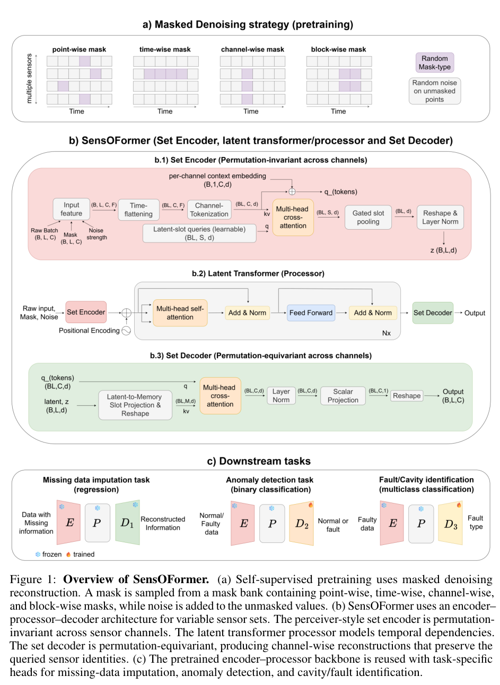
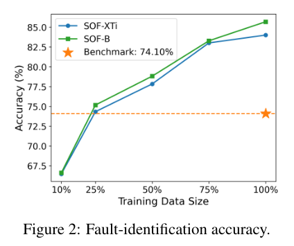
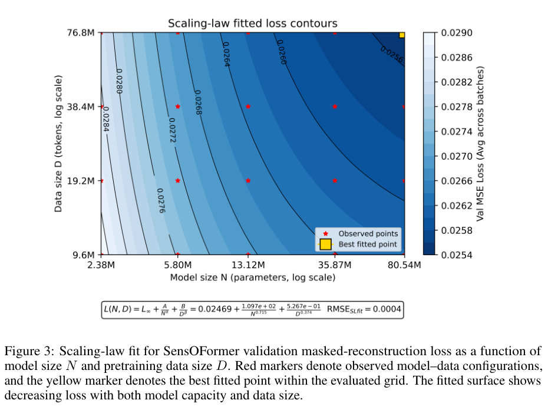
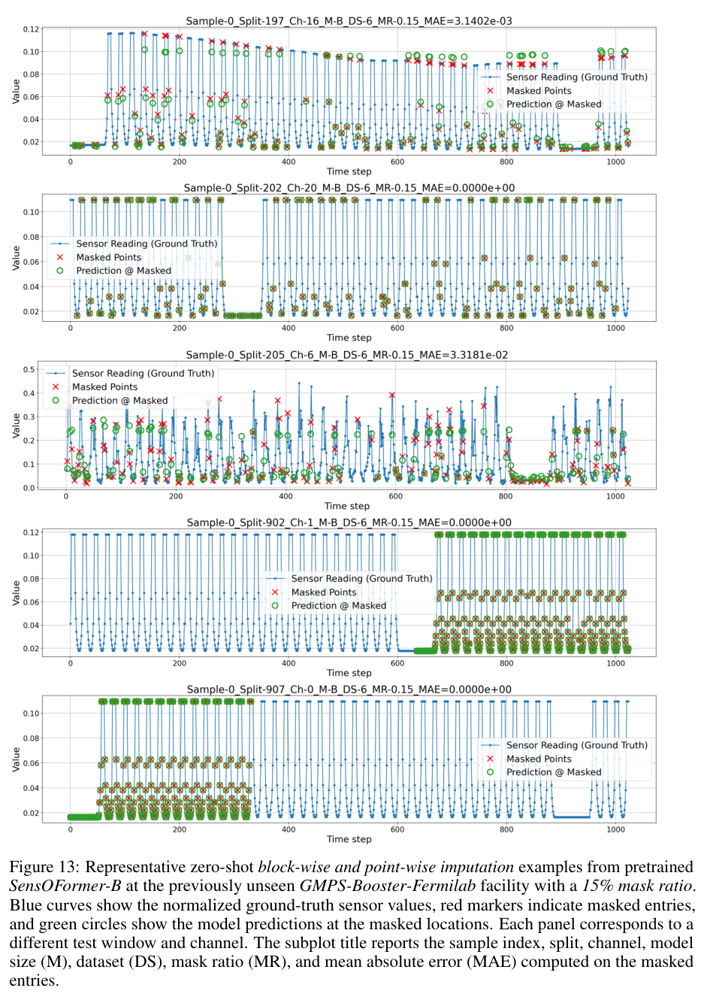

# SensOFormer：加速器遥测的集合表示、补全与故障诊断

## 0. 身份与证据

原题 *SensOFormer: Foundation Models for Particle Accelerators*，Mahindra Rautela、Alexander Scheinker，Los Alamos National Laboratory。[官方 arXiv 2611.02031v1](https://arxiv.org/abs/2611.02031v1)，2026-11-01 16:25:32 UTC 提交，30 页；[本地全文](../pdfs/Rautela%20and%20Scheinker%20-%202026%20-%20SensOFormer%20accelerator%20telemetry.pdf)。PDF 页脚印有 NeurIPS 2026，当前核验全文仍是作者 arXiv v1，不能单凭模板页脚认定正式会议版本。[作者项目页](https://mahindrautela.github.io/sensoformer/)提供代码等入口。

本文使用多装置真实历史遥测和既有标注数据做**离线机器学习评估**；属于真实数据上的算法证据，并非新束流实验、线上控制验收或激光等离子体诊断验证。本轮已读取正文、参考文献及附录 A—D，未运行作者训练、推断或控制代码。共享 MinerU 凭据在本轮另一篇公开 PDF 的探测中返回 HTTP 401/A0211（令牌过期），本篇未重复提交；采用已验证 PDF 的布局文本及原页渲染回退。

## 1. 摘要：把多种诊断任务建立在同一表示上

摘要先指出大型加速器的测量存在噪声、缺失、异步采样和不同子系统时间尺度。作者提出带掩码去噪的 Perceiver 式 Transformer：预训练时隐藏部分测量并重建，随后复用表示做缺失数据补全、异常检测、故障腔定位与故障分类。

“基础模型”在这里表示跨五个装置预训练、复用编码器和处理器的传感器模型；不是从物理方程直接预测任意加速器，也不表示已经涵盖激光尾场加速器。文章的主结果支持离线表示复用和部分域外重建。

## 2. 引言：为何固定通道向量不足

引言第一层动机是束流稳定、安全和运行可靠性依赖大量耦合组件；RF、磁铁、真空、冷却、时序和束流监测系统积累了丰富但弱标注的数据。相比每个任务重新训练，作者希望把这些数据转化成共用的自监督信号。

第二层是数据结构。不同采集时段和子系统的传感器数、排序、缺失模式均可变化，通道的物理含义来自位置和子系统，而非数组列号；把所有批次填充到最大通道数会浪费计算。快速 RF 故障与慢冷却漂移也不适合被解释成一个均匀时间尺度。

第三层是模型要求：用集合编码器适配变长通道，用时间 Transformer 描述压缩表示，再用集合解码器恢复指定通道。引言列出的四项贡献依次是模型、跨五装置预训练、尺度研究、补全及诊断迁移；其中“首次”是作者限定表述，本文未另做全球优先权考证。

## 3. 相关工作：贡献在组合及应用范围

第二节先对照加速器专用模型：LANSCE 虚拟诊断、CEBAF 腔故障、SNS 调制器、LHC 束损、LCLS RF 与 Fermilab 控制。它们说明存在共享子系统语义，但不证明相同通道可无条件跨装置互换。

随后对照科学基础模型和时间序列方法。作者将贡献定位为把集合压缩、时间表示、等变重建、结构化缺失和多装置预训练结合起来，而非声称注意力、集合模型或去噪目标本身是新发明。附录 A 的 SeFT/MOIRAI 对照主要是输入、目标及实现配置差异；没有给出二者完整适配后的同任务数值对赛，因此不能从架构表推导全面优越性。

## 4. 方法：先构造可学的缺失，再压缩传感器集合

### 4.1 掩码去噪预训练

第三节先解释为何采用重建而不是只预测未来：本文主要任务是恢复任意位置的缺失测量，且子系统时间尺度不统一。每个训练窗随机选择点、时间、通道或矩形块掩码；可见位置再加随机强度噪声，目标是原来的干净测量。

图来自 PDF 第 4 页。上部横轴为时间、纵轴为多个传感器，紫色为隐藏位置；这部分没有物理单位。中部是网络流程，图中明确画有 **per-channel context embedding**，与 token 相加后形成解码查询；它是保持通道身份的重要路径。下部雪花/火焰标识冻结/训练部分。图说明模型怎样共享表示，不能据流程图认定对任何新传感器均能泛化。

### 4.2 编码、时间处理及解码

正文给出的输入为批量、时间、通道、特征四维张量，当前数值特征是测量值和掩码指示。每个时间点的通道被视为一个集合；16 个可学习潜在查询对通道 token 做交叉注意力，池化得到一个时间潜在向量。处理器再沿时间做 Transformer，解码器把潜在向量投影为 32 个 memory slots，并用通道查询恢复逐通道标量。

集合编码器对输入通道重排不变，解码输出应随相同身份的查询一起重排。这是**排列性质**，并不自动保证校准变化、未见装置或新通道语义可迁移。正文 3.2 的两维特征说明未详细展开图中 context embedding 的构造；其与物理位置、通道名及新装置传感器的对应规则，需要进一步核对代码，不能把文字省略误判为代码没有通道信息。

第三节最后区分三个接口：补全直接复用重建解码器；二分类异常检测和腔/故障多分类分别接专用头。后两者需要监督标注，不能统称为零样本诊断。

## 5. 实验：哪些装置在预训练内，哪些在外

### 5.1 数据与输入语义（Table 1）

预训练包含五个装置：LANSCE 2019—2024 的 4,250 条、每条 10,000 点且 1—1,754 通道；LHC 2017/2018 两条约 52—54 万点的 66 通道束损序列；LCLS 三组共 9,841 条、9 通道 RF 记录；SNS 的 10,000 条、3,753 点、12 通道调制器波形；CEBAF 的 2,375 条故障事件。

CEBAF 的 192 个输入索引是 **8 腔×4 信号×每信号 6 个提取特征**，不是 192 个物理时间点。即使后续 CNN 沿该索引操作，也不能把其“时间卷积”解释为真实传播时间或故障演化速度。

LANSCE 2025（17 条、最多 769 通道）和 Fermilab GMPS-Booster（1,295,713 点、43 通道）只用于评估，不参与预训练。因而前者是跨年份，后者是本文最清楚的跨装置补全测试。五个预训练装置本身的测试集补全，只能称在已见装置留出数据上的零微调推断。

### 5.2 缺失补全（Table 2）

表 2 比较 XTi/Ti/Mi/S/B 五种模型、七组数据及 5%、15%、25%、50% 点掩码。B 在 28 个组合中的 25 个误差最低，S 在另三个最低；这比较的是五种本模型尺度，并非与所有时间序列模型相比的 25/28 胜率。尤其 LANSCE-2025 的 50% 掩码中 B 的 8.6389 高于 S 的 7.4946，增大模型并非每格都改善。

表值为反归一化后的 masked-entry MAE。LANSCE 旧年份 15% 掩码的 B 为 1.6769，新年份为 6.6987；后者更难，提示分布迁移。GMPS 15% 掩码从 XTi 的 154.4622 降到 B 的 148.0681，支持有限跨装置改善。不同传感器混有不同原始单位和量级，不能把不同数据集的这些原始 MAE 直接比较为同一物理测量精度，也不能将某幅归一化曲线误差当作表中全部数据的误差。

### 5.3 SNS 异常检测：21/21 的分母与条件

作者冻结编码器与潜在处理器，仅训练约 0.22M 参数的 1D-CNN 头。标准 8,000/2,000 划分中全部 11 种比较方法的 precision、recall、F1、AUC 都为 1，因此该测试不能区分实用早期预警能力。

更有区分力的是 **21 个独立诱导早期故障运行文件**。附录 B 说明它们不进入该基准的训练或普通测试，先运行约三分钟正常状态，再逐渐扰动调制器设置。只有归一化检测延迟小于 25% 且 F1 大于 0.8 才算通过；XTi 和原分层投票集成均为 20/21，B 为 21/21。这不是任意实际故障的 100% 检出率、连续线上无漏报或安全保证。

SNS 还在自监督预训练语料中；论文没有给出能逐事件证明**预训练语料与所有诊断测试事件**隔离的统一清单。已知“诊断头测试未训练”与“整个模型从未见过任何相关无标注事件”应分开，未独立审计前不作后一个声明。

### 5.4 CEBAF 故障/腔识别及标签效率

每条事件用 192 个提取特征形成潜在序列，分别接 9 类腔定位和 8 类故障分类头，约 0.50M 下游可训练参数。XTi 腔定位准确率 84.80%，与既有 LSTM/CNN 的 84.60% 接近；故障分类为 84.01%，高于引述基准 74.10%。基准来自此前发表结果，文章未把全部训练预算、输入及参数严格匹配，差值不能全归因于某个单一模块。

图来自第 10 页，横轴为有标签训练数据比例，纵轴是固定测试集准确率（%）。蓝色 XTi、绿色 B 随标签增加而改善，橙色虚线是既有 74.10% 基准。两种模型在 25% 标签时越过该线；满标签时 B 为 85.69%。这里“只需四分之一标签”仍依赖完整的跨装置自监督预训练，不等于仅用四分之一总数据，也不代表只付分类头计算成本。

正文的限制段明确承认：评估仅限可取得的公共/历史数据；预训练成本高，大骨干推断更贵；固定任务仍可能适合专用模型；未做持续学习，实时部署及控制系统集成留待未来。

## 6. 结论及开放数据声明

结论重申共享骨干对补全及诊断迁移的可行性。可支持的结论是“多装置历史数据的自监督表示有复用价值”，不能扩大成任意装置的现成控制器。数据继续由原发布方提供，受装置访问限制的数据不重分发；项目页代码入口不等于本轮已复现结果。

## 7. 附录 A—B：可复现性细节与关键公式

### 7.1 模型及划分

附录 A 解释 SeFT 与 MOIRAI 的任务适配差异。MOIRAI 所引默认实现的 128 变量上限是该配置范围，不是注意力方法绝对不可扩展到更多通道的数学结论。

附录 B 的五种模型参数为 2.38M、5.80M、13.12M、35.87M、80.54M；最大时间位置编码长度 1,024。**PDF 写的是原始序列先按 80%/10%/10% 划分，再做长度 1,024、步长 256 的重叠窗**。这在设计上防止同序列相邻窗口跨训练与验证集，但 LHC 仅两条长序列、GMPS 仅一条的表格表示，与具体切分实现之间仍需代码/划分文件澄清。不能用网页的 90/10 简述替换 PDF。

四种掩码等概率选一种；点掩码概率 0.15，时间掩码隐藏某时刻 75% 通道，通道掩码隐藏某通道 60% 时间点，矩形块面积约整个窗口的 15%。作者尽量避免遮掉整行/整列/整窗，因此本基准不直接验证整通道长期完全失联。

### 7.2 仅用可见值归一化（原式 1—5）

令掩码为 1 的元素是待预测目标，对每个批次/通道从可见时间点取得最小值和最大值，定义：

$$
r_{b,c}=\max\!\left(x^{\max}_{b,c}-x^{\min}_{b,c},10^{-5}\right),\qquad
\widetilde{x}_{b,t,c}=\operatorname{clip}\!\left(\frac{x_{b,t,c}-x^{\min}_{b,c}}{r_{b,c}},0,1\right).
$$

变量：b 为批次、t 为时间/输入索引、c 为通道；r 与原测量同单位，归一化结果无量纲。先减可见最小值，再除可见范围，避免用隐藏目标计算输入统计量；下限防止常数通道除零。裁剪把范围外数值截到端点，因而对罕见极值的恢复能力还需专门检验，不能由归一化损失很小推断极值准确。

训练时仅在可见值加零均值高斯噪声，标准差从 0、0.005、0.01、0.015 取值。噪声是在归一化空间定义，不能解释为所有传感器统一的物理噪声；验证和零微调补全不加该噪声。

### 7.3 训练目标（原式 6）

$$
\mathcal L=
\frac{\sum_{t,c}M_{t,c}(\widehat{x}_{t,c}-x_{t,c})^2}{\sum_{t,c}M_{t,c}}
+0.05\frac{\sum_{t,c}(1-M_{t,c})(\widehat{x}_{t,c}-x_{t,c})^2}{\sum_{t,c}(1-M_{t,c})}
+\frac{0.01}{(L-1)C}\sum_{t=1}^{L-1}\sum_{c=1}^{C}|\widehat{x}_{t+1,c}-\widehat{x}_{t,c}|.
$$

这里 x 是干净的归一化目标，帽号为预测，L、C 分别是窗口长度和通道数。第一项是掩码位置均方误差；第二项弱约束可见值；第三项是一阶总变差式平滑。推导上，先分别按隐藏/可见样本数平均平方差，再给相邻预测的绝对差加权，三个量都在归一化空间无量纲。物理直觉是抑制为拟合噪声而产生的高频振荡；但真实快速突变也可能被平滑，且 CEBAF 的索引为特征而非物理时间。验证损失只计算第一项，故不能与完整训练目标混用。

### 7.4 算力及参数比较

常规预训练为 16 张 80GB H100，每卡 micro-batch 1、累积 4 次，全局批量 64，25 epochs、约 125K 更新；AdamW 学习率 10⁻⁵，2.5% warmup 后余弦衰减，bfloat16、损失用全精度，梯度范数截到 1。下游用单张 48GB RTX A6000。尺度扫描另用 32 张 H100、单遍预训练，不应把两种实验成本混写。

附录估算既有 CEBAF BiLSTM/CNN 指定层至少约 0.302M/0.412M/0.462M 参数，省略未明确最终层。SensOFormer 的 0.22M/0.50M 是**头**，2.38M/80.54M 是完整预训练模型；分类实际保留冻结编码器/处理器但移除重建解码器。头较小不等于总参数少，也不等于推断更快；文章没有完整同硬件延迟/能耗基准。

## 8. 附录 C：尺度律是有限网格拟合

图来自第 19 页。横轴为参数数量 N，纵轴为数据量 D（图标 tokens，均为对数轴），颜色是 masked validation MSE；红星是五种模型×四种数据比例的已算配置，黄色方块为已评估网格中最佳拟合点。低损失区域在右上，说明本扫描内扩大二者有益；不能据拟合色面认为未算点已经计算过。

原式 14—15 的正确幂次在分母：

$$
\mathcal L(N,D)=\mathcal L_\infty+\frac{A}{N^\alpha}+\frac{B}{D^\beta}
=0.02469+\frac{1.097\times10^2}{N^{0.715}}+\frac{5.267\times10^{-1}}{D^{0.374}}.
$$

N 为原始参数个数、D 为原始数据计数，不能以百万为单位代入同一系数；图上数据轴称 tokens，但异质传感器窗口如何折算原始计数还需训练实现说明。A、B 吸收计数单位，损失为无量纲归一化均方误差。拟合 RMSE 为 4×10⁻⁴，只是 5×4 有限配置上的拟合残差。项目网页若把正指数直接乘上去，会给出反向趋势；本笔记以 PDF 分式及原图为准。

原式 16—20 假定算力与参数数、数据数乘积成正比，固定系数为 κ。令 K 为算力除以 κ，代入数据量等于 K/N：

$$
f(N)=A N^{-\alpha}+B K^{-\beta}N^\beta,\qquad
\frac{df}{dN}=-\alpha A N^{-\alpha-1}+\beta B K^{-\beta}N^{\beta-1}=0.
$$

移项得到边际收益平衡，再求幂：

$$
N^\star=\left(\frac{\alpha A}{\beta B}\right)^{1/(\alpha+\beta)}K^{\beta/(\alpha+\beta)},\qquad
D^\star=\left(\frac{\beta B}{\alpha A}\right)^{1/(\alpha+\beta)}K^{\alpha/(\alpha+\beta)}.
$$

代入拟合指数，参数数随算力约按 0.343 次幂增长，数据量约按 0.657 次幂增长。直觉是数据项衰减较慢，增加总算力时需更快增加数据。这是“拟合律成立、单次训练配方不变、成本近似乘积”的条件性推导，未验证改变通道数、窗口长度、硬件效率或训练 epoch 后仍成立。

## 9. 附录 D：代表性曲线与域外误差

附录依次展示 LANSCE 旧年点/块掩码（Figures 4—5）、新年（6—7）、LHC（8）、SNS（9—10）、LCLS（11—12），最后是完全未参与预训练的 GMPS（13）。这些是选择出的窗口，不是各数据集全部事件或误差分布；图中 normalized MAE 与 Table 2 的 raw MAE 不同。

图来自第 30 页，横轴为窗口内时间索引，纵轴为归一化数值；蓝线是原测量，红叉为隐藏点，绿圈为模型预测。前面点掩码可利用邻近周期，后面块掩码考验缺口内的模式恢复。部分周期波形标注零误差，第三行不规则信号仍有明显偏差；这些代表图支持对不同模式的有限适配，不证明所有突发故障、未见工作模式或连续缺失都准确。

## 10. 开放问题与对本库方向的意义

优先补核四类资产：序列/事件级训练—验证—测试清单（含无标签预训练与诊断测试的关系）、通道 context embedding 的跨装置映射、原始计数/归一化裁剪与极值误差、同硬件推断成本及实时漂移表现。以上是可复现性待核项，未据正文缺省宣称数据泄漏或代码错误。

对激光加速器的启发是复用可变诊断集合和缺失重建接口，但本篇没有以 LWFA 单发电子谱、发散角、靶状态、γ/中子产额作训练或测试。用于这些任务需要真实同步诊断、单发及运行时段隔离、域外扰动、误报/漏报代价与物理量校准；当前不能直接引用本文准确率作为激光装置性能。

速记：SensOFormer 在多装置历史遥测中展示“共享预训练骨干＋任务头”的价值；最强的域外证据是新年份与未见 GMPS 的有限离线补全，21/21 和尺度拟合均有明确分母与假设。

原图均摘自本篇作者 PDF 并保留原图注；页码、裁剪及 SHA 见 [视觉核验记录](../research/senso-visual.json)。
