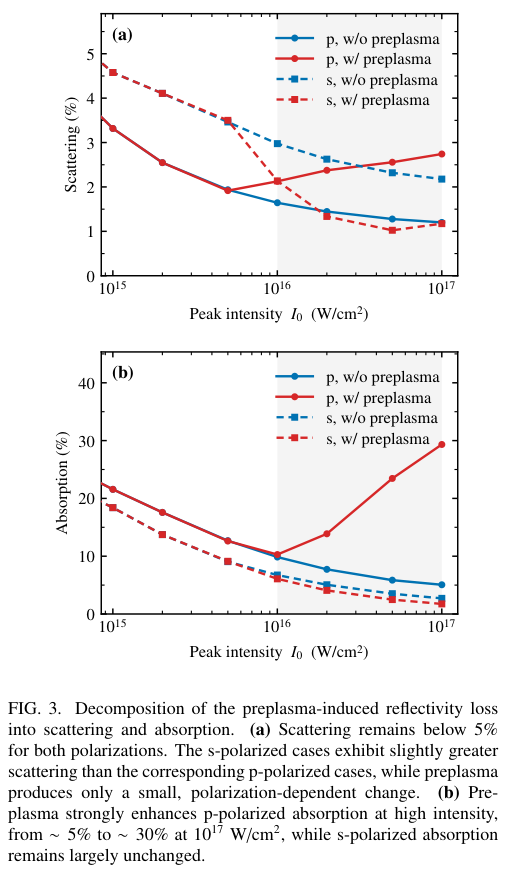
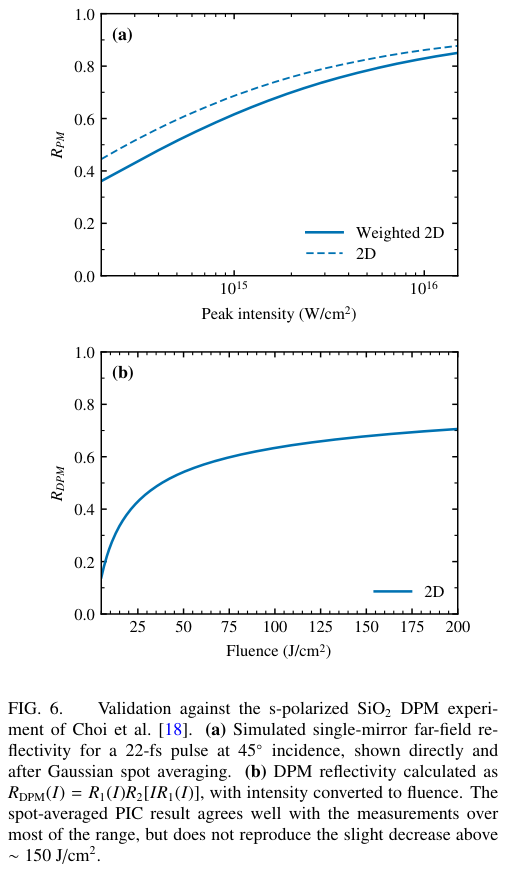
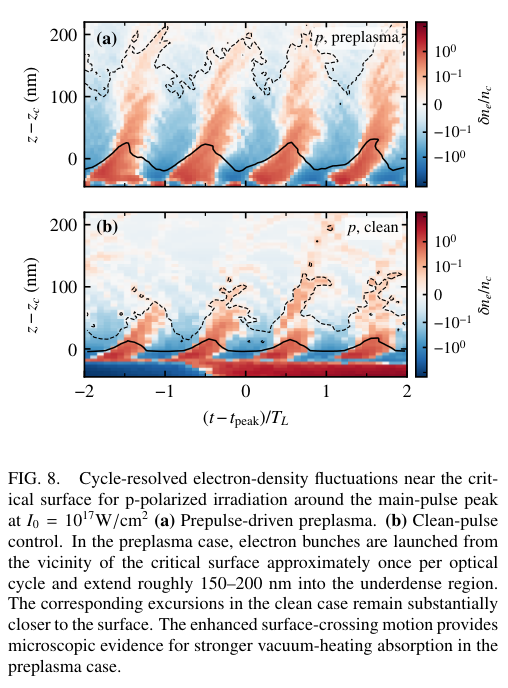

# 预等离子体怎样改变等离子体镜反射率：吸收、收集角和真空加热证据

## 0. 论文身份与核验范围

原题 *The preplasma origin of the plasma-mirror reflectivity response*，Zhongwei Wang、Douglass Schumacher，Ohio State University。[官方 arXiv 2611.04355v1](https://arxiv.org/abs/2611.04355v1)，2026-11-03 05:38:22 UTC 提交、11-04 公告，10 页、8 图。[本地 PDF](../pdfs/Wang%20and%20Schumacher%20-%202026%20-%20Preplasma%20plasma%20mirror%20reflectivity.pdf)。当前按作者预印本入库；正式版关系的本轮检查见 [version-checks.json](../research/version-checks.json)。

全文及参考文献已读，目视第 1—8 页，核对方法、公式、图注和关键结果；3 幅最终原图摘录已查看，来源页码、裁剪范围和哈希见 [mirror-visual.json](../research/mirror-visual.json)。本轮共享 MinerU 凭据已实际报告 HTTP 401／A0211 过期，本篇未重复提交；采用本地布局文本与 PDF 页面渲染回退。

**新增证据是作者 WarpX PIC 模拟，不是新的等离子体镜实验。** 输入的时间对比度、低场反射率和 BELLA／CoReLS 双镜实验数据来自既有文献。本轮没有运行 PIC、电离率、碰撞模型、Fresnel 传播或实验数据拟合。

## 1. 摘要与引言（原 §I）

等离子体镜利用非线性电离实现脉冲清洁：低强度预脉冲透过未电离的减反射靶，主脉冲到来时表面形成过密等离子体并反射。反射率随强度先升后降，使对比度增益与主脉冲能量通量之间存在权衡。

引言先汇总熔石英、玻璃、VHS 带、8CB 液晶和聚合物镜的既有测量。p 偏振下降比较普遍，s 偏振则可能下降或饱和，且与光斑等条件有关。Table I 是跨文献摘要，材料、入射角、脉宽和聚焦差异很大，不能把它当作同一平台上的受控偏振扫描。

过去经验模型常用临界面粗糙度衰减解释镜面反射损失，但只拟合镜面能量，无法唯一判断未被收集的能量是吸收还是散射。作者因此加入实测预脉冲历史形成预等离子体，再结合近场／远场能量诊断区分两条损失通道，并与两套既有 DPM 结果比较。

摘要的主结论限于当前模拟条件：p 偏振的下降主要进入吸收通道，周期性表面电子束团支持真空加热解释；s 偏振高通量反射率回落仍未复现。后者是模型缺口，不是已解决的散射机制。

## 2. 方法（原 §II）

### 2.1 低场电离决定主脉冲之前的靶态

ADK 的准静态隧穿近似要求 Keldysh 参数远小于一，但等离子体镜开启和预脉冲电离往往不满足。原式(1)为

$$
\gamma=\frac{\omega\sqrt{2m_e I_p}}{eE_0}
=\sqrt{\frac{I_p}{2U_p}},\qquad
U_p=\frac{e^2E_0^2}{4m_e\omega^2}.
$$

ω 是激光角频率，m_e 是电子质量，I_p 是电离势，e 是正的元电荷量，E_0 是电场幅值，U_p 是非相对论有质动力能。将周期平均的摆动动能 U_p 代入平方比即得到右式；γ 大意味着光场在隧穿过程中的变化不可忽略。U_p 的定义是解释该等式所用的标准展开，不是本轮新增拟合。

作者在 γ≥0.5 使用 PPT 电离率，在 γ<0.5 切换至两模型接近的 ADK 表达式；固定 800 nm 后预计算电离率并查表，避免逐粒子反复计算无限级数。模型不是在全部场强直接使用同一个 PPT 数值求和。

为了代表 8CB 分子 HOMO 电离，每个分子单位中的一个碳采用引用 DFT 结果 6.64 eV，其余碳仍采用原子值 11.26 eV。原 Fig. 1 表明这一低阈值配合 PPT 比纯原子碳或同阈值 ADK 更接近 Poole 等 2016 年的低场开启曲线。“无电离率拟合参数”只说明没有为该曲线拟合速率，不等于没有材料模型选择或系统误差。

### 2.2 近场吸收与远场散射的定义

两块近场诊断面分别垂直入射和反射方向，空间上分离两束，并对时间与面积积分 Poynting 通量。原式(2)—(3)可写为

$$
R_{\rm near}=\frac{\int dt\int dA\,\mathbf S_r\cdot\widehat{\mathbf k}_r}
{\int dt\int dA\,\mathbf S_i\cdot\widehat{\mathbf k}_i},\qquad
\mathbf S=\frac{\mathbf E\times\mathbf B}{\mu_0},\qquad
A=1-R_{\rm near}-T_{\rm near}.
$$

R_near 为诊断面收集的全部反射电磁能／入射能，T_near 是靶后透射分数，A 是由补数定义的吸收分数。它并不是直接测得的碰撞加热或某一种吸收机制功率；有限积分窗口、未收集电磁能、暂存场能及数值能量误差都需要闭合后才能把该补数严格解释为材料／粒子净吸收。正文没有另列这些闭合残差的数值误差表。

作者再将反射近场按频率分解，用 Fresnel 核传播至远场，计算镜面收集孔径内的能量分数 R_far。镜面锥半角按聚焦发散角的两倍统一定义：

$$
\theta_c=2\alpha,\qquad \alpha=\frac{\lambda}{\pi w_0},\qquad
S=R_{\rm near}-R_{\rm far},\qquad
R_{\rm far}+S+T_{\rm near}+A=1.
$$

λ 是波长，w_0 是 Gaussian 光束腰，α 是 1/e² 半角发散角，S 在这里是散射能量分数，与上式的矢量 Poynting 通量符号不同。将 A 的定义及 S 的定义直接代入即可得到最后的能量账本；四项用同一入射能归一化。

物理上，这个方法能区分“离开所定义镜面锥的反射能”和“全部近场反射以外的能量”。但 S 的大小依赖孔径、传播近似、带宽和诊断窗口；不是与收集几何无关的普适漫散射率。文献中收集锥约为聚焦锥的 1.92 或 2.35 倍，作者选择 2 倍是统一比较约定，并非每个既有实验的完整实际接受度重建。

### 2.3 PIC 设置与预脉冲到主脉冲的衔接

作者使用 WarpX 26.03、Yee 电磁求解器和三阶粒子形函数，未电离靶作为宏观介质，电离后加入 Pérez 等相对论二体 Monte Carlo 电子—离子碰撞；初始中性宏粒子为每单元 16 个。引用碰撞算法的文献名称包含碰撞电离，不等于本文已经逐项验证所有碰撞电离过程；本文明确使用 PPT／ADK 场电离与电子—离子 Coulomb 碰撞。

常规 2D 主计算采用 800 nm、w_0=5 μm 的 Gaussian 脉冲，26×18 μm² 区域、2048×2048 网格，横向／法向间距约 12.7／8.8 nm。每组 2D 运行约需单张 H100 一小时。选定的 3D 验证为 32×32×20 μm³、1024³ 网格，间距约 31／20 nm，960 个 CPU ranks、约 17 小时／组；硬件、维度和网格都不同，不能把两种运行时间直接作为二维算法相对三维的同硬件加速比。

预等离子体不是任意指定的指数密度坡：先单独运行 **2D 预脉冲 PIC**，用实测时间对比度的两个 Gaussian 分量表示皮秒肩部与 ASE 底座，保留峰值前最后 3 ps；作者认为更早的相对强度低于 10⁻⁵、绝对强度低于约 10¹² W/cm²，对这里电离贡献可忽略。随后将不同物种和电荷态的分布绕靶法向 z 轴旋转映射，构造 3D 主脉冲的初始态，再推进主相互作用 400 fs。

这一流程是“先形成预等离子体、再从该快照启动主脉冲”的模型链。轴对称映射抹去了不符合该对称性的三维初始结构；不是完整实测三维靶态输入。原 Fig. 2 的少量 3D 点支持当前 Gaussian／平滑靶条件下的 2D 光斑加权结果，但不替代分辨率、每单元粒子数、时间截断或真实三维不均匀性的全面收敛。

## 3. 反射率与双镜结果（原 §III）

### 3.1 p 偏振的高场损失主要进入吸收账本

Fig. 2 中，加入预等离子体后，p 偏振在约 10¹⁶ W/cm² 以上出现明显下降；相同强度区间的 s 偏振接近无预等离子体结果。二维光斑加权曲线与对应三维点接近，支持偏振选择性不是这几组情况下的二维伪影。

横轴为峰值强度 W/cm²，对数刻度；上图纵轴是散射分数百分比，下图为吸收百分比，分别列 p／s、有／无预等离子体。所有曲线散射小于约 5%，并未出现足以解释 p 高场反射下降的相同增量。在 10¹⁷ W/cm²，p 吸收由无预等离子体约 5% 增至约 30%；s 吸收仅少数百分点。

这里“p 吸收增加”指高于约 10¹⁶ W/cm² 后的分支，不能误读为全强度扫描单调上升；低端曲线仍先下降。散射本身也有随偏振／预等离子体的小变化，只是当前接受度下贡献远小于 p 吸收的增加。吸收／散射是能量去向判据，真空加热则是对吸收微观机制的进一步解释，两层证据需要分开。

### 3.2 p 偏振 BELLA 双等离子体镜

作者比较 Czapla 等 2025 年的既有实验：8CB 液晶膜、p 偏振，PM1／PM2 入射角 8°／11°，镜间距 140 mm，脉宽 35 fs，实验膜厚 20—40 nm。模型每片用 25 nm，普通／非普通折射率为 1.53／1.73。PM1 的时间分辨反射脉冲被送入第二组模拟，PM2 因而接收经过清洁的底座，而不是将两个相同的单镜反射率机械相乘。

对实验焦点扫描，采用 Gaussian 传播将焦点位置映射成每片镜上的强度，再按两片透过能量链相乘：

$$
z_R=\frac{\pi w_0^2}{\lambda},\qquad
I_1(z)=\frac{I_0}{1+(z/z_R)^2},\qquad
I_2(z)=\frac{I_0 R_1[I_1(z)]}{1+[(d-z)/z_R]^2},
$$

$$
R_{\rm DPM}(z)=R_1[I_1(z)]R_2[I_2(z)].
$$

z 是焦点相对 PM1 的位置，d 是镜间距，I_0 是无镜衰减的束腰峰值强度，R_2 对应 PM1 清洁后的时间轮廓。第一步由 Gaussian 束面积随 z 的变化得到强度；第二步再扣去第一面反射损失；最后才对剩余能量应用第二面反射率。

这一实验位置映射使用 w_0=60 μm、I_0=8.1×10¹⁷ W/cm²，得到 z_R≈14.1 mm。它与常规 PIC 设置中 w_0=5 μm 的计算光斑属于不同层次的几何处理，不能据此声称整束 60 μm 光斑已按同样纳米网格完整作三维扫描。

Fig. 4 示意 PM1 对底座的清洁：未电离 25 nm 膜的冷反射约 1%，在给定 I_0=10¹⁶ W/cm² 情况下，约提前 0.8 ps 开始显著电离。右轴是主脉冲反射率／瞬时反射率，并非本轮新测得的最终对比度增益。

Fig. 5 的模拟复现较宽的焦点位置依赖和 PM2 附近下降，但模拟最高约 75%，引用实验峰值超过 80%。焦点附近实测逐发波动大，模拟落在该散布范围内；这支持主要趋势，不能写成逐点误差已闭合、全参数无拟合预测或独立的新实验复现。

### 3.3 s 偏振 CoReLS 4-PW 双镜与未复现回落

对 Choi 等 2020 年既有实验，模型使用 s 偏振、22 fs、45°，近似实验的 50°；用 300 nm、折射率 1.4533 的 SiO₂ 层重现低场减反射条件，没有显式解析实验的多层 AR 镀膜。DPM 能量衰减同样为 R_1(I)R_2[IR_1(I)]。

若 I 是光束截面上的峰值强度，表面照射能流密度为

$$
F=I\tau_{\rm FWHM}\sqrt{\frac{\pi}{4\ln2}}\cos\theta_i.
$$

F 是靶面 fluence，τ_FWHM 是强度时间半高全宽，θ_i 是入射角。对时间 Gaussian 积分得到根号因子，乘 cosθ_i 是把束轴垂直截面能量分摊到斜入射后的靶面面积，不能混用两种面积定义。

上图横轴为峰强，纵轴为单镜 R_PM，实线是 Gaussian 光斑加权、虚线是直接 2D；下图横轴为 J/cm²，纵轴为双镜反射率 R_DPM。原文描述与实验在大部分区间接近，但 **原 Fig. 6(b) 实际仅显示一条蓝色模拟曲线，没有可见的实验点或误差条**，不能仅从本图独立计算或审计定量残差。

正文明确承认：既有实验在约 150 J/cm² 以上出现轻微反射率回落，模拟曲线仍继续缓慢上升。45°／50°角度近似、简化镀膜、实际光斑／时间非均匀性等尚未通过受控扫描逐项排除，因此不能将缺口唯一归因于某一种额外散射过程。

## 4. 预等离子体和真空加热解释（原 §IV）

### 4.1 临界面坡长

作者定义临界面局部密度尺度长为

$$
L_c=\left|\frac{\partial\ln n_e}{\partial z}\right|_{z=z_c}^{-1},
\qquad n_e(z_c)=n_c.
$$

n_e 是电子数密度，n_c 是该激光频率的临界密度，z_c 是临界面。取对数再求导表示局部相对变化率，倒数给出变化一个 e 倍所需的法向距离；这是局部尺度，不是整条预等离子体的总厚度。

在 I_0=10¹⁷ W/cm²、t=−2τ_FWHM，p／s 的 L_c 分别约 33／22 nm；在峰值为 38.8／21.5 nm，约为波长的 0.049／0.027。无预脉冲对照在较早时刻尚不足以形成临界面，主脉冲自行电离后坡长仍约小于 5 nm。预脉冲因而使主脉冲高能段到达前已有有限梯度，但此处仍是陡坡区，不能误写成几微米长尺度稀薄等离子体。

### 4.2 周期性电子束团支持 Brunel／真空加热

横轴为相对峰值时间／激光周期，纵轴为相对临界面位置 nm，色条是归一化电子密度涨落 δn_e/n_c。上下均为 p 偏振，分别有／无预等离子体，不能把它当作 p／s 直接轨迹对比图。

预等离子体情形约每个光学周期抽出一组束团，延伸至欠密区约 150—200 nm；清洁脉冲对照多在 100 nm 内。p 偏振具有法向电场，场反转后部分抽出电子可重新进入过密靶并传递能量，符合 Brunel／真空加热的表面往返图像。主相互作用的 L_c/λ≈0.04—0.05，作者认为即使 15° 入射仍有可观作用。

这是“预等离子体改变梯度＋p 偏振选择性＋周期束团增强”的机制支持。Fig. 8 是密度时空图，不是逐粒子完整能量轨迹；文中未给局域 J·E 按机制分解、同梯度碰撞开关、共振吸收排除或逃逸粒子能量闭合。因此可记录作者以真空加热为主的解释，不能进一步升级为已排他确定每份吸收能量的唯一来源。

### 4.3 s 偏振缺口与逆韧致吸收估算

s 偏振没有相同的法向激光电场，预等离子体不会自然产生同样的 Brunel 响应。作者用指数密度坡的逆韧致吸收估算

$$
f_{\rm IB}=1-\exp\left[-\frac{8}{3}\frac{\nu_{ei}^{*}L_c}{c}\cos^3\theta_i\right].
$$

ν_ei* 是所采用的有效电子—离子碰撞频率，c 是光速。指数内可理解为穿过近临界坡的有效碰撞光学厚度；在该厚度很小时，吸收近似等于指数内正的量，因此坡短或碰撞弱会抑制吸收。本文给出 L_c=21.5 nm、电子体温中位数 124 eV、15°、Z_eff=4 时约 2.6%，与该模拟少量吸收相近；本轮没有重新计算 Coulomb 对数或碰撞频率来独立复核该数值。

经验粗糙度模型要产生 30% 反射下降需约 40 nm 临界面粗糙度，而本模拟小于 10 nm；已测试的 f 数范围也未造成显著变化。作者提出真实束流空间／时间非相干性和靶不均匀性可能增强结构与散射，但还没有演示加入这些因素即可定量恢复高通量 s 回落。

## 5. 结论与接续（原 §V）

这篇工作将“实测预脉冲历史→电离与预等离子体→主脉冲 PIC→近／远场能量账本→双镜能量链”串联起来，对当前参数下 p 偏振反射率下降提供了比单纯粗糙度拟合更具体的解释。其证据仍是模拟和已有测量的比较，不构成新的独立对比度／反射率实验。

下一步需要：固定并公开 PPT 扩展代码与输入；分别审计吸收补数中的场能／粒子能／边界能流；给出收集锥、网格与粒子数敏感性；把预脉冲测量误差、轴对称映射和光斑加权误差传递至最终 DPM 曲线；提供 s 偏振原始实验点及残差，再测试不均匀性、镀膜与角度等假说。当前文本没有完整的输入文件／数据仓库声明，也未闭合 s 高通量回落。

对激光束流／转换靶应用的意义在于：进入主靶前的脉冲清洁和能量损失取决于底座历史与偏振，不能只按主峰强度优化。本文没有计算随后电子／离子束品质、γ／中子产额、屏蔽或诊疗终点，不能把前端光学解释直接外推成这些应用的效率增益。
