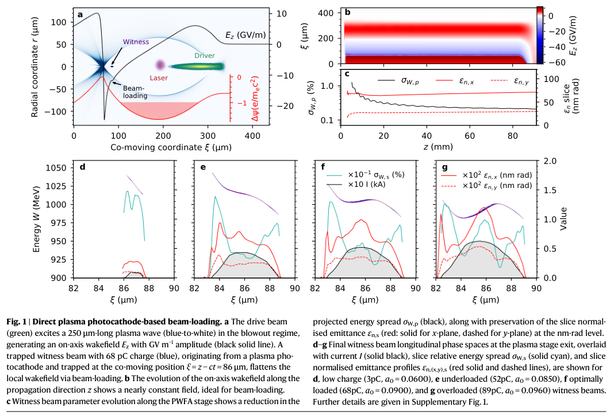
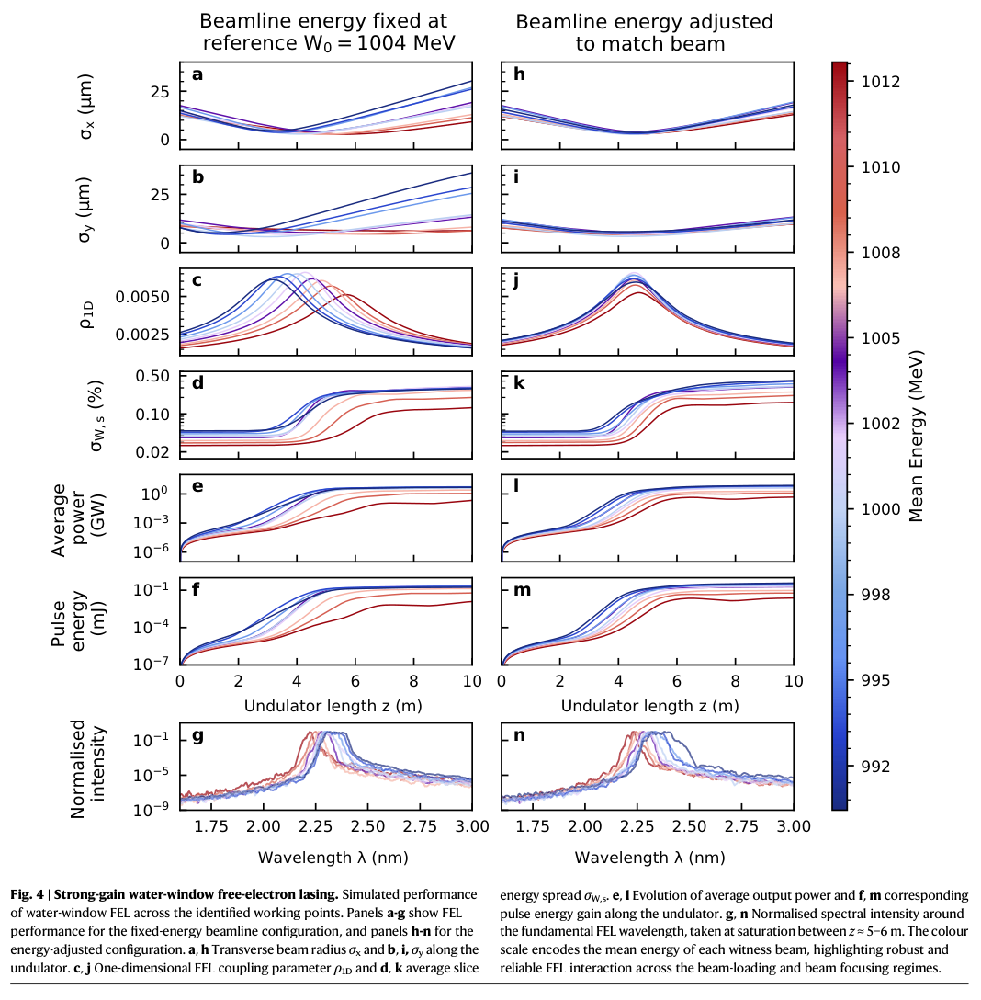
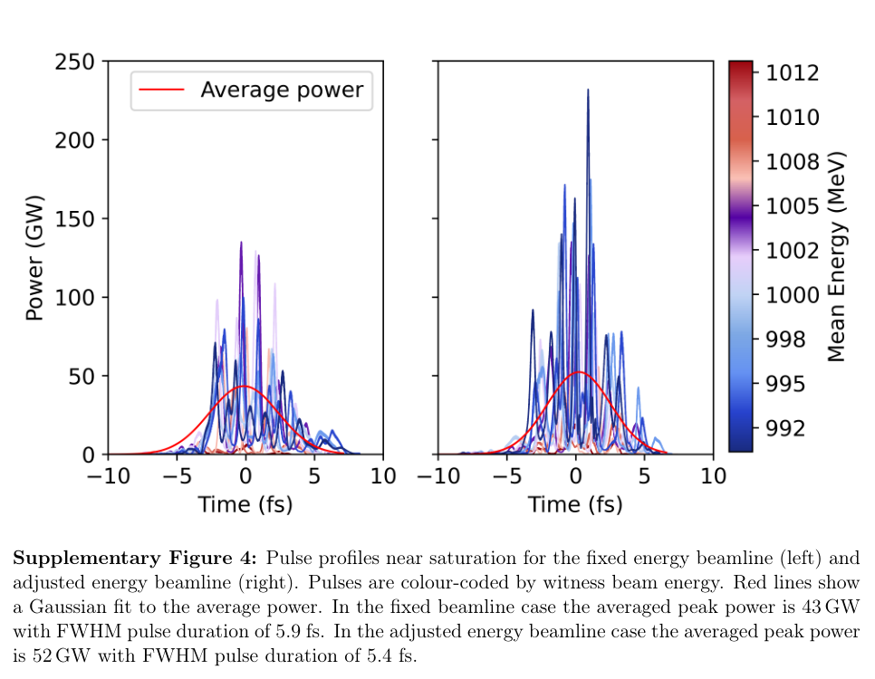
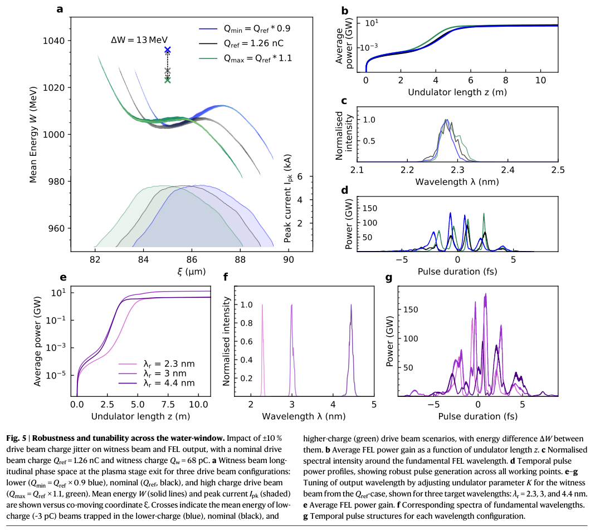
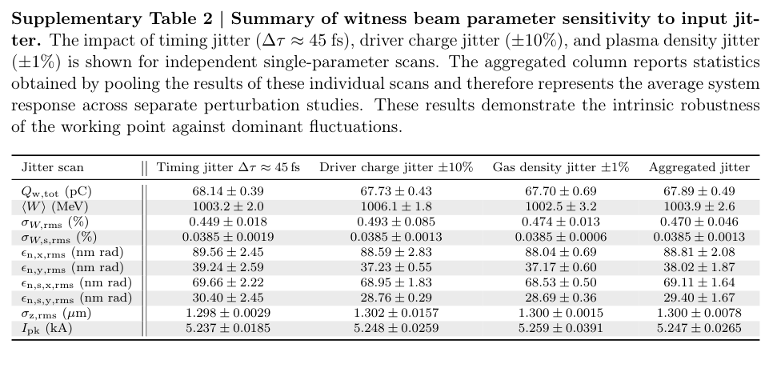

# 等离子体光阴极束流加载怎样支持水窗强增益 FEL

## 1. 论文身份与阅读范围

L. H. A. Berman、D. Campbell、E. Hartmann、T. Heinemann、T. Wilson、B. Hidding、A. F. Habib，*Strong-gain water-window X-ray laser driven by plasma photocathode wakefield acceleration*，[Nature Communications，10.1038/s41467-026-78880-4](https://doi.org/10.1038/s41467-026-78880-4)。出版社标明 2026-11-05 在线、10-04 接收；本地是 **Article in Press**，不能称最终 VOR。机构库的 10-04 日期对应接收阶段，本笔记采用出版社在线日。

[主文 PDF](../pdfs/Berman%20et%20al.%20-%202026%20-%20Strong%20gain%20water%20window%20X%20ray%20laser.pdf)13 页，[补充材料](../pdfs/Berman%20et%20al.%20-%202026%20-%20Strong%20gain%20water%20window%20supplement.pdf)18 页，均验证文件头、类型、SHA、独立页数及全页文本。已阅读主文方法／结果及补充说明和表格，关键页、5 幅原图／表的裁剪和哈希见[视觉清单](../research/visual-validation.json)。原图由上述论文提供，按出版社 CC BY 4.0 标注来源，仅作矩形裁剪。

本篇为 **FBPIC → Elegant → Puffin 贯通模拟**。历史 FEL 实验是背景，本文没有新水窗出光测量。共享 MinerU 凭据本轮测试仍为 401/A0211，本篇未重复提交，使用本地布局文本与渲染回退；未运行作者代码或下载复现数据库。

## 2. 问题：为何不能只提高电子能量

水窗约 2.3–4.4 nm。FEL 同时要求低归一化发射度和低切片能散；仅有 GeV 平均能量不能保证起振。光阴极在电子驱动 PWFA 内释放低横向动量电子，低初始发射度留下余量，让增加电荷带来的空间电荷代价换取更高电流、束流加载和更平坦纵向相空间。

这里的驱动器是电子束，注入激光负责电离；全文没有模拟从某台激光装置产生驱动束的完整前级。将它直接称为已实现的全激光水窗源会超出证据。

## 3. 加速段：电荷、发射度、能散之间的交换

参考驱动束 1 GeV、1.26 nC，纵向 rms 长度 25 μm、半径 2.5 μm；He⁺ 密度约 $1.78\times10^{16}\,\mathrm{cm^{-3}}$。800 nm、50 fs 注入激光在焦点释放电子，扫描 $a_0=0.0850$–0.0960，形成约 52–89 pC 见证束。实际模拟加速长度约 91 mm，不能把“米尺度概念”读成这里已经计算了数米等离子体。

主文 PDF p3。上排为共动坐标 ξ、径向位置 r（μm）、轴向场（GV/m）和势；下排横轴 ξ（μm）、纵轴能量（MeV），叠加电流、切片能散和发射度。3 pC 时纵向啁啾大；52、68、89 pC 分别进入欠载、近最优和过载。物理趋势是增加电荷压平局部场，超过最优后反转啁啾，不能无限加荷而持续改善能散。

约 68 pC 工作点的平均能量 1.004 GeV、峰流 5.305 kA、投影 rms 能散 0.210%；补充表 1 的切片 rms 能散约 0.045%，x/y 归一化切片发射度约 77.25/31.14 nm·rad。**投影、切片和不同平面的指标不能混写。** 主文 Fig. 2 采用电流 FWHM 核心及约 115 nm 合作长度切片；输运段投影量则包含束翼，切片采样也不同，跨图数值不能当作完全相同统计口径。

## 4. 输运与 FEL：保住亮度才形成增益

Elegant 以 PMQ 四极组捕获、EMQ 三极组匹配，比较固定参考能量与逐工作点调整磁场两种方案。变量权重 PIC 粒子先转换和重采样；Puffin 再上采样并加入泊松散粒噪声。它们是不同数值模型的接口，尚需实验束流和误差传播验证。

共振关系为

$$
\lambda_r=\frac{\lambda_u}{2\gamma^2}\left(1+\frac{K^2}{2}\right).
$$

15 mm 周期、约 0.42 T 对应 $K\approx0.59$；约 1 GeV 束流给出约 2.3 nm。切片能散须小于 FEL 参数 $\rho$，发射度须满足相应横向条件。文中低发射度允许小束腰而不必强烈额外聚焦，但这不表示整条输运线无需四极磁铁。

主文 p7，左右列对应两种输运方案。前六行横轴为波荡器长度 z（m），纵轴分别为束半径（μm）、无量纲 $\rho$、切片能散（%）、平均功率（GW）和脉冲能量（mJ）；末行是波长（nm）对归一化谱强度，颜色表示电子平均能量（MeV）。调整输运后各束团更同步聚焦，增益／饱和差异缩小。所示饱和长度约 4.8–7.0 m、三维功率增益长度约 20–60 cm，脉冲能量最高约 0.4 mJ，均为模拟结果。

补充 p5，横轴时间（fs）、纵轴功率（GW）；彩线是不同电子工作点，红线是平均轮廓的高斯拟合。固定／调整方案给出平均轮廓峰值 43/52 GW、FWHM 5.9/5.4 fs。它与 Fig. 4 沿传播的“Average power”0.3–8.5 GW、个别时间尖峰达百 GW 是不同定义，不能混为单一功率或整装置平均功率。

## 5. 有限扰动扫描怎样支持“稳健”

主文 p8。上排比较驱动电荷 ±10% 时的 ξ–能量相空间、电流、平均功率增益、归一化光谱及时间功率；下排通过波荡器 K 改变共振波长到 2.3、3、4.4 nm。参考 68 pC 加载把见证束平均能量变化压到约 1006±2 MeV，相比低电荷参照更小。这是少数指定输入的扫描，不是完整随机抖动分布或真机逐发成功率。

补充 p17。行分别为 pC、MeV、%、nm·rad、μm 和 kA；列为 45 fs 定时、±10% 驱动电荷、±1% 气体密度的独立扫描及汇总。图注明确最后一列是把独立扫描样本汇集统计；补充 p16 正文又使用“不相关源聚合”措辞。**这里不把末列视为实际同时施加全部误差的联合模拟，也不把 ± 数字当通用测量误差。** 气体密度、激光能量和定时之间的相关性、横向偏轴及真实光学漂移仍需补足。

## 6. 适用边界与接续

这项结果将低发射度“余量”转成可加载电荷、低啁啾和输运容差，是有用的源设计链。其限制包括准柱对称两模 PIC、理想化驱动束、重采样接口、有限噪声／扰动样本，以及尚未完成的实验联合验收。补充表 1 切片能散末点约 0.058%，与主文一处“全部小于 0.055%”概述不完全一致，取具体表格而不抹平差异。

优先接续是取得最终 VOR，固定输入／代码版本和核心／全束统计口径，联合扫描驱动束相空间、气体、定时和磁铁误差，并在真实装置分别测量电子输出与水窗光谱／脉冲能量。本文没有转换靶、MeV 伽马、光核中子／核素、辐照剂量或防护性能证据。
