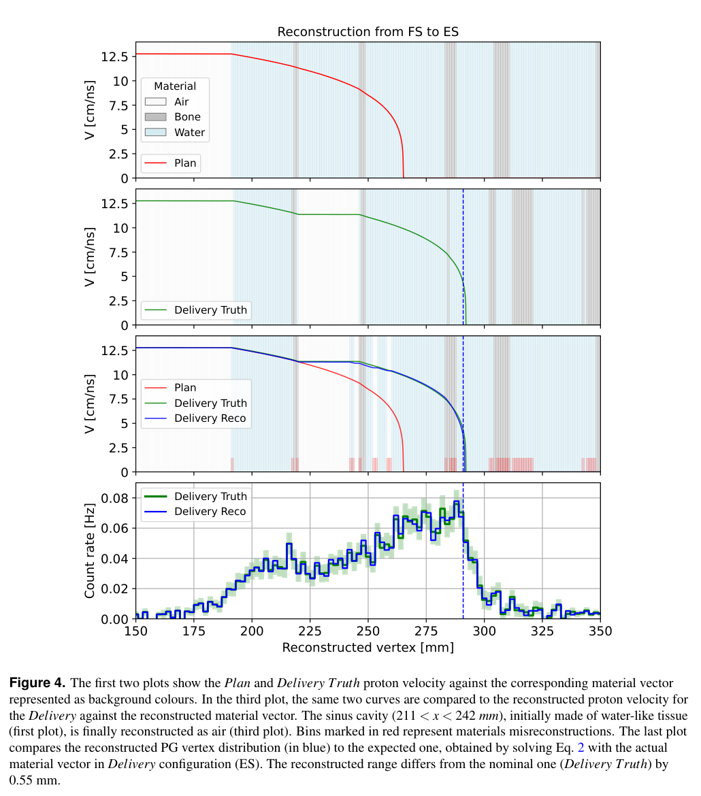
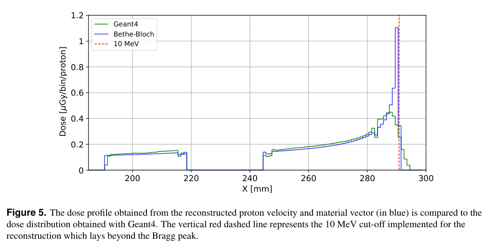
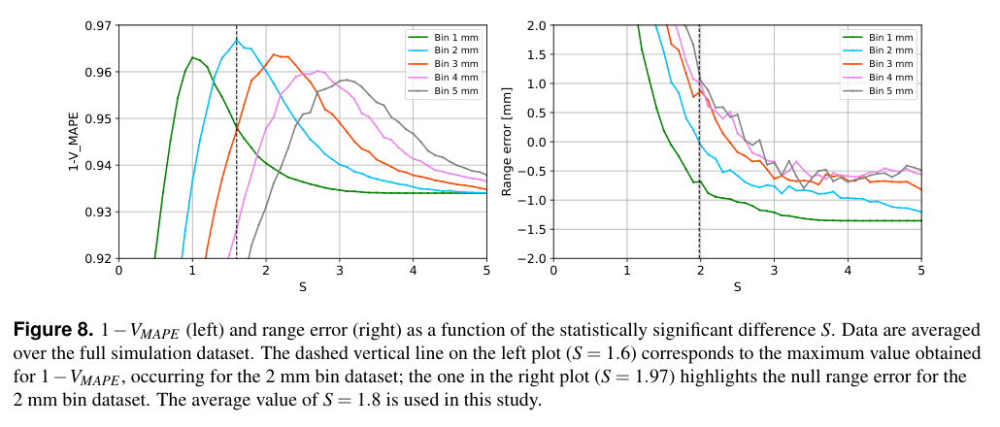

# 用瞬发伽马飞行时间联合重建质子速度与沿程材料

## 1. 身份、版本与证据范围

Pavel Kavrigin、Alicia Garnier 等，*Experimental Assessment of Prompt Gamma Time Imaging in Complex Anatomy*，[arXiv:2611.06683v1](https://arxiv.org/abs/2611.06683v1)，2026-11-04 15:52:06 UTC 投稿、11-05 公告。精确标题 Crossref 前三结果没有核到同作品正式论文，本轮按作者预印本入库。

[本地全文](../pdfs/Kavrigin%20et%20al.%20-%202026%20-%20Prompt%20gamma%20time%20imaging%20complex%20anatomy.pdf)15 页，含 p15 反向重建补充结果。文件头、类型、SHA、独立页数和全页文本通过；已读结果、方法、讨论及补充图，8 个关键页和 3 幅原图摘录见[视觉清单](../research/visual-validation.json)。图为原论文裁剪，权利归原作者。本轮一次公开 URL 的 MinerU 请求返回 401/A0211，使用本地布局／渲染回退；未运行 Geant4 或重建代码。

**直接实验是 100 MeV 质子照射 RANDO 头部人体模型；没有患者临床疗效或激光质子束验证。** PGTI 的速度、材料与剂量是模型辅助反演，不能与原始探测计数等同。

## 2. 装置和数据：八模块、低强度、两种鼻窦状态

ProteusOne 以约每束团一个质子的 Single-Proton Regime 工作；上游束流监视器与八个 TIARA 切伦科夫伽马模块符合，模块位于模型两侧约 15 cm。鼻窦填超声凝胶为 FS、留空为 ES，用来模拟计划与实施之间的解剖变化。另测无模型背景，信号处理离线进行。

原始 ES／FS 分别约 $6.9\times10^3$／$6.2\times10^3$ 事件；扣背景后总量约 5000。文章把这些计数换算成未来 30 模块系统约 $1.7\times10^7$ 入射质子的统计量；**30 模块效率是外推，不是本次八模块已在临床强度实时完成两束点照射。** 模块 8 使用原始数据，其他模块扣背景，不能统一描述为全部同法处理。

八模块平均 CTR 为 298±6 ps FWHM，即约 127±3 ps rms；它不同于引言中未来系统约 100 ps rms 的性能目标。1 mm 铜靶用于时延校准，几何由 CT 给出，定位不确定度小于 1 mm。

## 3. 重建方法：先按几何求顶点，再更新材料

沿已知束轴的一维时间方程为

$$
\mathrm{TOF}=\int_0^{x_v}\frac{dx}{v_p(x)}+
\frac{\sqrt{(x_d-x_v)^2+y_d^2+z_d^2}}{c}.
$$

第一项是质子到核反应顶点的时间，第二项是伽马到模块的时间。不同角度的 TOF 谱不能直接相加；给定速度曲线后逐模块解顶点，再合并空间分布。

计划 CT 被压成空气、水样组织和骨三类，密度分别约 0.0012、1、1.48 g/cm³。Bethe–Bloch 平均能损给出初始速度；逐 bin 比较 Plan 与 Delivery 的 PG 数，若

$$
|N_{P,j}-N_{D,j}|>S(\sigma_{P,j}+\sigma_{D,j}),
$$

就按最接近的密度比改材料，再重算速度和顶点。这里采用的是标准差之和，不能自行换成方差平方和开根号。$S=1.8$ 是经验选择，不能直接称为标准高斯显著性或假阳性保证。材料区分主要借助密度近似，密度相近组织的可辨性有限。

低于 10 MeV 时用于求顶点的速度被固定为约 4.34 cm/ns，使时间曲线延伸而不发散；最终速度曲线的末段则继续以计划材料外推。**直接 PG 约束与低能端外推必须分开。**

## 4. 实验结果：范围接近，材料并非逐 bin 全对

PDF p7，前三行横轴位置（mm）、纵轴速度（cm/ns），底色表示三种材料；第四行是顶点位置对计数率（Hz）。红色为计划、绿色为基于实际 CT 的参照、蓝色为重建。约 211–242 mm 鼻窦从水样材料被改为空气，局部误分类以红色标出。计数误差来自平方根计数／采集时间，非速度或材料的完整系统误差。

FS→ES 的“范围误差”0.55 mm，具体定义为两条速度曲线达到 **10 MeV 阈值**时的位置之差；反向 ES→FS 补充图给 1.44 mm。不能把单一 0.55 mm 写成患者群体的普遍精度，也不能称为直接观测到零能停止点。约 10 个 **2 mm 重建 bin**材料误分类，图按 1 mm CT 网格显示，视觉上的红格更多。

如果实施范围超过计划范围，计划范围以外没有对应参考 TOF，材料暂假定不变；这一部分不是新数据独立恢复出的解剖。两次放置还有小倾斜，使远端材料序列变化，提醒定位误差与真实材料变化会耦合。

## 5. 剂量与 MC：一阶估计和参数选择分别说明

PDF p8，横轴 x（mm）、纵轴按原图为 μGy/bin/proton；蓝色为速度／材料经 Bethe–Bloch 得到的剂量、绿色为 Geant4。异质区趋势和峰位置接近，解析峰更尖、峰前剂量较低，因为它不含核反应剂量、δ 电子输运和程长涨落。这是参照 MC 比较，并非独立绝对剂量计验收。

原 Fig. 5 图注把 10 MeV 截断描述为在 Bragg 峰之后，而方法将其定义为停止点前约 1 mm 的低能阈值；Fig. 6 图注的红／蓝描述也与图例和方法文字相反。此处保留原图，采用明确的方法定义解释，等待作者澄清，不改画数据或据图注推导新的物理结论。

Geant4 10.4.2、QGSP_BIC_HP，CT 在 MC 中使用 12 材料；重建仅三材料。MC 还折入计时展宽和泛化的粒子效率。模块 1、3、6 存在响应差异，没有逐模块实测效率修正，因此模型符合不能当作完整响应闭合。

PDF p13，横轴 S，左纵轴 $1-V_{\rm MAPE}$、右纵轴范围误差（mm），颜色对应 1–5 mm bin。两份 CT 上 20 个 Plan、各 100 个 Delivery 构成 2000 个模拟实验；它们不是 2000 个独立患者。2 mm 时速度指标最优约 S=1.6、平均范围误差过零约 S=1.97，作者取 1.8 折中。这里的“过零”是平均偏差，不代表个例误差、方差或外部盲测都最优。

## 6. 可借鉴之处与未闭环

可借鉴的是把多角度 TOF 还原到统一空间坐标，再用材料更新改变质子时间模型；对核诊断，比单独拟合 PG 边缘提供更多信息。但当前仍依赖已知束轴、计划 CT、三材料先验和该几何的 MC 调参。重建小于一分钟不含离线 MC 几小时、采集及校准成本。

下一步需要独立 CT／几何上的冻结参数测试、范围外材料恢复、逐模块效率及校准误差传播，以及临床束流强度下的堆积与计数测试。机器学习是展望，尚未形成本文实验链；不得外推为临床疗效、激光离子源或辐射防护认证。
