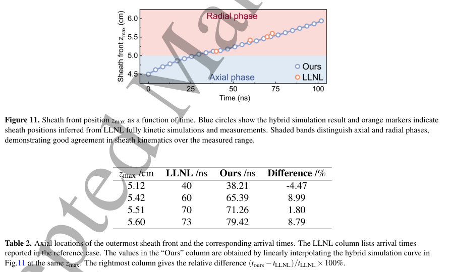
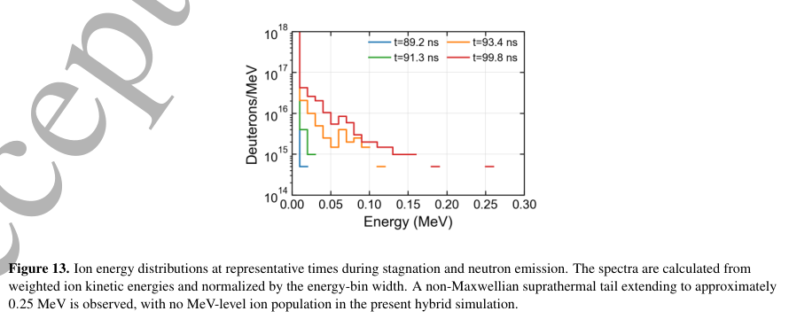
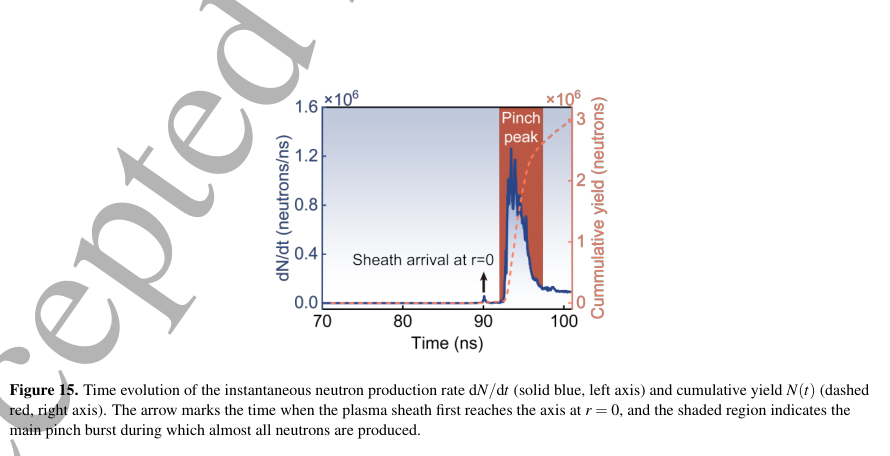
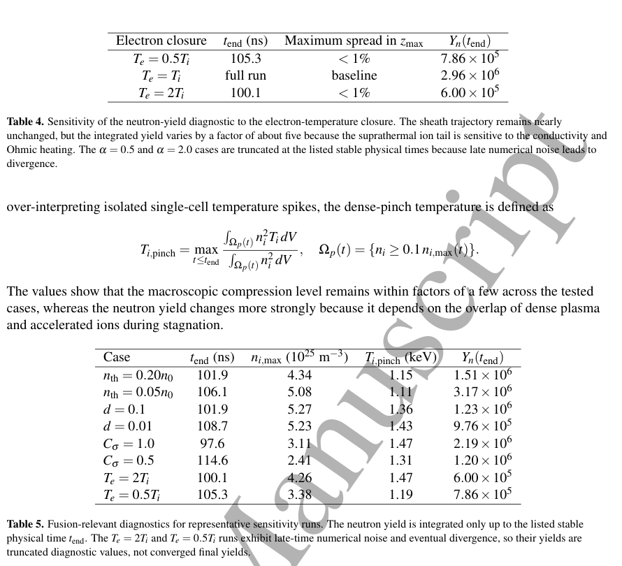

# DPF 全电磁混合 PIC–流体接收稿：中子产额账本与数值适用范围

## 1. 原条目更新与全文版本

Yinjian Zhao、Zhe Liu、Qiang Sun、Qianhong Zhou、Guangrui Sun，*A fully electromagnetic hybrid PIC-fluid model for predictive fusion neutron yield in dense plasma focus*，[Nuclear Fusion，10.1088/1741-4326/aebda4](https://doi.org/10.1088/1741-4326/aebda4)。Crossref 给出接收稿在线日 2026-11-04；本地 PDF 封面明确 **Accepted Manuscript**、NF-108657.R2，尚不能称最终 VOR，也未从正文核到精确接收日期。

该作品已以 [arXiv:2604.09032](https://arxiv.org/abs/2604.09032) 存在台账，原 processed_date 为 2026-06-11、note_path 为空。本轮在**同一对象**更新正式 DOI、实际接收稿 PDF 和本笔记，保留原处理日期及历史文件线索，不增加独立作品计数。

[本地接收稿](../pdfs/Zhao%20et%20al.%20-%202026%20-%20Hybrid%20PIC%20fluid%20dense%20plasma%20focus%20accepted.pdf)28 个 PDF 页（封面＋27 页稿件）。下文统一用 PDF 页码。已读正文方法／结果／限制，文件头、SHA、独立页数和全页文本通过；14 个关键页及 4 幅原图／表见[视觉清单](../research/visual-validation.json)。原稿为 CC BY 4.0，摘录保留原图及接收稿水印。MinerU 共享凭据本轮仍过期，本篇未重复提交，使用本地全文／渲染回退。没有复跑作者模拟或实验。

## 2. 模型从哪里开始，省略了什么

这是 **二维轴对称 r–z 数值研究**。离子用粒子，电子为准中性流体，保留 Maxwell 位移电流，耦合外电路；它不等于包含电子动理学的全 PIC。初态已是预电离的 rundown 末端层，跳过中性气体击穿、电离和此前扫雪式质量加载。

实心阳极半径 1 cm、长 5 cm，外半径 1.5 cm，轴向主要区域长 10 cm；背景密度 $6.7\times10^{22}\,\mathrm{m^{-3}}$、鞘层 $3.3\times10^{23}\,\mathrm{m^{-3}}$。网格约 0.2 mm，时间步 $4.25\times10^{-13}$ s，约 52.6 万离子宏粒子。初始电路电流约 177.3 kA；不能将模型说成从零电流完整启动放电。

电子闭合基线取 $T_e=T_i$，电导为标量；Spitzer 模型、低密度过渡和电导上限参与数值处理，离子–离子碰撞用 Nanbu 小角散射，每 100 步调用一次。没有独立电子能量方程、张量电导、异常电阻、电子非热尾或三维 kink。

**定量产额的基线未启用 Hall 和电子压强梯度扩展；扩展项另作定性研究，近箍缩时不稳定而未用于收敛产额。** 摘要列出方程项不能证明其全部同时支撑基线数字。

## 3. 中子率如何计分

接收稿用 D(d,n)³He 的 NRL／Duane **中子分支截面**，单向后处理为

$$
\frac{dN_n}{dt}=\sum_\alpha w_\alpha n_t(\mathbf r_\alpha)
\sigma_{DD,n}(E_\alpha)|\mathbf v_\alpha|,
\qquad N_n=\int\frac{dN_n}{dt}\,dt.
$$

$w_\alpha$ 是宏粒子代表的物理离子数，$n_t$ 是局部靶氘密度；这是假定靶静止形式的束靶诊断，并非对完整离子分布做对称双粒子相对速度积分。作者因此不乘对称配对的 1/2；所用截面已是中子分支，也不再乘一遍分支比。若移植到热核或束束率，必须重新定义目标分布与去重因子。

约 $2.5\times10^{18}$ 个氘对应 $2.96\times10^6$ 中子，反应比例约 $1.2\times10^{-12}$，支持忽略聚变产物反馈的当前近似；它不支持燃烧等离子体或能量增益外推。计数为源端积分，不含探测器效率、角谱、输运、屏蔽或实际每发测量。

## 4. 与参照比较：轨迹、能尾和产额分别看

PDF p15。图横轴时间（ns）、纵轴最外层鞘位置 z（cm），蓝色为混合模型、橙色为 LLNL 参照；表比较四个固定位置的到达时间，差异 −4.47%、8.99%、1.80%、8.79%。这是少数观测点的约 10% 一致性，不是全场误差或中子产额误差。混合结果用 $n_i\ge1.5n_0$ 提取前沿，参照由文献密度图像读数，定义并不完全等同；径向快速坍缩差别更大。

PDF p16，横轴离子能量（MeV）、纵轴按能宽归一的 Deuterons/MeV，颜色表示约 89.2–99.8 ns。非 Maxwell 尾延伸至约 0.25 MeV，没有全动理学参照中的 MeV 尾。积分产额数量级相近不能证明加速机制相同。

PDF p18，横轴 ns、左轴中子率、右轴累计中子数；大部分产额在鞘到轴后的窄箍缩窗口。作者给出 $2.96\times10^6$，与空心阳极全动理学文献 $8.6\times10^6$ 同数量级、比早期混合模型 $3.6\times10^4$ 高约两个量级。**本模型实心、参照空心；同尺寸同电流实心装置的严格对照数据未提供。** 因而不能称作实验产额的精确复现。

原图高分辨率核对显示左轴为 $\times10^6$ **neutrons/ns**、右轴累计量为 $\times10^6$ 中子；在 ns 时间轴上积分的数量级相容，不能把左轴误读为每秒。这只是单位核对，不是重新积分原始数据后的独立产额验证。

## 5. 灵敏度与稳定性：宏观不变不代表产额收敛

PDF p22。列给结束时间（ns）、峰密度、密度平方加权的致密区温度（keV）和累计中子数；不是单个温度峰值 2.45 keV。$T_e=0.5T_i$、$T_i$、$2T_i$ 分别给 $7.86\times10^5$、$2.96\times10^6$、$6.00\times10^5$，但前后两项在不同稳定结束时间截断。这个约五倍差异同时含闭合与截断影响，不能视为同一终态的纯参数误差条。

时间步减半给 $2.87\times10^6$，约差 3%；空间步减半轨迹快约 4–7%，但只稳定到约 88 ns，早于主要中子爆发，所以尚未证明**产额的空间收敛**。阈值、电导上限、清散度参数的轨迹差常小于 1–1.5%，表 5 的产额仍明显变化且结束时间不同。

接收稿承认晚期局部电场达 $10^{10}$ V/m 含数值放大。五个保存快照中，能量 ≥20 keV 宏粒子没有落入高场区；这只是有限时刻重合检查，不是全轨迹电功审计，也不能排除间接磁场耦合。密度平滑宽度尚未系统扫描。Hall／压强扩展运行不能替代上述基线的定量验收。

## 6. 成本与印刷式复用问题

实际计时为 EPYC 7542、16 OpenMP 线程，计算部分每步约 0.084–0.128 s，24 万步约 5.6–8.5 h，**不含诊断 I/O**。相对全 PIC 的 $10^5$–$10^6$ 降本是尺度估算；3D／256 核表为未来假设，未实测。

两项静态核对需在复用前澄清，均不是本轮代码运行结论：

- 式(3)总电流用离子平均速度构造。由式(5)替代到式(7)时，对单个离子一般仍有 $e(\mathbf v_\alpha-\mathbf u_i)\times\mathbf B$ 项；印刷式(7)没有这一热速度项。需核实是体速度近似、另行更新还是推导／排版省略，不据此宣称作者程序有 bug。
- 成本段在 $n_e=10^{24}$–$10^{25}\,\mathrm{m^{-3}}$、100 eV 写 Debye 长为几 μm；按 $\lambda_D=\sqrt{\epsilon_0 k_BT_e/(n_ee^2)}$ 直接算约 **0.074–0.024 μm**。电导上限的系数也约为 $20.83C_\sigma$ S/m，需实际限幅激活比例才可判断其是否“弱作用”。不在笔记中替作者重估全 PIC 速度比。

## 7. 接续价值

该接收稿把中子分支、模型闭合、晚期异常场和不同参照几何明确列出，比只看一个总中子数更适合作为混合模型核验材料。优先获取最终 VOR 与原始率曲线，固定同一几何／同终止时刻，检查束靶和完整相对速度率的差别、离子力实现、电导限幅及致密区能量账本，再做空间／粒子数收敛。

本文没有激光转换靶—光核中子／核素链、探测器响应、辐照剂量、临床或屏蔽验收；DPF 的 D–D 束靶源不能直接替代这些应用的数据。
