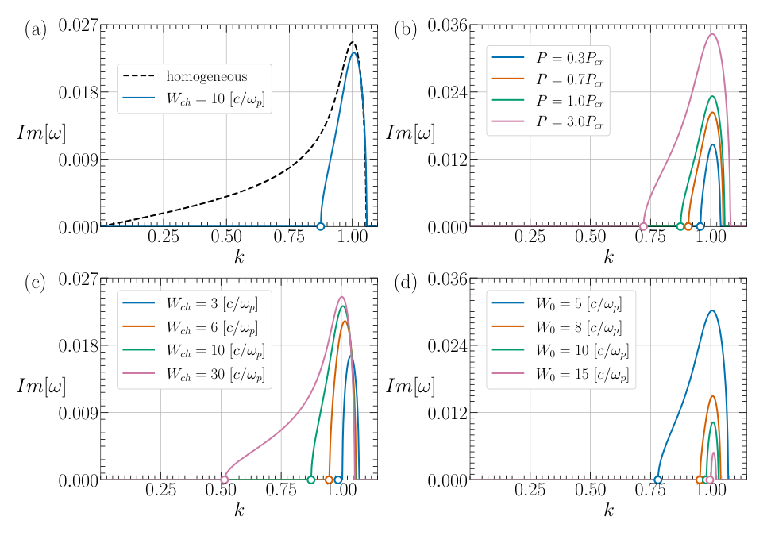
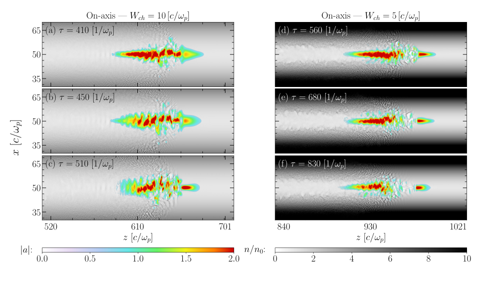
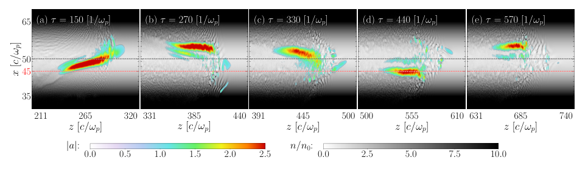

# 抛物等离子体通道中的激光 hosing：恢复力、残余短波模与判稳边界

## 1. 论文身份与阅读范围

Yash M Jogiya、Vishwa Bandhu Pathak，*Suppression of the Laser Hosing Instability in a Parabolic Plasma Channel*，[arXiv:2611.07475v1](https://arxiv.org/abs/2611.07475v1)，2026-11-05 05:33:14 UTC 投稿、11-06 公告。本次 Crossref 精确标题前三项是 2017、2014 和 2016 年相关旧论文，未核到同作品期刊 VOR；按作者预印本入库。

[本地全文](../pdfs/jogiya-2026-hosing-parabolic-channel.pdf)共 24 页，正文 I–V 节及参考文献均已读；12 个模型／公式／结果关键页和 3 幅原图摘录经目视核查。MinerU 本次真实请求返回 401/A0211 令牌过期，采用本地布局文本与原页渲染回退。图为原文裁剪，权利归原作者；未复跑 OSIRIS。

**本文证据是弱相对论变分模型、线性模分析及二维 PIC 现象演示，没有激光束或电子束实验。** 文章较强的“截止波数”表述还有印刷式层面的判稳问题，不能直接作为已验证通道设计定律。

## 2. I–II 节：把激光和尾场分别写成可移动的高斯结构

引言将 hosing 识别为脉冲内部不同纵向位置发生横向偏转的耦合模：激光偏轴驱动偏轴尾场，尾场折射率梯度又偏转激光。它不同于整个脉冲在导引通道中平滑摆动。文章希望用通道提供恢复力，并把这两种诊断图像分开。

II 节以激光矢势和静电尾场势的高斯试函数代替完整场，保留振幅、相位、两个方向的光斑宽度、波前曲率以及两个质心。横向积分后再变分，得到质心和包络的耦合方程。还采用激光与尾场同方向宽度相等的约束；因此不是无条件等价于完整 Maxwell–Vlasov 系统。功率在该近似模型中守恒，激光耗尽和强非线性末态不由该守恒式完整描述。

共动变量是纵向滞后与传播距离，原文分别记作 ψ=ct−z 和 τ=z；其空间尺度归一到 c/ωp，后续实验室时间归一到 1/ωp。用于包络恢复力的通道为

$$
\frac{n(x,y)}{n_0}=1+\frac{(x-x_{c0})^2+(y-y_{c0})^2}{W_{\rm ch}^2}.
$$

这里 Wch 是**归一化密度曲率尺度**，不等于有明确边界的物理管半径。减小它会增大横向密度梯度，不能在固定光斑和功率下任意称为“更优”而忽略其他激光动力学。

## 3. III 节：二阶展开分离模态，适用背景须缓变

作者围绕缓慢变化的零阶解，把作用量展开至扰动二阶，分出 hosing、对称光斑自调制和反对称光斑自调制三个子系统；本文只解 hosing 分支。线性横向密度梯度不引入新的二阶耦合，抛物曲率则留下质心恢复项。

通道轴偏移只出现在零、一阶项，因此在该线性、理想抛物通道模型中，hosing 方程系数不依赖初始横向注入位置。这是模型级独立性；不能扩大为任意失配、非抛物通道、强非线性或有限壁面下的注入误差容忍保证。

## 4. IV 节解析：恢复力削弱反馈，但不提供耗散

两质心方程可写成

$$
\partial_\tau^2 x_a+(\kappa^2+\omega_{\rm ch}^2)x_a=\kappa^2 x_\phi,
\qquad
\partial_\psi^2x_\phi+x_\phi=x_a,
$$

$$
r_L=\frac{k_0W_0^2}{2},\qquad
\kappa=\frac{\sqrt{P/P_{\rm cr}}}{r_L},\qquad
\omega_{\rm ch}=\frac{1}{k_0W_{\rm ch}}.
$$

W0 为初始归一化光斑，k0 为激光波数相对等离子体波数的比，rL 是归一化 Rayleigh 长度。κ 衡量两个质心的反馈耦合，ωch 描述通道恢复力。通道只给激光质心增加弹簧项，不加入摩擦；因此“无增长”与“受到阻尼衰减”必须区分。

将共动导数换回实验室坐标，代入平面扰动 exp[i(kz−ωt)]，由尾场方程先得质心响应比例，再代入激光方程，得到原式(27)：

$$
(\omega^2-1)(\omega-k)^2
=\omega^2(\kappa^2+\omega_{\rm ch}^2)-\omega_{\rm ch}^2.
$$

其中 ω 和 k 分别是相对 ωp、ωp/c 的无量纲频率和波数。对实 k 求复 ω 时，正的 Imω 表示时间增长。实系数四次多项式的复根成共轭对，所以该保守模型的最大 Imω 不会为负；这不代表真实碰撞、吸收或耗散等离子体不能阻尼。

原 PDF p12，横轴为归一化 k，纵轴为归一化 Imω。(a) 均匀等离子体虚线与 Wch=10 通道实线；(b) 功率比 0.3–3；(c) Wch=3–30；(d) W0=5–15，其余参数和激光频率 ω0=8ωp 见原图注。图显示作者色散计算中低波数尾受抑，短波共振附近仍有增长；高功率增强耦合，收窄通道或增大光斑可降低部分增长。**圆点是作者式(31)给出的候选截止，不能视为本次独立验证的严格稳定边界。** 曲线属于线性模型，非 PIC 实测增长率或实验数据。

在近共振、小耦合展开中，原式(29)给出

$$
\Gamma_{\rm peak}\simeq\frac{\sqrt3}{2}
\left[\left(\frac{\kappa^2}{2}\right)^{1/3}
-\frac{\kappa^2+\omega_{\rm ch}^2}{3}
\left(\frac{2}{\kappa^2}\right)^{1/3}\right],
\qquad
\mathcal V=\frac{\kappa^2+\omega_{\rm ch}^2}{(\kappa^2/2)^{2/3}}\ll1.
$$

推导先令 ω≈k≈1，取小复偏移，把色散约化为三次式，再对主根作一阶修正。第二项说明恢复力降低该近似峰值；若算出负值，是展开越出适用域，不能称为获得负增长或完全阻尼。作者在 Fig. 2 只于 V<0.5 画近似虚线；这一绘图阈值也不等于严格误差保证。

### 截止判据的静态核对

作者令 ω=k，得到

$$
k_{\rm cut}^{(31)}=\frac{\omega_{\rm ch}}{\sqrt{\omega_{\rm ch}^2+\kappa^2}},
$$

并在包络匹配条件下化成原式(32)的平方根功率标度。但是令色散方程左减右为 F，在该候选点有

$$
F(k,k)=0,\qquad
\left.\frac{\partial F}{\partial\omega}\right|_{\omega=k}
=-2k(\kappa^2+\omega_{\rm ch}^2)\ne0
$$

（非零 k、非零通道或耦合）。**该点是简单实根，不满足一般时间稳定边界上实根合并的必要重根条件。** 因此代入未耦合激光支不能单独证明它就是四次色散的精确不稳定带端点；需要在实 k 下追踪所有根，并同时核 F=0 与偏导为零。式(32)继承这一待澄清边界，暂不推荐作精确设计公式。此处只是对印刷式的代数核对，不是运行作者代码后发现程序错误。

作者关于非零通道稳定极低频／低波数分支的机制解释可保留在其理想线性模型范围内；“任意长波均消失”的有限参数范围、短波带宽和偏离共振后的定量结论仍需更严格的全根核查。式(34)把恢复力写成固定频率下增长参数平方的常数减项，也不能直接解释成固定 k 下所有 Imω 都减少同一个常数。

## 5. IV 节数值结果：二维非线性现象支持，不是解析增长率验收

OSIRIS 使用 200×100(c/ωp)² 移动窗口、8250×1600 网格、每格 16 粒子；离子为固定中和背景。激光 a0=2、ω0=8ωp，纵向包络长度 150c/ωp（FWHM 约一半）、光斑 W0=6c/ωp。作者明确说明 a0=2 的强演化处于弱相对论线性理论的形式适用域外，因此这里只比较现象，不定量验收式(27)。均匀等离子体先自聚焦、Raman 前向散射形成子脉冲，再出现 hosing。

原 PDF p19，横轴 z、纵轴 x 均以 c/ωp 计；彩色是归一化矢势模 |a|，灰度是 n/n0。左列 Wch=10，时间 410、450、510/ωp；右列 Wch=5，时间 560、680、830/ωp。较强通道里仍有局部短波形变，但幅值较低、整体更受约束。两列观察时刻与演化状态不同，不能从快照直接拟合等时增长率或给出普适抑制百分数；前沿耗尽、Raman 散射与聚焦也会影响图像。没有三维、移动离子、网格／粒子数／随机种子收敛或实际束流稳定性的闭环验收。

原 PDF p20，Wch=5、初始偏移 −5c/ωp；坐标、彩色和灰度含义同上，但 |a| 色条上限为 2.5。白虚线表示通道轴、红虚线表示初始激光位置。整个脉冲绕轴移动与沿脉冲内部的质心摆动不同，这为诊断区分提供实用思路。**图内(a)时间为 150/ωp，图注和正文却写 140/ωp；原图保留，时间标注待作者澄清。** 其余面板为 270、330、440、570/ωp。它只覆盖所示时窗，不能证明任意离轴误差与任意传播长度的 hosing 都不变。

## 6. V 节结论与接续价值

本文可借鉴的是把通道恢复力和尾场反馈分开，并将“整脉冲轨迹摆动”和“内部 hosing 调制”设计成两个诊断量。应在冻结背景近似适用的弱相对论算例中先核色散全根和真正边界，再做三维、移动离子、有限通道及失配扫描；二维 a0=2 图像符合只能作为下一步验证的线索。

文章没有给出实验束流品质、伽马或光核产额、靶转换效率、剂量或防护性能。本次仅做文献解读、原页核验和印刷式代数检查，不把作者的解析／PIC 结论升级为实验或工程验收。
