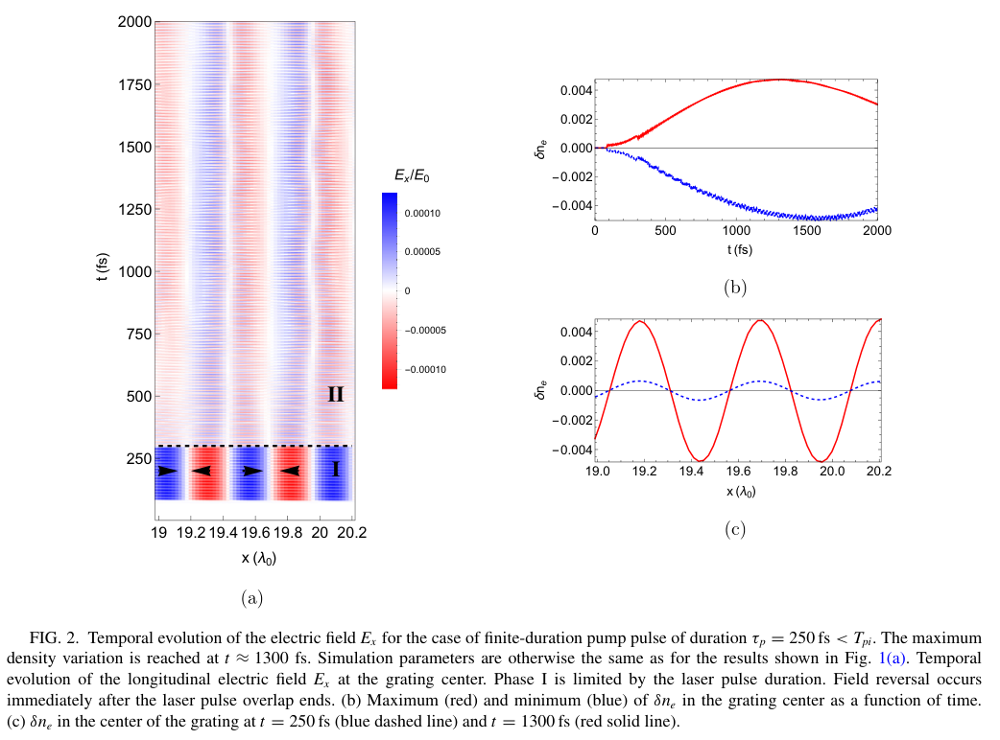
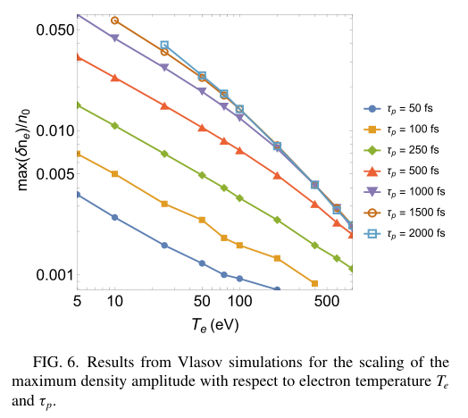
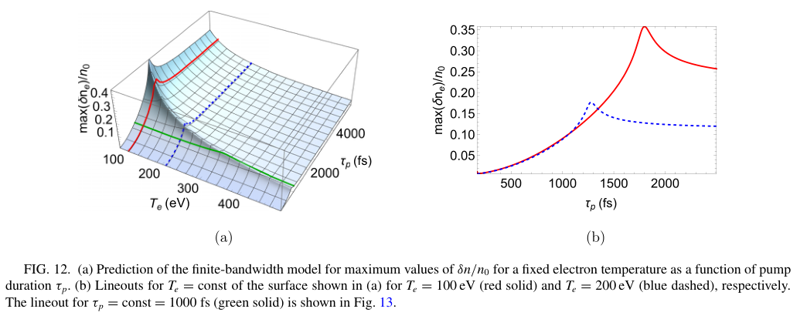

# 有限泵浦结束后，等离子体光栅为何仍能存在

## 1. 论文、版本与证据范围

Götz Lehmann、Sophie Opara、Karl H. Spatschek，*Formation and persistence of ponderomotive plasma gratings created by finite-duration laser pulses*，[Physical Review E 114, 055205](https://doi.org/10.1103/9237-5stj)，2026-06-16 收稿、10-22 接收、**11-06 正式发表 VOR**。此前只有下载失败的候选，本轮从 APS 官方 harvest 恢复[14 页全文](../pdfs/lehmann-2026-finite-pulse-plasma-gratings.pdf)，首次计入完成台账，删除对应重试；接收日不作发表日。

全文主文和两份附录已读；8 个关键页、3 幅原图摘录目视核查，见[视觉记录](../research/visual-validation.json)。原图沿用 CC BY 4.0，作者、题名、期刊和 DOI 如上。MinerU 本次公开 URL 请求返回 401/A0211 令牌过期，采用本地布局文本、原页渲染和独立 PDF 校验。本文是**Vlasov–Maxwell 数值研究与近似动理学解释**；引言中的泵浦—探测实验来自既有文献，不是本论文新增实验，本轮也未复跑求解器。

## 2. 引言和问题：脉宽是独立控制量

相向、等频泵浦的干涉强度形成空间周期结构。电离光栅在强度峰处增加电子；有质动力光栅则把既有自由电子推向强度谷，初期密度调制与强度反相。作者要回答的是：驱动力撤去后，密度格点是否立即消失，以及电子温度和有限脉宽如何共同限制可用调制。

空间周期由等离子体内波数给出，为半个介质波长；本文固定在集体响应区，避免与俘获主导区混用。采用的两个既有参数为

$$
\nu=\frac{\omega_{pe0}^{2}}{2k_1^{2}a_0^{2}c^{2}},\qquad
\mu=\frac{3T_e}{m_ea_0^{2}c^{2}}.
$$

其中温度按能量计，电子等离子体频率、泵浦波数和归一化矢势分别为上述频率、波数和幅度。前者比较集体响应与泵浦驱动，后者比较热压与驱动能标；在固定密度和幅度下，扫描温度就是扫描后者。有限脉宽还要与离子响应时间比较，不能只用这两个参数判断光栅寿命。

## 3. 第二节：Vlasov 结果与离子惯性

基准是预先完全电离的氢平板，密度为临界密度的 0.05、长度为 30 个真空波长；波长 800 nm、线偏振、幅度 0.01，单束强度约为 2×10¹⁴ W/cm²。空间分辨率每波长 50 格，速度步长为各物种热速的 0.02 倍；基准电子／离子温度 50／5 eV，温度扫描保持离子温度为电子的十分之一。电子和离子等离子体周期约 12／520 fs。**文中脉宽是电场包络 FWHM，不能直接当强度 FWHM**；短脉冲主体用超高斯，后面的近似模型用高斯。

无限长驱动时先有电子响应，随后离子被空间电荷场加速、聚集，并最终越过密度极值；最大调制约出现在 1900 fs。250 fs 驱动则在泵浦撤去后发生场反向，密度仍在离子惯性下继续增长，到约 1300 fs 才最大。

原 PDF p4。(a) 横轴位置以 800 nm 波长归一化，纵轴为 fs；颜色是纵向场除以约 4×10¹² V/m 的归一化场。(b) 横轴时间 fs，红／蓝为密度扰动最大／最小值；扰动按初始密度归一化。(c) 比较 250／1300 fs 的空间密度。泵浦退出后的场反向与延迟峰值支持“电子光栅转向近准中性的离子光栅”，并不表示驱动结束后仍在向系统持续注入能量。

作者把首个时间周期中峰谷差变化不足约 10% 的窗口作为可用持续时间，例子约 700–1200 fs。它与“到达最大值的时间”以及后续多次衰减再形成的总观察时间不同；Fig. 5 延伸至十余 ps，不能据此把整个时段都说成高对比稳定光栅。

原 PDF p6，横轴电子初温 eV，纵轴为最大电子密度扰动除以初始密度，双对数坐标；颜色／符号对应 50–2000 fs。短于约 250 fs 时，作者拟合的温度指数约为 −0.5；较长脉冲在低温仍约 −0.5、高温趋近 −1，转折随脉宽移动。延长泵浦最初增加幅度，到约 ps 量级逐步饱和。这里是初温、固定幅度和密度下的扫描，尚无跨密度／离子种类的普遍最优脉宽。

## 4. 第三节前半：先拉动离子，再转成压强恢复

忽略电子惯性时，电场、有质动力和压强梯度近似平衡。泵浦存在时电子被束缚，电场拉动离子；泵浦消失后有质动力项撤去，电场由压强梯度支撑，方向随之变化。对短驱动的离子声速和时间尺度，可写作

$$
c_s\simeq\sqrt{\frac{\gamma_e T_e}{m_i}},\qquad
 t_{\rm scale}\sim\frac{\lambda_0/8}{c_s}\propto T_e^{-1/2}.
$$

这里离子质量为质子质量，电子绝热指数近似为 3，温度要先从 eV 换成焦耳。推导是用线性离子连续性与动量方程消去速度，再以电子压强闭合得到声波方程；把离子从密度低点移动到邻近聚集位置的距离估成波长的八分之一，就得到恢复时间。50 eV 时声速约 0.1 nm/fs，对应约 10³ fs，与数值峰值同量级。**这是尺度解释，不是精确的实验寿命公式**；长驱动还存在有质动力对有效声速的修正，温度也随时间变化。

## 5. 第三节后半：有限带宽解释趋势，不负责定量饱和

原单频线性响应通过电子／离子 susceptibility 和高斯泵浦频谱建立。有限脉宽使驱动拥有宽频谱；作者用截断的高斯加权频率平均构造有效响应，忽略相位演化、空间谱展宽和耗散。长脉冲的近零频极限给出近似反温度标度；短脉冲覆盖离子声共振，频率贡献相消，温度依赖减弱。

原 PDF p11，(a) 横轴电子温度 eV 与脉宽 fs，纵轴为最大密度扰动相对初始密度；(b) 是 100／200 eV 的脉宽切线。模型在约 2000／1400 fs 附近出现明显转折，曲线还有局部峰值，不能把图解释成严格单调饱和律。它与前面的完整 Vlasov 曲线属于不同证据层，尤其幅值不能直接互换。

频率窗口约与脉宽成反比，把窗口边缘与离子声频率比较，有

$$
\Omega\simeq\frac{3.92}{\tau_p},\qquad
\Omega\lesssim k c_s
\Longrightarrow
T_e^{\rm crossover}[\mathrm{eV}]\simeq
\frac{4\times10^{8}}{\tau_p^{2}[\mathrm{fs}^{2}]}.
$$

前一步来自电场高斯 FWHM 与驱动频谱宽度的换算；后一步固定了本论文的波长、密度、氢离子和声速闭合，所以系数并非通用常数。1000 fs 对应模型转折约 400 eV；Vlasov 图中指数转折并不与之精确重合。作者也明确近似模型主要预测趋势，不能把它宣称为完整非线性、加热及长期阻尼的定量替代。

附录 A 专门给出电场脉宽约定及高斯到矩形的面积因子 1.0644；附录 B 讨论热压与有质动力的相对量级。两者服务于归一化和解释，不是新的实验验证。

## 6. 对本库的意义与接续

这项工作可用于挑选激光整形／等离子体光学的低温、有限脉宽窗口：电子响应很快，离子仍能保存驱动留下的密度结构。它没有直接给出探针衍射效率、损伤阈值、三维横向均匀性、逐发重复性，亦未证明 PW 光路、转换靶或次级核源的性能。文末明确无公开数据或软件；本轮没有数值收敛复算，不能独立确认作者求解器。

接续应优先比较同一初态下的相位、密度调制和探针衍射效率，分开首周期 10% 平台与多周期再形成，再做碰撞／复合、真实温度历史和横向尺寸测试。速记：**短泵浦可留下较长的离子密度光栅，但“泵浦结束后存在”与“高效、稳定、可复用的光学元件”还隔着诊断与实验验收。**
