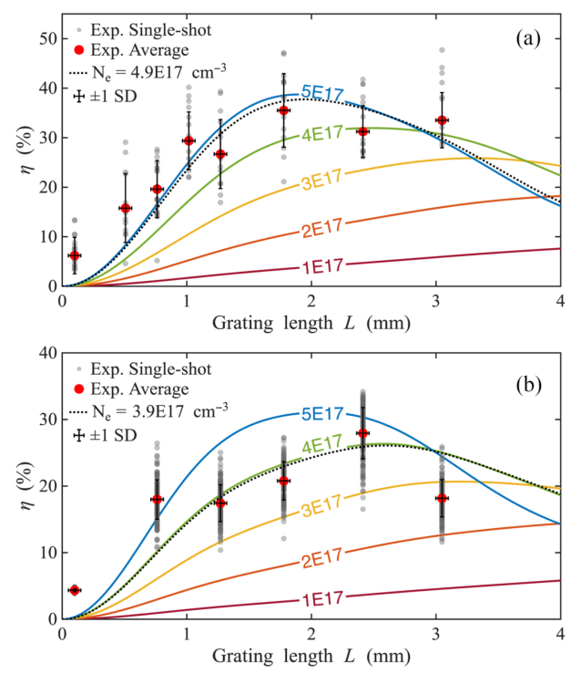
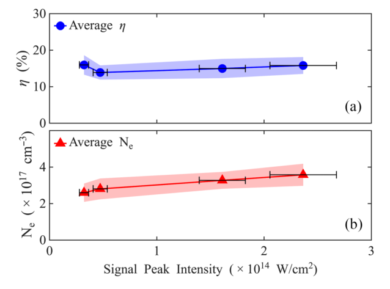
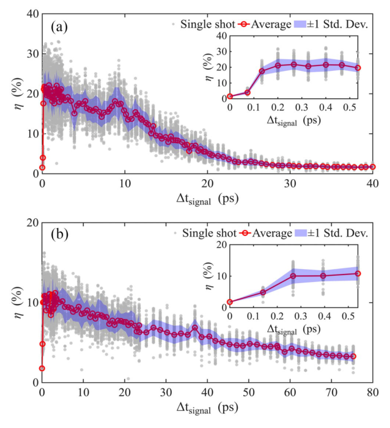

# 电离等离子体光栅的衍射效率实验：孔径、长度、强度耐受与时间窗口

## 1. 身份与证据范围

M. M. Wang、V. M. Perez-Ramirez（共同第一作者）、N. M. Fasano 等，*Experimental scaling of diffraction efficiency in laser-induced plasma gratings*，**Physical Review Applied 26, 054022 (2026)**，[DOI:10.1103/9q15-5b5w](https://doi.org/10.1103/9q15-5b5w)。原刊 PDF 载明 2026-04-29 收稿、09-29 接收、11-06 发表，为正式 VOR。

[本地全文](../pdfs/wang-2026-experimental-plasma-grating-diffraction.pdf)共 11 页，正文 I–V 节、附录及数据位置已读；p1–9 实际目视核查，3 幅关键原图摘录逐张检查。图来自 CC BY 4.0 原刊，作者、题名、期刊与 DOI 见上。MinerU 前次本轮请求已因 401/A0211 令牌过期失败，本文未重复提交，采用本地布局／渲染回退。没有重跑作者模型或重分析原始实验数据。

**这里有真实超短脉冲衍射实验。机制是中性 CO₂ 的空间选择性光场电离，产生“等离子体—中性气体”折射率条纹；不同于 Lehmann 等在预电离等离子体中研究的有质动力密度光栅。** 向多 PW 光学元件拓展属于应用方向，本文未以多 PW 信号束验收。

## 2. I–II 节：实验装置与衍射效率的分母

Princeton Pulsar 20-TW、800 nm、10 Hz 系统提供两束 s 偏振泵浦与一束 p 偏振信号。泵浦全夹角 3°，在 CO₂ 气室中产生周期 15.3 μm 的电离条纹；信号按 Bragg 条件进入。一阶匹配满足

$$
\Lambda=\frac{\lambda_p}{2\sin(\theta_p/2)},\qquad
\theta_B=\arcsin\frac{\lambda_s}{2\Lambda}.
$$

λp、λs 分别是泵浦和信号波长，θp 是泵浦全夹角；本实验两波长均为 800 nm，故 θB=1.5°。条纹周期来自两泵波矢之差，Bragg 条件则要求信号的横向动量改变匹配光栅倒格矢。调角、带宽和角散布都会改变匹配。

泵浦在气室的强度 FWHM 脉宽估计为 29±4 fs，信号为 41±8 fs；两者由压缩器处测量加传输光学色散估计，不能称在相互作用点已逐发直接测得。小孔径采用泵浦腰部相交、约 6 mbar CO₂；大孔径在焦点前 2 cm 相交、约 1.4 mbar，以降低高能量下的丝化和超连续谱。两种配置还改变了信号几何和聚焦前束径，不是只改一个孔径参数的控制实验。

透过气室后的光照在 Teflon 散射屏上，由 CCD 积分计数并扣残余泵背景。作者称“绝对衍射效率”，其具体定义是

$$
\eta_{\rm meas}=\frac{C_{\rm first\ order}}{C_{\rm total\ transmitted\ signal}}.
$$

**这是气室后透射信号中分入一阶的比例，不是泵浦到信号的能量转换效率，也不是包含整套光路损耗的总效率。** 原文假定所测强度下信号吸收可忽略；本次未重建屏响应、收集角、偏振响应及背景扣除的完整系统误差预算。

Mach–Zehnder 干涉相位经二维 Fourier 分析得到电子密度分布，阴影图辅助确认条纹。小、大孔径 D 分别为 **23、98 μm**，定义为横向密度剖面的锐边间距。文章“毫米尺度”主要体现纵向相互作用长度，不能改写成已经演示毫米横向通光孔径。

## 3. III.A 节：长度存在最优值，密度拟合与独立测量分开

未碰撞、低密度等离子体折射率近似为

$$
n_{\rm plasma}=\sqrt{1-\frac{N_e}{N_c}},\qquad
N_c=\frac{\epsilon_0m_e\omega_s^2}{e^2}.
$$

Ne 增加会增大等离子体与中性区域的折射率差，从而加强两衍射模耦合。作者采用耦合模理论；把效率写为 0–1 的比例，原式(2)等价于

$$
\eta_{\rm model}(L)=\frac{\kappa^2}{q^2}\sin^2(qL),\qquad
q=\sqrt{\kappa^2+\left(\frac{\Delta\alpha}{2}\right)^2},
$$

$$
\kappa=\frac{\pi n_1}{\lambda\cos\theta_B},\qquad
\Delta\alpha=\frac{2\pi\bar n}{\lambda}(\cos\theta_2-\cos\theta_1).
$$

n1 是有效折射率调制的基频幅度，κ、q、Δα 的量纲均为长度倒数，L 是光栅长度。两耦合振幅方程的正常模分裂为 q，积分后得到模间能量的正弦交换；精确 Bragg 匹配时退化为 sin²(κL)，第一峰在 κL=π/2。因此更长的光栅不会无条件更高效，越过峰值会把能量耦回；有限角度和光谱平均还会降低峰值。

原 PDF p5，横轴 L（mm），纵轴 η（%）；(a) 小孔径、(b) 大孔径。灰点是单发，红点是平均，黑误差条为发间标准差（不是均值标准误或全系统误差）。彩线是不同 Ne 的模型；黑点线以 Ne 为自由参数拟合。模型积分考虑信号带宽 Δλ=80 nm，以及两配置的角散布 ±0.43°／±0.54°。

小孔径在 L=1.78 mm 取得最高均值 **35%**、单发 **48%**；大孔径在 L=2.41 mm 取得均值 **28%**、单发 **34%**。两者不是同一工作点。拟合 Ne 分别为 4.9×10¹⁷、3.9×10¹⁷ cm⁻³；这些数字是效率曲线拟合参数，不能替代干涉仪的独立密度测量。横向泵斑不均、角散布和平均密度均随配置改变，所以 35%→28% 不能单独归因于孔径放大。

## 4. III.B–C 节：增泵提高调制，强信号耐受不等于最佳效率同时实现

在大孔径、L=2.67 mm 下增大泵浦，测得 Ne 和 η 上升。Fig. 5(a) 的 η 每点取 400 发、密度 100 发；Fig. 5(b) 误差条为 100 发的标准差。泵峰强度由脉冲能量、低功率拍摄的截面积与脉宽估计；横向平均／峰值、干涉条纹局部最大值不可混用。理论曲线说明增大有效调制有益，但依旧依赖带宽、角度、密度均匀性及长度匹配。

原 PDF p6，横轴是**信号在光栅处的估计峰强度**（10¹⁴ W/cm²）；上图 η（%）、下图 Ne（10¹⁷ cm⁻³），每点平均 100 发，阴影和横误差条表示标准差。信号能量 0.92–8.5 mJ，对应约 3.2×10¹³–2.4×10¹⁴ W/cm²。效率约 14–16%，在该范围没有明显系统性退化；作者正文报告降低不足 1%。Ne 则从 2.6 增至 3.6×10¹⁷ cm⁻³，解释为信号诱导的弱附加电离。

这里是有限强度范围的耐受结果，没有扫描到失效阈值。**不能把此处最高强度与前述最高平均 35% 拼成同一高性能点，也不能把估计的入射峰强度写成衍射输出束已直接测得的峰强度。** 作者另外报告 10 Hz 连续一小时效率无系统下降、波动标准差 2%；没有在本文图中展示完整长期序列，本次未重分析该序列或重新验收固体光学损伤对照。

## 5. IV 节：17／68 ps 是衍射延时曲线的拟合时间

原 PDF p7，横轴正延时 Δtsignal（ps）表示信号后到，纵轴 η（%）；(a) 小孔径、(b) 大孔径。每个延时点 100 发，灰点单发、红圈均值，阴影 ±1 标准差；插图放大最初 0–0.5 ps 的开启。**这是多发逐延时扫描，非一发内部的实时轨迹。** 本次扫描最大单发 33%／16%，不同于长度扫描的最佳 48%／34%。

正文报告指数拟合的 1/e 时间为小孔径 **17 ps**、大孔径 **68 ps**。它们对应衍射效率随延时衰减的操作窗口，不能直接当作密度调制振幅、电子复合或离子扩散的独立寿命；效率与调制幅度之间本身有非线性关系。复合和双极扩散是作者给出的衰退机制，较大几何的时空耦合是寿命差异的可能解释，未由单机制分离实验唯一归因。

开启曲线还卷入泵／信号脉宽、时空重叠与时间抖动；原文未给出完整仪器响应反卷积，不能把 41 fs 信号脉宽直接称为寿命测量分辨率。十几至几十 ps 的可用时间与逐发再生、10 Hz 长期运行是三个不同时间尺度。

## 6. V 节与附录：不均匀性的模型说明及未闭环部分

附录承认干涉仪给出沿视线积分的信息，不能精确测得三维横向均匀性；泵条纹又在降低功率的对准条件下记录。作者将该强度图输入简化单电离 ADK 模型，得到估计的二维密度，再把 9 个局部峰值分别代入**各自均匀密度的理想光栅**耦合模型。这可说明密度不均匀导致最优长度不同、效率下降的可能性，但没有真实非均匀光栅的三维传播和完整累积相位重建，不能称为已闭合的效率损失分解。

Fig. 9 黑虚线图内标注 Ne=3.9×10¹⁷ cm⁻³，与 Fig. 4 大孔径拟合一致；其图注却写 4.9×10¹⁷ cm⁻³。此处记录为原刊静态标注差异，等待澄清，不擅改数据或重画曲线。文末给出作者实验／理论数据位置，本次没有打开或重新拟合该原始数据集。

这篇工作的实证价值是展示电离光栅的多参数衍射扫描和有限强度、重复运行窗口。后续需要联合固定几何与工作点的误差预算、密度三维诊断、独立波前／指向与角谱验收、放大孔径后均匀性和信号能量标定。激光压缩、光学门控和多 PW 系统集成是后续应用方向；本文没有报告粒子束转换靶、伽马／中子产额或临床／防护验收。
