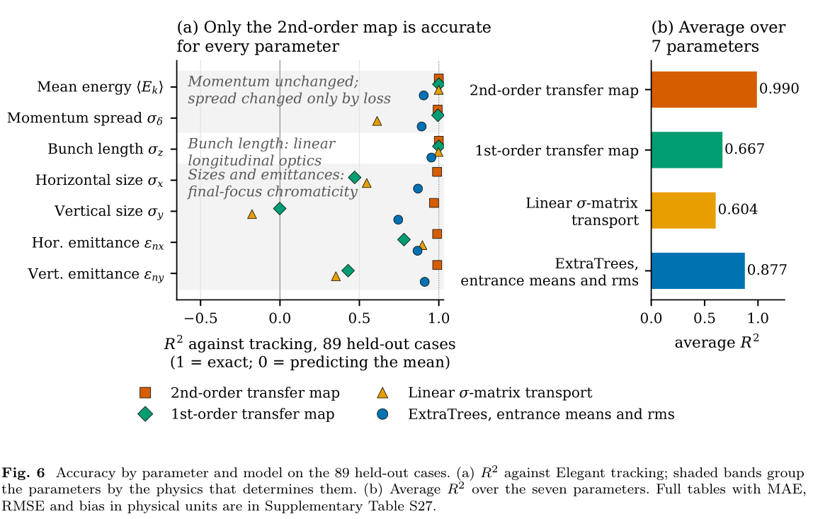
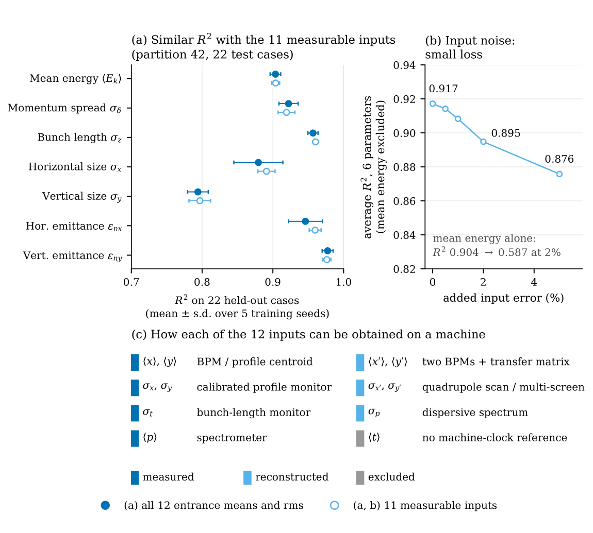
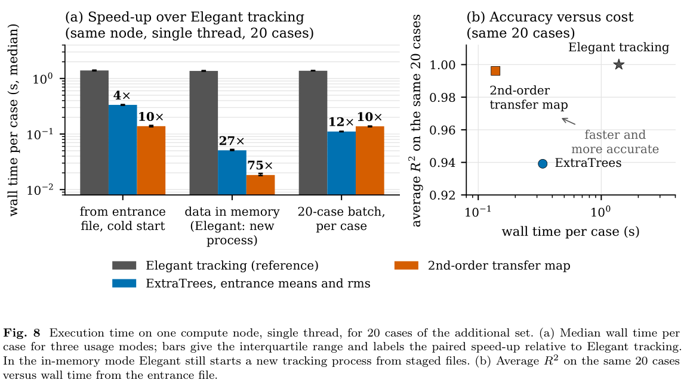

# 用二阶传输映射与入口束流矩预测 MeV γγ 对撞机的相互作用点束参量

## 1. 论文身份与证据范围

Jiawei Zhang、Yongsheng Huang、Yuancun Nie、Qiang Gu、Yuan Chen、Yuanjie Bi，*Fast prediction of electron-beam parameters using transfer maps and machine learning in a digital model of a MeV γγ collider*，[arXiv:2611.08036v1](https://arxiv.org/abs/2611.08036v1)，2026-11-05 13:53:45 UTC 投稿、11-06 公告。本轮精确标题 Crossref 前三结果只有相关对撞机设计／背景论文，未核到同作品正式发表版本，故按作者预印本入库。

[本地 PDF](../pdfs/zhang-2026-transfer-maps-ml-gamma-collider.pdf)共 **37 页**，含主文及参考文献 15 页、内嵌补充 22 页；本轮阅读主文与全部补充，目视核查 8 个关键页及下列 3 幅原图摘录。MinerU 本次认证返回 401/A0211 令牌过期，采用本地布局文本和原页渲染回退。图权利归作者，裁剪坐标与哈希见[视觉清单](../research/visual-validation.json)。本轮未运行 ASTRA、Elegant、训练、推理或计时程序。

**本文是 200 MeV 电子输运线的模拟预测层研究，尚未接入真机；没有模拟逆康普顿光子转换、光子碰撞、光核产额或真实诊疗。**

## 2. 引言与束线：完整粒子设计与有限观测预测是两种输入条件

γγ 对撞机的光子亮度、带宽和重叠依赖转换点附近的电子束品质。设计阶段有完整模拟粒子分布，可直接使用粒子级传输映射；未来装置只能提供有限测量／重建量，因而需要从束流矩推断输出。论文分别评价这两个任务，没有提出新的机器学习算法，也未把预测组件称为已运行的数字孪生闭环。

研究边界是一个臂从统一 Twiss 重匹配的入口到 32.625 m 的 IP，包含两个双弯消色散段、dogleg 和十个四极磁铁的末端聚焦。名义能量／电荷为 200 MeV／1 nC。ASTRA 以三维空间电荷和镜像电荷跟踪注入器至 17 m，每例 10,000 宏粒子；下游 Elegant 的 CSR、ISR 与尾场全部关闭，磁铁保持各例参考动量下的**归一化强度**，不能直接代表固定物理梯度硬件的变能量运行。

参考线还有两处历史零长度水平粒子截断，半宽 2 mm；它们不是已确认设计，也不等同于设计中内径 6 mm 的真空管。所有模型的标签仅对存活到 IP 的粒子计算。全 200 例透过率范围为 0.478–0.9999，中位 0.996；因此束参量变化可能来自选择效应，不能一概解释成无损的相空间演化。

## 3. 数据与方法：重叠测试集合、映射系数与评价口径

200 例由八个注入器设置变化产生，生成器采样定律、预设边界和随机种子未保留。五次拆分各为训练 157、验证 21、测试 22 例；测试集合重叠，其并集是 **89 个独立工况**，不是 110 个独立测试样本。每个工况只汇总确实将其留出的模型预测。另 500 例已经在历史分析使用，联合采样和筛选历史不完整，只是一致性检查，不能称新盲测或域外检验。

二阶映射把每个入口粒子送到检查点和 IP：

$$
q'_i=C_i+\sum_jR_{ij}q_j+\sum_{j\ge k}T_{ijk}q_jq_k,
\qquad q=(x,x',y,y',s,\delta),\quad s=\beta(p)ct,\quad\delta=p/p_{\rm ref}-1.
$$

其中横向位置和路径坐标用 m，斜率和相对动量无量纲，矩阵系数随坐标单位相应变化。它来自围绕参考轨道的 Taylor 展开；存储的二阶系数只乘一次独立单项式，不能另加排列因子或阶乘。逐粒子计算后施加相同两处截断，再计算七个输出，因而保留了非高斯分布的高阶矩和选择信息。

只保留线性项时，均值与协方差满足

$$
\mu'=C+R\mu,\qquad\Sigma'=R\Sigma R^T.
$$

推导是将中心化变量代入线性映射后取期望；协方差的左右矩阵分别来自两个相乘因子。若输入非高斯、输出二阶非线性或出现粒子损失，有限均值／协方差不能唯一确定结果。补充中的二阶高斯闭合虽有作者代数测试，七指标平均决定系数反而约 −0.356；“公式通过”不等于分布假设成立。作者未采用三阶映射，因为独立四极系数检查存在尚未解释的超容差差异；本轮没有独立复现该差异或认定软件缺陷。

ExtraTrees 用入口六坐标的均值及总体 rms 共 12 项输入、64 棵树，五次拆分各五个估计器种子；归一化只用训练统计。其输出包括平均动能、相对**动量**展宽、束长、两向尺寸和两向归一化迹空间发射度。动量展宽单位是百分数／百分点，不能未经转换称能散。

$$
R^2=1-\frac{\sum_i(y_i-\widehat y_i)^2}{\sum_i(y_i-\bar y)^2}.
$$

分子是残差平方和，分母是同批测试真值相对均值的平方和；1 为完全符合、0 为该均值基线，负值表示更差。七指标平均是无权宏平均，**0.88 不表示每个样本有 88% 相对精度**。论文另给物理单位 MAE、RMSE、偏差及按工况重采样的区间。

## 4. 结果：非线性末端聚焦与粒子选择决定比较结果

PDF p10 原 Fig. 6：左图纵轴为七个束参量、横轴为相对 Elegant 的无量纲决定系数；右图是七项无权平均。二阶粒子映射平均 0.990，各项 0.970–1.000；入口矩 ExtraTrees 平均 0.877，单项约 0.744–0.953。线性粒子映射与线性矩传输平均分别约 0.667、0.604。较高平均不能掩盖垂直尺寸的较大残差。

没有加速结构时单粒子动量守恒，集合平均能量／展宽仍会因截断而变。线性矩传输不丢粒子，平均能量决定系数约 0.9993，却只有约 0.611 的动量展宽决定系数。束长主要由时间—动量相关和线性纵向传输控制；完整协方差包含该相关，12 项均值／rms 输入则没有。横向尺寸与发射度受强聚焦色差、非高斯尾和粒子选择影响，二阶逐粒子法明显优于多数线性近似，但入口矩 ML 的水平发射度决定系数约 0.866，仍低于线性矩参照的约 0.896，不能笼统称 ML 每项优于线性模型。

同一 89 工况上，将 ExtraTrees 输入由八个设置改为入口矩，宏平均从约 0.585 升至 0.877；其中设置模型只有每拆分保留的一套预测，而入口模型还跨五个种子平均，故物理输入比较伴随保留集成口径差别，尚非完全相同集成规模的消融。旧的逐拆分指标 0.548／0.881 也不能与该共同工况重聚合数值混用。六个透过率低于 0.95 的共同测试工况贡献了 ML 水平发射度平方误差的约 91.1%、水平尺寸的约 79.1%，显示尾部和选择效应值得单独诊断，六例小分层本身不足以作普适性能结论。

## 5. 可测输入与噪声：实现路径不是硬件验证

PDF p11 原 Fig. 7：a 图横轴为无量纲决定系数、纵轴为各束参量，误差棒是五次训练种子之间的标准差；它只用拆分 42 的 **22 测试工况**，不是全部 89。b 图横轴为加在输入上的误差级别（%），纵轴平均明确排除了平均能量。c 图分开直接测量、重建和排除项，没有证明这些诊断已部署。

候选十一输入包含六项直接测量路径和五项重建路径；移除的是未映射到机器时钟的模拟平均时间，不是声称束团到达时间不可测。角度和角展宽可能需要同步 BPM、多屏／四极扫描，动量展宽需要带校正的色散谱。重复脉冲、标定光学和重建误差仍需现实检验。

无噪声时，十一输入在拆分 42 的七指标平均约 0.915，十二输入约 0.911；差异小于种子波动。2% 控制扰动下，**排除能量的六项平均**由 0.917 降至 0.895，七项平均却约从 0.915 降至 0.851，因为平均能量单项由 0.904 降至 0.587。不能将六项稳定写成所有输出均稳健。

补充规定：正 rms／平均动量施加单位均值对数正态相对扰动；带符号的质心、角度等加以训练标准差为尺度的随机误差，并保持共用通道扰动与部分协方差界。这里的“2%”是这一人为噪声规则，不是所有诊断共同达到 2% 实测精度，也不含系统偏差的完整传播。

## 6. 运行成本：入口文件到七输出与驻留内存分别报告

PDF p12 原 Fig. 8：a 图纵轴为每例中位墙钟秒数、对数刻度；横轴分入口文件冷调用、数据／模型驻留及二十例批量，柱上倍数为相对 Elegant 的配对加速，误差棒为四分位距。b 图横轴为从入口文件开始的每例秒数、纵轴为同一二十工况的七项平均决定系数，不能把这里的约 0.939／0.996 代替 89 工况的主精度。

作者在同一 Xeon 节点、各库一线程、固定二十例、一次不计预热后十次轮换顺序计时。入口文件到七输出的中位时间为 Elegant 1.390 s、加载 25 模型的 ExtraTrees 0.334 s、含系数生成的二阶映射 0.138 s，配对比约 4.16、10.05。驻留模式约 27／75 倍，但 Elegant 仍要另起进程；二十例批量时约 12.48／10.07 倍。模型／系数加载、粒子读取、输入构造和推理边界不同，不能只摘最大倍数，也不能计作真实诊断采集和控制延迟。旧跨节点计时仅留历史来源，不支撑当前速度结论。

## 7. 补充核查与接续重点

补充的末段映射结果起点是最后一个观测点，不能冒充入口到 IP 的表现。多个神经表征比较也不能推出“多观测／图像普遍无用”：其检验限定共享编码器、均值池化、特定元数据和这批模拟分布；MAE、RMSE、不同聚合和多重比较区间的排序并不相同。

冻结模型的光学扰动检验有明确辨识边界：最后观测面之后的末端聚焦改变时，输入可逐位不变而 IP 标签变化，误差膨胀几十至百倍；所以模型必须绑定下游光学配置，而不能宣称同一入口信息可识别任意磁铁变化。固定物理梯度、CSR／ISR／尾场及真实诊断标定均需另建标签和验证。四例、24 次支持性 CSR 扫描未通过整体参考资格，涉及适用性、效应尺度上的数值稳定性和弯后尾场覆盖，**关闭 CSR 是证据缺口的范围限定，绝不是证明其效应可忽略**。

最可借鉴的是先分清完整粒子与有限诊断信息，再用守恒、线性相关、色差及粒子选择解释每个输出；后续应补受控采样清单、确认设计后的同配置标签、同集成规模输入消融、独立工况及实测冻结参数检验。数据、模型和代码目前为向作者合理请求获取，本文公开 PDF 不等于可下载的一键复现包。
