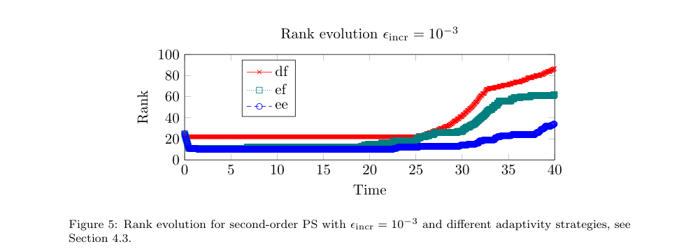
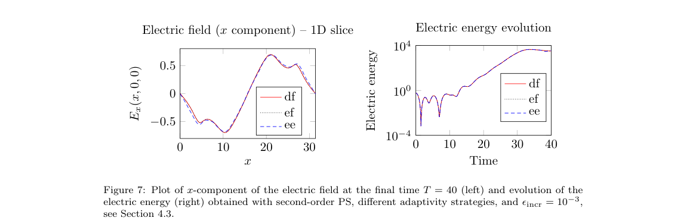
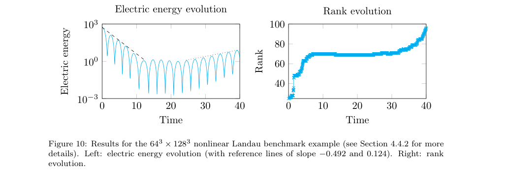

# 用电场还是分布函数选秩：六维 Vlasov 的物理观测量自适应

## 1. 来源与阅读范围

Fabio Cassini、Lukas Einkemmer，*A physics-based adaptive low-rank method for 6D Vlasov simulations*，[arXiv 2611.07107v1](https://arxiv.org/abs/2611.07107v1)，2026-11-04 20:23:46 UTC 投稿，11-06 公告。[25 页官方作者预印本](../pdfs/cassini-2026-adaptive-lowrank-vlasov.pdf)；官方页面没有期刊参考，精确标题 Crossref 前三项没有核实到本作 VOR。2022 年 Ensign 论文是其方法前作，不是本文正式版，见[版本记录](../research/version-checks.json)。

主文、三份算法伪代码及图表经阅读，10 个关键页和三幅原图摘录目视核验，见[视觉清单](../research/visual-validation.json)。采用本地布局文本和原页渲染，本轮未使用 MinerU，也未运行 Ensign、CUDA 或作者算例。这是一篇数值方法预印本，全部“实验”均指作者数值测试。

## 2. 引言与原 §2：六维相空间怎样降维

对象是无碰撞电子 Vlasov–Poisson：三维位置加三维速度、固定均匀正背景、周期边界，以静电势闭合场。它不是完整电磁 PIC，也未包含相对论激光、碰撞、电离、辐射反作用或 QED。

把分布函数写为

$$
f(t,\mathbf x,\mathbf v)\simeq
\sum_{i,j=1}^{r}X_i(t,\mathbf x)S_{ij}(t)V_j(t,\mathbf v),
\qquad \langle X_i,X_j\rangle=\langle V_i,V_j\rangle=\delta_{ij}.
$$

\(r\) 是位置—速度矩阵分离的秩，并不是每个空间坐标各自的张量秩。固定秩的演化投影到低秩流形切空间，经 projector-splitting（PS）形成 K、S、L 子步，分别更新空间因子、系数矩阵和速度因子；密度积分与 Poisson 求解直接用低秩因子，避免重建完整六维数组。

当每个方向取 n 点时，文中主要存储／运算复杂度为 \(O(rn^3)\)／\(O(r^2n^3)\)，相对完整数组 \(O(n^6)\)。PS 的大中间数组仅有 r 列；对照的一阶 BUG 需要 2r 列，二阶 midpoint BUG 的所选变体需要 3r 列。**这是主要对象的规模比较，不是整个程序峰值内存必然精确减半或减至三分之一。**

## 3. 原 §3：物理观测量控制的是哪种误差

每一步对小矩阵 S 做 SVD，去掉最小奇异值形成临时减秩解，再比较三个指标：df 使用最小奇异值；ef 使用 \(\|E-E_{red}\|_{L^2}\)；ee 使用电场能差 \(|\mathcal E-\mathcal E_{red}|\)。ef／ee 以观测量自身大小乘相对容差，再加绝对容差，分别设升秩和降秩阈值。误差太小则接受并降一秩，太大则拒绝该步、在初态加入随机正交方向后重算，其余接受并保秩；另设最小／最大秩。

这一指标衡量**删掉当前最小奇异方向对指定观测量的影响**，并不是相对于真实解的全局误差证明。电场能是空间积分标量，可能掩盖相位、局部场、速度尾部、精细结构和不同方向的误差；量纲与数值尺度不同的 df／ef／ee 即使用同一个容差数字，也不代表相同物理精度。文中没有给出正性、质量／总能严格守恒或电磁／边界一般化保证。

实现用 C++/CUDA Ensign，大数组按最大秩预分配，实际秩变化只改列数视图；小 S 矩阵仍可重新分配。因此瞬时秩降低主要减少计算，预留大数组内存由 \(r_{max}\) 决定，并不每步自动随当前秩缩小。空间／速度采用 Fourier 伪谱，子步用 RK4，整体 PS 分裂为一阶或二阶；单个子步 RK4 不代表整体四阶。

## 4. 原 §4.1–4.2：PS 与 BUG 的成本比较

收敛阶检查在较小 \(16^3\times16^3\)、固定秩 10、T=0.1 上，以细步 PS2 为参考；不能把此检查当成大尺度自适应的全部收敛证明。比较配置为 EPYC 9554P 64 核、192 GB RAM，及 A100 80 GB，双精度。

在 \(80^3\times80^3\) 双流、T=40 的 df 控制下，Table 1 一阶 BUG／PS 的 GPU 总时间约 464／381 s，CPU 为 8620／6880 s。二阶 GPU 为 808／685 s，即约 1.18 倍；论文“约 20%”描述依赖这些比较，不能声称普遍数量级加速。PS／BUG 的容差策略及随机增秩不同，作者也承认秩演化不完全一样。二阶 BUG 在同硬件上不能运行 \(90^3\times90^3\) 这一配置，说明该例的内存限制，不是所有 BUG 实现的普遍上限。

## 5. 原 §4.3：低秩收益与保真代价

PDF p19，横轴为无量纲时间，纵轴为秩；红／绿／蓝为 df／ef／ee。同一 \(128^3\times128^3\) 双流例、二阶 PS、升秩绝对阈值 \(10^{-3}\)，T=40 时秩约为 85／62／35（由图读取近似值）。相应 Table 3 总时间 1910／1310／712 s。ee 与 df 在这组运行中约相差 2.68 倍，来源是接受更宽松的观测量要求，不能与 PS 对 BUG 的 1.18 倍混为同一基准。

PDF p21，左图为 T=40、y=z=0 的无量纲 \(E_x\) 对 x 切线；右图是无量纲电场能随时间的对数曲线。ee 保留增长／饱和的总体能量走势，但左图可见场偏差；原 Fig. 6 的分布函数切片差异更显著。ef 对局部场更好，但依然不保证分布函数所有细节。其余场分量约小两个数量级，本图没有直接展示这些分量。控制 ee 适合优先研究该观测量的成本权衡，不能据图推出速度尾部或稀有反应产额可信。

## 6. 原 §4.4：大规模基准

| 数值问题 | 位置×速度网格 | ee 升秩阈值、时间步／终时 | 作者单 A100 总耗时 |
| --- | --- | --- | --- |
| 线性 Landau | \(64^3\times256^3\) | \(10^{-6}\)，0.04／40 | 约 20 min，秩主要 8–11 |
| 非线性 Landau | \(64^3\times128^3\) | \(10^{-4}\)，0.02／40 | 约 43 min |
| 双流 | \(128^3\times128^3\) | \(10^{-5}\)，0.032／40 | 约 19 min |
| bump-on-tail | \(128^3\times128^3\) | \(10^{-4}\)，0.03／30 | 约 26 min |

PDF p22，左为电场能对无量纲时间、对数纵轴，右为秩；参考斜率 −0.492／0.124 描述阻尼／再增长趋势。秩从 25 上升、形成平台、后期再增加至约 100，支持按动力学阶段调秩的价值；这些参考趋势不是独立六维全秩真值的逐点误差。线性大例完整单分布数组按双精度约 35.2 TB，是存储量估计，文中没有因此运行同规模全秩对照。

## 7. 复现时须澄清的伪代码与应用边界

原 PDF p8 Algorithm 3 第 26 行印为 \(V^0\leftarrow S^0_{new}\)，与 \(V\in\mathbb R^{N_v\times r}\)、\(S\in\mathbb R^{r\times r}\) 的维度不符；第 19 行直接截列前，伪代码也未显式列出把 X／V 旋转到 S 的奇异向量基。这里仅记录**印刷伪代码未闭合**，没有审计上游实现，更没有判定 Ensign 程序必然如此执行。复现应固定 [Ensign](https://github.com/leinkemmer/Ensign) SHA、检查这两步、记录随机种子和达到秩上限时的行为。

对 PIC／HEDP 的启发是按研究问题选择可证伪观测量，并同时保留独立的分布函数尾部、守恒与域外诊断；若目标为韧致辐射、光核或核反应，只有电场能相符显然不足以验证反应源项。本文没有机器学习训练、真实装置实验、转换靶产额或临床／防护结论。
