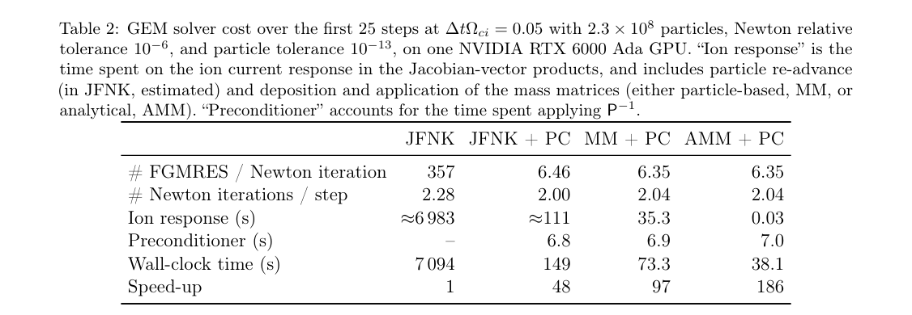
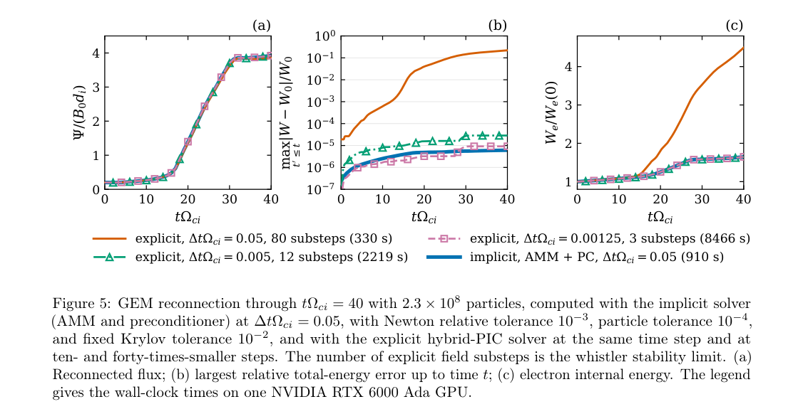
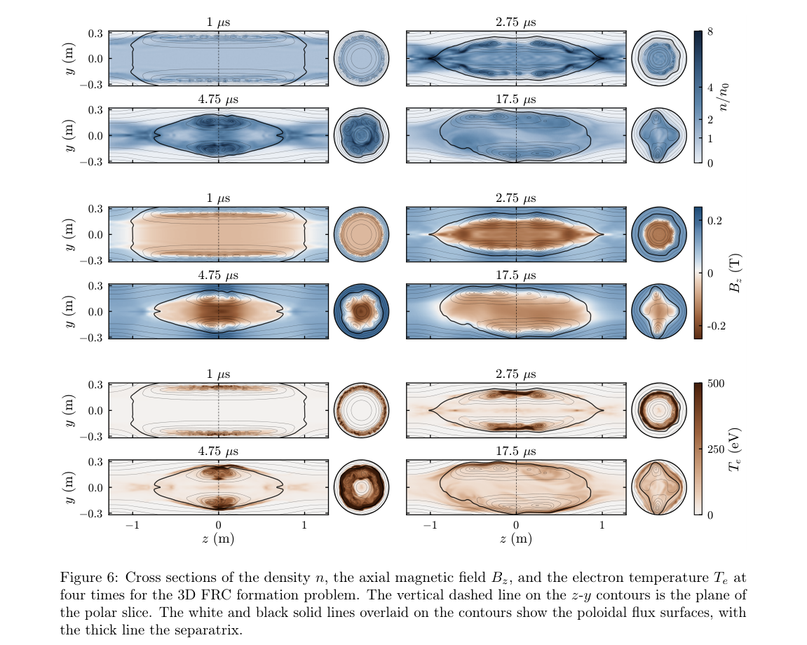

# 隐式混合 PIC 如何减少粒子重推：物理预条件器、解析质量矩阵与等误差成本

## 1. 论文与证据范围

Prabhat Kumar、Luis Chacón、William J. White、Lujain Almarhabi、Stephen E. Clark，*A physics-based-preconditioned quasi-Newton solver for energy- and momentum-conserving implicit hybrid particle-in-cell simulations*。[官方 arXiv 2611.08402v1](https://arxiv.org/abs/2611.08402v1)，2026-11-05 18:12:22 UTC 投稿、11-06 公告；本次读取[30 页作者预印本](../pdfs/kumar-2026-preconditioned-implicit-hybrid-pic.pdf)。官方页面无期刊参考，精确标题 Crossref 前三项未核实同作品正式版，见[版本核对](../research/version-checks.json)。预印本不是正式 VOR。

本文明确引用仓库已收录的 [2611.00127v1](../../2026-11-05/notes/Kumar%20et%20al.%20-%202026%20-%20Theta%20implicit%20hybrid%20PIC.md)，但新增电场—压力联合未知量、Hall-MHD 预条件器、解析质量矩阵与 GEM 性能基准，按独立后续论文收录；它们不是两个独立实验复现。本文主文及附录 A 经阅读，10 个关键页和三幅原图／表目视核验，见[视觉清单](../research/visual-validation.json)。本轮未使用 MinerU，采用本地布局文本、原页渲染和独立 PDF 检查；没有运行 WarpX、输入文件或性能测试。

## 2. 问题：昂贵的是哪一级迭代

混合模型将离子作为粒子、电子作为无惯性标量压力流体，采用准中性和无位移电流的 Ampère 定律。隐式推进消除了 whistler 显式稳定步长随网格平方缩小的限制，却没有恢复被模型删去的电子惯性、光波或相对论强场过程。

标准 Jacobian-free Newton–Krylov（JFNK）每次计算 Jacobian 对向量的作用，都要评价含粒子推进的非线性残差。线性迭代次数很大时，隐式大步长的收益会被反复推粒子抵消。作者分两层降成本：预条件器减少 Krylov 次数；解析质量矩阵使每次线性迭代只做网格操作。完整粒子响应仍保留在 Newton 残差和线搜索中，因此收敛解与 Jacobian 近似应分开讨论。

## 3. 原 §2：离散系统、守恒与求解器

离子实际受力电场为 \(\mathbf E^*=\mathbf E-\mathbf D\)，其中 \(\mathbf D=\eta\mathbf J-\eta_h\nabla_h^2\mathbf J\)；完整电场用于 Faraday 更新。粒子中点位置上使用互为转置的 gather／deposit，压力方程包含离散功、耗散加热和可选传导。未知量为 \(U=(\mathbf E^{n+\theta},P_e^{n+\theta})\)，磁场和粒子轨道非线性消元，每次残差评价重新解粒子轨道。

总能量是离子动能、内部磁场能和电子内能之和，没有独立电场能。在闭合周期系统、耗散加热与磁功配对、下限等修正不触发时，印刷式(13)给出

$$
W^{n+1}-W^n=-\frac{\theta-1/2}{\mu_0}
\|\mathbf B^{n+1}-\mathbf B^n\|_h^2.
$$

\(\|\cdot\|_h^2\) 含网格体积。中点 \(\theta=1/2\) 守恒到非线性和粒子求解误差；\(\theta>1/2\) 有上述磁耗散。空间变化的超电阻使加热配对只近似成立，密度／压力 floor、真空处理和开边界也要另列能量。动量结论进一步要求周期 Cartesian 网格、中心差分及离散无散磁场；有壁或外线圈时是包含外力的平衡，不能声称等离子体动量独自不变。

预条件器把电场—压力 Jacobian 近似为块三角：先解压力输运／传导块，再解含 Hall、电子对流、耗散及局部离子响应的场块。引入辅助旋度—旋度变量，把四阶空间项改写为二阶耦合系统；几何多重网格 V(3,3) 内使用局部六分量 block-Jacobi，场块内层 GMRES、外层 FGMRES。辅助变量只属于预条件器，不增加真实非线性未知量。附录 A 给出块消元、局部逆和压力模板。

解析质量矩阵（AMM）以形函数支持内平滑的密度、磁场替代逐粒子沉积。线性形函数的自相关核为各方向 \((1/6,2/3,1/6)\) 的张量积；三维逐粒子质量矩阵每节点 243 个量，AMM 每节点、每离子种类仅保存四个系数。密度更新的连续性近似不是沉积的精确导数；位置、磁场和噪声响应的省略只允许出现在近似 Jacobian，残差仍需完整求解。能否收敛及成本依赖状态和容差，不能仅由守恒恒等式保证。

## 4. 原 §3：验证与性能的三个口径

线性测试覆盖平行 whistler、斜传播 kinetic Alfvén 和导电圆柱本征模。最精细两种平面波频率误差约 0.085%／0.063%，Table 1 较粗网格误差可达 1.01%，所以“优于 0.1%”只适用于相应精细测试。两种平面波是冷离子／等温电子基准，压力未知量被消去，不能单独证明非线性压力块的全部行为。

GEM 的封闭周期域在 Newton 容差 \(10^{-13}\) 时总能误差低于 \(5\times10^{-16}\)，离子动量变化低于 \(10^{-9}M_iv_A\)。与 Stanier 参考曲线比较时，作者把本次曲线提前 \(1.2\Omega_{ci}^{-1}\) 对齐重联起始；磁能释放最终相差约 0.6%，不是未经平移的整个时序逐点重合。

PDF p20，列为 JFNK、仅加预条件器、粒子质量矩阵加预条件器、AMM 加预条件器；时间单位 s。固定 \(\Delta t\Omega_{ci}=0.05\)、约 \(2.3\times10^8\) 粒子、单 RTX 6000 Ada、同可执行文件及初态，**前 25 步总时间**依次 7094／149／73.3／38.1 s。FGMRES 每 Newton 迭代由 357 降至约 6.35；186 倍是最后一列相对第一列，AMM 相对同预条件器的粒子矩阵约 1.92 倍。表中 ion-response 的 JFNK 时间含估计值，186 倍不是对显式 PIC 的通用加速率。

PDF p21，横轴均为 \(t\Omega_{ci}\)；(a) 重联磁通以 \(B_0d_i\) 归一化，(b) 从起点到当前时刻的最大总能相对误差，对数纵轴，(c) 电子内能除以初值。图例计时针对整个 \(t\Omega_{ci}=40\) 区间，容差也不同于 Table 2。同粒子步长显式 330 s、隐式 910 s，显式较快但电子加热和能量误差明显较大；显式步长缩小 40 倍后为 8466 s，能量误差与隐式相近，才得到约 9.3 倍成本差。**相近能量误差仍不等于所有分布函数、重联细节或全部误差都已相等。**

## 5. 原 §4：三维 FRC 示范与限制

模型用外线圈反向 theta-pinch 形成 FRC，初始氘等离子体 \(n_0=5\times10^{19}\,\mathrm{m^{-3}}\)、\(T_i=T_e=5\) eV、偏置磁场 −0.06 T，柱半径 0.32 m、长 2.56 m；128×128×480 网格、约 \(8.4\times10^8\) 离子，20 张 A100 上 12.7 h 推进至 20 μs。步长约为显式 whistler 限制的 440 倍，不能等同于计时快 440 倍。

PDF p22，各时刻标为 1／2.75／4.75／17.5 μs；纵向截面横纵坐标 z、y 单位 m，旁列为极向截面。上／中／下组颜色分别为密度 \(n/n_0\)、轴向磁场 T、电子温度 eV；粗线是 separatrix，细线为极向磁通。场反转、收缩与后续倾斜显示求解器可推进复杂离子尺度动力学，未构成装置实测或稳定运行证明。

该算例每十步把整个解旋转约 34.38°、以五次样条重映射场，目的是减弱 Cartesian 网格锁定的 m=4 印迹；应独立检查这一额外操作对能量、动量、模谱和倾斜增长的影响，不能把周期 GEM 的机器精度守恒直接移植到此算例。作者报告密度加权电子温度约 140 eV，而同密度绝热估计约 22 eV；这里含欧姆加热、离子碰撞和电子—离子能量交换，未包含电子热传导，输运敏感性及定量验证留作后续。

## 6. 对本库的价值与接续

价值在于给出可追踪的隐式求解成本拆解，以及守恒、容差、物理模型和边界的明确分工。后续复现应固定代码 SHA、输入与硬件，分别检查线性求解、完整粒子残差、floor／真空／空间变超电阻和重映射账本，并以多个物理观测量比较等误差成本。本文没有激光转换靶、光核产额、临床或防护验收，本轮也没有复跑上述模型。
