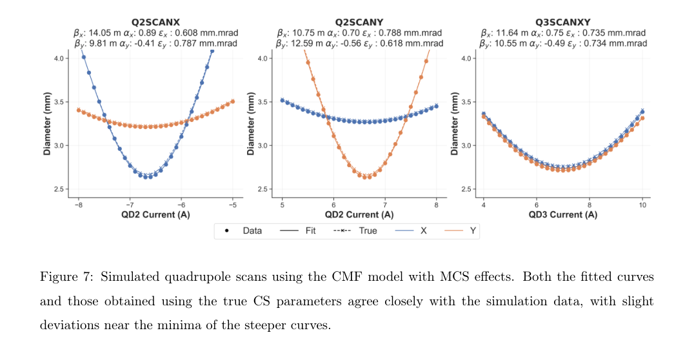
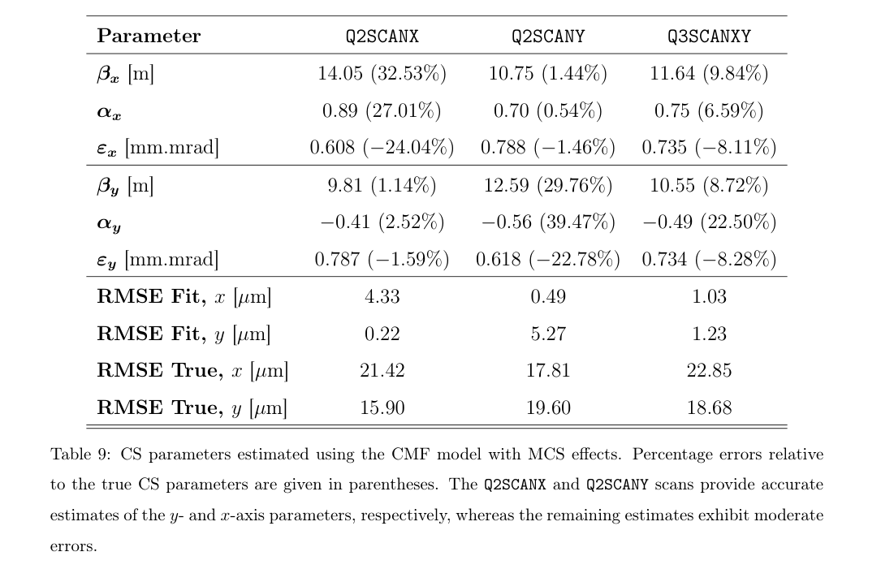
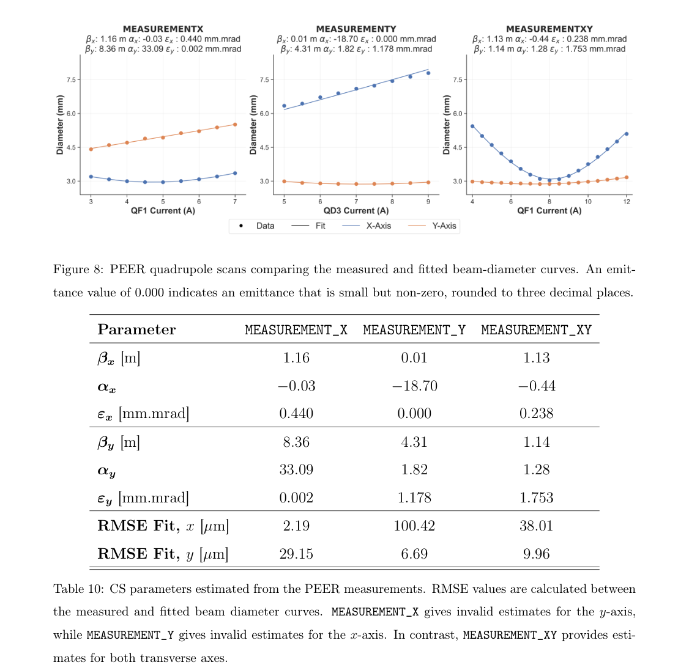

# 空气中屏像反演 VHEE 束流：散射修正的价值与真值辨识的限制

## 1. 论文身份和证据分层

Joel Valerian、Paul Giansiracusa、Vincent Lu、Paarangat Pushkarna、Roger Rassool、Suzie Lyn Sheehy、Yaw-Ren Eugene Tan、Matteo Volpi，*Estimation of Very High Energy Electron (VHEE) beam parameters using an in-air screen*。[arXiv 2611.05973v1](https://arxiv.org/abs/2611.05973v1)，2026-11-04 05:07:26 UTC 投稿、11-05 公告，[31 页官方作者预印本](../pdfs/valerian-2026-vhee-inair-screen.pdf)。官方页面没有期刊参考，精确标题 Crossref 前三项未核实本作正式版，见[版本核对](../research/version-checks.json)。

主文、附录 A／B 和图表经阅读，15 个关键页、三幅原图／表摘录目视核验，见[视觉清单](../research/visual-validation.json)。本次采用本地布局文本和页面渲染，未使用 MinerU，未运行 OpenTOPAS、拟合程序或原始屏像分析。论文有**MC 标定、模拟反演及真实 RF 直线加速器束流屏像**三层证据；没有激光加速、患者治疗、组织生物终点或 FLASH 疗效验证。

## 2. 引言：窗口散射怎样污染上游束流参数

常规四极扫描从屏上束宽随电流的曲线反推上游协方差矩阵；若屏在真空窗和空气漂移后，多重 Coulomb 散射（MCS）增加束宽与发散。忽略这一项，优化器仍可能很好地拟合束宽，却以错误的初始发射度补偿模型缺项。作者用含散射的协方差传播，把可改动的上游四极配置和空气中诊断连接起来。

## 3. 原 §2：量的定义、模型和标定

单轴相空间变量为 \((x,x')\)，其中 \(x'\simeq p_x/p_z\) 是小角斜率。协方差写为

$$
C=\epsilon\begin{pmatrix}\beta&-\alpha\\-\alpha&\gamma\end{pmatrix},
\qquad \epsilon=\sqrt{\det C},\quad D=2\sqrt{C_{11}},\quad\Theta=2\sqrt{C_{22}}.
$$

这里 D 是 **2σ 束径**，不是 FWHM；\(\Theta\) 也是 2σ，\(\epsilon\) 为几何发射度，表中单位 mm·mrad，不能直接当归一化发射度。两个横向平面分别拟合，模型忽略其耦合。

穿过均匀散射层长 L 时，\(C_{out}=M_{drift}C_{in}M_{drift}^{T}+\Delta\)。附录 B 将深度 \(\ell\) 的小角踢量积分：

$$
\Delta=\int_0^L T(\ell)
\begin{pmatrix}(L-\ell)^2&L-\ell\\L-\ell&1\end{pmatrix}d\ell.
$$

\(T\) 是单位长度角方差，按动量平方的倒数变化。模型假设动量沿深度线性减少，以 NIST CSDA 射程及反函数估计终能；小动量损失极限为 \(\Delta_{11}=\theta_0^2L^2/3\)、\(\Delta_{12}=\theta_0^2L/2\)、\(\Delta_{22}=\theta_0^2\)。单位分别对应位置平方、位置×角度、角度平方。

作者在 Lynch–Dahl 特征散射角上乘材料系数 λ，以 MC 出射发射度拟合：空气／水／钛／铅为 0.939／0.965／1.009／1.039。训练配置仅为 100／200 MeV、几何发射度 0.1／1 mm·mrad、β=2／10 m、α=±5；各材料七个厚度，空气 \(L/X_0=10^{-4}\) 至 \(10^{-2}\)，其余 \(10^{-3}\) 至 \(10^{-1}\)。表中跨模拟点误差是这组参数上的汇总，未声明独立保留集，不是临床不确定度或材料普适标定。

MC 使用 OpenTOPAS 4.0.0／Geant4 11.1.3、初始零能散、约 \(1.25\times10^6\) 主电子。排除散射角 >45° 的粒子，再对 1000×1000 相空间直方图做二维 Gaussian 拟合；因此“发射度真值”是选定截断和 Gaussian 核心口径，不是所有散射尾部的无条件二阶矩。修正后四项误差均值±标准差为 −0.06±3.17%（发射度）、0.15±0.66%（束径）、0.18±2.18%（发散）和 −0.03±0.06%（平均动能）；这些是 MC 对模型结果，不能写成实测绝对精度。

## 4. 原 §3.2：拟合好不等于反演正确

模拟束线为三个厚四极、真空漂移、125 μm 二级钛窗和 200 mm 空气；初始 100 MeV、两轴发射度均为 0.8 mm·mrad。三种扫描配置各 31 个电流点，对含／不含 MCS 的同一束线模型做参数拟合。

PDF p16，横轴为 QD2 或 QD3 电流 A，纵轴为 2σ 束径 mm；蓝／橙为 x／y，点为 MC、实线为拟合、叉线为真实上游参数经模型传播。加入 MCS 后整体重合明显改善，近极小值仍有残差。此图是合成扫描，不是 PEER 实测，也不能只凭曲线重合判定上游协方差正确。

PDF p17，β 单位 m、α 无量纲、几何发射度 mm·mrad，括号是相对初始真值误差。虽然拟合曲线 RMSE 均小于 6 μm，Q2SCANX 的 \(\epsilon_x\) 仍偏低 24.04%，Q2SCANY 的 \(\epsilon_y\) 偏低 22.78%；Q3SCANXY 的两轴发射度偏低约 8.1／8.3%，αy 误差可达 39.47%。不含 MCS 的 Table 8 发射度最大误差约 377%，其拟合 RMSE 也能小于 6 μm。由此得到的是**必须建模窗口／空气，且单凭拟合 RMSE 不足以验证参数**。

## 5. 原 §2.4／3.3／4：真实屏像及跨扫描不一致

PEER 使用澳大利亚同步辐射装置注入器 RF linac，约 100 MeV；实测为 100 个束团、约 100 ns／1 nC 的束列。屏距钛窗为 **165 mm**，与模拟的 200 mm 不同。Blue 800 Speed 增感屏倾斜 45°，相机以 1 ms 曝光、同步触发，经过透视／尺度标定及背景扣除；1 ms 不是电子束脉宽。本文未由这组电荷和时间直接验证靶中剂量率或生物效应。

PDF p18，横轴为扫描四极电流 A，纵轴为 2σ 束径 mm；点为屏像、线为拟合。MEASUREMENT_X 的 y 轴、MEASUREMENT_Y 的 x 轴没有有效约束，表中 0.000 是小非零数的舍入，不是零发射度。有效方向按 Table 10 为 0.440、1.178 mm·mrad，双轴扫描为 0.238／1.753 mm·mrad。原 Fig. 9 将三个拟合参数集用于相同扩展电流范围，得到不一致束径曲线，所以还没有证明跨配置可迁移。

作者讨论了旋转束斑／横向耦合、四极与几何误差、屏与相机分辨率、色散及能散。两轴独立模型未描述完整 4×4 协方差；一小时内扫描参数的大幅变化也尚未归因。PEER 直线路段没有可独立验证该法的真空屏，历史 LTB 结果又受弯转磁铁色散影响。与设计发射度同量级不是独立真值验证。

## 6. 原文数值和附录的未闭环之处

- 摘要称模拟初始参数最大误差 13%，但 Table 9 βx 为 32.53%、αy 为 39.47%，发射度最大约 24%；讨论又把约 40% 写为发射度误差。正文／表格口径不一致，本笔记不采用“所有参数 ≤13%”。
- §3.3 正文给出 0.426、1.138、0.231／1.694 mm·mrad，与同一版本 Fig. 8／Table 10 的 0.440、1.178、0.238／1.753 不同；保留两组来源，不自行平均或判定哪组是最终数据。
- p12 标定方格写为 45×45 **cm²**，结合原图尚需作者确认单位；本次不擅改为 mm，也不据此认定全部实验比例尺错误。
- 附录 A 式(A.1)用 \(k^2=G/(B\rho)\)，而薄透镜式(A.2)直接用 \(-kL\)，符号定义不统一。进一步仅按其(A.3)的系数 \(a_1=-2DL(C_{11}+DC_{12})\) 反解，应为 \(C_{12}=-a_1/(2D^2L)-C_{11}/D\)，但印刷(A.4)末项为加号。此为原页及静态代数核对，不是作者全束线拟合代码缺陷的证据。

## 7. 应用价值与后续验证

本研究为转换靶、空气隙或诊疗束线之前的束流二阶矩诊断提供低成本建模思路，最有价值的结果是揭示“束宽拟合很好、上游相空间仍可能错”。后续需取得原始屏像、标尺、四极标定与代码，澄清上述版本差异，以独立真空诊断／保留扫描验证，加入四维耦合与宽能散，并检查非 Gaussian 尾部和屏响应。扩展至激光电子束、转换靶 γ／光核源或临床前剂量学都需要新增实证；本轮未完成这些验证。
