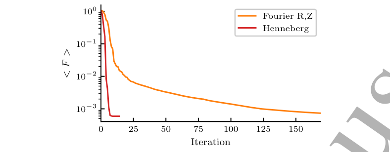
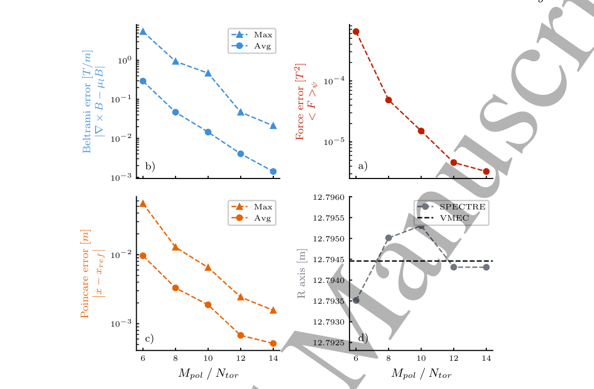
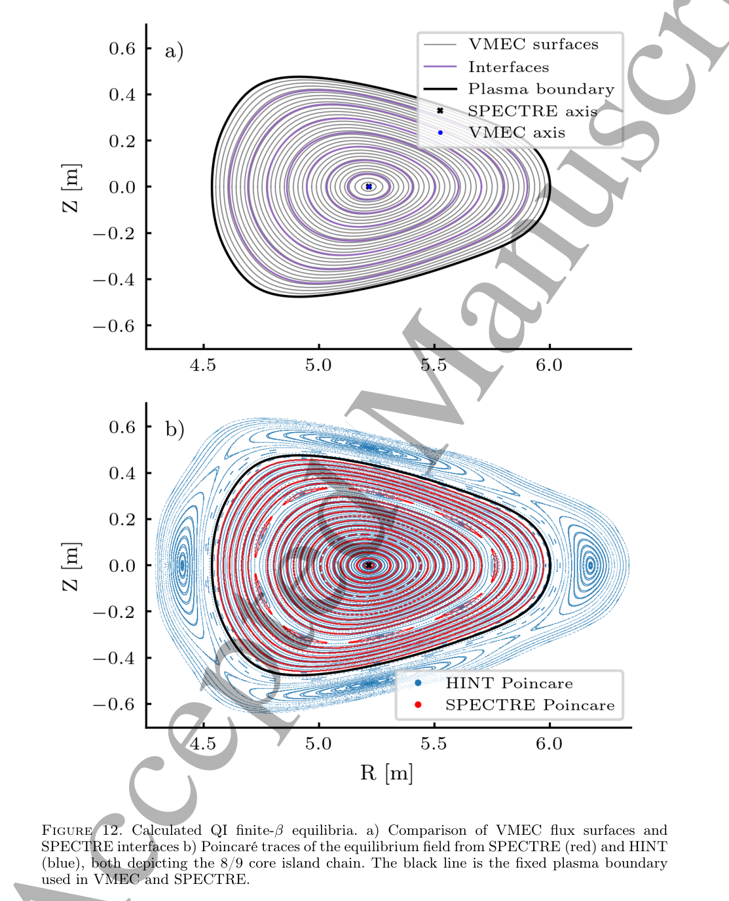

# SPECTRE：允许磁岛与混沌拓扑的三维 MRxMHD 平衡求解器

## 0. 论文信息与本次证据

- 原题：*SPECTRE: A robust solver for 3D equilibria with arbitrary topology*。
- 作者：Erol Balkovic、Joaquim Loizu、Emmanuel Lanti、Christopher Berg Smiet、Camilla Lazzati、Rohan Ramasamy、Alan Goodman、Joachim Geiger、Jonathan P. Graves。
- 期刊及 DOI：[Plasma Physics and Controlled Fusion，10.1088/1361-6587/aebef8](https://doi.org/10.1088/1361-6587/aebef8)。Crossref 标示 2026-11-06 online；本地读到的是 **IOP Accepted Manuscript，PPCF-106085.R1**，有独立封面及 Accepted Manuscript 水印，不能称最终排版 VOR。精确接受日期以出版社记录为准，不能从 online 日反推。
- [官方全文](https://iopscience.iop.org/article/10.1088/1361-6587/aebef8/pdf)；[本地 PDF](../pdfs/balkovic-2026-spectre-equilibria.pdf)。PDF 共18页：封面1页，作者稿17页，以下页号先指作者稿页号。
- 本次读主文、附录与参考文献，通过本地布局文本和原页渲染交叉检查；关键渲染为 PDF 第6、10、11、13、14、15页，保留3个原图摘录。MinerU 状态由当日总验证记录统一说明。本地没有安装／编译／运行 SPECTRE、SPEC、VMEC、HINT，也没有复现计时或装置实验。

## 1. 摘要与引言：解决什么困难

摘要提出一个 MRxMHD 三维平衡求解器：允许子体积内部出现磁岛、场线混沌，使用实空间总压跳跃残差与信赖域最小二乘，提高强形状扭曲配置下的求解鲁棒性。论文证据是数值基准和跨代码比较，核心结论没有覆盖实验验证、动力学稳定性或任意输入的全局收敛保证。

1.1节先说明静态 MHD 力平衡是设计磁约束装置及后续稳定性／输运研究的基础。嵌套磁面使问题简化，但三维扰动会产生磁岛和混沌，强行保持全局嵌套磁面的解空间有限。本文没有求解微湍流、快粒子输运或时间演化；这些是平衡解的潜在下游用途。引言把轴对称 Grad–Shafranov 方程写作 “hyperbolic”，这是原稿文字，通常的静态轴对称 GS 方程应按椭圆型处理；此处不沿用其分类措辞，也不据此断言程序有错。

1.2节引入分区 Taylor 弛豫：用不相交的理想界面把等离子体分成若干体积，界面是磁通面，子体积内部不要求处处存在嵌套磁面。各区固定磁螺度等整体约束、压力分段常数，因此可以容纳重联后的拓扑，而不是显式模拟重联过程。

## 2. MRxMHD 方程与 SPEC 的数值问题

原稿式(1.1)把磁能、内能和各区磁螺度约束合入变分泛函。忽略不影响本笔记推导的乘子归一化选择，其物理结构是

$$
\mathcal F=\sum_l\int_{V_l}\left(\frac{B^2}{2\mu_0}+\frac{p_l}{\gamma-1}\right)dV
+\sum_l\lambda_l\left[\int_{V_l}\mathbf A\!\cdot\!\mathbf B\,dV-H_{l0}\right].
$$

这里磁场 B 的单位为 T，压力为 Pa，磁导率为 μ₀，γ为比热比，A 为磁矢势，H 为磁螺度，λ为约束乘子。对场变量取驻值给出区内 Beltrami 方程；对界面位移取驻值给出跨界面总压平衡。把乘子重标定后，原稿式(1.2)–(1.3)为

$$
\nabla\times\mathbf B=\mu_l\mathbf B,
\qquad \mathbf B\cdot\hat{\mathbf n}=0,
\qquad F_l=\left[p+\frac{B^2}{2\mu_0}\right]_l=0.
$$

此处 μ_l 是每区的 Beltrami 常数，量纲为逆长度，不是 μ₀。由电流与磁场平行可知区内洛伦兹力为零，故区内压力常数；允许的压力梯度集中在界面，需由磁压差平衡。这解释了为何它叫“阶梯压力平衡”，也解释了界面位置和数量为何会影响有限分辨率的解。

1.3节说明 SPEC 用全局多项式–Fourier 基求磁矢势，用 Fourier 系数描述界面。解区内 Beltrami 场时可以规定磁通和螺度，也可以迭代实现电流或界面两侧旋转变换约束。区内线性求解与界面非线性优化是不同层级。

SPEC 原先用界面自由度同阶截断的“力频谱”做平方方程组求根。由于磁压包含磁场平方，力频谱比几何和矢势频谱宽，截断窗口内残差很小不代表总残差小。**图1**（p4）画的是极向／环向模数 m、n 平面上的残余力频谱，红框内是被优化的模；框外仍有残差。作者给出的 W7-X 示例在截断空间达机器精度，但平均残余力约 **8 kPa**。这是特定旧解的诊断，不是所有 SPEC 解的一般误差。

## 3. 新最小化框架（原文第2节）

### 3.1 实空间残差与信赖域最小二乘

2.1节把界面总压跳跃在选定角网格上采样，避免只驱动低阶力频谱到零。网格密度可调，作者也提出未来可在高曲率处加密；本文没有展示任意自适应采样策略的全面验证。网格仍有限，不能把“实空间”理解为完全消除离散或混叠误差。

2.2节的目标是对界面 Fourier 几何系数优化：

$$
\min_{\{R_{lmn},Z_{lmn}\}}\frac12\sum_l\sum_{i,j}F_l^2(\theta_i,\zeta_j).
$$

每个残差都是某界面某采样点的压力失配，几何系数控制界面形状。把所有残差写为向量 r，局部用雅可比 J 线性化，得到用于理解该方法的 Gauss–Newton 模型

$$
\frac12\|\mathbf r(\mathbf x+\mathbf s)\|^2
\simeq \frac12\|\mathbf r+J\mathbf s\|^2,
\qquad \|\mathbf s\|\leq\Delta.
$$

这一步是标准最小二乘解释，不是新增的作者算法公式。线性化残差产生近似曲率，因此不必显式求每个残差的二阶导；信赖域半径 Δ 限制一步的几何改变量。算法可改善优化稳健性，但局部模型不构成全局最优证明。

作者监视的总体力误差则使用磁面平均，以补偿角网格对应的非均匀物理面积：

$$
\langle F\rangle=\sqrt{\frac{1}{N_{\rm vol}}\sum_l\langle F_l^2\rangle_{\rm surface}}.
$$

它与未加面积权的离散优化目标应区分。原图2未标单位，而图7力误差轴标 T²；原式总压采用 Pa。**不在缺少明确归一化说明时，把图中的数值直接当 Pa 或擅自换算**。

**图2**（p5，原页摘录）：横轴迭代次数，纵轴对数尺度的总体力残差。橙色圆柱 Fourier R、Z 表示初期快、后期慢，红色 Henneberg 表示约10次迭代达到相近最终残差；原始 R、Z 曲线持续约160次。它比较同一算例的表示方法和迭代收敛，**不能直接换算为相同倍数的墙钟加速**。

### 3.2 几何合法性与共用求场器

2.3节补充三点：信赖域步若造成界面相交则拒绝；map2disc 解二维 Laplace 问题，利用等值面构建不相交初始界面；区内 Beltrami 场仍复用 SPEC 的求场器。整体代码用 Python，链接 Fortran 扩展。因此新旧代码并非所有数值模块都独立，跨代码一致性须结合共享模块理解。

## 4. 验证算例（原文第3节，依原图次序）

### 4.1 轴对称与 QA 真空

3.1节用轴对称托卡马克测试真空和 β=6% 的轴位置，扫描弛豫体积数。**图3**（p7）以 R、Z（m）叠加 D 形截面、8区界面及 VMEC 磁面，两代码轴相合。**图4a/b**以体积数4至64为横轴、轴大半径为纵轴；正文指出仅4区时误差也小于1 mm。**图4c**画随几何 Fourier 分辨率变化的轴位置差，正文称极向阶数至少4即可达到该算例的轴位置收敛。该结论针对轴位置指标，不能代替全场、力残差和磁岛宽度收敛；原图4c轴标签 Mpol/Ntor 与轴对称 Ntor=0 的正文设定不够协调，按极向分辨率扫描理解并保留印刷问题。

3.2节研究强形状 QA 固定边界真空配置。**图5**（p8）左图是 map2disc 初始与优化后界面的 R、Z（m）截面，说明该例从明显不同的初值仍能收敛；右图把 SPECTRE Poincaré 点、界面与 VMEC 磁面比较。**图6**为三维界面、最外边界和绿色磁轴，颜色代表磁场强度，展示几何形状；没有独立效率或稳定性含义。

**图7**（p9）横轴共同是 mpol=ntor 从6增至14：左上 Beltrami 残差（T/m）的最大／平均值下降；右上力残差（T²）下降；左下单区与7区场线一周追踪位移差（m）下降；右下轴半径（m）逐渐接近 VMEC。**印刷图的左上标 b、右上标 a，但图注把 a 指为 Beltrami、b 指为力误差，二者对调**，此处按坐标物理量解读。正文将 Poincaré 误差称 relative displacement，但图中纵轴及符号是长度差、单位 m，故不将其写成无量纲相对误差。轴位置不单调趋近而误差总体下降，也说明单一低阶解不充分。

**图8**（p9）以 R、Z（m）比较单区场线与7区界面，支持此无压无流真空配置的全局场对分区数不敏感；不能把它推广到有限压强、有磁岛的情况。QA 文中计时为低阶6：**9 CPU h／1.3 h墙钟／7 CPU**，高阶14：**120 CPU h／8.6 h墙钟／14 CPU**。这是不同分辨率的计算成本，没有提供同误差条件下的新旧求解器速度比。

### 4.2 W7-X 真空自由边界

3.3节把计算域分成等离子体区与外围环形真空区，外计算边界及线圈场固定输入；自由的是内部等离子体边界。真空区法向场同时依赖外线圈和等离子体产生的场，因此还需 Picard 迭代。

**图9**（p10）在环向截面0与π/10画 R、Z（m）的 Poincaré 比较，SPECTRE 与线圈 Biot–Savart 场都显示内部嵌套面和旋转变换5/5附近的偏滤器岛链；第三幅是旋转变换随 R 的无量纲曲线。这里基准来自计算线圈场，未比较真实 W7-X 测量，也没有测试有限压强 W7-X 放电。该例 mpol=ntor=18，约 **30 CPU h／7.5 h墙钟／4 CPU**。

### 4.3 有限 β 旋转椭圆自由边界

3.4节研究零净环向电流、有压强的旋转椭圆配置。**图10a**（p11）是按轴上值归一化的输入压力随环向磁通下降，图内体积平均 β=2.6%；**图10b**是旋转变换随 R（m）的比较，增加界面数后趋近 VMEC。**图11**的 R、Z（m）截面叠加外场、外计算边界、VMEC磁面、SPEC及SPECTRE界面；后两者几乎重合。

三代码轴位置分别为 **10.4205、10.4197、10.4196 m**（VMEC、SPEC、SPECTRE）。SPECTRE 初始轴10.4 m，初始界面未取自另外两代码的收敛解。Nvol=16、mpol=ntor=12时求力平衡约 **10,000 CPU h／117 h墙钟／85 CPU**。不能从“鲁棒”推导“低成本”，也没有同硬件计时的普遍优越性证明。

### 4.4 有限 β 准等动力学 QI 配置

3.5节用四周期候选配置，体积平均 β=1.5%、轴上β=3%、零净环向电流。**HINT 采用与线圈一致的自由边界，而 SPECTRE 采用 HINT 一个内核磁面的近似拟合固定边界**；VMEC也用此固定边界。这是重要的比较条件差异。

**图12**（p13）：横纵轴为 R、Z（m）。上图 SPECTRE 的8区界面与 VMEC磁面总体相合，轴位置差小于0.2 mm。下图红点 SPECTRE 与蓝点 HINT 在黑色固定内边界内有相近场线结构，显示8/9共振核心岛链；边界外只有HINT结果，不能拿外区蓝点当两代码比较。

作者报告与 HINT 的轴位置差约 **2 mm**，同相位岛链的 O 点在环向截面π/4相差约 **7 mm**，岛宽“相近”，未给全误差预算。**图13**（p14）以 R（m）为横轴、旋转变换为纵轴，SPECTRE在8/9共振附近有局部平台。该比较明示为**定性**，不是严格同边界、同模型、同误差条件下的定量闭合。

界面按环向磁通二次间隔布置，近似对应半径的线性间隔，避免贴近岛分离面和低阶有理面。作者试过扰动间隔、提高分辨率（基准mpol=12、ntor=11），未见可辨变化；但系统界面放置敏感性、岛参数误差以及自由边界QI对照仍待后续研究。

## 5. 讨论、代码与附录

第4节把实空间残差、信赖域和多种边界基准作为主要改进，提出以后与 HINT、JOREK、M3D-C1 做更全面比较。MRxMHD可用于某些非线性饱和态研究，不代表本文已经预测一般环形NTM演化，更不代表求得的每个驻态都稳定。

第5节给出[作者代码仓库](https://gitlab.com/spectre-eq/spectre)，声明MIT许可证；本次仅记录论文声明，没有当前仓库SHA、源码审计或运行证据。贡献及致谢表明QI输入由合作方提供，不能把现有论文材料等同于全部可复现输入已公开。

附录A解释 Fourier R、Z 表示中极向角不唯一，产生近零方向，导致信赖域变小与后期慢收敛。Henneberg 表示选定唯一几何角，在图2这一例约10次迭代达到相同终态；将来可能用等弧长等表示。它有利于旋转椭圆类形状，但不是任意强形状边界都适合的万能参数化。

## 6. 接续与速记

复现应固定代码版本、输入边界／线圈／压力和电流约束，分别扫描求场基、采样网格、界面数与界面放置；同时记录力、Beltrami、全场追踪、磁轴、岛宽误差及完整墙钟／CPU／内存。进一步与HINT比较需在同一线圈和自由边界条件下进行，先消除近似内边界的差异。

这篇论文最有用的启示是：**截断残差“归零”可以是假收敛，几何表示也直接影响优化条件数**。它为三维非嵌套平衡提供更稳健的方法证据；没有新增激光束流、强场QED、光核中子／核素、剂量、防护或临床实测。
