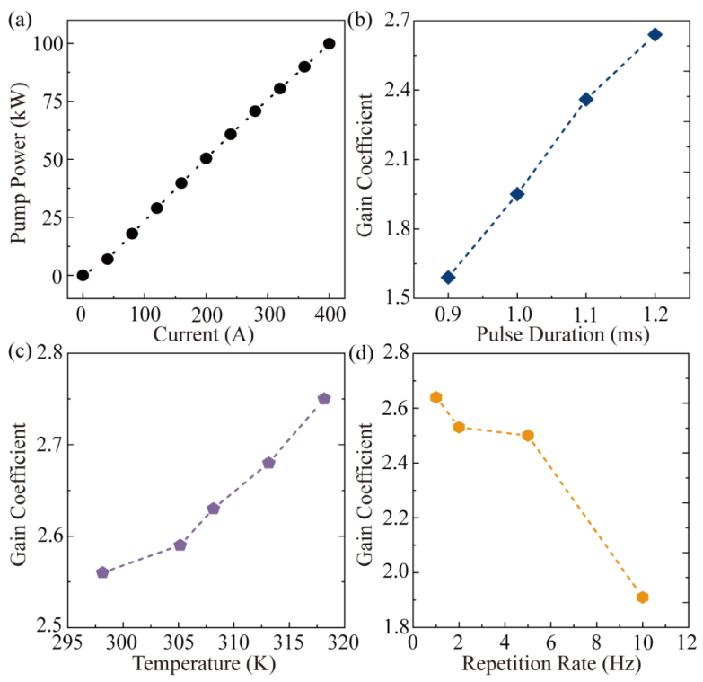
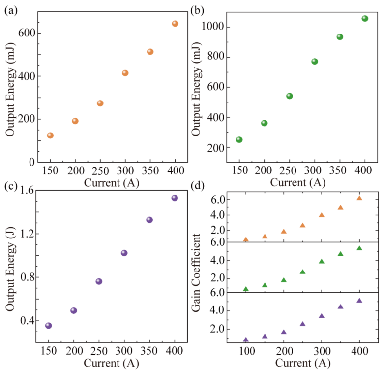
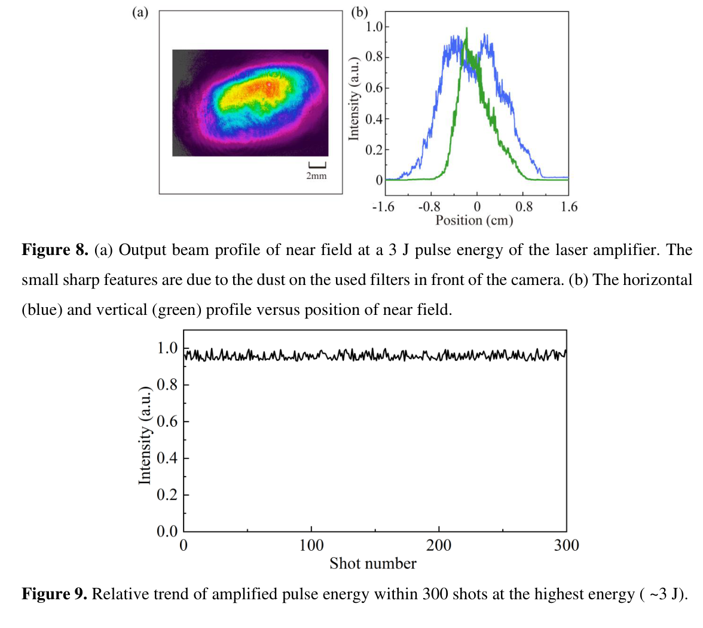

# 室温对向二极管泵浦 Yb:YAG 有源镜：3 J／1 Hz／10 ns 放大实验

## 0. 论文与全文版本

- 原题：*3 J/1 Hz opposite diode-pumped Yb:YAG active mirror amplifier at room temperature*。
- 作者：Jinsheng Liu、Lailin Ji 等，上海激光等离子体研究所。
- 期刊：High Power Laser Science and Engineering；[DOI：10.1017/hpl.2026.10219](https://doi.org/10.1017/hpl.2026.10219)。出版社在线日期为 2026-11-06；本次实际阅读 **19 页出版社 Accepted Manuscript**，首页明确“尚未文字编辑／排版”，不能称最终 VOR。
- [本地 PDF](../pdfs/liu-2026-ybyag-active-mirror.pdf)／[布局文本](../pdfs/liu-2026-ybyag-active-mirror.txt)。本轮 MinerU 公共 URL 请求一次返回 HTTP401／A0211（令牌过期），随后采用本地布局文本和原页渲染；没有重新运行作者放大器模型或实验。
- 类型：**激光器部件实验＋泵吸收计算**。对激光等离子体驱动器的关联在于室温、紧凑、焦耳级重复频率泵源；不是超短脉冲压缩、拍瓦输出或粒子／次级辐射应用实验。

## 1. 摘要：已经实现和仍属展望的部分

作者实现约 300 mJ 种子经两级有源镜放大至 **3 J、1 Hz、10 ns**，晶体工作温度约 293 K。光路长约 2 m，台面占地约 60×80 cm²；摘要称以近高斯光束免去整条链的望远镜。这是纳秒放大实验，不能从 3 J 直接外推已获得飞秒强场性能。

摘要关于 50 J 或更高能量的表述，依赖增添有源镜并使用百毫焦级、1–10 Hz 种子，是扩展设想。本次实测 3 J 的种子装置固定 1 Hz，未展示 3 J／10 Hz，更没有展示 50 J 输出。

## 2. I. Introduction：为什么选择室温厚片有源镜

Yb:YAG 的长荧光寿命有利于储能，小量子亏损有利于减小热负荷。作者以室温百毫焦级系统的历史比较表说明目标：在紧凑结构中扩展到焦耳级输出；表 1 为前人结果汇总，不能计为本实验验证。

引言指出薄盘储能体积与横向 ASE 的约束，转向尺寸较大的块状介质。这里“薄盘不适合焦耳级”的措辞是本文的设计论述，不构成对所有薄盘系统的普遍排除结论。已有放大链、低温设备及其面积比较也依赖各文献不同系统边界。

作者前期空间复用设计和专利是背景；本文新的实验证据是室温 Yb:YAG 两级纳秒放大。前作台式 20 TW 的光学方案模拟，不能并入本轮 3 J 系统的已测性能。

## 3. II. Basic characteristics：封装、镀膜与泵浦

### 3.1 图 1：有源镜封装和 ASE 控制

增益介质为 **60×35×6 mm³、2 at.% Yb:YAG**。泵光与信号从相反侧入射，信号在后面高反膜反射形成 V 形路径；冷却通道避开信号传播路径。图 1 是几何示意图，没有性能坐标；图中空气／玻璃／水／增益介质界面分别对应表面 1–4。

玻璃约 76×51×3 mm³，水层厚 3 mm，流量 15 L/min；去离子水加银丝用于抑制微生物。作者给出泵透射、信号反射、Brewster 角出入射等镀膜要求，并以倾斜泵浦避免剩余泵光直接返回 LD。两只面对面的有源镜还需要抑制寄生腔。

正文第 5 页说侧面为 **Cr:YAG** 包层，1030 nm 吸收系数 4 cm⁻¹，单侧厚 8 mm；图 1 的跨页图注却写 **undoped YAG**。本次原页与文本均核对到该差别，保留为接收稿待澄清项，不自行选择其中一种材料。

原文用玻璃和水的折射率约 1.44、1.33 说明界面反射很小。作静态解释时，正入射 Fresnel 强度反射率为：

$$
R=\left(\frac{n_g-n_w}{n_g+n_w}\right)^2
 =\left(\frac{1.44-1.33}{1.44+1.33}\right)^2\simeq0.00158.
$$

其中折射率无量纲；0.158% 小于文中的 0.5%。这个估算只说明单个理想界面的量级，不是全系统传输损耗或实际镀膜测量。

### 3.2 图 2：LD 光谱漂移与泵吸收计算

两组 LD 阵列各有 8 stacks×32 bars，每 bar 标称 420 W；准直匀化后每个泵源约 100 kW。晶体与 LD 使用独立水路：调节 LD 水温时，晶体保持约 293.15 K。

图 2(a) 横轴重复频率 Hz、纵轴中心波长 nm；292.15 K 下由 1 Hz 升至 20 Hz，波长从 927.0 红移至 936.2 nm。图 2(b) 横轴 LD 冷却水温 K、纵轴波长 nm；1 Hz 下从 292.15 升至 318.15 K，对应 927.0→935.8 nm。图 2(c) 是 318.15 K／1 Hz 时实测归一化光谱，FWHM 为 4.9 nm。

图 2(d) 横轴波长 nm、纵轴吸收率 %，蓝色双程和红色四程曲线是**计算**结果，不能当成两种泵浦方式的整机能效测量。结合 LD 光谱，作者报告双程吸收约 89.8%、四程约 98.9%。两者相差 **9.1 个百分点**，相对增加约 **10.1%**；这解释了正文“提高约 10.1%”的口径。后续全部放大实验仍使用双程泵吸收，四程性能没有在本文整机输出中验证。

## 4. III. Experimental amplification results

### 4.1 图 3：泵功率与小信号增益扫描

来源为接收稿 PDF 第 10 页。图 3(a) 横轴电流 A、纵轴泵瞬时功率 kW，400 A 时约 100 kW；经过玻璃和水约损失 8%，在 36×16 mm² 泵面上对应约 16 kW/cm²。这里 100 kW 是泵脉冲内功率，不是 1 Hz 平均功率。

图 3(b) 横轴泵脉宽 ms、纵轴无量纲增益，0.9→1.2 ms 时显著上升，1.2 ms 达 2.64。作者随后固定 1.2 ms。图中 0.9–1.0 ms 的增益约从 1.6 到 1.94，不能把正文“每加 100 μs 约增 10%”读成逐点精确规律；后两步接近这一量级。

图 3(c) 横轴 LD 水温 K、纵轴增益，298.15→318.15 K 时约 2.56→2.75；作者将温升带来的泵光红移与储能匹配联系起来，同时指出更高结温的寿命代价。图 3(d) 横轴 Hz、纵轴增益，1、2、5、10 Hz 分别约 2.64、2.53、2.50、1.91。高重复频率热效应抵消泵波长变化的收益。因此 10 Hz 的部件增益扫描不等于 3 J／10 Hz 整机输出。

“gain coefficient”在本文实际指一次有源镜来回路径的能量放大倍数，**无量纲**，不是常用单位为 m⁻¹ 的局域增益系数。说明性定义与小信号近似为：

$$
G=\frac{E_{\rm out}}{E_{\rm in}},\qquad
G_{2}\simeq G_{1}^{2}\simeq2.5^2=6.25.
$$

能量单位相消；第二式要求两次抽取近似同增益、忽略明显耗尽及附加传输损耗。当输入增强、反转粒子数被消耗时，这个乘积近似会高估实测双程增益。

### 4.2 图 4–5：两级系统与第一极单程放大

图 4 为 293 K 两级有源镜光路图：FI 为 Faraday isolator、HWP 为半波片、HR／RM 为反射／返回镜、AM 为有源镜；插图是 300 mJ 种子近场。作者自制种子最大约 350 mJ、10 ns，重复频率固定 1 Hz，信号同步器保证与泵源时序配合。原文把 350 mJ 写成“maximum output power”，这里按单位解释为**能量**。

图 5(a–c) 横轴泵电流 A，纵轴输出能量 mJ，比较 110、207、302 mJ 注入；图 5(d) 横轴电流 A、纵轴增益，400 A 附近约 2.5。种子能量小于储存泵能量的 1%，作者按小信号增益解释三种注入量下的相似倍数。文中“信号单程吸收约 55%”属于该介质的重吸收／传播语境，不能将其误称输出光光效率。

### 4.3 图 6：第一极双程放大与饱和趋势

来源为 PDF 第 13 页。图 6(a–c) 横轴电流 A，输出能量依次使用 mJ、mJ、J，注意子图单位变化。400 A 时输出随注入增大而提高；图 6(d) 为各注入量的无量纲增益，依次约 **6.13、5.29、5.07**，大种子时增益低于 6.25 小信号乘积。

正文先写沿用图 5 的 110／207／302 mJ，随后叙述中又简写为 100／200／300 mJ；图 6 图注明确为 110／207／302 mJ。笔记保留这一精度差别，不用简写输入反算“更精确”的输出。图中趋势支持抽取耗尽的解释，但未给独立储能随时间数据以完整闭合耗尽账本。

### 4.4 图 7：第二极单程达到 3 J

两级采用第一极双程、第二极单程。经过 FI 与反射镜后，第二极前表面有效注入约 **1.2 J**；图 7 横轴电流 A、纵轴输出 J，400 A 时约 **3 J**，第二极增益约 2.5。第一极 302 mJ 双程约 1.53 J 与第二极 1.2 J 有效输入属于不同位置；不能忽略中间传输损耗。

论文援引 Yb:YAG 约 9.6 J/cm² 饱和通量，解释尚可提高抽取；没有由此实测更高输出。整机的种子能量增益约为 3 J／0.300 J≈10；这与泵吸收率、光光效率是三个不同量。

若只做量级估算，每个 100 kW、1.2 ms 泵脉冲约为 120 J，两组约 240 J；3 J 与之比约 1.25%。这是由标称功率和脉宽推得的**粗估比值**，未整合实测泵时间波形、功率校准、有效入射面和种子能量扣除，不作为论文实测光光效率，也不应与表 1 的不同系统能效直接排名。

### 4.5 图 8–9：近场保持和 300 发相对能量序列

来源为 PDF 第 15 页。图 8(a) 是 3 J／1 Hz 近场图，标尺 2 mm；图 8(b) 横轴位置 cm、纵轴任意单位强度，蓝色水平、绿色竖直剖面呈不等宽结构。在第二极后 0.5 m 测到约 **8×12 mm² 的 1/e² 全宽**，不是半径，也不是 FWHM。作者报告放大前后两方向近场轮廓保真度超过 96%，但种子近／远场本身较差，只比较近场轮廓；这不等于 M²、Strehl 或衍射极限束质验证。

图 9 横轴发次 0–300，纵轴标为 Intensity (a.u.)；图注称相对脉冲能量趋势。曲线在接近归一化 1 的范围内波动，**没有明确报告 RMS、峰峰值、归一化定义及逐发原始数列**，因此不凭截图补造“百分之几稳定度”。1 Hz 下 300 发约五分钟，不能代表长时连续运行、寿命或更高重复频率热平衡。

作者给平均通量 3.98 J/cm²、估计峰通量 7.10 J/cm²，与引用的 10 ns／10 Hz／1030 nm 镀膜损伤阈值 15 J/cm² 比较。该阈值的测试和工况边界不能替代本机长期老化、局部热点、污染与损伤概率验收；正文“can operate without accident”不在笔记中升级为安全认证。

## 5. IV. Conclusion 与后续问题

可保留的结论是：对向泵浦、与信号通道分离的水冷封装以及双级有源镜方案，在约室温下完成 3 J／1 Hz／10 ns 纳秒放大，并给出部件增益、近场和短时序列证据。50 J 及 1–10 Hz 规模扩展仍需更多有源镜、更好种子、热工／ASE／寄生振荡与束质验证。

优先补充：最终 VOR 中包层材料、图 3(b) 百微秒增益表述和种子能量取整的澄清；实测每路泵功率时间积分及端到端效率；完整 M²／远场／波前与时间波形；300 发原始能量及统计定义；更长时间、更高重复频率和完整损伤寿命测试。

用于激光等离子体、束流或核应用时，还须独立闭合压缩后脉宽／对比度、焦点强度、靶稳定、粒子能谱和次级辐射产额。本论文没有完成这些应用验证，也没有临床或辐射防护验收。

## 6. 复习速记

**3 J／1 Hz 是室温纳秒放大实测；50 J 是扩展设想。89.8%／98.9% 是双／四程泵吸收计算，近场 96% 不能代替完整束质，300 发曲线没有给稳定度统计。**
