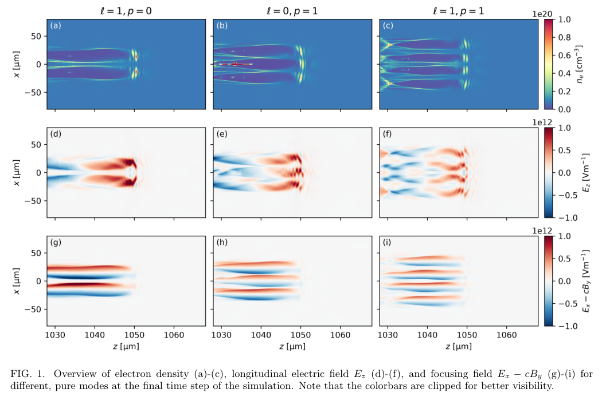
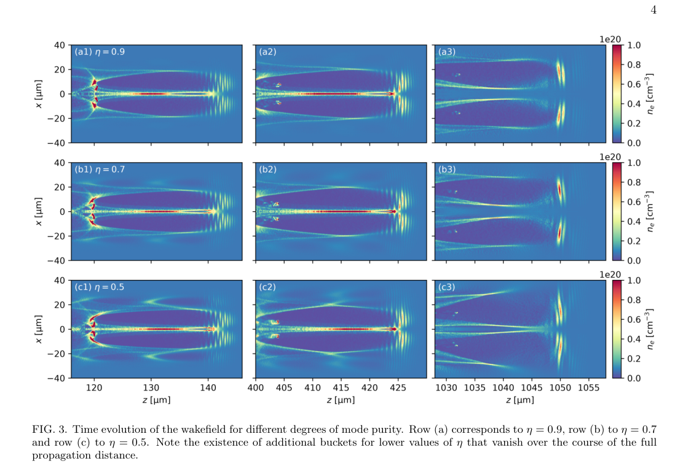
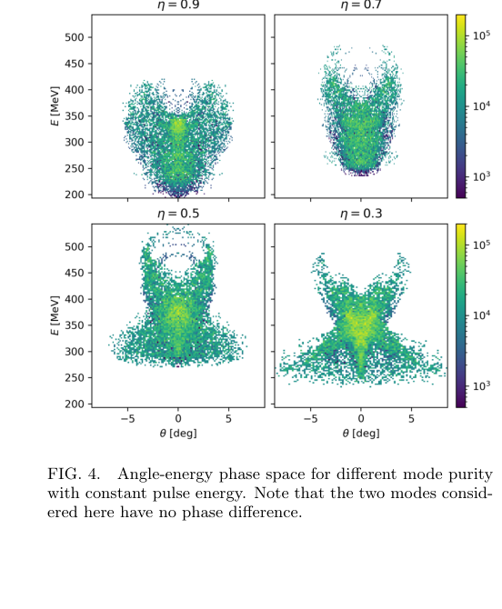

# LG 模式纯度与相位怎样改变正电子尾波加速

## 0. 论文信息与证据

- **题目**：Influence of Laguerre-Gaussian pulse mode purity on positron acceleration in nonlinear wakefields。
- **作者**：Lars Reichwein；**标识**：[arXiv:2611.06420v1](https://arxiv.org/abs/2611.06420v1)，[DOI](https://doi.org/10.48550/arXiv.2611.06420)。11-04 12:21:33 UTC 首投，11-05 公告；PDF 内题头日期为 11-05，两种日期不混用。
- **版本**：官方作者预印本 v1，6 页。arXiv 期刊字段空；精确标题 Crossref 前三项没有核实同作品期刊版本。相关 2014 donut wakefield 论文是前作，不是本作正式版。
- **全文**：[PDF](../pdfs/reichwein-2026-lg-mode-purity-positrons.pdf)、[布局文本](../pdfs/reichwein-2026-lg-mode-purity-positrons.txt)。文件头、类型、哈希、三路页数、逐页文本见 [PDF 核验](../pdf_validation.json)。MinerU 一次实际请求返回 401/A0211（令牌过期），因此本地提取、原页与原图交叉阅读；未运行 FBPIC。
- **证据类型**：准柱对称 PIC 加上线性真空模式分析；没有正电子加速实验，也没有现场测得的模式纯度容差。

## 1. 摘要与引言：纯度之外还有相干相位

普通电子吹出泡在轴附近通常对正电子散焦；带环形强度的 LG 驱动可形成轴上电子细丝，从而同时聚焦和加速正电子。本文沿用这个机制，改变方位／径向模式阶数，以及两个模式的相干叠加。

作者的核心发现是：在其固定能量、固定等离子体与注入设置下，某些混模比纯模产生更高的最大正电子能量，但这个结果对相对相位敏感。传播中额外泡结构消退不等价于激光已经被测量为纯模，也不证明一般扰动会被自净化。

## 2. PIC 设置及纯模式比较（原文 II、II.A）

FBPIC 使用谱准柱坐标网格；论文给模拟域 40 μm × 80 μm、1000 × 250 网格及三个方位模。背景电子密度固定为 7.7×10¹⁸ cm⁻³，驱动线偏振，基准归一化矢势 10，腰斑 12 μm，脉宽 10 fs；比较模式时保持脉冲总能量。不同混模局部峰值并不因此相同。

正电子束预先放在激光后方 7.5 μm，初始 Lorentz 因子 200，初始横向动量为零，束长 3.84 μm、横宽 5.76 μm。这里检验的是理想外置束的加速，并未模拟转换靶产额、捕获和输运整条链。正文未给完整束密度／电荷、宏粒子数、时间步和分辨率收敛，不能据此评估束载容限。

**原图 1，PDF p2**：横轴传播坐标 z、纵轴 x，单位 μm；三列分别是 (1,0)、(0,1)、(1,1)。第一行电子密度为 cm⁻³，其后两行是纵场及横向聚焦场，单位 V/m。色条有意截断，饱和颜色不能读成实际最大场。两个方位阶数为 1 的模式保留轴上加速／聚焦区；(0,1) 轴上成为普通泡内部，正电子最终全部失去。

**原图 2，PDF p3** 的横轴为 θ（度）、纵轴 E（MeV），色条未给可用于束电荷归一化的单位。两种保留正电子的纯模最大能量均超过 350 MeV；(1,0) 高能尾在约 ±5°，主群约 275 MeV、靠近轴向；(1,1) 高能部分角散更小。并非所有粒子都成为同一个高品质束团。

正文给 (1,0) 两平面发射度 5.1×10⁻⁵／2.9×10⁻⁵ m·rad，(1,1) 为 1.6×10⁻⁵／1.9×10⁻⁵ m·rad；此处没有明确给出几何／归一化及统计定义，不自行替作者补定义。它们也不是能谱峰对应的切片发射度证明。模式自聚焦阈值和通道优化留待后续研究。

## 3. 固定总能量的混模扫描（原文 II.B）

作者把 (1,0) 和 (1,1) 的幅度分别按模式功率份额的平方根加权，扫描 η=0.9、0.7、0.5、0.3，主图使用初始相对相位零。η 是这两个指定正交模式间的权重，不是实验任意模式分解的通用“纯度”。

**原图 3，PDF p4**：行对应 η=0.9／0.7／0.5，列对应不同传播位置；横轴 z（μm）、纵轴 x（μm），色条电子密度（cm⁻³）。低 η 初期出现额外泡瓣，传播至约 1 mm 后外部结构减弱。各列 z 窗口不同，不能把这些图当固定空间处的时间分辨测量。作者没有给激光 LG 投影谱随时间的定量自净化率。

**原图 4，PDF p4**：横轴 θ（度）、纵轴 E（MeV）；初始同相时 η≈0.5 的最大能量约 500 MeV，η再降则回落，故不是单调“纯度越差越好”。分布同时存在明显低能、宽角部分。500 MeV 是最大输出能量，不是能量增益、均能、窄带峰或实验数值。

作者另述 η=0.5、相位差 π/2 时最大能量约 250 MeV，但没有画出该组相空间。这里只能引用正文报告；不能从一组额外计算推断完整相位容差、统计误差或全局最优。

## 4. 线性解析模型及关键公式（原文 III）

将共同纵向包络提出后，原式(4)的横向复振幅为

$$
a_r=e^{i\theta}\left[\sqrt{\eta}\,u_{10}(r)+\sqrt{1-\eta}\,e^{i\phi}u_{11}(r)\right],
\quad u_{10}=\sqrt r\,e^{-r/2},\quad u_{11}=\sqrt{r/2}(2-r)e^{-r/2}.
$$

这里 θ 是模式方位角，**不同于原图能角分布中的粒子偏转角**；φ 为模式相对相位。原文此处 r 是模式函数的无量纲径向变量，图5用 a.u.，不能把它直接当图1的 μm 横坐标。

实模式函数的复振幅模平方有两项自强度和一项干涉项。将上述两函数代入，得到原式(6)：

$$
|a_r|^2=re^{-r}\left[\eta+\frac{1-\eta}{2}(2-r)^2+
\sqrt{2\eta(1-\eta)}(2-r)\cos\phi\right].
$$

推导中交叉项系数来自 2√η√(1−η)u₁₀u₁₁，因 u₁₁ 含 1/√2 而化为上式。相同总模式功率仍能因相干交叉项而改变局部强度和峰的位置；这就是不能只用一个 η 描述真实驱动的原因。这里是式间静态展开，未运行作者程序。

不同模式获得的 Gouy 相位为

$$
\psi_{\ell p}=(2p+|\ell|+1)\arctan\frac{z-z_f}{z_R},
\qquad \Delta\psi=2\arctan\frac{z-z_f}{z_R}\quad[(1,1)-(1,0)].
$$

z_f 为焦点、z_R 为 Rayleigh 长度，二者单位与 z 相同。相减后得到系数差 2，说明起始同相不能保证全程同相。**原图 5，PDF p5** 横轴无量纲 r、纵轴相位 φ；中间 η=0.5 的强度峰随相位向外移动再返回，两纯模不随相位改变。色条截断；这是真空线性模型，不是密度 7.7×10¹⁸ cm⁻³、矢势 10 下非线性传播的定量解。

## 5. 结论与下一步（原文 IV）

本文提供了“模式功率份额＋相干相位＋传播演化”共同决定正电子尾波的数值例子。它没有证明某个混模可稳定产生高亮度、窄能散、可输运的实验正电子源。

后续需独立相位扫描、真实多模分解与密度误差、更多方位模／粒子数／网格收敛、非零初始发射度和束载、输出电荷／捕获率及完整六维相空间；线性 Gouy 图只能指导问题，不能代替非线性模型。这些是本笔记提出的验证任务，均尚未执行。

**复习用速记**：在特定固定能量 PIC 扫描中，η≈0.5 同相混模最大输出约 500 MeV，改相位可降至约 250 MeV；不能把最大能量提升等同于稳定高品质束流。
