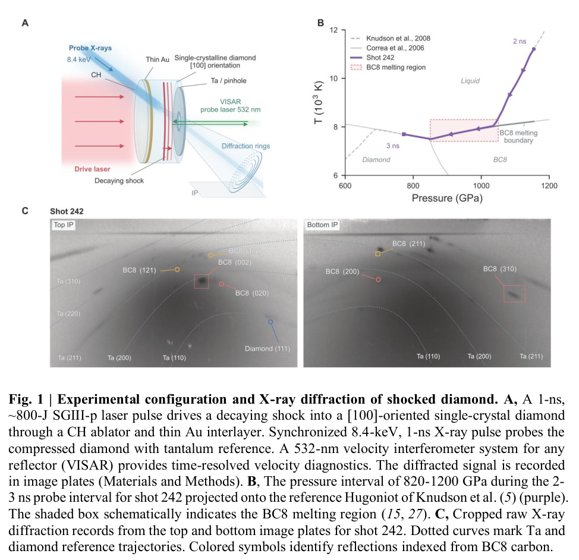
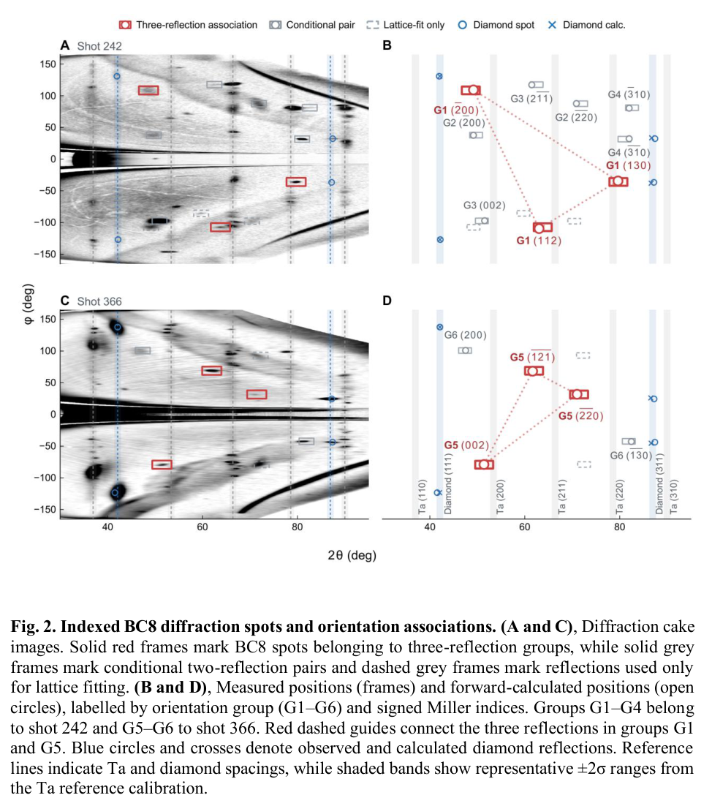
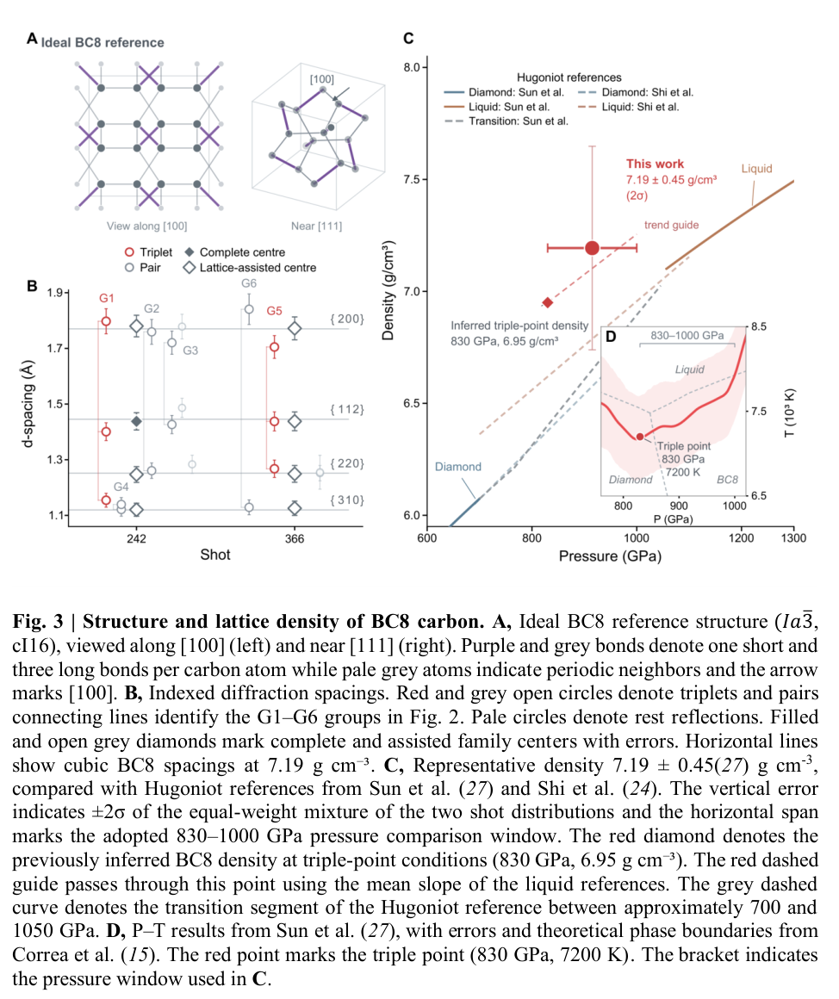

# 近 TPa 碳的单晶衍射：BC8 指认的直接信息与条件

## 0. 论文信息与阅读范围

- **题目**：Single-crystal X-ray diffraction of BC8 carbon near terapascal pressures；Liang Sun、Bo Chen 等。
- **标识**：[arXiv:2611.06045v2](https://arxiv.org/abs/2611.06045v2)，[DOI](https://doi.org/10.48550/arXiv.2611.06045)。首投 11-04 06:48:37 UTC，v2 更新 11-05 05:38:31 UTC；按 v2 全文阅读。
- **版本**：12 页公开作者预印本，页眉仍为 Submitted Manuscript。无期刊参考字段；精确标题 Crossref 返回的 *Diamond melting and thermodynamic evidence…* 是本文参考文献27的前作，不是本作 VOR，不能替换 DOI。
- **全文**：[PDF](../pdfs/sun-2026-bc8-carbon-diffraction.pdf)、[布局文本](../pdfs/sun-2026-bc8-carbon-diffraction.txt)，[PDF 核验](../pdf_validation.json)。主文、参考文献、致谢与三幅主图均已读；本地文本与原页核对，未重新做晶体索引或实验。
- **补充材料缺口**：p9列出 Materials and Methods、Figs S1–S6、Tables S1–S5，但这份12页PDF中没有这些内容。官方 `/src/2611.06045v2` 实际也返回同一PDF（字节相同），本轮没有获得独立补充文件。因此不能宣称已审计完整标定／拟合／候选结构排除链。

## 1. 摘要与背景：为什么不只看峰位

作者主张首次以晶体学信息直接指认由液态碳形成的 BC8。这里“直接”是探测到衍射斑点并作结构索引，相对于前作的热力学拐点推断；它仍依赖探测器几何、晶格模型、指标指派和取向拟合。

引言依次说明金刚石高压亚稳性、仅增压不一定跨过动力学势垒，以及先进入高温液相再沿衰减冲击路径结晶的思路。前作提出约 830 GPa、7200 K 三相点及可能的 BC8 熔化段。本作增加的是原位取向分辨衍射，不能把前作热力学数据与本作结构数据当成同一个独立重复测量。

## 2. 实验和时空积分（原文 Results 前三段）

SG-IIIp 用 351 nm、1 ns 驱动激光，经 CH 烧蚀层和薄 Au 层驱动 [100] 单晶金刚石中的衰减冲击；图注给约800 J。同步 8.4 keV Cu He-α、1 ns X射线照射，IP记录衍射，Ta用作参考，532 nm VISAR约束速度历史。

**原图1，PDF p10**：A是几何示意，C是242发上下IP的原始衍射局部图，没有绝对强度标定色条；彩色符号是后续索引，不是探测器自动识别的BC8标签。B横轴压力（GPa）、纵轴温度（10³ K），紫色路径以VISAR压力历史映射到参考Hugoniot；2–3 ns曝光期间覆盖约820–1200 GPa（正文概述为约0.8–1.2 TPa），阴影是示意熔化区。

曝光覆盖不同位置与时刻，不能把所有斑点都分配到同一个精确压力／温度。366发采用类似设置、压力范围重叠。两次记录是独立发次，但仪器标定、结构假设及参考EOS仍有共同系统项。

## 3. 取向约束与有条件的反射分组（Results 中段）

作者将IP映射到散射角2θ和方位角φ，先用BC8指标拟合逐发的正交晶格度量：242发12个反射，366发7个反射。再检验子集能否共享一个晶体取向，同时比较2θ与φ。只有径向d间距相符不足以完成此检验。

**原图2，PDF p11**：A/C为两发衍射展开图，B/D为实测方框与前向预测空心圆；横轴2θ（度）、纵轴φ（度）。红框是三反射组，灰实框是条件性两反射组，灰虚框仅用于晶格拟合；蓝标记是金刚石，色带来自Ta标定的不确定度。不能把六个G组都称为同等确定的独立单晶。

242发三反射候选组的角RMS为1.64°，作者明确保留为候选；其余配对更弱。366发三反射组RMS为0.48°，是较强的取向支持。固定已拟合晶格后，以两个反射预测第三个的留一检验落在名义2°范围内。**晶格度量仍使用全组数据拟合，这不是完全冻结、全流程盲测**；误指派概率与替代结构比较要依赖缺失的补充方法和原始数据进一步复核。

为理解约束，可从布拉格关系写起：

$$
2d_{hkl}\sin\theta=\lambda,\qquad
\frac{1}{d_{hkl}^{2}}=\frac{h^{2}}{a^{2}}+\frac{k^{2}}{b^{2}}+\frac{l^{2}}{c^{2}}.
$$

h、k、l为整数指标，a、b、c为正交晶格边长，与d、波长λ取相同长度单位。第一式由相邻晶面路径差等于一个波长得到；第二式是正交倒易矢量长度平方相加。散射角只限制倒易矢量长度，加入φ和共同旋转矩阵才进一步限制方向。本式是用于解释索引原理的标准几何推导，非作者原始拟合程序复现。

## 4. 晶格密度与压力比较窗口（Results 后段）

理想立方BC8的等价晶面有相同d间距，本文允许正交畸变以描述分裂；观察到的{200}、{112}、{220}、{310}族中心与立方BC8参考接近。一部分族中心依赖晶格辅助补足缺失成员，因此不能全部视为独立实测峰心。

**原图3，PDF p12**：A为结构模型；B横轴发次／组号、纵轴d间距（Å），实／空菱形分别区分完整和晶格辅助族中心。C横轴压力（GPa）、纵轴密度（g/cm³），红点7.19±0.45来自两发分布等权混合；竖误差是±2σ。横跨度830–1000 GPa是采用的结晶比较窗口，**不是同一位置直接测压误差条**。D的P–T与三相点来自前作及理论相界；本作没有新测一条完整熔化曲线。

假设BC8常规晶胞16个碳原子，密度由拟合体积反演：

$$
\rho=\frac{16m_{\mathrm C}}{abc}
=\frac{16M_{\mathrm C}}{N_Aabc}.
$$

M_C为碳摩尔质量，N_A为Avogadro常数，a、b、c若用cm则ρ为g/cm³。推导就是晶胞质量除以体积，原子数16是结构模型输入，不是从IP独立数出的原子数。242／366发分别为7.19±0.45、7.20±0.46 g/cm³（±2σ）。这些相近数值增强同一模型下的内部一致性，不能替代结构指认、共同标定误差与畸变模型检验。

作者以液体参考曲线、830 GPa处既有密度6.95 g/cm³及一条趋势线作比较，915 GPa处约7.10落入误差范围；这是相容性论证，不是第二种独立密度测量。正文将一处热力学来源指向ref25，而上下文前作主要为ref27，文献指向需最终版本澄清。

若假定熔化熵为正，Clapeyron关系为

$$
\frac{dT_m}{dP}=\frac{\Delta v}{\Delta s},\quad
\Delta v=v_{\rm liquid}-v_{\rm solid}.
$$

密度更高的固体意味着比容更小，故Δv>0时给正斜率。但密度排序、结晶窗口及Δs符号均是这段解释的条件，不应说论文已独立测出熔化斜率。

## 5. Discussion、可复现缺口与用途

作者把取向组、理想金刚石禁戒反射及两发晶格密度一致性合起来指认BC8，并把畸变来源留给时空分辨更高的测量。本笔记保留为**预印本作者报告的实验结构指认及其条件**，不把“首次／解决争议”的优先权主张当成已完成独立复核。

p9数据声明称可向研究者提供数据／代码，但未给可下载仓库或固定版本。本轮没有原始整幅IP、标定协方差、完整反射表、所有候选结构残差或拟合程序，且公开PDF缺补充方法。因此没有重新索引、误差传播、结构竞争检验或EOS模拟。

对HEDP／ICF的价值是提供动态加载路径和结构诊断案例；尚未测得卸压回收BC8、常压超硬／半导体性能、ICF烧蚀层性能、束靶核反应或辐射防护指标。

**后续重点**：补充材料及原始数据；在冻结晶格／标定和候选结构集后做反射留出验证；时空分辨衍射与压力联合重建；卸载相保存。**速记**：366发三斑点共同取向的0.48°RMS比单纯峰位更有约束，但7.19±0.45是模型辅助晶格密度，830–1000 GPa是比较窗口，完整方法仍待补齐。
