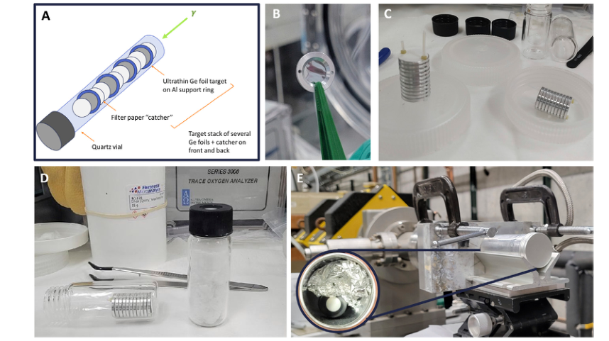
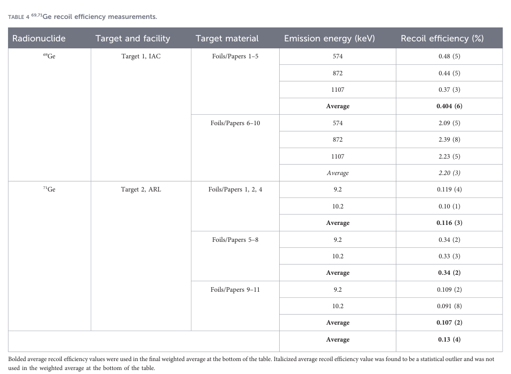
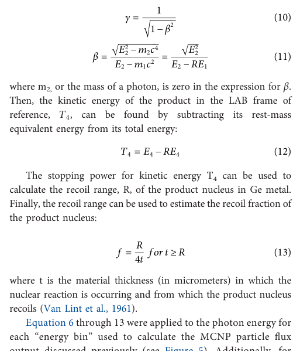

# Ge-71光核反冲分离：实验计数与待澄清的运动学模型

## 0. 文献信息与证据

- **原题**：Nuclear recoil separation in the photonuclear production of auger electron emitter Germanium-71 for high specific activity medical isotope production。
- **作者**：E. Paige Abel、Mason Jaussi、Nick Erfurth；**正式论文**：[10.3389/fnuen.2026.1940142](https://doi.org/10.3389/fnuen.2026.1940142)，Frontiers in Nuclear Engineering 5:1940142；9-30接受、11-09发表。
- **全文**：[17页出版社排版PDF](../pdfs/abel-2026-ge71-recoil.pdf)、[文本](../pdfs/abel-2026-ge71-recoil.txt)、[验证](../pdf_validation.json)。PDF首页的发表日、DOI、作者及版式与Crossref一致；web工具的网页快照仍显示“最终版待发表”，该旧页面不替代当前实际取得的正式PDF证据。
- **类型**：RF电子直线加速器→钨韧致辐射→天然Ge光核反应→捕集纸活度测量；MCNP／SRIM／解析反冲模型另列。没有激光驱动实验、实际药物标记或治疗验证。本轮未运行这些模型或拟合。

## 1. 为什么做反冲分离

72Ge(γ,n)71Ge的产品和靶同属Ge，普通化学分离难以排除稳定Ge载体。利用反冲将产品从薄靶弹出、捕获在另一材料上，可望提高比活度；“捕获到少量产品”与“已获得医用比活度／纯度”是两个阶段。

**原图4，p5**：A示意Ge薄箔／双面捕集纸交替堆叠，B–E为装配及辐照实物，无定量坐标。名义8 μm天然Ge薄箔以10 mm孔径Al环支撑；两靶分别10和11片，纸厚210 μm，每组辐照10 h、钨辐射体厚2.286 cm。正文写20 MeV S-band、60 mA（模型式5定义为脉冲峰值电流），**图4E图注写25 MeV**；未见足够脉宽／频率实数支持将60 mA当平均电流，绝对光子率复现仍需机器日志。

## 2. 怎样从计数估计71Ge（pp6–13）

68/69/71Ge的约9.2、10.3 keV特征X射线重叠，不能仅据单个峰指认核素。作者用HPGe测69Ge γ线作为替代监视，并用BEGe在约四个月多时点加六个月后测量，拟合固定半衰期的三指数；后期再以单指数检验71Ge衰变。68Ge未检出只表明低于该测量MDA，不能宣称严格无污染。71Ge需要等待2–3周抑制69Ge，这也损失半衰期约11.43 d的目标活度。

反冲效率式(3)为捕集纸EOI回推峰计数率／（纸＋箔总峰计数率）×100%。它是计数推断比例，并非每入射电子的产额、绝对活度或药物比活度；不同材料的低能自吸收、几何和回收损失仍需独立响应核查。

**原表4，p14**：最右列为百分数。69Ge两组为0.404(6)%和2.20(3)%；后三组直接71Ge为0.116(3)%、0.34(2)%、0.107(2)%。作者用离群检验去掉2.20%，其余四组加权并扩大不确定度得到**0.13(4)%**。该合并包含69Ge替代测量，不是四组独立71Ge重复。原文把检验统计量和临界值均称“critical value”，此处仅记录其剔除决策，未重做统计。

所有21片箔均有破裂，纸脆化，碎Ge粘到纸上可能抬高表观反冲；纸丢失可能降低读数。厚度不均和活动度差异也未充分量化。因此有实验分离迹象，但重复性和纯产品回收仍未闭环。

## 3. 模型0.23%的证据与公式审计（pp8–9、14）

MCNP6的f4光子通量、TENDL截面、SRIM射程及解析运动学给出0.23%。作者认为与实验在两倍内；这不是已达到测量不确定度内一致，也不是本轮复算结果。

**原式10–13，p9**无图轴，R、t均为长度，f为无量纲逃逸比例。按靶核静止、光子能量E、c=1，四动量守恒应有

$$s=M^2+2ME,\qquad E_{\rm CM}=\sqrt{s},\qquad\beta_{\rm CM}=\frac{E}{M+E}.$$

这是本笔记的**静态物理核对**。原文p8将E_CM叙述为靶静质量能加光子能（该和属于实验室总能量），式(6)的c因子写法亦需明确单位；p9式(11)分母印为E−Mc²，与上述定义不符。不能据此断言作者实际程序使用了错误式子，但在取得实现前不可直接采用印刷式复现0.23%。

另有两项口径待核：式(13)R/(4t)在均匀厚平板、各向同性固定射程模型下对应**单面**逃逸；实验是双面捕集，双面理想比例为R/(2t)，需确认作者后处理中是否加倍。正文称在0–π/2等角取平均且假设各向同性；球面各向同性通常需sinθ权重并覆盖完整方向域，应索取角度定义／权重。这些疑点不是对实验效率的任意“修正”。

式(14)还需确认f4输出是每能箱积分还是微分谱，以决定是否再乘ΔE。按本次阅读，无法关闭该归一化问题。

## 4. 意义与下一步

最有价值的是把薄靶、捕集材料损伤和可分离比例放进同一实验链。目标反冲射程≤88 nm，8 μm箔仍远厚于射程；纳米材料是建议，尚非验证方案。优先获取照射日志、实际厚度、捕集纸空白／碎片污染和低能效率修正、原始拟合及模型代码；再讨论纳米靶热工、可回收性、绝对活度和比活度。本文不能直接外推为激光光核医用核素端到端成功。
