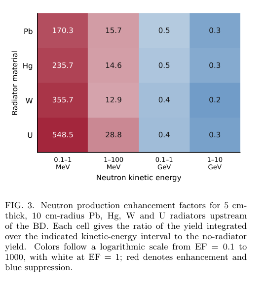
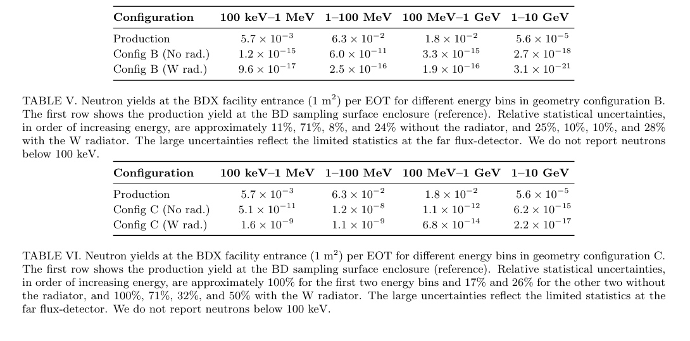

# Jefferson Lab次级中子：产生增益为何不等于样品处增益

## 0. 来源、版本与证据

- **原题**：Secondary neutron beam production at Jefferson Lab；A. Fulci等13人，报告号JLAB-PHY-26-5020。
- [arXiv:2611.09525v1](https://arxiv.org/abs/2611.09525v1)，11-06 14:37:35 UTC首投、11-09公告；作者预印本，期刊参考字段仅列报告号，精确标题Crossref前三项未核实同作品期刊版。此前BDX设施综述是相关前作，不是本篇正式版。
- [12页PDF](../pdfs/fulci-2026-secondary-neutron-beam.pdf)、[全文文本](../pdfs/fulci-2026-secondary-neutron-beam.txt)、[验证](../pdf_validation.json)。本轮本地文本／原图阅读，未运行FLUKA或作者分析代码。
- **证据类型**：FLUKA4-5.2输运设计研究；几何对照工程图并不等于中子谱／剂量的实验验证。束源是RF加速器11 GeV单能、零发射度铅笔电子束，没有激光束实际耦合。

## 1. 三层比较与数值设置（pp2–3）

A为现有铝水束流收集器、混凝土和土层／BDX-MINI井；B增加拟议BDX设施；C再加直径50.8 cm水平空气提取管。高Z辐射体另置于收集器前，分别改变源项和输运。

PRECISIO＋PHOTONUC／ELECTNUC，<20 MeV用JEFF-3.3点截面；普通与高能运行族分别使用10 MeV和0.1 GeV电磁阈值，高能族中子截断约400 MeV。光核偏置、leading-particle及重要性分裂均需保留统计权重；不能把偏置次数当真实源强。产生端约10⁷ EOT、高能无辐射体10⁸ EOT，传播约10⁸–10⁹ EOT，各族不是相同计分能区。

## 2. 4π源项的材料／能区权衡（pp4–6）

**原图3，p4**：横轴四个中子能区，纵轴5 cm厚、10 cm半径Pb/Hg/W/U；数字为相对无辐射体的分能区产生率比，无单位，颜色用对数尺度。W在0.1–1 MeV达355.7，1–100 MeV为12.9，但0.1–1 GeV仅0.4、1–10 GeV仅约0.2。高Z主要增加低能产生，同时削弱高能份额，不能用一个“增强倍数”代表所有应用。

总外穿4π计分面产额从约0.11 n/EOT增至W3.3、U5.6 n/EOT。这里是围绕收集器的加权穿越计分，不是远处样品通量；重复穿越选择和角度接受度应跟随作者分析约定。图7的θ_ellipse标签指穿越位置，不能直接替换成动量极角；7000箭头只是抽样记录示意，定量密度使用全体权重。

## 3. 传播到设施入口（pp9–11）

**原表V、VI，p10**：列为四个能区、单位n/EOT，B／C均在轴心1 m²入口面计分；“Production”一行却为全4π面，接受度不同。C低两能区相对统计误差约71%–100%，这些是名义趋势，平滑曲线不能当拟合或高精度增强证明。

以65 μA、I/e≈4.06×10¹⁴ EOT/s归一化，C无W全谱约4.9×10⁶ n/s，带W约2.5×10⁶ n/s；无W的1–10 GeV分量约2.5 n/s，均为**1 m²上的总率**，不是n/cm²/s。W使C的0.1–1 MeV名义率升高，但全谱及更高能区率下降。B带W的全谱总率上升则来自表格未列的<100 keV部分，不能直接相加四列重建该全谱值。

现有A的Well1在20×20 cm²接受面上只有约4.5×10⁻⁶ n/s；无提取管很难直接利用。零计数的土层上方高能箱不是严格零通量上限。全谱约0.1 eV–10 GeV、表格仅≥100 keV，两口径必须分开。

## 4. 对转换靶／防护工作的用法

应同时优化指定能区的源项、角谱与样品接受度；最大发电量材料并不必然提供最大有效照射率。该文给出完整的源到传播比较框架，但未给核库／模型系统误差闭环、热工结构或人员剂量的验收结果。作者提供FlukaROOTOutput、BDX-FLUKA-Analysis仓库线索，本轮未审计代码。后续优先做独立谱计分与权重核验、深穿透重复批次统计、实测基准和规定能区／接受面的统一比较。
