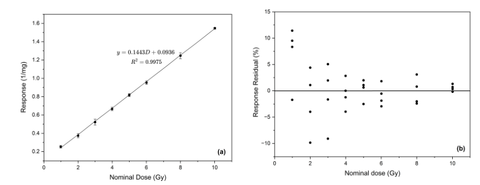
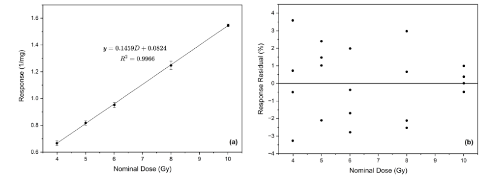
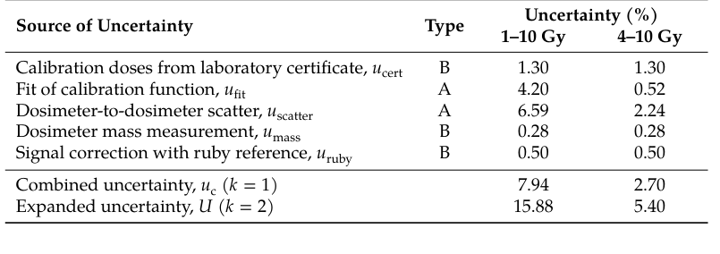

# 低剂量丙氨酸EPR：4–10 Gy标定成立，FLASH仍待验证

## 0. 文献与证据

- **原题**：Optimizationand Performance Assessment of a Low-Dose Alanine Electron Paramagnetic Resonance Dosimetry Procedure for Potential Application in Electron Beam FLASH Radiotherapy。原文题头“Optimizationand”连写，台账保留正式标题。
- **作者**：Babedi Sebinanyane、Urszula Gryczka、Chamunorwa Oscar Kureba、Gregory Campbell Hillhouse、Aneta Sterniczuk、Marta Walo。
- **正式版**：[10.3390/molecules31214029](https://doi.org/10.3390/molecules31214029)，Molecules 31:4029，11-04接受、11-09发表。[16页PDF](../pdfs/sebinanyane-2026-alanine-epr.pdf)、[文本](../pdfs/sebinanyane-2026-alanine-epr.txt)、[校验](../pdf_validation.json)。MDPI主入口403，实际全文来自官方mdpi-res.com CDN。
- **证据范围**：同批丙氨酸丸、60Co常规率0.0261–0.0323 Gy/s标定和重复读出；没有电子束／激光束／UHDR实验。全文、表格和原图已读，本轮未重做拟合或照射。

## 1. 操作参数与定义（pp3–9）

Magnettech MS5000 X-band、TE102腔；单丸平均37.70±0.21 mg。比较腔内位置、叠丸数、微波功率、调制幅度和读出时间。最终选两丸、控制螺杆长度9 mm、1.8 mW、0.4 mT、2 mT扫宽、120 s×10次即20 min。9 mm是螺杆读数，不是通用腔中心坐标。

四丸虽产生更高信号，但增益不再随质量成比例；两丸取的是灵敏区和质量响应的操作折中。1 Gy能看清中央峰只证明信号可分辨，不能据此声称1 Gy定量准确。响应先用ruby参考修正，再除总质量，单位mg⁻¹；本机参数不可未经验证迁移到另一EPR系统。

## 2. 为什么截掉1–3 Gy（pp10–12）

**原图7，p11**：左图横轴名义剂量Gy、纵轴质量归一化响应1/mg；点为均值、误差为个体响应标准差。右图是每次响应相对拟合预测值的百分残差，不是剂量相对误差。1–10 Gy线性拟合R²=0.9975仍在低端有约10%及更大的残差，不能以高R²替代低剂量准确度。

**原图8，p11**：相同坐标与归一化，4、5、6、8、10 Gy各四个独立剂量计，y=0.1459D+0.0824，R²=0.9966，响应残差在±4%内。截距不能忽略，适用下限4 Gy来自本系统表现，而非丙氨酸材料的普遍阈值。

## 3. 不确定度、独立验证与重复性（pp12–14）

**原表1，p12**：各分量单位%，按k=1平方和合成；4–10 Gy中批内散布2.24%为最大项，合成2.70%，扩展**5.40%（k=2）**。1–10 Gy相应为7.94%和15.88%。扩展不确定度不是单个验证点偏差，也不等于短时重复性。

4.5、7、9 Gy另作独立照射，每点四组，剂量反演D=(r−c)/m；最大绝对偏差4.44%。9 Gy四组均略低，落在该扩展预算内，不等于证明没有系统偏差。7 Gy同一丸组拔插后重复读十次的RSD为0.77%，仅说明同条件短时精密度，不能替换5.40%的总不确定度。每次20 min读出使其更接近离线独立参考，而非实时逐脉冲剂量监测。

## 4. 对VHEE／FLASH的意义与下一步

该文提供低剂量参考读出的可操作基线，正式结论仍限定于60Co。文中引用的约5%临床剂量基准仅作比较，不构成本系统通过临床验收；5.40%还略高于该参考数。用于VHEE前需要辐射质转换、UHDR／每脉冲剂量依赖、能谱与温湿度／批次迁移和独立参考交叉验证；本文没有新的FLASH生物效应证据。
