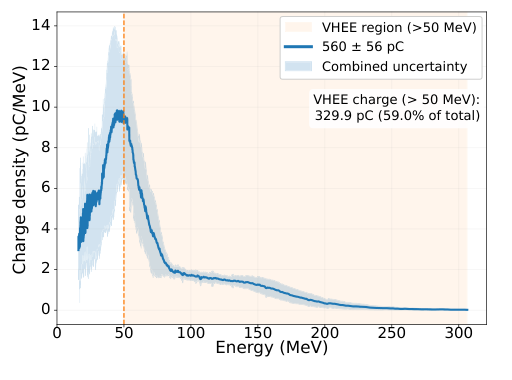
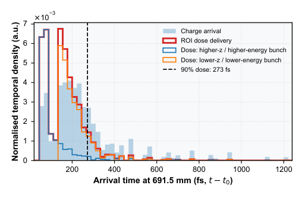

# 高电荷激光VHEE束：实测稳定性与模型剂量时间分开

## 0. 文献信息与阅读证据

- **原题**：Stable, High-Charge, Laser-Driven VHEE Beams for Preclinical Applications。
- **作者**：Chaitanya Varma、Camilla Giaccaglia、Julien Gautier、Jean-Philippe Goddet、Amar Tafzi、Pascal Rousseau、Alessandro Flacco。
- **来源**：[arXiv:2611.09329v1](https://arxiv.org/abs/2611.09329v1)，2026-11-06 11:23:46 UTC首投、11-09公告；作者预印本。期刊字段空，精确标题Crossref前三项未核实同作品期刊版，不能据此证明尚未发表。
- **全文**：[13页PDF，含S1–S3补充图](../pdfs/varma-2026-lpa-vhee-preclinical.pdf)、[布局文本](../pdfs/varma-2026-lpa-vhee-preclinical.txt)。[哈希／逐页验证](../pdf_validation.json)；本轮用本地文本和原页阅读，未使用MinerU，未复跑FBPIC或Geant4。
- **证据**：LPA束流／辐照测量＋解释性PIC＋剂量响应和到达时间模型。与11-08的VHEE空气屏诊断论文作者、装置和问题均不同。

## 1. 问题与实验条件

直接辐照浅层预临床靶时，窄能散不一定是首要目标；更需要指定ROI内的有效电荷、谱重现和空间覆盖。LOA Salle Jaune采用约2.4 J、80 TW、795 nm、29.6 fs激光，He中掺1%、2%、5%氮进行电离注入。出射束经1.5 mm铝窗；谱仪、Turbo-ICT和约800 mm处空气屏分别测谱、电荷和束斑。空气屏包含窗散射，不能当源端发射度测量。

## 2. 实测电荷、能谱与稳定性（PDF pp3–5）

**原图3，p4**：横轴能量MeV，纵轴电荷谱密度pC/MeV；橙底为>50 MeV区。30发平均谱在40–60 MeV附近有主峰、高能尾约到200 MeV。图例总电荷560±56 pC，>50 MeV积分329.9 pC、59%；正文报告最高559±56 pC，二者保留原有取整差。总电荷不能全部算作VHEE电荷，浅蓝“combined uncertainty”也不自动等于所有系统误差闭环。

固定设置序列的谱重现指标为

$$\mathrm{RMS\!-!CV}_W=\sqrt{\frac{\int_W\sigma_S(E)^2\,dE}{\int_W\bar S(E)^2\,dE}},\qquad W:E>50\ \mathrm{MeV}.$$

这是逐能箱方差的综合量，既响应谱形变化也响应幅度变化，不等于总电荷CV。作者采用<0.30作为本研究操作阈值；最稳单组<0.15、VHEE份额62%，不是通用束流标准。平均电荷>350 pC组CV约7%–10%；全活动指向抖动0.7–2.7 mrad，面积CV约9%–35%。最小指向抖动并不代表最小剂量面积变化，三个最优指标也不应拼成同一组工作点。

## 3. PIC机制及其限制（pp5–7、10–11）

准柱对称、Lorentz boost的FBPIC使用简化2/4/2 mm上坡／平台／下坡，代表例密度2×10¹⁸ cm⁻³、真空焦点6 mm、a₀=1.86。该例按与实测峰尾谱的**定性相似性**选取。自聚焦、电离注入及强束载使泡间鞘层重构；末态第二束主要贡献50–70 MeV峰，第一束贡献高能尾。

S2、S3保留的是末态分组标签：部分最终第二泡电子与第一组起初出生于相同共动区域并向后滑移。因此“最终第二泡”不等于“出生于第二泡”，粒子点密度也不是电荷密度。两群在实验中尚未单独分辨，机制是否降低输入抖动敏感度仍需扰动扫描；文中未提供完整数值收敛链。

## 4. 剂量、飞行时间和印刷差异（pp7–9）

**原图12，p8**：横轴为691.5 mm靶面相对最早到达时间fs，纵轴为归一化时间密度a.u.；电荷到达与ROI剂量加权分布不同。Geant4响应R(E)单位Gy/pC，结合测得谱及假设纵向分布形成权重wᵢ=QᵢR(Eᵢ)，再按弹道传播累积剂量。

实测每发剂量约0.400±0.020 Gy，报告10 mm ROI、40 mm深度的辐照用途。作者定义从最早到达到累积90%剂量的t₉₀，使用0.9D/t₉₀。**正文和图13用269 fs，图12虚线图例写273 fs**，未自行统一。正文给模型知情两群1.34±0.07×10¹² Gy/s；均匀30 μm源模型203 fs、1.77±0.09×10¹² Gy/s。误差不能解读为涵盖未知纵向分布、MC和输运系统误差；这些是脉冲尺度有效率，不是直接时间分辨测量、微观峰值或平均治疗剂量率。文中“每分钟数十Gy”另属平均率口径。

## 5. 对本库的价值与待办

新增激光束流到预临床靶面剂量的实验联系，但本文没有独立给出新的FLASH生物保护结论或临床验收。下一步应取得逐发谱、窗后束斑和绝对剂量联合数据，解释269/273 fs差异，验证真实纵向相空间及扰动PIC；不要把文中引用的既有生物学论文算成本作的新生物终点。
