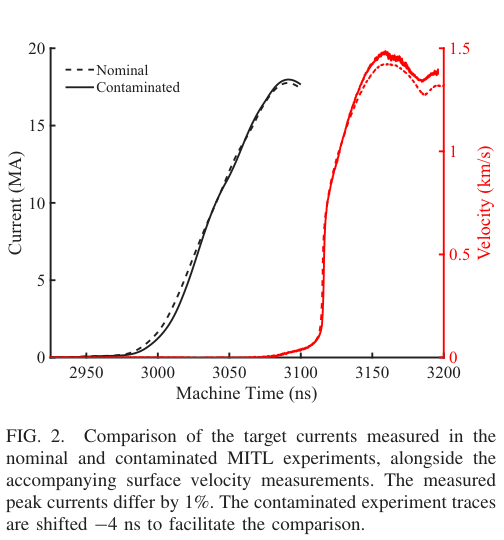
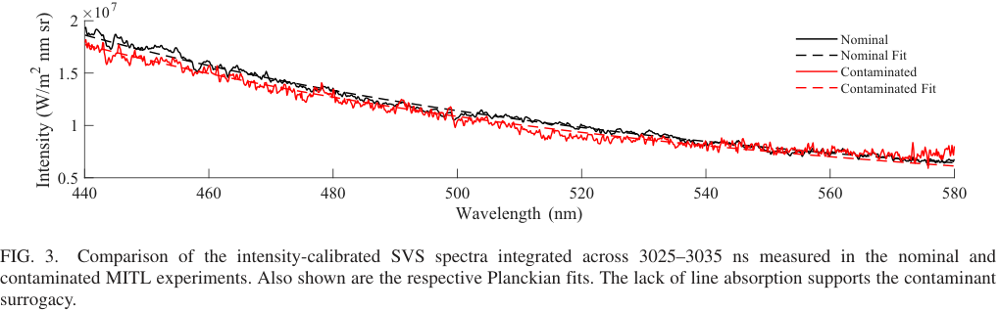

# 电极污染增加后，Z装置内MITL的电流为何几乎不变

## 0. 来源、版本与证据

- **原题**：Multi-MA Fusion Accelerator Performance Insensitivity to Electrode Contamination；Nathan P. Brown、David C. Fairchild、Christopher A. Jennings、Leah N. Appelhans、Jacob T. Banasek、Nichelle Bennett。
- **正式版**：[PRX Energy 5, 043006](https://doi.org/10.1103/hkpv-c3y7)，2026-10-08接收、11-10发表；出版社排版VOR，CC BY 4.0。日期与PDF首页、Crossref相符。
- [6页全文](../pdfs/fusion-electrode-contamination.pdf)、[布局文本](../pdfs/fusion-electrode-contamination.txt)、[文件验证](../pdf_validation.json)。本轮阅读正文及原图，未重跑CHICAGO、GORGON或PrismSPECT，未取得作者原始数据。
- **证据类型**：两次相邻Z装置放电的实验比较，辅以MHD反演和既有PIC解释；测量对象是高电感内磁绝缘传输线（MITL）的负载电流耦合。

## 1. 假说与可控污染（pp1–3）

经典图景是电极解吸→表面等离子体→间隙等离子体→跨隙漏电流。作者引用的CHICAGO研究却预测：增加表面中性库存主要增加被强磁场约束的表面等离子体，并不同比增加间隙密度，因此负载电流只小幅变化。本篇以人为增加污染测试这一预测，并非测量所有传输损失机制。

304L不锈钢经标准清洗、氢处理后，在阳极／阴极朝向间隙的表面、半径5.5 cm以内接枝辛基膦酸PO₃C₈H₁₉。XPS显示P以及增加的C/O，ToF-SIMS确认预期质荷比，支持接枝成功。一个分子原含31个原子，键合伴随净失去两分子水，故每个接枝分子净增25个原子；**不能把单分子接枝层直接理解为25个厚度均匀的原子层**。约⅓×10¹⁵ cm⁻²的覆盖率来自相关表面研究的估计。模拟的“1 ML”定义为10¹⁵ H₂O分子/cm²，名义8.3 ML还包含粗糙度假设；约30 ML的污染库存估算依赖相对粗糙度f=1，未经原位绝对面密度标定。

## 2. 电流近似相同，测量链是什么（pp2–4）

**原图2，p3**：横轴机器时间ns；黑色曲线用左轴电流MA，红色曲线用右轴表面速度km/s；虚线为名义表面、实线为污染表面。污染炮整体平移−4 ns，便于比较波形，不能据此判断原始定时完全相同。负载峰值17.8与18.0 MA，相差约1%；外MITL堆栈峰值约25 MA，与负载电流口径不同。

PDV/VISAR测三个相隔120°方位的Cu返回筒速度，再以外部B-dot波形作初值，用GORGON迭代展开负载电流。反演假设表面膨胀仅由磁压力驱动，并使用SESAME 3325 EOS和29235电导表。它是**模型辅助电流诊断**，不是在负载处直接读取电流。正文未给这1%差值的完整系统不确定度／多炮置信区间；两炮相近支持该几何下的弱敏感性，不能建立所有工况下的等价性。

## 3. 光谱支持替代污染物，但不直接测出间隙密度

**原图3，p4**：横轴波长440–580 nm，纵轴强度W/(m²·nm·sr)，3025–3035 ns积分；两工况均以连续谱为主，Planck拟合温度约10 eV。视线穿过低密度间隙并终止于高密度阴极表面，因此10 eV主要是表面辐射温度；不能当成模型中>100 eV间隙电子温度的实测。另查650–680 nm未见早期吸收线，结合PrismSPECT预测，支持接枝分子已解离、作为常见H/C/O污染的替代物合理；未独立测定漏电通道的密度／输运率。

## 4. 对HEDP靶设计的用法与限制

作者采用标准Be套筒几何，但**省略燃料、外磁场线圈和激光预热**，没有在本实验比较聚变中子产额。引言的I_max⁶标度和60 MA／100 MJ预测均是背景，不能写成本轮实测增益。结果仅约束这一高电感内MITL；PHC及其他区域可能更敏感，不能据此取消清洗。优先补多炮重复、反演误差传播、库存绝对标定及真实带燃料／预热条件。论文声明数据与软件未公开，需向作者索取；本轮没有完成独立代码或实验复现。
