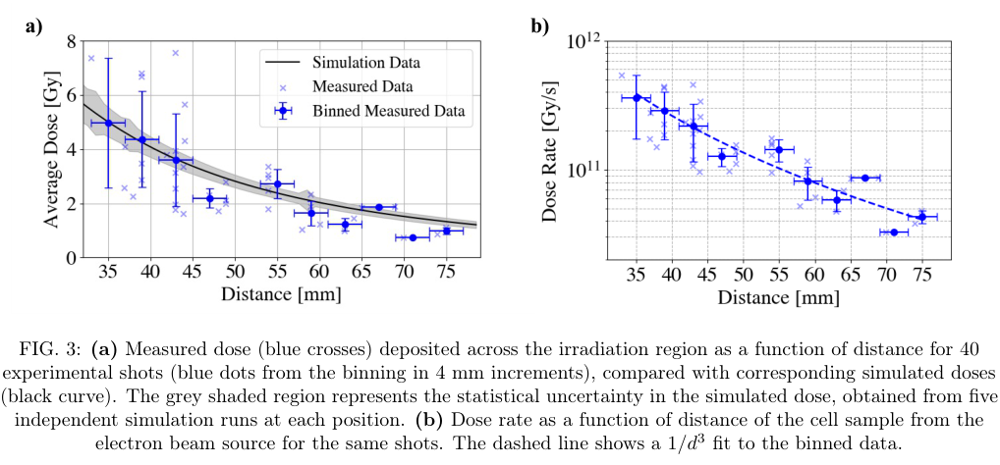
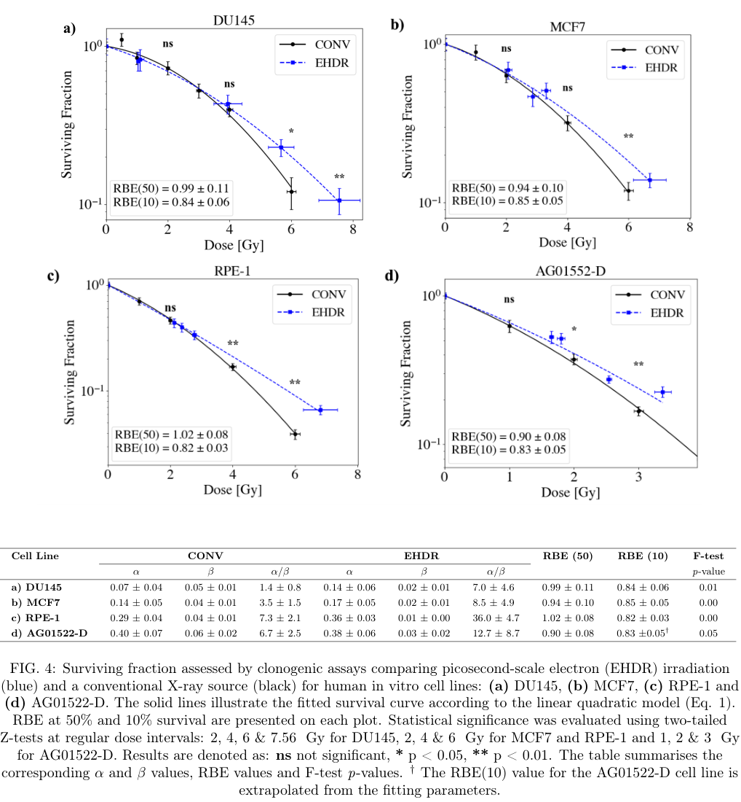

# 单脉冲皮秒电子辐照：细胞保护趋势与剂量、时间和对照边界

## 0. 来源、版本与阅读范围

- **原题**：Experimental Evidence of Cellular Sparing under Single-Pulse Picosecond Irradiation at Extreme Dose Rates；H. Maguire、C. A. McAnespie、P. Chaudhary等，Queen’s University Belfast／NPL。
- [arXiv:2611.12812v1](https://arxiv.org/abs/2611.12812v1)，2026-11-09 18:17:20 UTC首投、11-10公告；作者预印本。官方页面无期刊版字段，精确标题Crossref前三项未核实同作品正式版，不能由此证明没有正式版。
- [14页PDF](../pdfs/maguire-2026-picosecond-cell-sparing.pdf)、[全文文本](../pdfs/maguire-2026-picosecond-cell-sparing.txt)、[验证](../pdf_validation.json)。阅读正文与主要图表；未运行TOPAS、MCMC或生物实验。
- **重要缺口**：文中多次引用S1–S5，参考文献[44]仍为“Supplementary material available at...”占位。官方arXiv源码包仅有主文TeX、参考文献及Fig1–6，无S1–S5；本轮未取得这些补充材料，相关细节只按作者正文报告，未独立复核。

## 1. 激光—固体电子源与真正到达细胞的脉冲（pp3–6）

TARANIS提供10.6±0.5 J、0.8±0.1 ps、1.053 μm激光，经F/3聚焦到20 μm Au，入射30°，峰值强度约2.1×10¹⁹ W/cm²。电子能谱为双温Maxwell型：0.52±0.05和1.7±0.1 MeV，典型总电子数约5.5×10¹¹，散角约36°–37°。这属于激光—固体多MeV电子源，**不是窄能散VHEE尾场束**。

细胞放在空气密封子腔，前有1 mm Al窗、窗后18 mm处为细胞及背后EBT3膜。源到窗15–57 mm，对应源到细胞33–75 mm。源处约1 ps宽度来自激光时长的经验估计；宽谱飞行时间色散使细胞面1/e²时宽约12.5–23 ps。剂量率3×10¹⁰–5×10¹¹ Gy/s因此结合逐发膜剂量与输运／时宽估计，未由直接皮秒时间诊断测出。

**原图3，p6**：横轴源到细胞距离mm；(a)纵轴平均剂量Gy，淡蓝叉为40炮、蓝点按4 mm分箱，黑线为TOPAS，灰带为每位置5次模拟的统计变化；(b)纵轴Gy/s、对数尺度，虚线约1/d³。剂量约1/d²，加上传播时宽增长形成约1/d³剂量率趋势；同一扫距同时改变剂量与时宽，不能当成独立剂量率扫描。

原图2的14／66 mm剂量表征不是两组细胞照射距离；细胞最近只能33 mm，实际最高剂量7.56±0.67 Gy。14 mm处8.79±0.88 Gy和66 mm处1.58±0.08 Gy的不确定度是照射区横向变化，不能混作完整绝对剂量误差。TOPAS给出的细胞层纵向CoV约0.48%／0.30%，属于模拟均匀性。Al窗阻挡伴随质子、X射线贡献<1%的判断也由范围估计及模拟支持。

## 2. 存活结果：保护同时出现在正常与肿瘤细胞（pp7–8）

**原图4，p8**：横轴剂量Gy，纵轴克隆存活分数、对数尺度；黑色为160 kVp、2.4 Gy/min X射线对照，蓝色为单脉冲电子。DU145、MCF7为肿瘤，RPE-1、AG01522-D为正常细胞。2–3 Gy以内相近，更高剂量电子组通常存活更高。RBE=D_CONV/D_EHDR（同一存活水平），RBE10分别0.84±0.06、0.85±0.05、0.82±0.03、0.83±0.05；**AG01522-D只有约≤3 Gy数据，其RBE10为LQ拟合外推**，并非直接测到10%存活点。四种细胞不能都概括为“>3 Gy直接验证”。

LQ模型SF=exp[−αD−βD²]，α单位Gy⁻¹、β为Gy⁻²。数据加权非线性拟合再作MCMC，作者报告β降低；p11固定α复拟合得到β_CONV/β_EHDR约1.4、1.5、2.3、2.4，细节在缺失S5。图4图注误引“Eq.1”，实际LQ是Eq.2；表中p=0.00是显示精度，不是数学上的零概率。

CONV克隆实验为3次独立实验、每次6技术重复；EHDR来自单个激光实验周期，每次照射6技术重复。技术重复不能计成独立实验批次。实验给出体外细胞结果，且肿瘤也被保护，尚未证明正常组织选择性保护／肿瘤控制不受损。

## 3. 剂量学、辐射质和DNA终点（pp4–5、8–11）

EBT3由1–10 Gy常规X射线标定，每炮读取膜剂量。作者按已有UHDR膜过响应研究对约8 Gy最多7%的效应作校正，报告四条全曲线F检验仍p≤0.05；由于S3缺失，无法重建校正和剂量—拟合协方差，逐发读数也不消除系统校准误差。参考X射线的平均LET约1.75 keV/μm，电子约0.18–0.20 keV/μm，虽均为低LET，仍非同辐射质、同几何的纯时长对照。

原图5以照后0.5、1、6、24 h为横轴，纵轴53BP1 foci/cell/Gy：早期电子组较少，24 h残留没有显著差异。CONV为3独立重复，EHDR仅1或2次，无误差棒的条件不能解释为零误差。原图6为焦点FWHM（μm）分布及相对各自未照射对照的变化；低LET焦点大小只能提供定性线索，不能直接测出复杂不可修复损伤。

## 4. 物理意义和后续验证

这是连接激光电子源、逐发剂量与体外生物终点的新数据集，可约束早期辐射化学模型。局域耗氧／自由基过程仍是解释假说，本文没有直接测氧或自由基。与其他飞秒实验比较不能独立证明“尖锐飞秒—皮秒转变”，因为辐射质、谱、剂量及实验条件同时不同。下一步应取得S1–S5和原始剂量／克隆数据，做同辐射质的脉宽扫描、独立剂量交叉标定、跨批重复及正常组织／肿瘤联合终点；本篇不构成临床FLASH方案或疗效建议。
