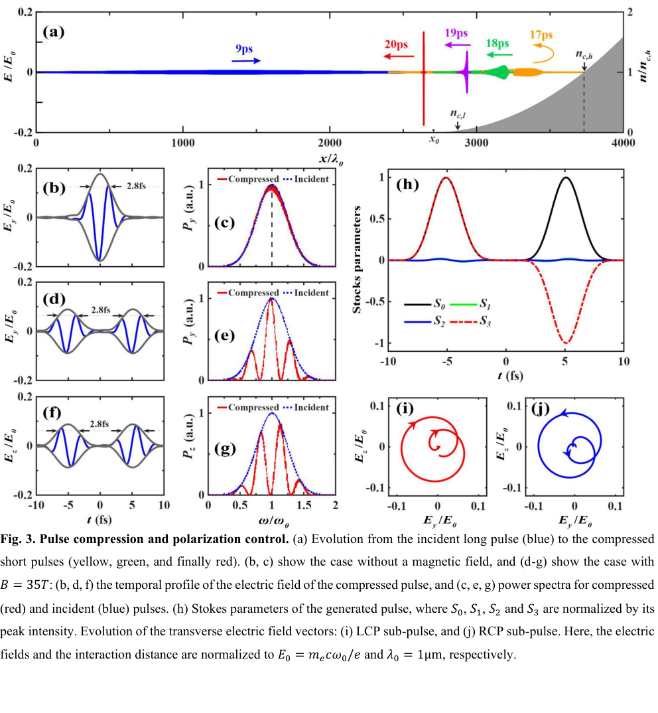
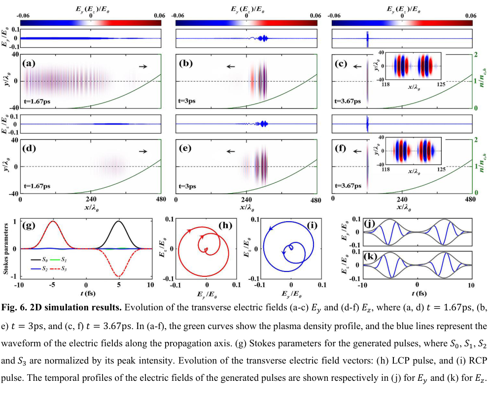

# 磁化等离子体压缩器：把宽带啁啾脉冲变成两束圆偏振亚周期脉冲

## 0. 来源、版本与证据

- **原题**：Magnetized plasma modulator for polarization-tunable ultrahigh-power single-cycle lasers；Li-Jia Shuai、Xing-Long Zhu、Zheng-Ming Sheng。
- [arXiv:2611.12410v1](https://arxiv.org/abs/2611.12410v1)，2026-11-09 13:43:32 UTC首投，11-10公告。作者预印本；官方无期刊字段，精确标题Crossref前三项未核实同作品期刊版，旧偏振调制器论文不是本篇正式版。
- [20页全文](../pdfs/shuai-2026-magnetized-plasma-modulator.pdf)、[文本](../pdfs/shuai-2026-magnetized-plasma-modulator.txt)、[验证](../pdf_validation.json)。证据为解析模型与1D／2D PIC，作者称SMILEI和EPOCH相符；本轮没有运行两个代码，也没有实测激光系统。

## 1. 两种延迟同时工作（pp3–9）

负啁啾使高频在前、低频在后；二次密度坡让高频进入更深后反射，其长路径补偿先发时间，完成时间压缩。纵向磁场使左／右圆偏振本征模的群速度和截止位置不同，压缩后可以分成两个相反旋向的子脉冲。偏振旋转与群延迟分束同时存在，不能只套低密度Faraday旋转公式。

作者采用冷等离子体色散ω²=c²k²+ω_p²/(1±ω_c/ω)，推导群速度及往返时间积分。式(1)用Gaussian单位，ω_c=eB/(m_ec)；转为SI计算时应改用eB/m_e，不能直接把Tesla代入Gaussian式。文字中“ω=ω_p截止”仅是无磁场基准；磁化模式实际有n_c,L/R=n_c(1±ω_c/ω)，论文后续反射位置公式已包含差别。

## 2. 基准1D结果和效率分母（pp4–5、9–12）

入射场高斯参数τ_σ=3 ps，强度FWHM=3.53 ps，总截取时长9 ps；ω从3.2×10¹⁵降至0.56×10¹⁵ rad/s，中心波长约1 μm。密度n=n_c,h(x−x₀)²/L²，L=1.03 mm、x₀=2.7 mm、n_c,h=3.28×10²¹ cm⁻³，最高延伸至1.6n_c,h。4 mm模拟窗、约6.7 nm网格、24宏粒子／格。这是预设宽带输入和理想密度坡，非从现有窄带PW装置直接得到。

**原图3，p10**：(a)横轴x/λ₀、左轴E/E₀、右轴n/n_c,h，展示入射和反射演化；(b,d,f)为t/fs上的归一化电场与包络；(c,e,g)横轴ω/ω₀、纵轴任意单位功率谱，不能当绝对能量；(h)S₀–S₃按峰值强度归一；(i,j)为两横向电场相图。E₀=m_ecω₀/e。

无磁场时3.53 ps→2.8 fs，压缩比约1261，强度3.43×10¹³→4.32×10¹⁶ W/cm²，报告能量效率99.1%。35 T时两圆偏振子脉冲相隔约10 fs，|S₃|/S₀>0.99，**99.5%是两个输出子脉冲的总效率**，不能分配给每一束。2.8 fs约为中心周期的0.84倍，是作者的“亚周期”定义，不能把电场某一尖峰宽度替换成相同指标。能量来自原入射脉冲重排，峰值提高不是净能量增益。

## 3. 磁场和维度依赖（pp12–17）

图4以B/T为横轴、偏振角rad为纵轴，修正模型接近PIC；10 T例的圆偏振度约0.84，不能与35 T的>0.99混写。图5显示高输出强度进入约10¹⁷ W/cm²后非线性／相对论效应降低压缩和效率；14 ps输入分束约需8 T，参数组合不同。图5(c)理论周期数还按模拟使用1.07校正，不是完全无拟合参数的独立预言。

**原图6，p17**：(a–f)为x/λ₀、y/λ₀上的E_y/E₀或E_z/E₀，绿色为密度；时刻1.67、3、3.67 ps；(g)为按峰值归一的Stokes，(h,i)为场矢量，(j,k)为t/fs上的场波形。该算例采用**1 ps、20 μm半径、L=293 μm、120 T**，而非基准1D的3.53 ps／35 T，仍得到约2.8 fs。只能说明该二维案例支持机制，不能证明厘米口径三维系统对横向不均匀、衍射和不稳定性均不敏感。

## 4. EW／ZW是口径外推，仍需能量账本和真实靶

正文提1 cm／30 cm光斑的EW／ZW潜力，结论又用厘米级直径措辞；这些是固定强度向大口径扩展的推想，不是有限能量三维模拟或装置测量。需要明确半径／直径、空间轮廓、两个子脉冲各自峰值及∫I(x,y,t)dA dt，才能复现绝对功率和效率。

后续重点是可制造密度坡、真实宽带相位／CEP误差、磁场均匀性与口径、温度／碰撞／离子演化、吸收和空间收敛，以及两个独立代码的参数／输出对齐。论文为强场QED和偏振粒子源提供潜在驱动器设计，但没有在本篇验证QED、粒子束、光核或中子产额。
