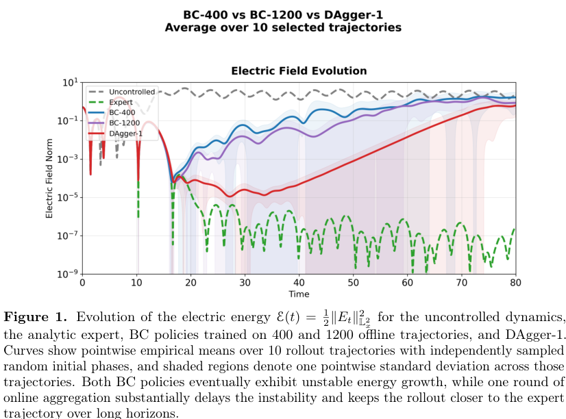
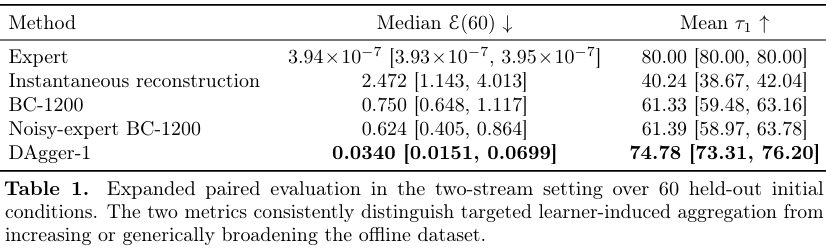
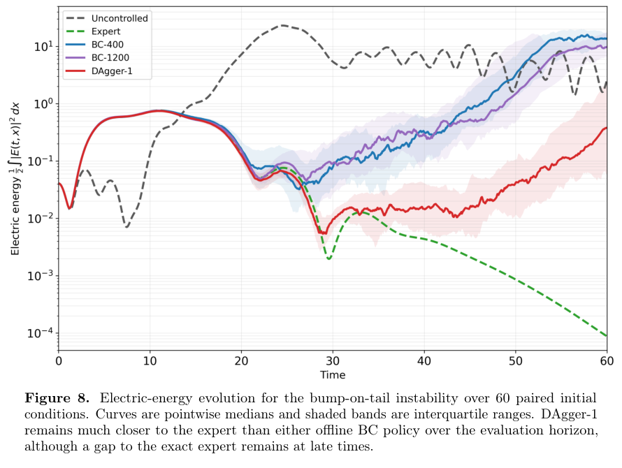

# 在线模仿学习控制Vlasov等离子体：轨迹覆盖比离线误差更关键

## 0. 来源、版本和验证边界

- **原题**：Online Imitation Learning for Stabilizing Vlasov–Poisson Plasmas；Xiaofan Xia、Qin Li、Wenlong Mou。
- [arXiv:2611.10870v1](https://arxiv.org/abs/2611.10870v1)，2026-11-07 17:43:44 UTC首投、11-10公告。作者预印本，无官方期刊字段；精确标题Crossref前三项未核实同作品期刊版。
- [43页PDF](../pdfs/xia-2026-online-plasma-control.pdf)、[文本](../pdfs/xia-2026-online-plasma-control.txt)、[验证](../pdf_validation.json)。阅读正文、数值／训练附录C及扩展评估E，核对关键定理表述和印刷式；未逐步复证附录全部证明，未运行求解器／训练／计时。作者代码“合理请求可得”，不是已审计的公开固定版本。
- **证据类型**：一维无碰撞Vlasov–Poisson解析分析及半拉格朗日数值实验；论文“Experimental Results”不是装置实验，也不是PIC性能基准。

## 1. 专家轨迹误差与部署轨迹误差（pp4–9）

归一化系统∂_t f+v∂_x f−(E+H)∂_v f=0、∂²_x V=1−ρ、E=∂_x V。专家H*=−E精确抵消自洽电场，使f自由输运，光滑初态下电场因相混合衰减。这个专家可在数值中读取全态；四密度传感器并不能直接实现它，也没有真实执行器幅值、延迟或噪声约束。

BC在专家轨迹f*上拟合H*(f*)；在线损失在学习者自己走到的f^π上比较H^π和H*。反例构造让专家从未激发的第二不稳定模获得很小的持续偏置，其后按exp(γ₂t)增长，说明小离线误差不足以控制未覆盖方向，不能推成“所有BC必然失稳”。有限维比较还假设状态协方差有统一正下界，并非仅靠维数即可断言稳定。

定理2要求初态解析／速度衰减、策略空间Lipschitz，以及部署分布上的小在线损失，给出概率≥1−η、有限T*∝ε^(−2/9)区间内的电场范数界C₁exp(−C₂t)+C₁ε^(1/2)(1+t)⁹，其中ε=ε_tr/√η。这是多项式上界，**不是任意长时间、统一小误差或实际网络训练必然收敛的证明**。式中的对象为电场L²范数，不能与图中的半平方电场能直接混同。

一处可复查的印刷口径问题：Eq.(3)定义时间积分损失，p6构造的逐时平方误差为ε_tr²，直接积分应为Tε_tr²，而定理1写ε_tr²，可能漏写时间平均或归一化。另p10／C.1把L=10π中的k₁=1、k₂=5写入cos(kx)，又称为不稳定Fourier模；未明确它们是索引还是物理波数。重现前应取得代码澄清2π/L因子，不能仅从文字擅改初态；本轮不据此断言作者代码有误。

## 2. 数值接口、预算与训练筛选（pp10–11、32–35）

两流平衡速度中心±2.4、σ=1，空间L=10π、v∈[−6,6]，1024×1024网格、Δt=0.02、T=80。四个传感器、50步历史和时间差分输入TCN＋注意力，输出前8个Fourier模。前50步是warm-up，不能解释为从t=0即完成反馈。

BC-400／1200按轨迹80/10/10划分，种子42；DAgger-1从BC-400出发，加800条聚合轨迹。聚合时以0.6概率用学习者、否则用专家，t>30且电场能>10⁻⁴就截断。理论混合系数与实现的随机动作选择并非自动等同。数据预算相同也不代表相同专家查询、仿真或墙钟成本；安全筛选可能改变覆盖范围。加权Fourier训练损失含1/k和目标幅值倒数，不等同于定理中未经加权的物理L²在线损失，需要额外桥接验证。

**原图1，p10**：横轴归一化时间，纵轴对数；图轴写“Electric field Norm”，图注却定义能量𝓔=½‖E‖²，应保留两者不一致而不自行选择。曲线为10个配对随机相位轨迹的逐时均值，阴影±1标准差，不是置信区间。DAgger红线延后增长，晚时仍明显离开精确专家；没有永远稳定的证据。

## 3. 六十例配对评估与独立不稳定性设置（pp40–43）

**原表1，p41**：第一数列为t=60电场能中位数，第二列为τ₁=min[80,首次t≥20且𝓔≥1的时刻]的均值，均为归一化量；括号为10,000次按初态重采样的95%区间。BC-1200为0.750／61.33，噪声专家BC为0.624／61.39，DAgger-1为0.0340／74.78，专家约3.94×10⁻⁷／80。DAgger相对噪声BC的能量中位数降低94.6%，相对普通BC降低95.5%；不能将这个终点比值称为所有时刻的误差降低。第二轮DAgger为0.0427，区间重叠，未显示一致改进。

**原图8，p42**：横轴归一化t，纵轴明确为½∫|E|²dx、对数；60个配对初态的逐时中位数和四分位带，统计量不同于图1。bump-on-tail改用L=20π、v∈[−9,9]、T=60，并为各方法重新训练，不能当两流训练模型零样本迁移。学习者混合概率0.4，t>20且能量>0.3截断。表2的末点实际t=59.98，BC为9.79、DAgger为0.381，降低约96.1%；两种平衡的绝对能量不能直接比较。图9代表例按两种控制器末能量的联合百分位选取，亦不同于主文／C.4按各方法中位附近选图的口径，不能自动视为同一个配对样本。

## 4. 可复现性和科研用途

作者报告单L40S、4 CPU、64 GB内存；400专家轨迹约1 h、单次T=80 rollout约2 min、BC约2 h、每轮DAgger约1 h。800条聚合轨迹与单rollout时间不能不加说明直接拼成端到端成本；提前截断、批量／并行执行及计时范围需要完整日志。未报告同误差网格／时间收敛、跨初态形状、传感器噪声扫描或真实装置部署。

可迁移的思想是把“学习者实际访问的危险状态”加入专家标签集，并同时记录损失、模谱、相空间和失稳时间。对PIC／强场项目仍应单独检验执行器、诊断稀疏性、守恒及域外状态；本篇未证明磁约束装置、激光等离子体或QED系统的控制有效性。
