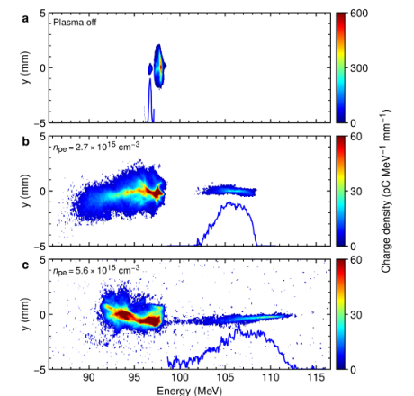
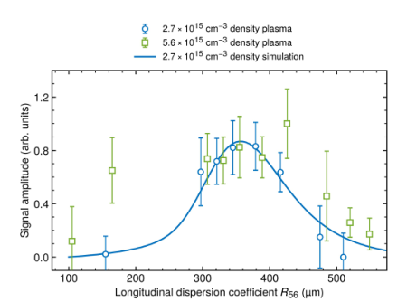
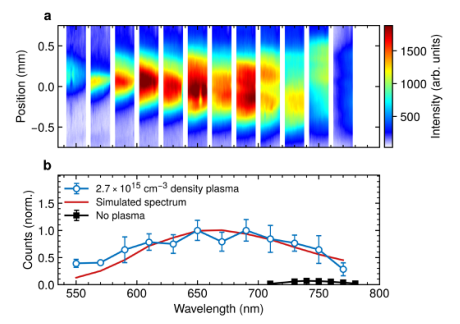

# 相对论电子束的紧凑等离子体极端压缩：Hessami 等论文笔记

## 0. 论文信息与阅读范围

- **题目**：Compact plasma-based extreme compression of relativistic electron beams。
- **作者**：R. Hessami、K. K. Swanson、M. Galletti、L. Verra 等，通讯作者 A. Marinelli、R. Pompili、C. Emma；SLAC／INFN-LNF／ENEA。
- **版本**：[arXiv:2611.13436v1](https://arxiv.org/abs/2611.13436v1)，2026-11-10 01:18:43 UTC 首投，11-11 公告；[预印本 DOI](https://doi.org/10.48550/arXiv.2611.13436)。本文按作者预印本阅读，不能据此称已获期刊最终版本。
- **版本去重**：有限Crossref标题前三项未核实本篇期刊版。最相近的[Swanson等五月PRAB前作](https://journals.aps.org/prab/abstract/10.1103/ggd1-pt1y)在官方摘要中是六作者的PIC／粒子跟踪可行性研究，而本篇为21作者SPARC_LAB实验，故不合并为同作品正式版；本轮只核对前作摘要、未读其PDF。
- **全文**：[本地 PDF](../pdfs/hessami-2026-plasma-compression.pdf)，14 页，SHA-256 `639844f5028e130d0612013a8093d2870f02a77ac64e182cfa093746ef4a4cb3`。阅读正文、Methods 1–8、数据／代码可得性及唯一 Extended Data Fig. 1；原文参考文献作为本篇上下文，不代表逐一读取被引文献。
- **提取方式**：MinerU 凭据已知失效，本篇没有重新提交；使用已验证 PDF、本地布局文本与页面渲染。实际查看 PDF 第3、4、5、6、8、9、14页，并逐一打开本笔记三幅保留裁图。
- **证据类型**：RF 光阴极注入器产生的双电子束驱动 **PWFA 实验**，结合间接 CTR 诊断和 PUFFIN 模拟；不是激光尾场加速实验。光阴极激光和放电预电离激光的存在，不改变主要尾场由电子 driver 驱动这一点。

## 1. 摘要：实验真正完成了什么

作者把“在等离子体中形成强能量啁啾、随后在弱弯转磁压缩器中压缩”用于相对论电子 witness 束，目标是减轻传统强弯转压缩中的相干同步辐射与横向品质之间的矛盾。与 CPA 的类比说明“先构造可控相关性、再压缩”的思路，不意味着电子束经历了与光学 CPA 完全相同的动力学。

实验用压缩后的 witness 在单个米级波荡器中产生光学单微束相干辐射，光电二极管测得脉冲能量 **7.6±1.3 nJ**。论文称其比本装置首次束驱动等离子体 SASE FEL 演示高约四个数量级；此前演示使用七个波荡器模块，而本篇为单微束预聚束辐射，不能把该跨工况比较视为同输入下四个数量级的能量转换效率提升。

飞秒级束长、具体峰值电流和在波荡器中的纵向演化主要由诊断约束下的模拟支持；阿秒／MA／EUV／软 X 射线能力属于后续缩放方向，本篇没有实测。

## 2. 正文引言与 Fig. 1：为什么先加啁啾

引言先说明短束对强场 QED、超快材料和实验室天体物理的需求，再指出传统磁压缩器会因强弯转集体效应损害横向束质。等离子体大梯度可让 witness 在很短距离上获得大纵向能量斜率，以较小磁色散完成压缩。**弱磁场有利于降低某些退化机制，但本文未给出压缩前后发射度的成对测量，不能写成已验证“横向品质完全保持”。**

Fig. 1（PDF 第2页）依次示意等离子体入口、出口与磁压缩后 driver／witness 的纵向相空间；压缩后的 witness 进入调到约650 nm共振的波荡器。这是实验布局与相空间示意，不是独立测得的时间分辨 LPS 图。

### 2.1 压缩条件与单位

为把原文“色散取啁啾的倒数”写得有量纲意义，定义束内纵坐标、相对能偏和相对啁啾：

$$
\delta=\frac{E-E_0}{E_0}=h z+\delta_u,
\qquad h=\frac{1}{E_0}\frac{dE}{dz}.
$$

其中纵坐标以长度计，相对能偏无量纲，相对啁啾以逆长度计，未相关能偏记为最后一项。在线性输运且忽略位置与未相关能偏的协方差时，

$$
z_f=z_i+R_{56}\delta
=(1+R_{56}h)z_i+R_{56}\delta_u,
$$

$$
\sigma_{z,f}^{2}=(1+R_{56}h)^2\sigma_{z,i}^{2}
+R_{56}^{2}\sigma_{\delta,u}^{2}.
$$

先将相关能偏代入纵向传输映射，再对平方取平均，得到上述束长关系。忽略第二项时，最大线性压缩接近相关项抵消的位置；符号随纵坐标与磁输运约定而变，原文图示主要用色散幅值。

$$
|R_{56}|\simeq\frac{1}{|h|}
=\frac{E_0}{|dE/dz|}.
$$

因此原文的 **MeV/μm 绝对能量斜率不能直接与 μm 单位的色散互取倒数**，必须先除以平均能量。例如106 MeV与0.29 MeV/μm给出约366 μm的色散幅值，量级与 Fig. 3 峰位一致；这是本笔记的单位核对，不是复跑作者束流程序。未相关能散和二阶输运会限制最短束长，不能把上式的线性零点当真实零束长。

## 3. 束流—等离子体相互作用与 Fig. 2

SPARC_LAB RF 光阴极注入器产生约96 MeV的双束，driver／witness 电荷分别 **500／20 pC**、间隔约1 ps；RF deflector与束流模拟给出的 RMS 时长分别约 **500／30 fs**。束流被聚焦至约50 μm RMS横向尺寸，进入13 cm长放电毛细管；通过放电和束流到达时差在约十的十五至十六次方每立方厘米范围调节等离子体密度。无窗三级差分抽气减少窗口多重散射。

driver 激发尾场，witness 放在加速场沿束变化的位置；尾场既加速又构造能量斜率。在不计束载且处于非线性尾场的理想条件下，斜率随等离子体密度变化；本实验依靠密度扫描控制啁啾，而非直接独立测定所有尾场参数。

**原图定位与坐标**：PDF第3页 Fig. 2，横轴电子能量（MeV），纵轴屏上横向位置（mm），不是束内时间；色标为电荷密度（pC MeV⁻¹ mm⁻¹），三幅色标上限不同，a为600、b／c为60，不能直接按颜色比较绝对峰值。蓝线为 witness 能量分布。

**趋势与含义**：关等离子体时 witness 窄能谱与 driver 接近；开等离子体后 witness 获能并展宽，高密度工况展宽更强。谱宽支持相关啁啾存在，但仅能量投影不足以唯一重建纵向相空间。

| 密度（cm⁻³） | witness 平均能量 | RMS投影能散 | 100连续炮能散范围 |
|---|---:|---:|---:|
| 2.7×10¹⁵ | 106.1 MeV | 1.6±0.2 MeV | 1.03–2.86 MeV |
| 5.6×10¹⁵ | 109.9 MeV | 4.5±0.5 MeV | 1.8–5.01 MeV |

作者把投影能散与模拟入口束长结合，估计等离子体出口绝对啁啾约 **0.12–0.56 MeV/μm**。该区间不是每炮直接时域斜率测量；能谱中的非线性与未相关能散也需考虑。

## 4. 磁压缩与 Fig. 3：CTR给出的约束

米级四磁铁压缩器使用峰值约 **20 mT** 的弱弯转场。等离子体出口至压缩器入口的自由漂移已经贡献 **100 μm** 纵向色散，所以图上100 μm对应压缩器磁场关闭；不能把它视为零总色散。

**原图定位与坐标**：PDF第4页 Fig. 3，横轴纵向色散（μm），纵轴CTR探测信号（任意单位）。蓝圆／绿方分别为低／高密度实验，蓝实线只拟合低密度工况；误差棒是炮间标准差，不能称均值标准误或置信区间。

**趋势与含义**：信号随色散先升后降，约350–400 μm附近较高，支持压缩—过压缩过程。高密度更大能散使非线性压缩影响增强，峰值区域更宽。信号经背景扣除、平移和缩放，纵轴不是绝对辐射能量，不能用归一化峰高反推出绝对束长或电荷转换效率。

低密度曲线采用入口30 fs RMS高斯束与啁啾分布，拟合得到平均 **0.29 MeV/μm**、RMS宽 **0.04 MeV/μm**。正文据能散、slice能散估计与匹配CTR的束流模拟，推断压缩约一个数量级、出口为飞秒量级。**本篇未直接给出飞秒分辨的压缩后时间像**。

### 4.1 CTR公式与诊断的反演限制（Methods 5）

原文式(1)的相干部分由场幅相加后平方得到：

$$
I_{\rm coh}(k)\propto N^2|b(k)|^2 I_1(k),
\qquad
b(k)=\frac{1}{N}\sum_{n=1}^{N}e^{i\mathbf{k}\cdot\mathbf{r}_n}.
$$

电子数、单电子谱强度与聚束因子分别控制幅度、单粒子响应和相干相位相关性。完整粒子求和还存在随电子数线性增长的非相干项；在相干部分占优时才采用这里的平方标度。对纵向高斯分布取傅里叶变换，完成平方配方积分，得到原文式(2)：

$$
b(k)=\exp\!\left[-\frac{k^2c^2\sigma_t^2}{2}\right],
\qquad
|b(k)|^2=\exp[-k^2c^2\sigma_t^2].
$$

缩短 RMS时长将相干谱延伸至更高频率；热释电读数实际是该谱与探测器响应／收集效率在有限带宽上的积分。理想宽带、平坦单电子谱与固定电荷下，积分近似随时长的倒数增长；实际仪器不能脱离带宽与谱形假设直接绝对测时长。

Methods写明传感器带宽 **0.25–3000 μm**。每个色散设置采50炮driver+witness与50炮driver-only；先剔除偏离中位数超过2.5个robust标准差的异常炮，再扣除driver-only平均信号。误差由两组方差相减估计，依赖背景独立／平稳等条件。固定电荷近似也需逐炮核验。

## 5. 光学单微束辐射与 Fig. 4–5

压缩后的束进入 **77周期、周期28.18 mm** 的平面波荡器（磁体长约2.17 m），设定参数约1.4、共振约650 nm；“米级”不等于1 m整。所用相干单微束不等同传统长束SASE增益链。

**原图定位与坐标**：PDF第5页 Fig. 4。a横轴波长（nm），纵轴光在谱仪像面的位置（mm），色标为强度任意单位；竖向分段来自改变谱仪中心波长后的多炮拼接，并非同炮覆盖全波段。b横轴波长、纵轴归一化计数，蓝色为开等离子体、黑色为关等离子体，红色为模拟谱；标准差误差棒保留。

**趋势与限制**：开等离子体谱中心约 **665 nm**、RMS谱宽 **59 nm**（相对RMS宽 **8.9±0.3%**），谱宽较大，与少周期有效相干发射解释相容。关等离子体在总色散560 μm工况仍低于开等离子体峰信号的约7%，其谱中心因束能更低移到约750 nm。两组共振能量及压缩条件不同，不能据此单独隔离某个辐射机制的贡献。

光电二极管独立测得 **7.6±1.3 nJ**（炮间均值±标准差），相对标准差约17%。没有提供单炮全谱、单炮束长与横向发射度的完整联合统计，不能把各诊断的最佳数字组合成同一炮已经同时实现的指标。

正文 Fig. 5（PDF第5页，未另保留裁图）a为 **PUFFIN模拟**：不同波荡器周期的电流（kA）随束内位置（μm）的分布，插图为RMS束长（fs）随周期数增长；b为模拟光脉冲能量（nJ）随周期数，插图是不同位置的模拟功率（kW）随时间（fs）。该代表工况从入口 **4.8 kA、2.3 fs RMS** 演化至出口 **1.0 kA、12 fs RMS**，表明纵向空间电荷和波荡器色散使束重新展宽。**2.3 fs与4.8 kA均为该模拟输出，非直接实测值。**

模拟平均输出 **8.1 nJ**、RMS相对谱宽 **8.2%** 与实验数值接近；但谱权重由实测谱拟合，能量曲线又使用相同权重，不是完全独立的盲预测验证。本文没有新测量强场QED、γ源、中子、光核核素或临床／防护结果。

## 6. Methods 1–4：可复现装置条件

### 6.1 双束产生

约60 mJ、780 nm Ti:Sa激光经β-BBO倍频至约390 nm，分束／延迟系统产生约100 fs蓝光双脉冲，光阴极处相隔3 ps。偏振分束器、半波片、平移台和光阑控制能量、延迟和横向尺寸；输运至铜光阴极形成近top-hat横向分布。该光阴极间隔不是进入等离子体时约1 ps的束间隔，两者之间经过RF velocity bunching。

第一行波段近RF零交叉注入，用头尾不同加速率旋转纵向相空间；嵌入螺线管补偿横向作用。作者称该方法无需色散区刮束，不因掩膜／scraper主动损失电荷；这不等于整个束线无损失。

### 6.2 毛细管与密度诊断

LEXAN毛细管长13 cm、内径2 mm，以氮气工作；电磁阀打开2 ms，关闭后立即施加约9 kV、400 A放电脉冲。密度诊断包括Hβ Stark展宽和低电荷束列的共振尾场能量损失，属于两种辅助诊断口径，应补原始标定和误差。

532 nm预电离激光约200 μJ、光斑约5 mm，在主放电前约100 ns注入，使放电时间抖动降至约1–2 ns。电子束到达与放电电流由上游BPM／Pearson探头和500 MHz示波器核对。这不是把飞秒光学束团直接同步测量到1–2 ns以外的精度声明。

### 6.3 横向匹配与压缩器

入口三PMQ梯度约460 T/m，长度10／20／20 mm，焦距约5 cm；出口另有同类组捕获高发散witness。压缩器所在转接线从linac出口至波荡器入口5.75 m，包含两组电磁四极铁；四弯铁可在中心形成最大约12 mm水平位移。后3块弯铁磁长约13 cm，系统可工作至200 MeV束能。需取得实测前后发射度／失配、窗口外散射及透过率，才能量化横向品质收益。

## 7. Methods 6–8与扩展数据：共振、模拟和统计处理

### 7.1 波荡器共振关系

原文式(3)–(4)：

$$
\lambda_r=\frac{\lambda_u}{2\gamma^2}\left(1+\frac{K^2}{2}\right),
\qquad
K=\frac{eB_0\lambda_u}{2\pi m_ec}.
$$

波荡器周期、Lorentz因子与无量纲摆动参数决定轴上基频；磁场幅值、元电荷、电子质量和光速构成第二式。超相对论电子的平均轴向速度因横向摆动而略低于光速，一个周期中积累的滑移长度即给出第一式；参数随磁隙改变，由事先测得的磁隙—参数映射设定。106 MeV电子与参数1.4代入约650 nm，与装置设定量级相符；实测谱中心665 nm还包含能量分布与多炮平均影响。

### 7.2 光谱分析的选择条件必须保留

单次谱仪窗口只有 **16 nm**，像素谱分辨率 **0.06 nm/pixel**；CCD配5 ns门宽ICCD。完整曲线通过扫描中心波长和各窗口多炮平均拼成，不能称同炮宽谱测量。

**原文Methods 6在PDF第9页明确写：先扣除driver-only平均背景，然后对每个设置，选取高于中位数3个robust标准差的shots再平均。** 这与“删除离群点”不是一回事；正文没有给出该阈值对应的保留比例或完整分布。可能是特定信号选择，也可能存在需作者澄清的表述；本笔记按印刷文字记录，不自行改成全炮平均或异常值剔除。它会影响Fig. 4光谱是否代表所有shots及其与独立光电二极管能量统计的对应关系。

### 7.3 PUFFIN与二阶压缩映射

作者用3D、非周期平均／非慢变包络PUFFIN，加入自定义纵向空间电荷模块。输入20 pC、出口30 fs RMS、未相关能散0.1%的高斯束，平均能量106和109 MeV、绝对啁啾0.20–0.40 MeV/μm；先经过等效100 μm自由漂移，再过250 μm磁压缩器，进入77周期波荡器。这是模型设定，不是逐粒子实测输入。

CTR模拟另写高斯纵向长度 **10 μm**（约33.4 fs），与前述30 fs是邻近但不完全一致的设定，应保留原值。其二阶纵向映射为

$$
z_f=z_i+R_{56}\delta_E+T_{566}\delta_E^2.
$$

二阶系数描述线性压缩抵消后残留的曲率作用；原文此处没有明确写出能偏变量的归一化定义。若其为相对能偏，两个输运系数以长度计；若为绝对能偏，则单位相应变化，不能只凭符号把两种约定混用。获得源码前不宜据此独立复现数值。

### 7.4 唯一扩展数据图与拟合耦合

Extended Data Fig. 1在PDF第14页：横轴波长（nm）、纵轴归一化计数；蓝点为多炮实测谱，彩色堆叠为0.20–0.40 MeV/μm各啁啾模拟谱贡献，红线为其加权和。先把106／109 MeV两能量模拟谱平均，再通过非负最小二乘确定五种啁啾权重，以表示约106±3 MeV束群；同一权重用于正文能量沿程曲线。该图展示模型可以拟合观测谱，未提供独立留出谱的预测误差。

### 7.5 绝对辐射能量标定

硅光电二极管 Thorlabs PDA100A用参考800 nm激光标定 **2.46 nJ/V**，采样示波器LeCroy WS454；本篇光谱约665 nm且宽带，应进一步核实响应谱和传输光学的波长修正。谱仪可调200–900 nm、光栅1200 lines/mm、15 cm焦距成像镜构成1:1像面；仪器带宽和单窗口宽度不等于光脉冲时宽测量。

## 8. 结论、开放问题与本库应用

最强结果是：**用13 cm电子束驱动等离子体尾场构造大能量啁啾，结合弱弯转压缩器，并在单模块波荡器测到nJ级单微束相干光学辐射。** 压缩约一个数量级与飞秒级束长由CTR趋势、能谱和模拟共同支持；具体束长和峰值电流的强数字应一直带“模拟”标签。

对转换靶／光核链的价值在上游束流操控：能量—时间相关性、纵向空间电荷和诊断联合约束可能影响峰流及后续靶上沉积。该文没有转换靶、γ／中子绝对产额、剂量或热负荷数据，不能直接推出二次源效率改进。

优先续查事项：取得每个谱仪设置的全炮数据及阈值选择原因；直接或独立交叉测量压缩后束长，补齐前后发射度与传输电荷；核实色散总量与磁铁贡献（图上最低100 μm、关等离子体对照560 μm，结论写压缩器约400 μm为不同口径）；公开啁啾权重、未相关能偏归一化、二阶系数和PUFFIN／LSC固定版本。数据和代码目前均仅声明可向通讯作者合理请求，本轮没有取得或运行作者程序。

**复习速记**：实验看到的是能谱变化、随色散出现的CTR峰，以及nJ光学相干辐射；飞秒束长／kA峰流由模型支持。先把绝对啁啾换成相对啁啾，才可讨论色散取倒数的压缩条件。
