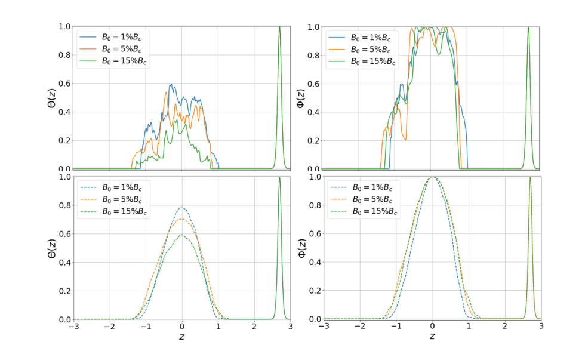
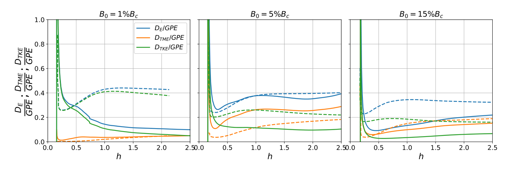
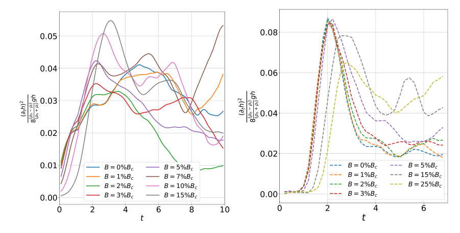

# 磁瑞利–泰勒不稳定性的二维／三维差异：互换模与混合模的作用

## 0. 论文与实际阅读版本

- Manohar Teja Kalluri、Andrew Hillier，*Role of interchange and mixed modes in magnetic Rayleigh–Taylor instability dynamics: A 2D vs 3D study*。
- 正式出版记录：[Physics of Plasmas 33, 112102 (2026)，DOI 10.1063/5.0335643](https://doi.org/10.1063/5.0335643)，2026-10-26接收、2026-11-11在线。
- **实际阅读全文**：[官方 arXiv:2510.27053v2](https://arxiv.org/abs/2510.27053v2)，21页、22图、1表；首投2025-10-30，v2历史日期2026-10-24，PDF首页另印“Dated: October 27, 2026”。三种日期含义分别保留。出版社PDF路由本轮403，未取得VOR，未核实作者稿与VOR逐字一致。
- [本地PDF](../pdfs/kalluri-2026-mrti-2d-3d.pdf)；SHA-256：`2d219167dd005d138758ef34d307aeaa82f158b8aa2a3ecfd3764a397b9aa7fb`。
- 证据类型：Dedalus非理想MHD数值对比及理论诊断，**不是PIC、ICF炮次或材料混合实验**。本轮使用本地全文提取与原页／裁图目视，MinerU已知凭据失效未重复请求；未运行作者代码。

## 1. 摘要：哪些二维结果可以外推

作者比较相同密度比、重力和三个代表磁场强度下的二维／三维MRTI。本文二维配置的界面沿x、计算面为xz、初始磁场沿x，因此扰动主要为沿磁场传播的undular模；三维界面为xy平面，可同时出现undular、interchange与mixed模。

三维产生更细的结构、更强的局地密度混合和搅拌；二维则有更强的两相相互贯入、更大的相干羽流及更高的重力势能释放。三维小尺度增加耗散，使动能占已释放势能的比例降低。作者认为磁能回到动能的归一化转换量在本扫描中接近，但这不保证二维重联拓扑、局部速率或粒子加速能复制三维。

## 2. I. Introduction：模式、磁张力与几何限制

图1用密度切片定义混合层高度h、气泡和尖钉：纯高密度／低密度颜色之间的中间色才表示局地混合。混合层长高并不自动代表均匀混合增强。

### 2.1 线性增长率及临界场

按作者归一化，线性单模公式为

$$
\sigma^2=A g k-\frac{2k^2B^2\cos^2\theta}{\rho_h+\rho_l},\qquad
A=\frac{\rho_h-\rho_l}{\rho_h+\rho_l}.
$$

其中k是波数大小、θ是波矢与磁场夹角、g是重力大小，磁场采用文中吸收磁导率的单位。第一项是浮力驱动，第二项是沿场弯曲的恢复力。令增长率平方为零，得到

$$
B_c^2=\frac{(\rho_h-\rho_l)g}{2k\cos^2\theta}.
$$

因此，平行波矢（θ=0）受磁张力最强；垂直波矢（θ=π/2）在线性理想近似中没有该张力稳定项。**Bc依赖参考波数和方向；“1%、5%、15% Bc”是本论文归一化扫描，不能直接换算为某装置的特斯拉数。**

图2实际明确画出了二维的三种可能取向：undular、mixed和interchange。摘要中“二维只有undular”只适用于本论文选定的磁场／计算面，不能概括任何二维MHD。三维允许不同方向并存，是本文比较的关键。引言还指出，仅比一个磁场或只比总动能／磁能不足以判断二维代理是否可靠。

## 3. II. Numerical methodology：方程、数值设置和比较基准

模拟使用Dedalus谱方法，密度通过平流–扩散演化，磁场有电阻扩散和散度清理，速度使用无散近似。密度变化系统一般可具有非零速度散度，作者将其近似为零，并承认这可能改变小尺度混合、增长常数和能量耗散。因此这不是一般可压缩HEDP等离子体模型。

| 项目 | 本文设置及限制 |
|---|---|
| 密度／重力 | 高密度3、低密度1，Atwood数0.5，g=1；时间／长度为无量纲模拟单位 |
| 扩散系数 | 黏性ν、磁扩散η、密度扩散D均为10⁻⁴ |
| 二维 | 区域4×6，2048×3072；另做512×768对比 |
| 三维 | 区域4×4×6，512×512×768；没有三维加密序列 |
| 边界 | 各方向周期；主不稳定界面z=0，上部稳定界面z=0.45Lz用于构造周期性和监视边界影响 |
| 初始密度 | 双tanh界面，半宽0.05，约7个三维格点、25个二维格点 |
| 初始磁场 | x方向；主要比较B0/Bc=0.01、0.05、0.15 |
| 扰动 | 二维k=1–128、随机幅度±0.0125；三维每方向k=0–64、幅度±10⁻³，以高斯包络限于主界面附近 |

图3说明两维度的初始扰动并非逐模相同。作者主要按**相同混合层高度h**对比发展阶段，而不是相同时间；后面只对一个二维中场案例检查替代扰动的敏感性。此设计有助于解释形态阶段，不能消除所有初始谱／种子差异。

原稿式(2a)把磁张力项印成负号，而式(13)动能方程的磁交换项为正号。这是当前作者稿的**印刷式符号不一致**；本轮没有读取作者求解器，不能据此断言实际代码使用了错误符号。

## 4. III. Results：先比较模式，再比较混合与能量

### 4.1 图4：三维模式谱说明了什么

作者对z=0处垂直速度做二维FFT：横轴kx为纯undular轴，纵轴ky为纯interchange轴，中间区域为mixed模。t=0.2、2、6的谱显示能量向低波数增加，同时在更宽的ky范围保留功率。纯interchange谱略高于纯undular谱，而按254个径向壳求和的“总谱”可高约两个数量级。

这个总谱同时包含一个壳内许多模式，纯方向谱只取坐标轴；两者的模式数与求和方式不同。因此可以说“mixed模在总体谱中占重要份额”，不能把纵轴差距直接解释为**每个mixed模**都比单个undular模强百倍，亦不是对两类模式因果贡献的独立消融实验。

### 4.2 III.A. Mixing layer：贯入、混合、搅拌必须分开

图5在t=6对比二维密度和三维的两个正交切面。二维羽流尺度较大、核心仍接近原始密度，能穿入更深；三维核心和边缘更弥散。随磁场增强，两者都趋于较大尺度、较少混合。图中的固定时间密度切片是定性展示，主要定量结论仍按h比较。

#### 混合参数和贯入参数（式6–7）

定义高密度体积分数f，则

$$
f=\frac{\rho-\rho_l}{\rho_h-\rho_l},\qquad
\Theta=4\langle f(1-f)\rangle_h,\qquad
\Phi=4\langle f\rangle_h(1-\langle f\rangle_h).
$$

横向平均在二维沿x、三维沿x和y进行，结果仅依赖z。局部纯相f=0或1时，Θ为零；局部均匀各半f=1/2时，Θ为一。Φ则先平均再乘积：即使一层由两块未混匀纯相各占一半，Φ仍为一。展开可得

$$
\Phi-\Theta=4\big(\langle f^2\rangle_h-\langle f\rangle_h^2\big)=4\operatorname{Var}_h(f)\ge0.
$$

这说明Φ大、Θ小时，流体在同一高度相互穿插，但局地仍未混匀。该恒等式是对作者定义的代数推导，不是新增模拟。

**图6，作者稿第8页原图摘录。**横轴z为无量纲高度；左列Θ、右列Φ均无量纲，范围0–1；上行为二维，下行为三维，t=6，颜色对应1%、5%、15% Bc。二维主层Θ峰约0.4–0.6，三维约0.6–0.8；二维Φ近一的平台较宽，三维则向中心平滑上升，符合“二维贯入强、三维混合强”。z≈2.7处的共同尖峰属于为周期边界构造的**上部稳定界面**，不能作为主RT层额外混合证据。本文没有把interchange与mixed两类对增强混合的贡献分别定量拆开。

#### 搅拌量（图7）与尺度（图8）

从密度平流–扩散方程出发，对空间求导，再与密度梯度点乘，得

$$
\frac{D|\nabla\rho|^2}{Dt}
=-2(\partial_i\rho)(\partial_j\rho)\partial_i u_j
+D\nabla^2|\nabla\rho|^2-2D(\partial_{ij}\rho)^2.
$$

第一项是速度梯度拉伸／压缩密度梯度的贡献；周期域平均消掉拉普拉斯散度项，扩散项减小梯度。图7左画拉伸项体积平均，右画梯度平方均值除以该拉伸项的时间尺度，横轴均为h：三维拉伸更强、搅拌时间更短；磁场增强后搅拌减弱、时间增长。**搅拌增大界面面积，混合还依赖D，二者不是同一量。**

图8用动能／涡量强度和磁能／电流强度之比定义特征尺度。弱场二维涡尺度随h增长，作者将其联系到涡合并；三维涡伸长使尺度较小且更接近常量。电流尺度总体随磁场增强而增大。原稿式(11)的密度加权和平均密度前因子应按作者定义保留，不宜直接替换为另一种常见涡量长度；本轮未由原始场重算。

### 4.3 III.B. Energy dynamics：势能释放、交换和耗散

图9、10显示：相同h下，二维的平均密度扰动和势能释放更大，原因与纯相贯入更深有关。仅比较TKE绝对值而忽略可用势能不同会混入这一效应。

定义磁张力功密度和浮力输入功率为

$$
W_B=\mathbf u\cdot[(\mathbf B\cdot\nabla)\mathbf B],\qquad
P_g=-\langle\mathbf u\cdot\delta\rho\mathbf g\rangle_V.
$$

对动量方程与速度点乘、体积平均，压力和周期散度通量消失，得到“动能变化=浮力输入+磁张力功−耗散”的结构。对W的正负部分分别积分可定义两方向的交换功率，再除以Pg。图11以15% Bc案例定位羽流头的负功区和磁能释放的正功／喷流区。正W不仅仅在数学上等同于“发生重联”；重联解释还依赖场拓扑及作者相关前作。

图12给出按浮力功率归一化的磁能／动能交换，二维弯曲磁场所需的比例较大，磁能回到动能的比例则接近。Table I把差异小于10%称为“similar”，属于作者比较标准，并非实验误差条。图13再给出**累计能量**比，弱场二维TKE约为势能释放的90%，三维约45%，差额需要耗散账本解释。

**原稿式(14)、(17)的归一化边界：**分母Pg随时间变化时，

$$
\frac{d}{dt}\left(\frac{K}{P_g}\right)
=\frac{\dot K}{P_g}-\frac{K\dot P_g}{P_g^2}.
$$

所以瞬时交换功率比不能直接当作累计K/GPE；后者需要对功率和耗散随时间积分，再以累计释放势能归一化。原稿从归一化导数写到式(17)的能量比例省略了这些条件，本笔记仅采用其诊断方向和另行绘制的能量曲线，不把该印刷式当作完整复现公式。

**图14，作者稿第14页。**横轴h为无量纲混合层高度，纵轴为累计耗散／累计释放GPE；蓝为总耗散、绿为动能耗散、橙为磁能耗散；实线二维、虚线三维，三列为1%、5%、15% Bc。弱场三维显著高于二维；中场两者总耗散更接近，但组成不同；强场三维总量仍较高。h很小时归一化分母小，起始尖峰不能当稳定耗散效率。

**数值口径需保留：**弱场正文称三维总耗散约35%，结论称约30%，而图14在h≈1–2显示约0.4–0.44；采样位置／口径未澄清，不能选一个数字当全时段常数。图15表明动能耗散主要来自速度梯度项，密度梯度相关项很小。这里耗散随维度和磁场变化，而非“任何三维都固定多耗散某百分比”。

图16用横向／重力方向的能量比例衡量各向异性。三维取两个横向分量、二维取一个，分别用L=2或1归一化；0对应按分量均分、1对应横向趋零。TKE比TME更偏向重力方向，三维比二维更明显，磁场增强时各向异性增加。这个指标针对本几何的分量能量，不能直接比较另一种未作L校正的各向异性定义。

### 4.4 III.C. Self-similarity：有限扫描支持什么

图17比较初始场相关功与重力功的比：二维保持显著影响，三维随时间降低；三维中再除以B0²后接近1/t趋势。作者据此认为三维逐渐接近流体型自相似，而二维仍受初始磁场约束。

**图18，作者稿第17页。**横轴无量纲t，纵轴为下式无量纲增长量，左二维、右三维；不同颜色代表B0/Bc，三维另含25%场，二维还有7%、10%场，不能把两侧每一条当作逐场配对。

$$
C_h=\frac{(\partial_t h)^2}{8Agh}.
$$

若采用h=2αAgt²，求导后代入便有Ch=α为常数，因此该量可检验这种二次增长；若采用别的h或α约定，系数会改变。三维弱／中场后段更接近平缓，但强场仍有上扬和波动，有限时间结果不是所有磁场的严格渐近证明。二维未显示相同HD型平台，**不等于证明二维绝无其他形式的MHD自相似**，作者亦保留此可能。

## 5. IV. Discussion：分辨率与初态的验证边界

### 5.1 图19–21：二维降分辨率对比，不是三维全面收敛

作者将二维从2048×3072降到512×768：图19耗散、图20贯入／混合／搅拌／各向异性整体接近，从而支持主要差异来自维度。图21再用扩散尺度对网格长度归一化，认为大部分阶段二维至少约2Δx、三维至少约Δx，末期趋于边缘分辨。

该证据有用，但没有三维加密序列；“全局RMS尺度已分辨”和“每个局地电流片／密度梯度都收敛”是不同命题。η、ν和D固定且相等，也没有系统扫描更高Re或磁普朗特数，不能把当前耗散比例直接外推到真实ICF或日珥。

### 5.2 图22：初态匹配敏感性

在5% Bc的二维测试，把最大波数改为90并降低幅度，使初谱更接近三维径向最大波数。图22显示h(t)及h/t²明显改变；按h对比TKE、TME和耗散则较接近。这支持论文的阶段比较策略，但只覆盖这一初态调整，缺随机种子群、三维初态谱消融和误差条，不能理解成任意初态都不影响结果。

## 6. V. Conclusion、Table I与科研用途

Table I将本扫描的较高项归纳为：三维混合、搅拌、耗散和各向异性；二维贯入、势能释放、弯曲磁场支出、TKE/TME；磁到动能转换接近。每个比较均受当前几何、场强、归一化和取样阶段约束。

对HEDP/PIC工作最直接的启发，是**把维度检查落到可观测量**：同h的Θ／Φ、势能输入、磁交换功率、累计耗散和局地尺度，而不是只比较一幅密度图或一个总能量峰。若关心转换靶内输运、磁化ICF混合或重联粒子加速，还需可压缩／动理学效应、物理输运系数、真实几何与测量响应；本篇没有完成这些应用链。

数据声明为向通讯作者合理申请，未提供本轮已验证的固定代码SHA或原始场数据。未复跑Dedalus、重新拟合自相似增长或验证实际实验。下一步优先取得最终VOR及代码／初态种子，澄清式(2a)、(14)/(17)和弱场耗散口径，并做三维收敛、同初谱配对和非零散度模型对照。

## 7. 复习速记

在本论文沿场二维配置下，二维更容易“纯相贯入”，三维更容易“局地混合”；两者的浮力能量输入与耗散也随之不同。相同h比较是必要的诊断选择，但不足以替代三维收敛和初态统计。
