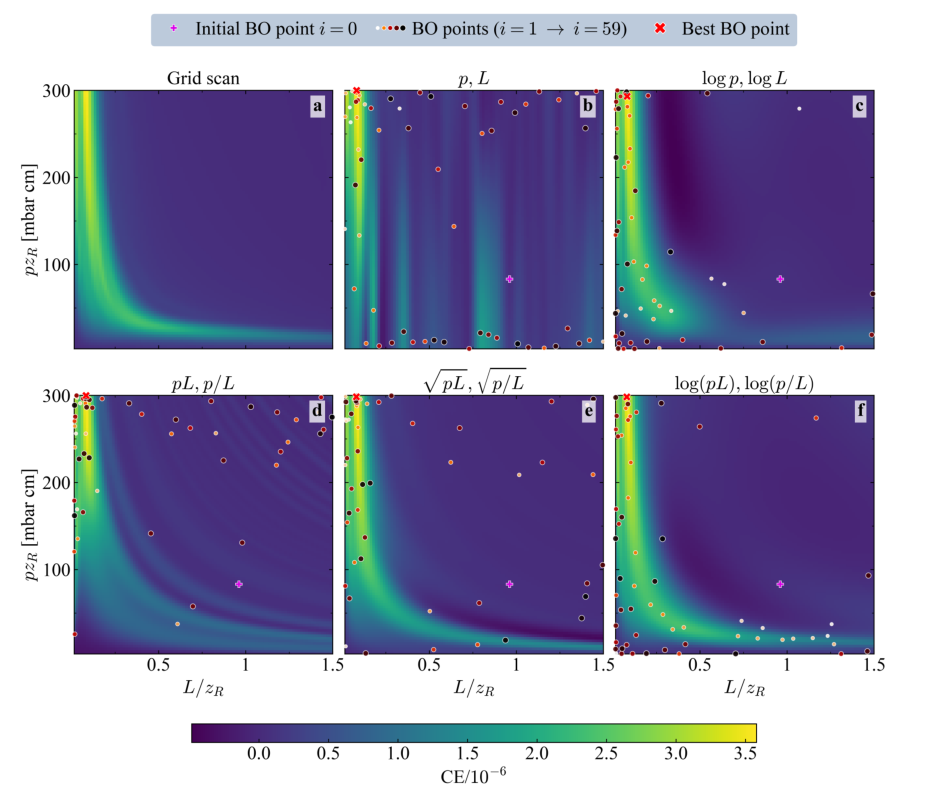
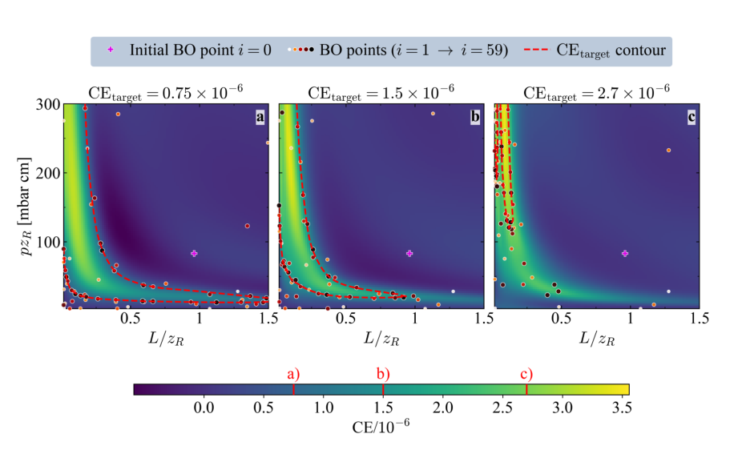
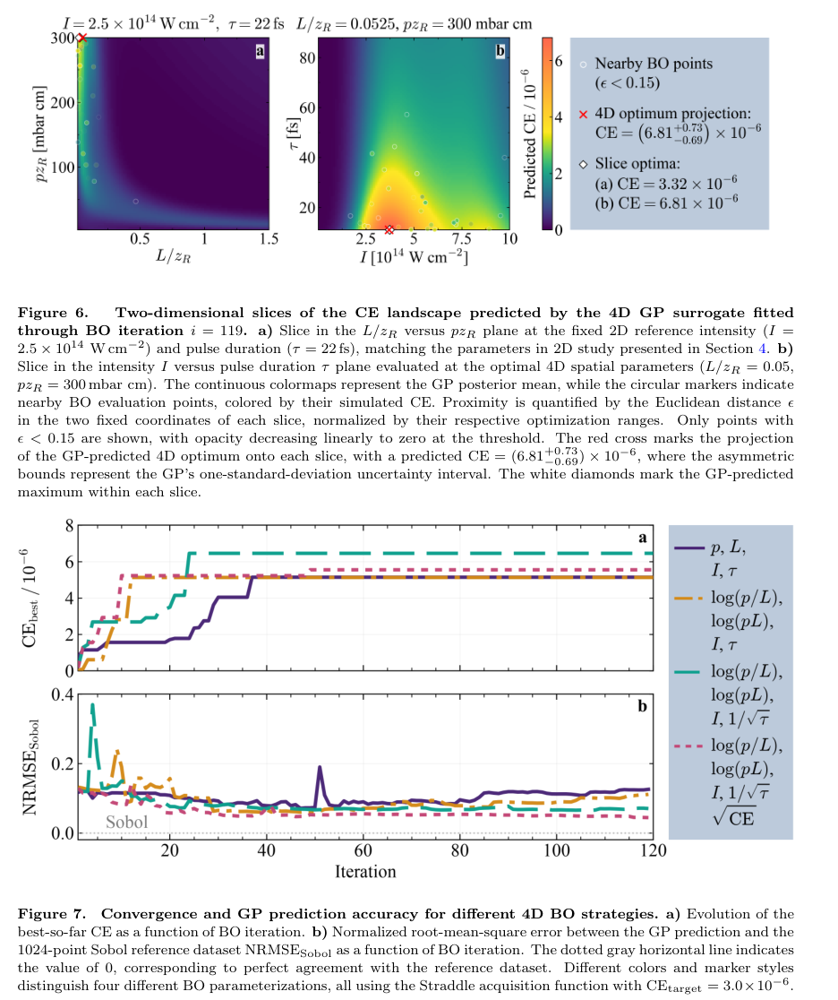

# 用物理坐标改善气体高次谐波贝叶斯优化与景观重建

## 0. 论文与阅读证据

- **原题**：Physics-informed Bayesian optimization of high-order harmonic generation in gases。
- **作者**：Dominika Maslarova、Mattys Pouyez、Patrik Jansson、Jan Vabek、Robin Weissenbilder、Linus Hagedorn、Anne L’Huillier、Tünde Fülöp。
- **版本**：[arXiv:2611.14119v1](https://arxiv.org/abs/2611.14119v1)，首投2026-11-10 14:07:56 UTC，11-11公告；[arXiv DOI](https://doi.org/10.48550/arXiv.2611.14119)。PDF页眉写明 *Mach. Learn: Sci. Technol (2026) To be submitted*，不能据模板认定已接收或正式发表。
- **全文**：[官方PDF本地副本](../pdfs/maslarova-2026-hhg-bayesian.pdf)，18页；SHA-256：`e7d29735afb6814290e95c51e22fe062367683a19d16857538b593abcf4174b5`。
- **实际工作**：通读本地布局文本、核对关键公式与图2–7，渲染检查PDF第3、5、6、7、9、10、11、12、13、14页；第6、9、11、13页另行打开，三幅保留摘录另行查看。MinerU凭据此前已失效，本轮未提交请求；使用经验证的本地文本和原页渲染。
- **证据类型**：确定性HarP高次谐波传播模拟＋GP代理／贝叶斯优化基准。文中引用实验建立物理动机，本篇没有报告新HHG实验，也没有PIC、临床或光核产额验证；本轮未运行HarP、BO、作者数据分析或收敛测试。

## 1. 摘要与引言：为什么“找到峰值”还不够

作者关注红外驱动光向XUV高次谐波的能量转换。单原子电离、连续态加速和复合决定微观偶极响应；中性气体与自由电子色散、原子偶极相位及聚焦几何相位共同决定宏观相位匹配。较强的局部响应不保证传播后的谐波能量更大。

已有理论指出，压力—介质长度平面中的高转换效率区域近似沿双曲线分布。普通平稳GP按所选坐标中的距离判断相关性，因此即便能找到高点，也可能把狭窄弯曲脊线重建成条带或假分支。本文把压力长度乘积、比值及适当的对数／平方根变换送入GP，使核函数感知的几何更接近物理结构。

第二个目标是识别超过给定效率阈值的整片运行窗口。该窗口可作为后续实验设计线索，但这里的“robust operating regimes”指确定性模拟景观中的宽高效区，没有引入实测抖动分布、误差传播或机会约束。

## 2. 高次谐波模型与计算设置（原文第2节）

### 2.1 微观—宏观耦合

HarP在柱对称、傍轴与慢变包络近似下，使用Crank–Nicolson有限差分推进红外场和谐波场。驱动场考虑线性原子响应、激光电离自由电子贡献及Kerr非线性；谐波传播考虑色散和吸收。非线性源由局部驱动场插值得到的原子偶极幅相构造。

原子电离率与谐波偶极来自预先计算的三维、单活性电子TDSE表。建表驱动含5周期上升沿与15周期平台，最后5个光学周期用于偶极傅里叶分析。因此本篇BO反复调用的是带此微观表及传播近似的HarP模型，不能当成每次都求解任意真实脉冲TDSE的从头算，也不能直接保证11 fs脉冲下所有非绝热效应已受控。

### 2.2 固定设置、搜索范围与效率定义

| 项目 | 本文设置 |
|---|---|
| 气体、温度 | 锐边、均匀氩气，293 K，介质外密度为零 |
| 激光 | 810 nm、线偏振，高斯时间强度与横向轮廓 |
| 聚焦 | 瑞利长度18.6 mm，腰斑69.3 μm；焦点始终在介质中心 |
| 原子参数 | 静态极化率约1.8×10⁻⁴⁰ C m²/V；800 nm Kerr系数9.8×10⁻²⁴ m²/W；Henke色散／吸收表 |
| 数值域 | 半径3倍腰斑、时间窗3倍强度FWHM、纵向覆盖介质全长 |
| 网格 | 径向202.9 nm，时间128.9 as，纵向步长为介质长度的1/256 |
| 两维与四维共同范围 | 压力乘瑞利长度3–300 mbar cm；介质长度／瑞利长度0.015–1.5 |
| 两维固定激光 | 峰值强度2.5×10¹⁴ W/cm²，强度FWHM 22 fs |
| 四维额外范围 | 峰值强度10¹²–10¹⁵ W/cm²，强度FWHM 11–88 fs |

理想气体密度由压力、温度计算；目标是**介质出口第23次谐波的能量转换效率**，不是所有XUV谐波的总效率，也不是远场通光孔径后的可用效率：

$$
N=\frac{p}{k_B T},\qquad \mathrm{CE}=\frac{E_{23}}{E_L}.
$$

其中气体数密度单位为每立方米；第23次谐波能量由出口谐波场模方作横向及时间积分。高斯驱动强度可写为

$$
I(r,t)=I_0\exp\!\left(-\frac{2r^2}{w_0^2}\right)
\exp\!\left(-\frac{4\ln2\,t^2}{\tau^2}\right).
$$

先对横向圆面积积分得到因子π乘腰斑平方的一半，再对时间积分得到脉宽乘根号π除以两倍根号ln2，故原文使用的入射能量为

$$
E_L=\int_{-\infty}^{\infty}dt\int_0^{\infty}2\pi r\,dr\,I(r,t)
=\frac{\pi^{3/2}I_0 w_0^2\tau}{4\sqrt{\ln2}}.
$$

这里脉宽是**强度FWHM**，腰斑是强度下降到峰值的e的负二次方所定义的半径；更换幅度宽度或半径定义会改变系数。原文将网格收敛测试放在代码仓库，本次未下载并独立复核该测试。

## 3. 贝叶斯优化方法（原文第3节）

### 3.1 顺序流程与评估次数

先由带种子的均匀随机抽样取得一个初始物理点并运行HarP；随后拟合GP、评价采集函数、选择下一点、运行HarP并把效率加入训练。原图1是这一闭环。60轮BO加初始点共61次HHG计算，120轮则共121次，不能将轮数直接当成总调用数。

每种主文二维／四维配置均做5个独立随机种子。**主文曲线展示单次运行**；跨种子的均值和标准差被作者放入HarP-BO仓库。下文主文数值不能自动解释为五次运行平均及置信区间，本轮也未读取外部种子数据。

### 3.2 GP核、坐标与输出变换

效率先除以参考量10⁻⁶，可再开平方根，然后对目标作零均值／单位方差标准化；各坐标经非线性变换后再线性映射到0–1。使用自动相关性确定的Matérn 5/2核：

$$
K(\mathbf{x},\mathbf{x}')=s^2
\left(1+\sqrt5R+\frac53R^2\right)e^{-\sqrt5R},
\qquad
R^2=\sum_{j=1}^D\frac{(x_j-x_j')^2}{\ell_j^2}.
$$

输出方差控制可表示的幅度，各方向长度尺度控制“距离多远仍相关”。坐标变换改变核中距离，因而改变代理模型的先验几何，而不是把物理约束作为偏微分方程残差加入训练。每轮用边际似然重新拟合超参数，并比较默认初始化和前一轮参数初始化，保留似然更高者。

HarP是确定性模型，观测噪声方差固定为标准化目标空间的10⁻⁵，主要起数值稳定作用；它不是测得的装置噪声。原文比较Matérn 3/2、5/2及RBF，三者收敛相近，5/2最终景观重建稍好；Matérn 1/2在第10轮后因GP拟合失败中止。该核比较细节在外部仓库，本轮仅核对论文中的报告。

### 3.3 候选池、LogEI和Straddle

非线性坐标下的包围盒可包含物理非法点。作者在归一化优化坐标内随机采样，反变换后拒绝超出原始物理范围者，直到得到512个合法候选，再选采集函数最大的点。因此方法间差别同时包含**GP距离几何和物理空间候选采样分布**的变化；论文没有把两者消融为独立因果贡献。

最大化效率使用LogEI。设当前GP预测服从高斯分布，均值、标准差分别为均值符号与标准差符号；对超过当前最佳值的正增量取期望，可由高斯积分得到

$$
\gamma=\frac{\mu-f_{\rm best}}{\sigma},\qquad
\mathrm{EI}=(\mu-f_{\rm best})\Phi(\gamma)+\sigma\phi(\gamma),
\qquad a_{\rm LogEI}=\log\mathrm{EI}.
$$

第一项奖励可能的均值增益，第二项奖励不确定区，取对数改善极小EI的数值稳定性；公式均在经过目标变换／标准化的GP空间应用。

阈值窗口采用Straddle，原文式(6)在PDF中具有绝对值符号：

$$
a_{\rm Str}(\mathbf{x})=1.96\,\sigma(\mathbf{x})
-\left|\mu(\mathbf{x})-f_{\rm target}\right|,
\qquad \mathrm{CE}(\mathbf{x})\geq\mathrm{CE}_{\rm target}.
$$

高不确定性增加采样优先级，偏离阈值越远则优先级越低，使采样沿高效区边界集中。目标阈值必须经过与训练输出相同的变换和标准化。1.96对应高斯代理假设下约95%的区间尺度；论文未用实验真值验证其概率覆盖率，不能作真实运行安全概率。

### 3.4 独立参考与指标

二维参照是覆盖物理域的100×100均匀网格，共10,000次HarP计算。四维用独立、乱序Sobol序列的1024点作为参考，全部排除于BO训练，供所有参数化共同评估。它是有限测试集，不能穷尽四维域。

$$
\mathrm{NRMSE}=\frac{\sqrt{\frac1M\sum_{m=1}^M(G_m-P_m)^2}}
{\max(G)-\min(G)}.
$$

参考值与预测值都是反变换后的物理效率。分母是**参考效率的动态范围**，不是每点效率，因而0.044不等于每点4.4%的相对误差，低效率区可有较大相对误差。

二维另用全域SSIM：

$$
\mathrm{SSIM}=\frac{(2\bar G\bar P+C_1)
(2\operatorname{Cov}(G,P)+C_2)}
{(\bar G^2+\bar P^2+C_1)(\operatorname{Var}(G)+\operatorname{Var}(P)+C_2)},
$$

其中稳定常数分别取参考动态范围乘0.01和0.03之后的平方。它比较整体亮度、幅度和相关结构；本文用**全局**统计，未作常规图像SSIM滑窗，四维未报告SSIM。最优点好不代表全域误差好，全域指标好也不保证窄边界或尾部都准确。

## 4. 两维压力—长度结果（原文第4节）

### 4.1 双曲脊线、变换和最优点

先定义缩放压力与长度，再以乘积和比值描述双曲线：

$$
P=pz_R,\qquad Q=L/z_R,\qquad
u=\log_{10}(PQ),\quad v=\log_{10}(P/Q).
$$

原文后续将缩放量简写为压力、长度。乘积恒定对应同一条近似双曲线，比值标记沿线位置。若使用文中固定单位计算对数，反变换为

$$
P=10^{(u+v)/2},\qquad Q=10^{(u-v)/2}.
$$

这一代数关系把双曲脊线变为近似定乘积坐标面。对有量纲数作对数隐含原文使用的固定单位；跨系统复用时应显式固定参考量和单位。作者比较线性坐标、分别取对数、乘积／比值、乘积／比值分别开平方、乘积／比值分别取对数五种配置。

**原图2（PDF第9页）**：横轴介质长度／瑞利长度，纵轴压力乘瑞利长度，单位mbar cm；共用色标为效率除以10⁻⁶。a是10,000点HarP网格，b–f是GP拟合至第59轮后的均值；圆点由浅到深、由小到大表征后续采样，紫加号为共同初点，红叉为已采样最佳点。a的高效带近似双曲线；b出现竖带，d出现假双曲分支；e、f的脊线结构更接近参照。负颜色来自不受正值约束的代理输出，不是负的物理转换效率。

每种配置做60轮BO。由于GP在下一次采样前拟合，图2及重建指标用至第59轮的观察，而最佳已采样效率曲线包含第60轮，比较时应保留这一轮差。

图3给出原图2对应的定量结果：五种坐标最终最佳效率均约3.6–3.7×10⁻⁶，但重建差异很大。线性坐标约3.67×10⁻⁶、NRMSE约0.14、SSIM约0.77；对数乘积／比值约3.64×10⁻⁶、0.04、0.98；平方根乘积／比值的NRMSE约0.05、SSIM约0.97。**最佳重建不等于最快找峰或最高采样峰值**。

### 4.2 阈值运行窗口

使用对数乘积／比值坐标和Straddle，分别选0.75、1.5、2.7×10⁻⁶三个效率阈值，各60轮。

**原图4（PDF第11页）**：横纵轴及色标与图2相同，红虚线是代理预测的阈值边界。阈值低时覆盖长介质／低压和短介质／高压两支；阈值提高后窗口变窄，2.7×10⁻⁶时主要集中短介质／高压端。采样点集中边界，表示该策略在学习“哪里越过阈值”，并不优先寻找唯一峰值。图例写采样至第59轮，图注叙述写至第60轮，保留原文这一轮数口径差异，未用本轮复跑判定哪者正确。

原图5显示三配置都在前20轮达到各自最高已采样效率。最高阈值配置在第19轮达到约3.47×10⁻⁶，接近直接网格的3.56×10⁻⁶。60轮后的NRMSE均小于0.08；中高阈值SSIM约0.98，低阈值约0.95。这里的网格峰值与BO连续候选峰值不同，并不构成两者矛盾：均匀有限网格可漏掉网格间更高点。文中可见的细小次级边界只作为候选结构，尚非已验证多分支普适性。

## 5. 四维结果：脉宽坐标与输出变换（原文第5节）

保持压力／长度范围，加入强度与脉宽，比较四种配置：原始四坐标；对数乘积／比值加原始强度／脉宽；再把脉宽改为其平方根的倒数；最后额外对效率开平方根。所有配置用Straddle、阈值3.0×10⁻⁶、120轮BO。

脉宽变换来自已有研究中“各强度对应最优脉宽处的最大效率近似随最优脉宽负二分之一次方变化”的经验物理标度。作者将其推广为整个输入域的坐标，这在本文基准中有效，但原标度**没有证明离开最优轨迹的整个四维景观都满足同一律**。

**原图6（PDF第13页上）**：a的横轴长度／瑞利长度、纵轴压力乘瑞利长度，在22 fs和2.5×10¹⁴ W/cm²切片；b横轴强度、单位10¹⁴ W/cm²，纵轴脉宽fs，在高压短介质切片。色标为预测效率除以10⁻⁶；空圆只是固定坐标归一化距离小于0.15的附近采样，不代表准确落在同一切片。红叉为四维预测最优点的**投影**，白菱形才是各切片自身最优，因此a中的红叉位置不能按a色值读成四维最优效率。b图标题写长度比0.0525，图注写0.05，应按原文保留近似／口径差异。

该代理给出的域内预测最优参数及作者另做的确认计算为：

$$
\frac{L}{z_R}=0.0525,\quad pz_R=300\ \mathrm{mbar\,cm},\quad
I=3.70\times10^{14}\ \mathrm{W/cm^2},\quad \tau=11\ \mathrm{fs},
$$

$$
\mathrm{CE}_{\rm GP}=(6.81^{+0.73}_{-0.69})\times10^{-6},
\qquad \mathrm{CE}_{\rm HarP}=6.96\times10^{-6}.
$$

对应介质长度约0.9765 mm、压力约161.3 mbar，均是按已给瑞利长度换算，非独立测量。误差条是平方根目标反变换后的GP一个标准差区间尺度，**不是实验统计误差，也不是作者用大量验证点标定的置信区间**。若正平方根目标在某点取均值加减标准差再平方，上下变化含有正负两倍均值乘标准差及同号标准差平方，故变得不对称；这解释形状，不能把平方后的均值自动等同完整后验期望。

压力最优落在上界、脉宽落在下界，不能称绝对物理最优；扩大域或优化低压分支可能出现更高效率或其他脉宽。

**原图7（PDF第13页下）**：横轴BO迭代，a为最佳已采样效率除以10⁻⁶，b为对1024个独立Sobol点的动态范围归一化误差。含脉宽变换但不变换目标的配置采样最高约6.46×10⁻⁶；加平方根效率后最高约5.55×10⁻⁶；原始坐标约5.14×10⁻⁶。加平方根效率配置虽采样峰较低，景观预测最好：NRMSE约0.044，相对原始坐标0.126下降约65%；相对相同物理坐标但不变换效率的配置下降约37%。单次图中的峰值排序不能推广成统计显著排名。

上面的6.96×10⁻⁶是作者根据代理最优位置**额外确认**的HarP结果，不属于120轮内的5.55×10⁻⁶最佳已采样数，不能将两者混为同一采样预算成绩。1024点独立验证与10,000点二维参照也有成本；61对10,000的调用数比较不是含所有训练、验证、超参数拟合和确认开销的端到端加速比。

## 6. 结论、可复现资源与后续问题（原文第6节及文后信息）

作者的主要结论是：在指定氩气、第23次谐波和参数域中，把物理标度融入输入坐标及输出尺度，能改善相同BO预算下的GP全域重建；阈值采样可描绘较宽运行窗口。论文没有附录，第15–18页为资助与参考文献。

文中给出[HarP-BO仓库](https://github.com/HarmonicPropagation/HarP-BO)、[v1.0.0代码归档](https://doi.org/10.5281/zenodo.24023612)、[单独的大型数据归档](https://doi.org/10.5281/zenodo.24044917)，以及HarP软件和方法前作。这里保留作者提供的入口，本轮未下载代码、固定SHA或重验外部数据，因此不宣称完成计算复现。

后续可证伪核查应优先针对：五种子的均值／离散度；同一物理候选池下的坐标消融；域边界扩展与代理不确定性的覆盖率；低效率区相对误差和阈值误分类；11 fs下微观表近似；锐边／均匀气体、固定焦位及柱对称假设；含焦位、波长、气种、气体轮廓的域外迁移；最终实验的强度、压力、脉宽抖动及可用XUV能量。不能仅因模型窗口宽就宣称真实源已稳定运行。

## 7. 速记

物理坐标变换让GP“看见”压力—长度高效脊线；平方根效率进一步改善四维景观预测。本文最强证据是有独立数值参照的代理重建，域内最高确认效率约6.96×10⁻⁶；它仍是作者预印本中的模拟结果，没有新实验及域外最优证明。
