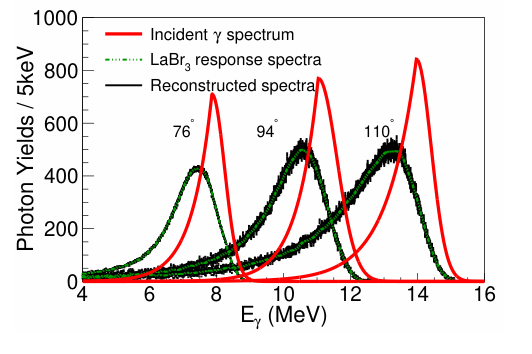
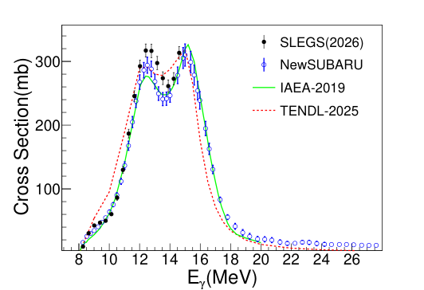
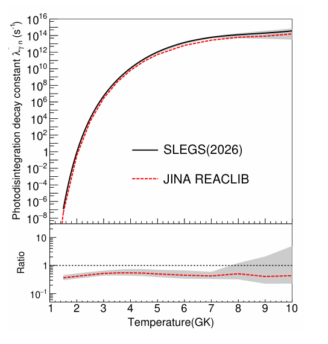

# SLEGS 的 Tm-169 光中子截面与恒星反应率：全文笔记

## 0. 文献信息与阅读范围

- Wang 等，*Measurement of the 169Tm(γ,n)168Tm Cross Section and Implications for γ-Process Calculations*；[官方 arXiv 2611.12994v1](https://arxiv.org/abs/2611.12994v1)，[DOI](https://doi.org/10.48550/arXiv.2611.12994)。首投 2026-11-08 12:44:23 UTC，11-11 分类公告。
- 实际阅读：[14页作者预印本](../pdfs/wang-2026-thulium-photoneutron.pdf)，正文至第12页，参考文献至第14页。官方元数据没有期刊版字段；有限 Crossref 标题前三项查询未核实同作品正式版，不代表正式版不存在。作者 Zi-Rui Hao、Bao-Shan Xi 的姓名顺序依 PDF 首页，arXiv 元数据将两者倒置。
- 方法：SLEGS 激光康普顿散射（LCS）γ束实验、探测器响应与截面展开、SLO 拟合、TALYS-2.0 反应模型和 MESA/反应网络后处理。LCS 使用储存环电子束与激光，不是激光尾场电子打转换靶。
- MinerU 已知凭据失效，本轮未请求；使用经验证 PDF、逐页文本和第1–12页渲染。图3、5、9保留原图裁剪，其他图逐图文字解释。未复跑 Geant4、展开、拟合、TALYS、MESA 或网络。
- 与已收录 [Gheorghe 等](../../2026-09-24/notes/Gheorghe%20et%20al.%20-%202026%20-%20Ho%20and%20Tm%20photoneutron%20reactions.md) 是不同作品：旧文基于 NewSUBARU，本篇新增 SLEGS 测量；**本篇联合拟合复用旧设施数据，不能把两套拟合当独立复现**。

## 1. 摘要与引言：新增实验锚点，反应率仍依赖模型

作者测量中子阈值以上至14.61 MeV的截面，先恢复入射γ能谱，再由有限带宽测量展开单能截面。12 MeV以下与 NewSUBARU 和 IAEA-2019较一致；第一GDR峰附近较高。摘要说“显著较高”，结论限定差异最高约10%、仍在合并不确定度内，因此不据此认定解决了数据分歧。

引言先区分 s/r 过程和富质子核的 γ 过程，再说明反应网络对强度函数、能级密度和光学势的依赖。Tm-169是稳定、形变、奇质量核，适合检测分裂GDR。IAEA-2019和更新后的 NewSUBARU 结果具有共同实验基础，不能把两者算作两次独立实验。SLEGS通过独立光子监测、探测器和展开链提供额外检验。

## 2. 实验装置（原文II）

### 2.1 束线与靶：图1

图1是束线示意，无定量坐标。CO₂激光与电子束碰撞产生γ束，经C5 5 mm、T2 2 mm孔径准直，照射FED中央Tm靶；剩余γ经铜衰减器进入下游LaBr₃探测器。图中同时画斜碰撞与背散射光路，不等于本次同时使用两种独立源。

SLEGS平台可提供约0.66–21.7 MeV、10⁵–10⁷ photons/s；**本次通量约10⁵ photons/s、能谱宽度6%–12% FWHM**，不是平台最佳“几个百分比”条件。靶纯度>99.99%，直径10 mm、厚5.0 mm、密度9.32 g/cm³、面密度1.66×10²² nuclei/cm²。载体为低活化聚乙烯，开孔10 mm。面密度与自衰减需同时处理，不能直接当薄靶。

### 2.2 FED响应：图2与式(1)

26根、2 atm、长度500 mm的³He管位于450×450×550 mm³聚乙烯慢化体，三环半径6.5/11.0/17.5 cm、各6/8/12根；周围含镉聚乙烯抑制背景。²⁵²Cf标定、环比和Geant4用于校验。

图2横轴中子能量MeV，纵轴效率%；三环的能量依赖彼此补偿，总响应约35%至42%，主测量中子多在1.5 MeV以下。曲线主要是模拟，²⁵²Cf实验标记是有限标定点，不能称整个能区逐点实测。

$$
\bar\epsilon_n=\frac{\int\phi_n(E_n)\epsilon(E_n)\,dE_n}{\int\phi_n(E_n)\,dE_n}\simeq0.40.
$$

分子是能谱各部分的预期检出数，分母是总发射数，故比值为平均检出概率。谱来自受约束γSF的TALYS计算；更换Maxwell谱和NLD/γSF模型产生的平均效率散布在3%以内，文中采用3.02%效率不确定度。效率近似平坦减少模型敏感性，但没有消除它。

### 2.3 光子监测、图3与DAQ

横轴γ能量MeV，纵轴 Photon Yields/5 keV；76°、94°、110°是碰撞/观察几何标记。绿点划线为测得的LaBr₃响应谱，红线为恢复的入射谱，黑线为入射谱重新折叠后的响应预测。黑绿吻合检验响应闭合，**黑线不是入射谱**；原图图例简写与图注需结合阅读。红谱仍有低能尾，并非δ函数单能源。图中计数尺度不能直接换成全束绝对通量。

铜衰减器降低瞬时计数率和堆积；³He由Mesytec MDPP-16/MVME记录幅度、通道和时间，LaBr₃由CAEN DT5730B/CoMPASS读出，激光时序用于背景区分。响应去除与通量标定是截面链的重要输入，非后续可忽略修正。

## 3. 截面提取与误差（原文III）

### 3.1 从计数到折叠截面：式(2)

$$
\sigma_f(E_{\max})=\int_{S_n}^{E_{\max}}n_\gamma(E)\sigma(E)\,dE
=\frac{N_n}{N_\gamma N_t\zeta\bar\epsilon_n},\qquad S_n=8.03\ {\rm MeV}.
$$

这里 nγ 是该次测量归一化的光子能谱，Nₜ为靶核面密度，ζ为厚靶自衰减因子。每个光子在有效靶中的反应概率为截面乘面密度，乘光子总数和效率得到检出计数，即上式来源。**量纲核查**：Nₙ若为积分计数，Nγ必须取对应积分光子数；若Nγ使用文中“flux”的 photons/s，则Nₙ也应换成计数率或补照射时间。这是复现时需明确的归一化约定，不是已查明作者代码出错。

最高能量14.61 MeV低于双中子阈值14.88 MeV，本文能区不需多重中子修正。该结论不能直接推广到更高端点的韧致辐射源。

### 3.2 欠定展开、图4与式(3)–(5)

$$
\boldsymbol\sigma_f=D\boldsymbol\sigma,\qquad
D_{ij}=\int_{E_j}^{E_{j+1}}n_{\gamma,i}(E)\,dE.
$$

每一束谱是矩阵一行，每个单能截面箱是一列；能箱多于束流设置时，数据不能唯一决定全部箱值。原文从平坦初猜开始，折叠预测与数据相减，经样条协调不同网格，再将残差加回试探曲线，直至约化χ²约1。印刷式(5)省略了显式插值算子；复现必须取得网格、插值、停止规则、误差相关和非负性处理，不能直接把不同维数向量相加。

图4横轴Eγ/MeV，纵轴截面mb；黑点是有限带宽折叠值、红线为单能展开值、阴影为总误差。阈值附近红线高于黑点，因为低能尾有部分光子不足以产中子。展开后的18点不是18个彼此独立的理想单能实验；应保留共同通量和探测效率系统误差。

### 3.3 不确定度与静态核查

原文列统计、算法和系统三类。GDR统计通常<3%；背景时间窗变更2.20%，LaBr₃去响应1.00%；系统包括FED 3.02%、光子通量标定1.00%、面密度/自衰减<0.10%、铜杂质与对准<1.00%。表I是展开后传播结果，总相对误差2.3%–6.9%，多数峰区约3%–4%；不能把展开前百分数逐项套到表I。

$$
\Delta\sigma_{\rm tot}=\sqrt{(\Delta\sigma_{\rm stat})^2+(\Delta\sigma_{\rm algo})^2+(\Delta\sigma_{\rm syst})^2}.
$$

这来自独立误差源的方差相加。两项算法误差若独立，2.20%和1.00%的平方和根约2.42%，原文却写合计约2.20%，需澄清合并/舍入口径。式(6)使用“net”和“background”计数的和开根号；独立开关窗、等曝光时，若前者真为已扣背景净数，应为净数加两倍背景的方差，故需作者说明原始计数和背景缩放定义。这里只做印刷定义审查，未重算原始统计。

6%–12% FWHM是**束流谱宽**，不是每个表I能量的对称误差条；能标还有几十keV标定不确定度和响应矩阵敏感性。表I逐项转录于[18点CSV](../research/wang-table1-cross-sections.csv)，未将转录数据包装成独立测量。

## 4. 实验结果、GDR与逆反应（原文IV）

### 4.1 截面与图5

横轴γ能量MeV，纵轴截面mb。黑点为本次SLEGS、蓝空心点为NewSUBARU，绿/红为IAEA-2019/TENDL-2025。SLEGS的范围仅8.27–14.61 MeV；图中更高能部分属于其他数据或评价。12 MeV以下较一致，12–14 MeV第一峰区本次高约最多10%，不能把整个26 MeV横轴都说成本次扫描。

表I例值：8.27 MeV时9.48±0.65 mb；12.41 MeV时317.08±10.26 mb；12.78 MeV时316.49±10.48 mb；14.61 MeV时313.45±9.77 mb。TENDL对低能上升、峰高和两峰间低谷均有形状偏差；评价库的选择会影响阈值附近厚靶卷积。

### 4.2 三Lorentz项拟合：图6与表II

$$
\sigma(E)=\sum_{i=1}^{3}\frac{\sigma_{mi}E^2\Gamma_i^2}{E^2\Gamma_i^2+(E^2-E_{mi}^2)^2}.
$$

每项在E=Eₘᵢ达到σₘᵢ，Γᵢ控制宽度；相加描述形变GDR分裂及高能有效项。联合拟合使用SLEGS数据与NewSUBARU总光中子数据8.26–39.3 MeV，并按各自误差加权。**σ(γ,n)与总σ(γ,Sₙ)仅在本文双中子阈值以下可等同**，不可将更高能多中子数据直接当单中子截面。

图6横轴MeV、纵轴mb，红线是两套数据联合拟合、阴影为九参数协方差传播的1σ带。联合拟合第一/第二峰的中心12.30±0.03、15.68±0.04 MeV，宽2.21±0.06、3.90±0.12 MeV，峰参数247.86±5.14、306.95±5.56 mb；这些是单个Lorentz项参数，**不等于总曲线峰高317 mb**。

联合χ²/ndf约8.7，作者明确参数误差为下限，不能把很窄拟合带当数据张力已解决。SLEGS-only拟合固定第二项中心/宽度和第三项，只放开第一项三参数及第二项峰幅，故并非全部独立九参数测定。第三项约25.38 MeV、宽15.23 MeV，仅受较稀疏高能数据约束，是有效参数化，不应解释成独立已证实新共振。

### 4.3 γ强度函数：式(9)–(11)与图7

$$
\overleftarrow f_{X1}(E)=\frac{\langle\Gamma_{X1}(E)\rangle}{D_\lambda E^3},\qquad
\overrightarrow f_{X1}(E)=\frac{\langle\sigma^{\rm abs}_{X1}(E)\rangle}{3(\pi\hbar c)^2E},\qquad
f_{E1}(E)\simeq\frac{\sigma_{\gamma n}(E)}{3\pi^2(\hbar c)^2E}.
$$

平均辐射宽除平均能级间隔及E³给下行偶极强度，光吸收截面除相空间因子给上行强度；再假设广义Brink–Axel上下行近似相同、且中子道主导吸收衰变，才得到最后一个近似。f单位MeV⁻³，截面和ℏc必须使用相容面积单位。

图7横轴Eγ/MeV、纵轴γSF/MeV⁻³（主图对数），插图在线性刻度比较两种拟合。默认SLO过于平滑；SMLO在9–11 MeV较接近，Gogny D1M HFB+QRPA局部可高到约两倍；没有一种默认处方同时复现低能斜率和完整双峰。本次SLO与旧SLO峰值相差<约10%。**测量阈值以下仍是SLO外推**，没有直接测到低能去激发强度。

### 4.4 逆(n,γ)截面与图8

Tm-168半衰期约93 d，直接俘获实验困难，作者用同一E1强度做HF逆反应预测。图8双对数：横轴入射中子MeV，纵轴截面barn；黑线/灰带为模型和NLD变化，彩线为评价库。1 MeV附近差异约两倍以内，keV区差异较大，2 MeV以上库间可差近一个数量级。详细平衡联系跃迁矩阵元，**不等于实验直接测到Tm-168的keV俘获截面**；NLD、中子光学势和阈下γSF依赖仍在。

## 5. 基态与恒星反应率（原文V）

$$
\lambda_{\gamma n}^{\rm gs}(T)=c\int_{S_n}^{\infty}n_\gamma(E,T)\sigma^{\rm gs}_{\gamma n}(E)\,dE,\qquad
n_\gamma(E,T)=\frac{8\pi E^2}{h^3c^3[\exp(E/k_BT)-1]}.
$$

黑体单位能量体积内的光子数乘c给通量，再乘截面并积分，得到每靶核每秒反应概率。在E用MeV、σ用mb、T₉=T/10⁹ K时，原文给：

$$
\lambda_{\gamma n}^{\rm gs}(T_9)=3.953\times10^{14}\int_{S_n}^{\infty}\frac{E^2\sigma^{\rm gs}_{\gamma n}(E)}{\exp(11.605E/T_9)-1}\,dE\quad({\rm s}^{-1}).
$$

恒星中激发态按Boltzmann统计权重加入：

$$
\lambda^*(T)=\frac{1}{G(T)}\sum_i\frac{2J_i+1}{2J_0+1}\exp[-E_i/(k_BT)]\lambda^{(i)}(T).
$$

G归一化为基态统计权重，低能离散能级求和、高激发部分用带自旋/宇称的NLD积分。实验只给基态锚点，λ*不是实验直接测量，也不等于上一式的λgs。

横轴温度GK；上图纵轴恒星光致蜕变常数s⁻¹（对数），黑线为TALYS、红虚线为JINA REACLIB。下图Ratio定义是**REACLIB/本次**，不是相反。在T₉约2–3.5，该比值0.44–0.55，故本次模型率约1.8–2.3倍；灰带是NLD变更，不是全部模型误差或实测置信带，约在该温区有20%–33%半宽，高温可扩到59%–91%。例如表III T₉=2.5的λ*为1.06×10⁴ s⁻¹，λlab仅8.54 s⁻¹，两者不可混用。

图10横轴GK、纵轴Nₐ⟨σv⟩，单位cm³ mol⁻¹ s⁻¹，对数轴；黑线为恒星俘获率、灰带来自NLD，紫虚线为REACLIB。T₉约0.1本次约高四倍。表III扩至极低温0.15，作者声明修改TALYS，以双精度和Eγ/kBT截断从80提高至700计算极小光中子率；这些数值不能视为未修改标准程序输出。未获得修改代码，未复现极小数值稳定性。

## 6. 网络敏感性（原文VI）、图11与结论（VII）

作者使用MESA v12778的20 M⊙、Z=0.02前身星；thermal-bomb给10⁵¹ erg，注入0.01 M⊙壳层，NucNet Tools网络含7852核素/48,965反应。重点展示质量坐标3.25 M⊙、峰温T₉约2.5的一条轨迹，冷却后继续10 Myr衰变。

图11横轴质量数，纵轴丰度Y（对数）；不同颜色标不同元素，实心/空心点分别比较默认、本次率与人为缩小10³倍的极端率。约两倍的实际率更新对最终p核丰度影响很小；极端降低10³倍时Tm-168衰变产物Er-168变化约一数量级。极端扰动是敏感性工具，不是测量误差。该单模型/重点轨迹结论不能推广成所有超新星质量、初始组成和核素均不敏感；局部流量可以改变而最终稳定丰度变化不大。原文对局部Tm流量的因果说明需完整网络流确认，本轮没有独立核查。

结论能支持：新增独立设施的18个展开截面点，约束分裂GDR、提供模型率比较；不能支持：阈下γSF已实测、逆俘获已实验验证、所有核天体模型已闭合。原始计数、响应矩阵/协方差、TALYS修改与网络输入未随本次取得；文中表I/III及NewSUBARU数据说明可向作者索取，后者部分为私人通信。

## 7. 对本库方向的用途与后续核查

用于韧致辐射或宽谱γ驱动的Tm核反应时，应将源在靶内的光谱、面密度、自衰减和能量依赖截面卷积，不能把317 mb峰值乘总光子数替代能谱积分。超过14.88 MeV还须纳入多中子道并区分反应计数与中子总数。本文没有给激光驱动电子—转换靶—核素分离的端到端产额、比活度、剂量或防护验收。

下一步优先取得原始开/关窗计数、光子积分/时间归一化、响应矩阵与完整协方差，澄清算法误差合并和式(6)计数定义；与库内NewSUBARU数据在同一截面定义/能标上比较，并取得联合拟合高χ²的处理与TALYS低温修改。速记：**截面是实验加响应展开，恒星/逆反应是模型推断；新SLEGS数据独立，联合拟合不独立。**
