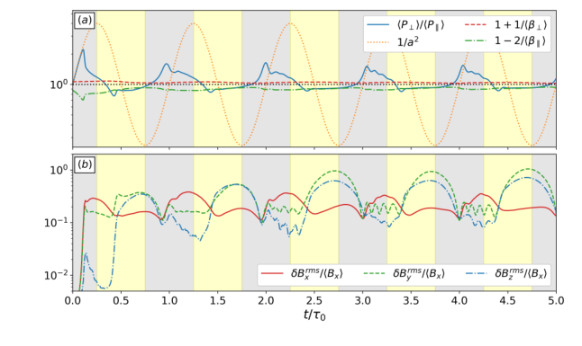
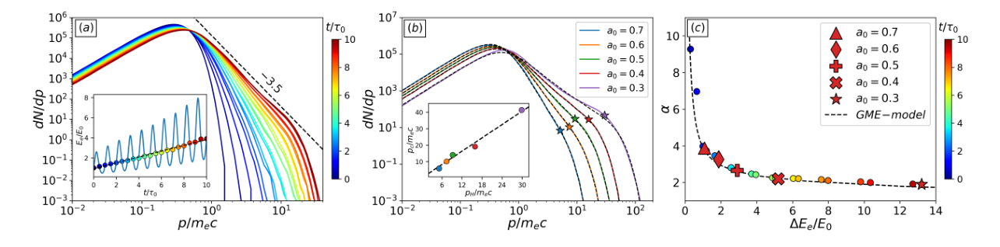
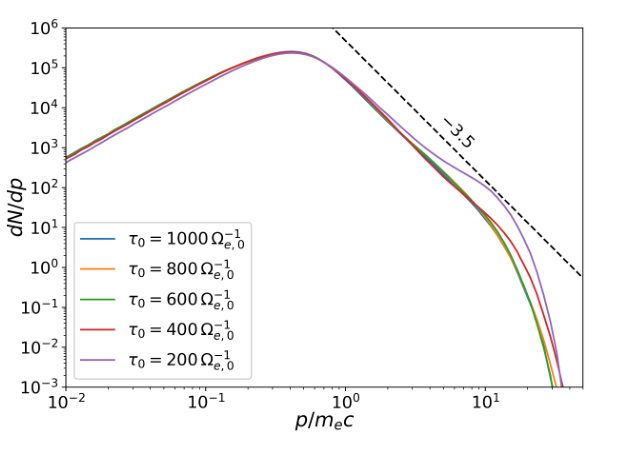

# 脉动高β等离子体的磁泵浦非热加速：PIC与广义最大熵模型

## 0. 论文、版本与阅读依据

- 原题：Nonthermal Particle Acceleration by Magnetic Pumping in Pulsating Plasmas。
- 作者：Giuseppe Arrò、Vladimir Zhdankin、Fabio Bacchini。
- 正式记录：[Physical Review Letters 137, 205201](https://doi.org/10.1103/wyt1-24q7)，2026-11-12发表、10-23接受；期号日期11-13不是在线发表日。
- **实际阅读全文**：[官方arXiv:2606.05286v2](https://arxiv.org/abs/2606.05286v2)，6-3首投、10-26修订，8页含补充文字与参考文献；不是取得的PRL VOR。PDF首页版本条与作者/标题对应，固定v2与无版本PDF字节相同。APS正文页当前要求订阅，CHORUS作者稿预计2027-11-12开放；本次官方harvest返回401 JSON，DOI入口403。
- 本地：[PDF](../pdfs/arro-2026-magnetic-pumping.pdf)；[布局文本](../pdfs/arro-2026-magnetic-pumping.txt)。SHA-256：`698e4829cb3b34e14f2424ffe30c25757b4f0d928745133e2314f715aa695e4e`。
- MinerU历史认证失效，本次零请求、未复测；使用已验证本地文本与原页渲染，目视p1–7。没有运行Zeltron、拟合或空间等离子体观测分析；补充GIF未取得/播放。

## 1. 摘要与引言：能量来自哪里

摘要提出：在高β等离子体中，周期压缩/膨胀可通过压力各向异性不稳定性，把外加宏观形变的能量留在粒子中，形成非热尾。证据是作者PIC与统计模型的比较，不是原位观测或激光实验。

引言先区分能库：低β情况下磁自由能足以支持重联或湍流加速；高β情况下磁能占比小，亚声速大尺度可压缩流可成为替代能源。作者列出磁鞘、吸积流和星系团环境作为潜在应用，未在这些真实环境中测得本文参数链。

第二步是不可逆性：绝热压缩升温、膨胀降温本可相互抵消；压缩产生垂直压力过量、膨胀产生平行压力过量，镜像/火管等模俘获或散射粒子，改变回程轨迹，使一个完整周期后仍留下净粒子能量。本文要补的是“磁泵浦产生非热尾”的自洽数值证据，而不是仅证明加热。

## 2. Methods：脉动箱是外加驱动

实验室坐标与随动坐标满足原文式(1)：

$$
\boldsymbol{x}=\operatorname{diag}(1,a,a)\boldsymbol{x}',\qquad
 a(t)=a_0^{\sin(2\pi t/\tau_0)}.
$$

这里的a0是无量纲线性尺度参数，τ0是周期，平均磁场沿x。它**不是**激光归一化振幅。随动网格固定，惯性力处理yz方向形变；即便只解二维空间，z方向压缩对动量的作用仍纳入。

对于a0=0.5，一个周期内y方向从初始Ly缩到Ly/2、再伸到2Ly、再回Ly；三维体积元正比a²，因此连续性和磁通冻结给出：

$$
 n\propto a^{-2},\qquad B_x\propto a^{-2}.
$$

由双绝热关系，若粒子始终绝热、非相对论且初始各向同性，则垂直压力正比nB、平行压力正比n³/B²，因此：

$$
P_\perp\propto a^{-4},\qquad P_\parallel\propto a^{-2},\qquad
P_\perp/P_\parallel=a^{-2}.
$$

这是无不稳定性时的参照，不是模拟的实际闭合。式中压力和磁场采用Gaussian/cgs定义。

作者使用Zeltron、电子—正电子对等离子体、周期边界；初始每物种密度n0、Maxwell–Jüttner温度T0/(me c²)=0.04，总压力对应β0=16，vA,0/c约0.07。初始域为64ρe,0×64ρe,0，1024²格，每格每物种512宏粒子，基准τ0=400Ωe,0⁻¹，演化10周期。该参数不是实际电子—离子质量比、开放逃逸或三维实验装置。

## 3. Results：从各向异性到净加速

### 3.1 压力阈值与不稳定性

作者从总压力张量去掉整体流动贡献，以局域磁场投影定义平行/垂直压力，然后比较体平均量。原文使用的镜像与火管参照阈值为：

$$
\frac{\langle P_\perp\rangle}{\langle P_\parallel\rangle}
>1+\frac{1}{\langle\beta_\perp\rangle},\qquad
\frac{\langle P_\perp\rangle}{\langle P_\parallel\rangle}
<1-\frac{2}{\langle\beta_\parallel\rangle},\qquad
\beta_j=8\pi P_j/B^2.
$$

阈值用于解释模的出现；平均量越界不能代替每个空间点的局部色散分析。

**原图1，PDF p2。** 横轴t/τ0；上图纵轴是平均垂直/平行压力比，对数刻度，橙点线为a⁻²，红/绿线为上述阈值；下图为各磁涨落分量rms除平均Bx。灰/黄区分别压缩/膨胀。蓝线被限制在远窄于绝热参照的区间，磁涨落随越阈出现，支持不稳定性散射解释；这本身不是能量转换效率测量。

原图2（p3，全文查看，未另留裁图）给出满压缩t=2.25τ0和满膨胀2.75τ0的二维随动坐标磁场/密度图。压缩时斜向镜像结构与密度反相关，膨胀时平行及斜向火管模的横向磁扰动增强；二维几何限制了可用波矢，不能将三分量振幅关系直接外推三维。

### 3.2 能量增量与分布：不要把29%写成效率

在每半周期回到初始尺度时取样，避免把可逆压缩能误认为净加热。a0=0.5的电子总动能可近似为：

$$
E_e/E_0\simeq1+0.29\,t/\tau_0.
$$

这是相对于**初始电子动能**每周期约29%的线性增量，不是每周期乘1.29，不是外加功到非热粒子的29%效率。正电子出现类似行为；本文未给出可用于激光系统的墙插效率或外加机械功完整账本。

**原图3，PDF p4。** (a)横轴p/(me c)，纵轴dN/dp为每动量区间粒子数，均对数；颜色为t/τ0，插图为Ee/E0。分布尾随时间增长，虚线斜率−3.5是图示/正文的尾部参照。(b)同样坐标，比较不同a0在10周期时分布及含截断拟合；插图pc、pH均除me c，黑线pc=1.35pH。(c)横轴净电子能量增量ΔEe/E0、纵轴拟合α；彩点为a0=0.3时间演化，红符号为不同振幅10周期结果，黑虚线为式(9)。图示符合有限参数扫描，不证明任意成分/碰撞度/空间维数普适。

作者式(2)–(3)的拟合形为：

$$
\frac{dN}{dp}=C p^2
\left[1+\frac{\epsilon(p)}{\epsilon_b}\right]^{-\alpha-2}
\operatorname{sech}\!\left[\frac{\epsilon^2(p)}{\epsilon_c^2}\right],\qquad
\epsilon(p)=\sqrt{p^2c^2+m_e^2c^4}-m_ec^2.
$$

p是动量大小，p²来自三维动量壳体积，εb是折点、εc是单粒子截断能。只有在ε≈pc、远高于折点且尚未截断的区间，p²与括号相乘才给出p⁻α。能谱须另乘dp/dε，不能把dN/dp直接称能量分布。

补充Table I给出a0=0.7/0.6/0.5/0.4/0.3时，α=3.9/3.3/2.6/2.2/1.9，εc/(me c²)=4.9/9.1/13.0/18.1/40.4。特别是基准0.5拟合α=2.6，不等同于图3(a)的−3.5参考斜率。有限动量的相对论过渡和截断会改变局部斜率；没有原拟合区间/误差及数据，不能宣称二者是同一估计量或已排除拟合张力。

### 3.3 Hillas尺度：截断受磁结构限制

由回旋半径约等于加速器长度得到Gaussian单位下的Hillas动量：

$$
r_g=\frac{pc}{e\langle B\rangle}\sim\lambda_B,\qquad
p_H=\max_t\frac{e\langle B\rangle\lambda_B}{c},\qquad
\lambda_B=2\pi\left(\frac{\int\!\sqrt{k_x^2+k_y^2}\,P_B\,dk_xdk_y}
{\int\!P_B\,dk_xdk_y}\right)^{-1}.
$$

PB是磁涨落二维功率谱；λB是逆谱加权平均波数，不是直接使用箱长。pH取整个时间序列最大值，约5周期建立。拟合pc≈1.35pH是这组算例的比例关系，不是独立精密理论常数。

### 3.4 广义最大熵模型：约束如何连接谱指数

作者为了闭式求解，以全分布超相对论近似、硬截断代替实际过渡/平滑截断：

$$
\frac{dN}{dp}=4\pi p^2 f_0(1+p/p_b)^{-\alpha-2},\quad 0\le p\le p_c.
$$

假设低动量扩散系数正比p²，因而f0近似不变；pb和α在固定粒子数N、给定总动能E下变化。令u=p/pb，并在pc≫pb、α>1下积分。数目积分的Beta函数给出：

$$
N\simeq\frac{8\pi f_0p_b^3}{\alpha^3-\alpha}.
$$

在α>2且忽略截断时，能量多一个pc因子，故E/N=3pb c/(α−2)。有限截断再保留高能尾的首项修正；用α趋无穷的初始状态定E0并消去f0、pb，得原文式(9)：

$$
\frac{\Delta E}{E_0}
=\frac{(\alpha^3-\alpha)^{1/3}}{\alpha-2}-1
-\frac{(\alpha^3-\alpha)^{(\alpha+2)/3}}{6(\alpha-2)}
\left(\frac{E_0}{3E_c}\right)^{\alpha-2},\qquad E_c=Np_c c.
$$

Ec在这里是N倍单粒子最大能，不能与前面的εc混用。α=2处需取合并表达式的极限；有限截断可支持α<2，不能在此区间丢掉最后一项。先令系统足够大/截断无关，再考虑α从大于2一侧趋近2，得到式(10)：

$$
\frac{\Delta E}{E_0}\simeq\frac{(\alpha^3-\alpha)^{1/3}}{\alpha-2}-1.
$$

物理含义是：在给定低动量峰值与粒子数的模型约束下，更大净注能对应更硬的尾。但初始PIC核心温度0.04为亚相对论，而解析分布为超相对论闭式理想化；这是尾部统计描述与数值拟合的比较，不是从实际初始分布精确推导出所有时刻的热力学定理，也不预测注能速率或物种间分配。

## 4. Conclusions及补充材料：已做的参数检查

结论提出高β环境的磁泵浦可形成非热尾，并将GME外推到大尺度、三维、多物种。作者同时把三维、电子—离子组分、非均匀性、湍流和碰撞列为后续工作；“模型不显含空间维数”不能升级为这些场景已被PIC验证。

补充先讨论磁涨落动画，本次仅读说明，未取得GIF。随后用a0=2与0.5互为倒数的对照，初始膨胀与初始压缩在10周期后得到近似相同分布；这是同一压缩范围的相位对照。

**原图6，PDF p6。** 横轴p/(me c)、纵轴dN/dp，对数刻度；τ0=200、400、600、800、1000Ωe,0⁻¹，均在各自10周期取样。400–1000曲线近合，200在高能截断附近出现堆积。它检验的是相同周期数后的形状，不是相同物理时长的加速率相同。作者认为较短周期下模型需补入正比于尺度二阶导数的惯性项；本文没有用扩展方程消除该偏差。

Table I的拟合参数已在结果处列出；没有不确定度或独立拟合复现。补充图7显示瞬时Hillas动量随脉动起伏、约5周期达最大；最高可达能先建立，不代表当时已形成足够多的高能粒子。

## 5. 可用结论、限制和下一步

- **可用**：在作者给定二维高β对等离子体脉动箱里，压力各向异性不稳定性、每周期净动能增长、非热尾以及随压缩强度增强的谱硬化形成相互支持的数值链；GME与有限扫描相符。
- **待核查**：三维和电子—离子能量分配、β扫描、真实驱动/损失、箱尺度/网格/宏粒子数收敛、拟合区间和误差、核心亚相对论与解析近似、短周期附加惯性项、VOR与作者v2差异。
- **对本库的意义**：提供可供PIC机制诊断借鉴的相位取样、阈值—谱—能量关联；不是LWFA或转换靶γ/中子方案，也没有新增实验束流、诊疗或防护验证。

复习速记：外加周期形变经各向异性不稳定性留下不可逆粒子能；29%是初始电子能量的周期增量，GME描述谱形约束，不提供实验效率或普适加速率。
