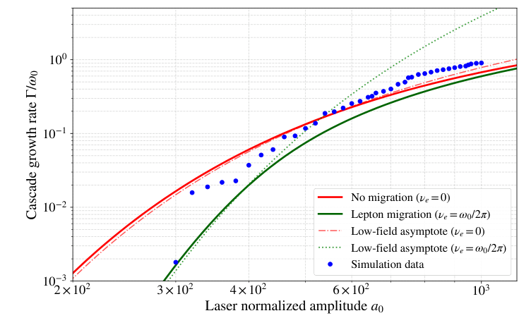
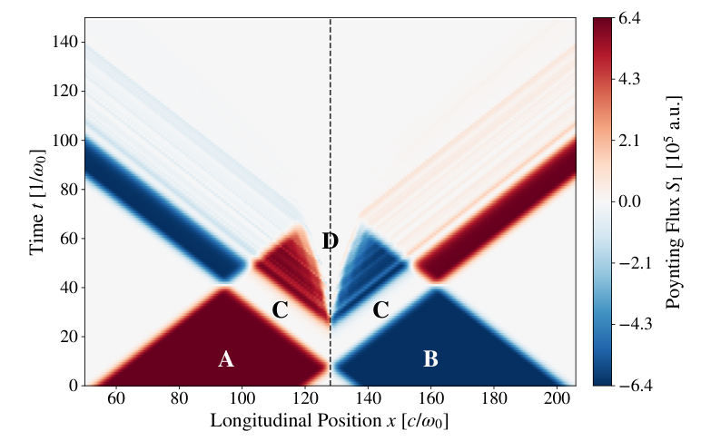
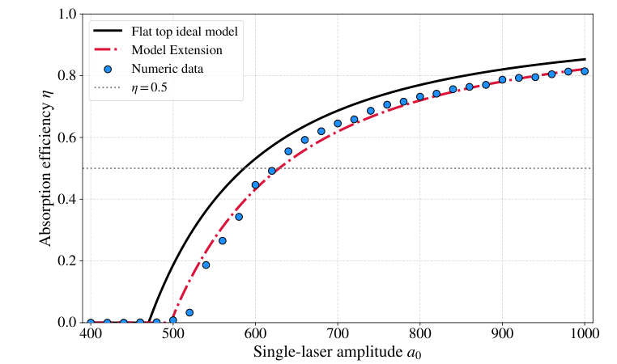

# 圆偏振驻波中的 QED 级联饱和、表观扩展与激光耗尽

## 0. 论文与阅读证据

- **原题**：SFQED Cascade Saturation and Laser Depletion Dynamics In CP Rotating Laser Standing Waves。
- **作者**：André Beverido、Thomas Grismayer、Marija Vranic；GoLP／Instituto de Plasmas e Fusão Nuclear，Instituto Superior Técnico，Universidade de Lisboa。
- **版本**：[arXiv:2611.15519v1](https://arxiv.org/abs/2611.15519v1)，首投 2026-11-11 14:10:22 UTC，11-13 公告；[arXiv DOI](https://doi.org/10.48550/arXiv.2611.15519)。PDF 使用 IOP 模板，但卷期、年份和文章号均是占位符，不能据此认定期刊接收或正式发表。
- **全文**：[官方 arXiv PDF 本地副本](../pdfs/beverido-2026-qed-cascade.pdf)，16 页，SHA-256：`e2a6c216e25b315e5f54b5dde878d6ebf83c2ca4d7412012cf2a4ad19b221583`。
- **实际阅读**：通读正文第1–13页并检查第13–16页参考文献；实际渲染并目视第4–13页，独立重开三幅最终裁图，核对图3、8、12坐标、图例和归一化。MinerU 凭据此前失效，本轮未重试，使用已验证的本地布局文本和页面渲染；未复跑 OSIRIS、级联模型、拟合或收敛计算。
- **证据类型**：1D3V PIC-QED 模拟＋有效速率模型。全文没有新实验；初始已有电子—正电子种子，不能写成无种子的真空自发击穿。约70%是一个模拟设置下的总激光吸收，不能写成70%的可用伽马束转换效率。
- **正式版和去重**：本轮有限 Crossref 精确标题检索前3项未核实同作品期刊版，因此按作者预印本入库。此前 Wei 等 `2608.03331` 的外加10 GeV电子束诊断场景，以及 Dou 等 `10.1103/xvmh-mcg7` 的CH靶空穴钻进／线性Breit–Wheeler火球，与本文作者、种子和场反馈场景不同，不合并计为同一作品。

## 1. 摘要和引言：从指数增长转向集体反作用

非线性 Compton 辐射让高能轻子产生光子，多光子 Breit–Wheeler 过程让光子产生新的电子—正电子对；新生轻子再次被激光加速，两者构成雪崩循环。双束反向圆偏振激光能够在磁节点形成旋转电场，是研究这一循环的理想化构型。

已有零维模型把粒子固定在一个磁节点，适合估算局部产生率，却忽略了节点轨道的不稳定性。随机反冲或偏离节点的出生位置会使粒子沿传播方向迁移，最终在电节点附近受到正常辐射俘获。能产生新对并不等于能在局部积累到相对论不透明密度。

本文的重点是早期增长之后的集体阶段：当对等离子体开始反射入射光，原驻波被破坏，反射光又构成新驻波，使原来困在电节点附近的粒子重新进入强场区并触发次级级联。作者将这种临界密度表面的逐节点推进称为**表观扩展**，不把它等同于单个粒子的流体膨胀速度。

## 2. 理论背景（原文第2节）

### 2.1 量子非线性参数与级联的两步循环

原文式(1)为

$$
\chi_e=\frac{\gamma}{E_S}
\sqrt{(\mathbf E+\mathbf v\times\mathbf B)^2-
\frac{(\mathbf E\cdot\mathbf v)^2}{c^2}},
\qquad E_S=\frac{m_e^2c^3}{e\hbar}.
$$

这里的电场、磁场是实验室系场，速度为粒子速度，洛伦兹因子为无量纲量；根号内项具有电场平方的单位。它来自场张量与粒子四动量的洛伦兹不变量：先把粒子感受到的横向有效场写成电场与磁洛伦兹力的组合，再减去沿运动方向的场分量，最后按 Schwinger 场归一化。相对论粒子的静止系场可以很强，所以实验室激光电场不必接近 Schwinger 场本身。

这是运动学强场参数，不能仅由真空激光强度推出级联已经发生。实际级联还依赖轻子能谱、光子谱、产生率、驻留时间、场反馈和初始种子。本文正文列出非线性 Compton、辐射反作用与 Breit–Wheeler 过程，但**未明确写出 LCFA 开关／适用性检验、光子采样和能阈、QED 模块版本或输入文件**；不能把这些实现细节当作本轮已核实事实。

### 2.2 圆偏振驻波、电节点与磁节点

原文图1说明两束同波长、相反传播且不同螺旋度的圆偏振平面波；图中不同颜色用于区分两束，**不代表双色激光**。两束电场相加，利用三角恒等式得到原文式(2–3)：

$$
\mathbf E=2E_0\cos(kx)
\left[\cos(\omega t)\hat{\mathbf y}-\sin(\omega t)\hat{\mathbf z}\right],
$$

$$
\mathbf B=\frac{2E_0}{c}\sin(kx)
\left[-\cos(\omega t)\hat{\mathbf y}+\sin(\omega t)\hat{\mathbf z}\right].
$$

波数与频率满足真空关系；单束归一化幅度为

$$
a_0=\frac{eE_0}{m_ec\omega_0},\qquad a_0^{\rm eff}=2a_0.
$$

在磁节点，磁场为零而电场幅度最大；在电节点，电场为零。图2显示相邻电节点与磁节点相距四分之一波长。这里必须分清**单束幅度**与**驻波峰值幅度**：本文扫描横轴均使用单束幅度，不能把图中的600直接改称驻波总幅度600。

磁节点附近的理想圆轨道对纵向扰动不稳定。正常辐射俘获使迁移出的轻子积累在电节点附近，但这些位置并不是最有效的对产生区。因此迁移主要降低“参与强场级联的活跃种群”，并非说全部迁移粒子都已经逃出计算域。

### 2.3 相对论不透明阈值的密度约定

作者使用如下标度作为临界界面的比较线：

$$
n_{\rm crit,rel}\simeq a_0n_c,
\qquad n_c=\frac{\epsilon_0m_e\omega_0^2}{e^2}.
$$

物理上，相对论运动增加有效惯性，等离子体频率中的质量需要乘上平均洛伦兹因子；当有效等离子体频率接近激光频率，传播受到抑制，因此临界密度比冷等离子体值提高。该推理只给出标度：对等离子体的两个物种各有电流贡献，精确色散关系还依赖每个物种密度、平均动量和场构型。

本文图4–6实际画的是**电子密度**，初始电子和正电子各为0.1倍临界密度，而文中的不透明标度采用单束幅度。正文未完整展开相对论质量和双物种因子的统一定义；后续复现应先按作者输出变量澄清，不能擅自把电子密度加倍或用驻波幅度替换比较线。

## 3. PIC-QED 设置（原文第3节）

| 项目 | 文中设置与边界 |
|---|---|
| 求解器 | OSIRIS，1个空间维度、3个动量分量；自洽场与QED过程 |
| 几何 | 对向圆偏振平面波；没有有限焦斑、横向逃逸或真实靶几何 |
| 波长、幅度 | 约1 μm；单束幅度300–1000 |
| 计算域 | 长41倍波长，中心磁节点在归一化位置128 |
| 空间、时间步长 | 空间约为波长的1/120；时间为光学周期的1/12566 |
| 种子层 | 厚0.2倍光速／参考频率，约31.8 nm；每种轻子密度0.1倍临界密度 |
| 宏粒子 | 每物种每格10个，初始热动量为零 |
| 脉冲包络 | 平方正弦上升、平台、平方正弦下降；文中给总长42.5 fs，平台31.5 fs，上升下降合计11 fs |
| 对照 | 作者称纯电子种子给出相同级联动力学；没有在正文提供完整误差和所有对照图 |

作者给出的时间步长满足其引用的强场轨道分辨条件

$$
\Delta t\ll \min\left(\frac{T}{500},\frac{T}{a_0}\right).
$$

这是作者的数值选择，**不能替代独立网格、时间步、宏粒子数与随机种子收敛序列**。文中约13个光学周期和42.5 fs是近似表述；重建精确输入时应使用作者实际包络参数。

## 4. 级联发展（原文第4节）

### 4.1 增长率：产生与纵向迁移竞争

作者在准稳态对产生阶段，对模拟粒子数的对数作拟合提取增长率。为解释原文式(4)，可对活跃轻子数和光子数写有效二种群模型：

$$
\frac{dN_\ell}{dt}=2W_{\rm cr}N_\gamma-\nu_eN_\ell,
\qquad
\frac{dN_\gamma}{dt}=W_{\rm rad}N_\ell-(W_{\rm cr}+\nu_\gamma)N_\gamma.
$$

其中每个转换光子贡献两个轻子；辐射率、对产生率和迁移率均为每单位时间。代入指数解得到特征方程

$$
(\Gamma+\nu_e)(\Gamma+W_{\rm cr}+\nu_\gamma)
-2W_{\rm cr}W_{\rm rad}=0.
$$

取较大本征值，定义所有速率除以激光角频率的无量纲量，便得到与原文式(4)同型的表达：

$$
\widehat\Gamma=\frac{S}{2}
\left[-1+\sqrt{1+
\frac{4[\widehat W_{\rm cr}(2\widehat W_{\rm rad}-\widehat\nu_e)
-\widehat\nu_e\widehat\nu_\gamma]}{S^2}}\right],
\qquad S=\widehat W_{\rm cr}+\widehat\nu_e+\widehat\nu_\gamma.
$$

这里特意写出无量纲速率，避免把原文归一化符号与有量纲迁移率混用。作者比较的1D近似保留轻子迁移而忽略光子迁移；常用轻子迁移率约为每光学周期一次。没有迁移时，产生率足够大便接近零维模型；产生率较低时，有限驻留时间明显抑制增长。

原文还给出低场近似（式5–6）：

$$
\frac{\Gamma}{\omega_0}\simeq
1.23\sqrt{\frac{\alpha a_0}{2}}
\exp\left(-0.96\frac{\alpha a_S}{a_0^{\rm eff}}\right),
\qquad \nu_e=0,
$$

$$
\frac{\Gamma}{\omega_0}\simeq
1.52\alpha a_0\frac{\omega_0}{2\nu_e}
\exp\left(-1.92\frac{\alpha a_S}{a_0^{\rm eff}}\right),
\qquad \Gamma<\nu_e.
$$

精细结构常数和归一化 Schwinger 场共同决定指数抑制；有迁移时指数系数增大，表示有效产生更难维持。这些系数沿用所引理论，不是从本篇数据重新拟合所得，也不能超出低场条件任意外推。

### 原图3：迁移抑制区和强产生区

**来源与坐标**：原文PDF第5页图3；横轴为单束归一化激光幅度，纵轴为级联增长率除以激光角频率，双对数刻度。蓝点是模拟，红色为无迁移模型，绿色为有轻子迁移模型，点划／点线为低场渐近式。

**趋势与物理意义**：300–400附近的增长受迁移明显限制；约400–600是过渡区；超过600后产生开始压过迁移。高场蓝点仍和两条有限模型曲线有可见偏差，“趋近零维趋势”不等于逐点精确吻合。图无误差条，本文没有提供拟合窗口、随机重复和置信区间，阈值区间只对本波长、种子和包络成立。

### 4.2 俘获、密度跃升和超调

图4（第6页）以单束幅度500为例：横轴为纵向位置除以光速／频率，纵轴为时间乘频率，色标是电子密度除以临界密度的十进对数。电节点附近的亮条纹体现正常辐射俘获；强产生发生的位置与最后密度峰的位置并不相同。

图5（第7页）比较400、500、600、700、800、900六个幅度。色标统一为电子密度相对临界密度的十进对数。弱场保留明显节点条纹；较强场出现向两侧推进的V形临界界面。该图是1D时空演化，不是二维空间中的真实锥形等离子体。

图6（第8页）把中心磁节点峰值密度和V形界面密度与相对论临界线比较。虽然纵轴标题含有“log10”，实际刻度显示的是对数坐标上的密度比；不应再对刻度数字取一次对数。约500–600间出现密度跃升，高场中心峰值可高于临界标度近一个数量级，界面密度则更接近临界线。

作者把超调称为“粒子产生惯性”：达到不透明密度时，光子库和高能轻子不会瞬间消失，它们继续辐射或成对，因此密度能在驱动场被屏蔽的过程中继续增加。这里的“惯性”指级联的有限响应和储备种群，不是新引入的惯性项。

作者还在晚时刻用密度约100倍临界密度、纵向尺度至少2.4 μm、Debye长度约0.63 μm和Debye球粒子数约十万说明集体等离子体条件。该数量级检查依赖其相对论温度／平均洛伦兹因子和密度约定，本文没有给出可独立重算的完整局部动量分布；本轮未重新计算这些数值。

### 4.3 场反射、节点移动和表观扩展

图7（第9页上）画单束幅度800时电场能量密度相对参考值的十进对数。A、B为两束入射波，C为原驻波区域，D为形成高密度等离子体后的场衰减区。初始节点／腹点在D区附近变为随时间移动的干涉条纹。单凭低电场能量不能区分吸收、反射或几何离开，因此作者再检查能流。

### 原图8：零净通量的两种原因

**来源与坐标**：原文PDF第9页图8；横轴是纵向位置除以光速／激光角频率，纵轴是时间乘角频率；色标是纵向Poynting通量，原图以10的五次方任意单位标注，红蓝表示相反方向，不能直接换算成瓦每平方米。C区两束等强反向波净通量抵消，D区则是高密度等离子体把电磁能排出内部。

**趋势与意义**：D区两侧的通量反号与反射一致，且与图7的场扰动相互支持。零净通量本身不能证明场被排斥；需要同时看场能量和方向。本文模拟中的能流证据尚不是实验诊断的唯一指纹，也没有计算探测器接受度或背景。

图9（第10页）给出机制示意：中心先达到不透明密度，反射波改变局部节点；原俘获粒子进入新的强场区，再次达到临界密度。相邻原电／磁节点距离约四分之一波长。若局部种子密度以恒定增长率增至临界值，则

$$
t_a=\frac{1}{\Gamma}\ln\left(\frac{a_0n_c}{n_s}\right),
\qquad
\frac{v}{c}\sim\frac{\lambda/4}{ct_a}
=\frac{\pi}{2\ln(a_0n_c/n_s)}\frac{\Gamma}{\omega_0}.
$$

这由指数增长积分得到时间，再用节点距离除以时间得到表观界面速度。局部种子密度不是简单固定为初始中心层密度；迁移和前一级级联会改变它，所以最后仍有非普适的对数因子。

图10（第11页上）横轴为归一化增长率，纵轴为界面速度除以光速，数据约在0.15–0.40间。作者给出线性关系

$$
\frac vc\simeq0.45\frac{\Gamma}{\omega_0},
\qquad \ln(a_0n_c/n_s)\simeq3.5.
$$

这是该扫描的经验拟合，无误差条和独立验证集；不能把系数0.45当作任意焦斑或密度下的普适常数，也不能把界面速度当成轻子平均速度。

## 5. 激光耗尽和脉冲包络模型（原文第5节）

### 5.1 总吸收、光子能量与轻子动能

图11（第11页下）以单束幅度800为例，横轴为归一化时间，纵轴为初始系统能量归一化值。激光电磁能最终约0.27，辐射能约0.61，电子／正电子动能各约0.06，总能量曲线约为1。这些是图上近似读数而非原始数据表；本文文字将总吸收概括为约70%。虚线时刻81表示激光脉冲时长结束，不是首次级联启动时刻。

因此至少要区分

$$
\eta_{\rm abs}=1-\frac{E_{L,\rm remain}}{E_{L,\rm in}},
\qquad
\eta_\gamma=\frac{E_\gamma}{E_{L,\rm in}},
\qquad
\eta_{\rm kin}=\frac{K_{e^-}+K_{e^+}}{E_{L,\rm in}}.
$$

前者包括流向光子和粒子等通道的能量，不能把约70%直接赋给光子。作者画的是粒子**动能**，没有另列新生对静质量能、边界能流和所有能量诊断定义；复现完整账本仍需代码输出口径。正文也没有给出“辐射能”对应的硬光子能阈、出射角接受度或可用谱亮度，所以约0.61同样不是经能阈和准直后的应用伽马效率。

### 5.2 从平顶到时变包络

理想平顶模型设首次达到不透明密度的时刻之前不吸收，之后剩余激光全部可转移，总脉冲时长为常量，因此

$$
\eta=\frac{E_a}{E_T}=1-\frac{t_a}{\tau_0}.
$$

对时变幅度包络，设

$$
a(t)=a_0f(t),
\qquad
\frac{dn}{dt}=\Gamma[a(t)]n.
$$

对密度方程分离变量并积分，得到原文式(10)的吸收起点：

$$
n_0\exp\left[\int_0^{t_a}\Gamma(t)\,dt\right]=a_0n_c.
$$

这里右端沿用作者按**峰值单束幅度**定义的临界密度，并非瞬时幅度乘临界密度。它是模型近似之一，不能静默改成另一套阈值又声称复现了作者公式。

单位横截面上的激光能量正比于幅度平方的时间积分。把吸收时刻后的能量除以全部脉冲能量，得到式(11)：

$$
\eta=\frac{\int_{t_a}^{\tau_0}a^2(t)\,dt}
{\int_0^{\tau_0}a^2(t)\,dt}
=\frac{\int_{t_a}^{\tau_0}f^2(t)\,dt}
{\int_0^{\tau_0}f^2(t)\,dt}.
$$

平顶包络代入后恢复前一式。其物理含义是：达到不透明密度越早，剩余可吸收激光能量越多；缓慢爬升段的能量与产生率都不能简单按峰值处理。

这一处理采用绝热近似：

$$
\frac{1}{\Gamma}\ll\tau_{\rm env},
\qquad \tau_{\rm env}=\left|\frac{f}{f'}\right|.
$$

作者认为强场活跃级联窗口中增长时间约飞秒，而实际包络变化常为十至百飞秒。但包络零点附近该条件并不自动成立；本篇实际展示的是指定平方正弦升降包络，**没有验证任意短脉冲、任意波形或随机抖动**。

### 原图12：包络修正改善总吸收预测

**来源与坐标**：原文PDF第13页图12；横轴单束激光幅度，纵轴总激光吸收效率，均无量纲。蓝点为PIC结果，黑线为理想平顶模型，红色点划线为时变包络模型，灰虚线表示50%。

**趋势与物理意义**：平顶模型在中低场明显提前预测吸收；包络修正把耗尽启动推向较大幅度，较好跟随蓝点。扫描中高端约1000的效率约0.82，尚未达到1；“趋向完全转换”是模型渐近趋势，不是本篇已经模拟或实验达到100%。

**限制**：图中没有数值误差、随机重复、模型参数不确定性和外部脉冲验证。它比较的是同一1D构型中的总吸收，不能宣称任意现实聚焦几何、固定能段伽马效率或实际装置已被准确预测。

## 6. 结论与面向实验的解释（原文第6节）

本文提出了一条自洽物理链：产生与迁移竞争决定局部能否变得不透明；不透明反射破坏原驻波；移动的干涉节点重启邻区级联；高能光子库和轻子产生过程造成密度超调；剩余包络能量决定总耗尽。增长率、能流反号和表观界面速度提供相互联系的模拟诊断。

作者明确指出1D缺少有限焦斑和有质动力横向排出，这会改变迁移、阈值和吸收，因此把本模型视作吸收上限线索。这样的“上限”仍依赖理想化边界和参数，本文没有对所有二维／三维构型证明数学上界。文中提出的宏观信号适合设计未来诊断，但目前没有真实级联实验、探测器响应或信号唯一性验证。

## 7. 开放问题与接续核验

1. **复现输入**：需要固定 OSIRIS/QED 模块版本、输入文件、场和粒子边界、宏粒子分裂／合并、光子最小能量、QED率近似和随机种子。
2. **数值稳健性**：需要空间／时间／宏粒子收敛，给出增长率拟合窗口、独立重复和界面定位误差。很小的时间步本身不构成收敛证据。
3. **密度与能量口径**：澄清每物种／总轻子密度、单束／总驻波幅度、平均洛伦兹因子、静质量能与边界能流；不能仅靠两条归一化曲线拼出完整能量账本。
4. **实验迁移**：在有限焦斑、三维逃逸、实际种子产生和激光同步抖动下重查阈值，联合测量反射、角能谱和界面形态，避免把一种宏观信号当成级联的唯一证据。
5. **应用边界**：没有转换靶韧致辐射、光核／中子／核素产额、临床剂量或防护验收。这里的γ辐射来自非线性Compton过程，不是重靶电子制动辐射。

## 8. 复习速记

这篇论文研究的是**有种子的1D圆偏振驻波级联怎样反过来耗尽激光**。记住三个区分：局部增长与迁移后的总粒子数、临界密度界面的表观推进与粒子流速、约70%总吸收与约60%模拟辐射能及实际可用伽马束效率。
