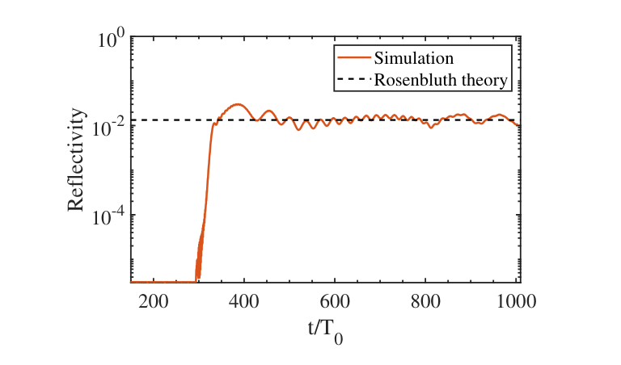
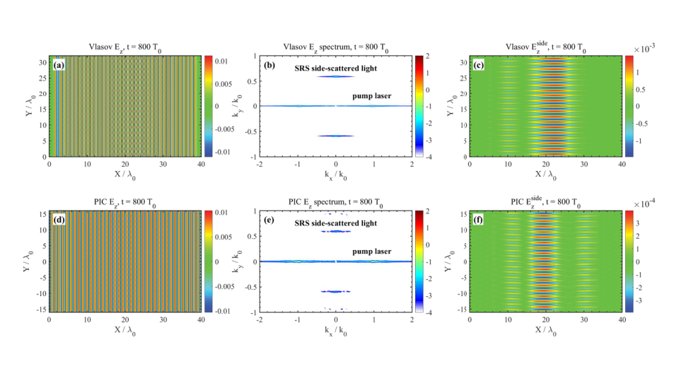
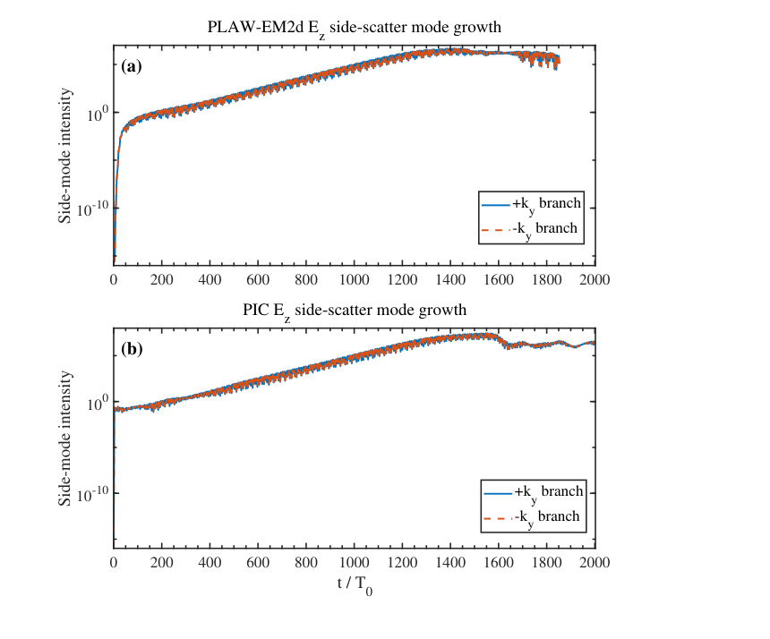

# PLAW-EM2d：以降维Vlasov–Maxwell模型研究SRS后向与侧向散射

## 0. 论文信息与证据范围

- 原题：*Multi-dimensional kinetic modeling of laser-plasma instabilities by a Vlasov-Maxwell system*。
- 作者：Y. Chen、D. J. Liu、X. D. Cao、C. Y. Zheng、Z. J. Liu、L. H. Cao、C. Z. Xiao；单位包括安徽理工大学、北京大学HEDPS、中物院、上海交大与湖南大学。
- 实际全文：[arXiv:2611.15248v1](https://arxiv.org/abs/2611.15248v1)，2026-11-11 09:38:38 UTC首投、11-13公告；[本地23页PDF](../pdfs/chen-2026-plaw-em2d.pdf)。DOI为[10.48550/arXiv.2611.15248](https://doi.org/10.48550/arXiv.2611.15248)，不是已核实的期刊VOR。精确标题Crossref前3项未核实同作品期刊版；此有界检查不证明期刊版不存在。
- 阅读依据：逐页非空的本地布局文本与原页渲染；正文、图注和参考文献已通读，关键页及下列原图实际查看。MinerU凭据此前失效，本轮零请求，明确采用本地回退。
- **证据类型：作者数值模型、分支基准与若干PIC对照。**本轮没有取得或运行PLAW-EM2d/PIC源程序，没有重做SRS、独立实验或性能测试。以下“误差”“反射率”等均为论文报告值，另行标明简单算术核查。

## 1. 摘要与引言：为什么需要二维连续动理学方法

摘要依次给出模型、基准和应用：将二维位置/二维速度的电子分布与面外冷速度闭合耦合，通过真空传播、Landau阻尼和均匀等离子体PIC对照后，展示密度梯度中的对流SRS后向散射及近90°侧散射。

引言第一段说明SRS会改变激光能量沉积并产生热电子，其基本过程为泵浦电磁波衰变为散射光与Langmuir波。后向、前向和斜向通道的匹配条件不同，有限横向尺度使侧散射需要至少二维描述。

随后作者比较三类方法：包络/三波或流体模型适于扫描增益，但俘获、相混等电子速度空间结构需要额外闭合；PIC直接演化动理学响应，却有有限粒子噪声；Eulerian Vlasov在相空间网格上演化连续分布，没有宏粒子采样噪声，适合弱模谱诊断，但成本高，仍存在离散误差。

最后从既有静电PLAW2d延伸到混合静电–电磁模型。作者将“首次二维Vlasov直接展示SRS侧散射”作为优先权表述；这里仅记录为作者主张，未进行足以独立确认首次性的文献审查。文章也没有证明该降维模型覆盖强相对论激光、移动离子或完整ICF靶。

## 2. 数值方法：2D2V与冷面外响应的具体取舍

### 2.1 支配方程和混合场分解

每种粒子的分布依赖两个位置和两个速度分量；面外速度作为单值场演化。原文式(1)可写为

$$
\partial_t f_s+v_x\partial_x f_s+v_y\partial_y f_s
+\frac{q_s}{m_s}(E_x-v_{z,s}B_y)\partial_{v_x}f_s
+\frac{q_s}{m_s}(E_y+v_{z,s}B_x)\partial_{v_y}f_s
=-\nu_s(f_s-f_{s0}).
$$

这里，分布函数的速度积分给出数密度；原文将该量记为ρ_s，真正净电荷密度还要乘电荷并求和。q_s、m_s分别是电荷、质量，ν_s是指定的空间相关Krook松弛频率，f_s0是局部Maxwell分布。Krook模型以给定速率拉回平衡，不能等同于已解析二体碰撞的Landau/Fokker–Planck算子。

推导结构来自沿相空间轨道的分布函数守恒：总导数分为时间、位置平流和速度加速。用洛伦兹力的面内两分量代入速度平流系数，再添加松弛项，即得上式。物理上，电子在面内有完整的非Maxwell分布，面外却没有被解析的热展宽或多流。

原文式(2)采用更强的冷闭合：

$$
\partial_t v_{z,s}=\frac{q_s}{m_s}E_z,
\qquad J_z=\sum_s q_s n_s v_{z,s}.
$$

它只保留面外电场响应；式中没有完整三速度动力学的对流导数及面外磁力项。此处忠实记录该近似，不能将它解释成全2D3V Vlasov–Maxwell系统的恒等降维。

电荷驱动二维Poisson方程得到面内纵向场；TEz分支演化面外电场与面内磁场，只接收J_z。**J_x、J_y并不反馈到电磁更新**，仅经密度变化影响静电分支。作者将这部分反馈在弱相对论、近一维条件下视作高阶项；侧散射演示没有独立给出该误差的系统收敛界。论文方程采用约化归一化写法，但没有集中列出所有场、时间、电流和源幅度的单位转换表，复现时应索取明确约定。

### 2.2 分裂推进与场时间层

原文依次作速度方向半步/整步/半步，再作位置方向半步/整步/半步，最后Krook整步。MPI分解物理平面，每个rank保留本地空间单元的完整速度网格；根rank执行全局场求解。这可能成为扩展瓶颈，但文中未给强/弱扩展曲线，不能据架构推出实际效率。

图1及正文明确：Vlasov推进用上一个完整时间层的静电场，只预测半步E_z；磁场仍用旧时间层；再由更新分布积分电荷、作FFT Poisson求解、推进冷v_z与时间中心电流，更新TEz场。单个平流算子对称排列不自动证明整个滞后场耦合为二阶或总能量守恒，文章未展示完整耦合的时间步收敛序列。

### 2.3 场、光源和边界

非零傅里叶模上，原文式(14)为

$$
\widehat\phi(\boldsymbol k)=\frac{\widehat\rho_c(\boldsymbol k)}{k_x^2+k_y^2},
\qquad \widehat{\boldsymbol E}_L=-i\boldsymbol k\widehat\phi .
$$

这由周期Poisson方程的傅里叶变换直接得到；零模人为设为零，需要与净电荷处理和归一化一起理解。源通过窄带外加电流注入泵浦/种子，另作一维真空标定确定发射幅度，并用x方向特征边界和sponge削弱电磁反射。

**各分支的边界不同：**所有报告结果在y方向均周期；x方向Vlasov及Poisson也周期，电磁场则开放并加吸收层。因此“开放电磁边界”不代表整个粒子–场体系采用开放输运边界；晚期粒子和电势周期效应仍需控制。

### 2.4 程序流程

原文图1为上述顺序的示意。读取时以正文关于旧静电场、半步E_z的具体描述为准，不能由图中的闭环箭头推断所有场与粒子同步。文章给出了若干空间网格和Landau速度域，却未提供各生产算例的完整输入文件、时间步/速度网格、Krook参数、PIC每格粒子数和端到端成本，尚不足以原样复现全部图。

## 3. 分支基准：真空传播与Landau阻尼

真空测试关闭等离子体电流，外加电流发射泵浦。作者用左右box-integral分离传播方向，并对左盒的泵浦泄漏作lock-in相减。图2给出残余反射小、透射趋近1、域内场能达到平台。它检验注入与传播稳定性；有持续注入及开放流出时，域内能量有界不等同于完整能量账本闭合，也不能据此给出未报告的精确反射误差。

静电测试采用固定离子、无碰撞Maxwell电子，密度微扰幅度10^-6，空间网格800×160，热速0.08c、密度0.02553604n_c，波数满足kλ_De=0.5，速度范围±10热速。每个速度轴半轴128点；离散速度回归时间约1006.6，拟合区间ω_pe t约51，在该回归前结束。

作者对固定y截面的激发模投影，以11个正峰拟合周期与包络，而不使用弱阻尼近似作为真值。原文图3/式(19)的精确动理学参照为频率1.4157ω_pe、阻尼率−0.1534ω_pe；拟合为1.4160ω_pe、−0.1535ω_pe，报告相对误差0.0260%与0.1100%。这是单一参数点对静电分支的有力检查，不能代替多网格收敛或其他速度分布测试。

## 4. 均匀等离子体PIC对照与非均匀SRS后向散射

### 4.1 均匀等离子体：一致到哪一层

盒长40λ_0×8λ_0，网格800×160，密度0.1n_c，电子温度约1 keV；离子固定，文中列质量比7344、电荷态2。泵浦频率为ω_0，反向种子频率0.6627ω_0。图4对比400T_0时相空间；图5对比500T_0时空间平均速度分布；图6、7比较480T_0的电磁/静电场及其二维谱；图8比较反射/透射历史。

图4–7支持相同相互作用区域与主要共振谱峰：电子调制主要在x约6–34λ_0；Langmuir谱峰约k_x/k_0=1.52、k_y≈0。Vlasov图更平滑符合无宏粒子噪声的表示方式，不能由“平滑”推出更高准确度。

图5两侧log(f)色标的绝对区间不同，图8的反射振荡幅度也非逐点重合。文章未给全局误差范数和完整PIC采样规格，因此适宜称**主要形状、谱峰及散射量级一致**，不称所有幅值精确一致或已经全模型收敛。

### 4.2 密度梯度：局域共振与对流增益

非均匀盒为320λ_0×1λ_0、6400×20网格，电子约1 keV、离子固定；密度约从0.051增至0.149n_c，两端平滑接真空。密度标长约80 μm，等于351 nm波长下约228λ_0。种子频率仍为0.6627ω_0。

只有局部密度满足频率/波数匹配，因此Langmuir场集中在x约160λ_0，而散射电磁波可以传播离开共振层。图9中右行与左行分量分别取(E_z−B_y)/2、(E_z+B_y)/2；这依赖所用归一化及传播方向约定。作者据此得到局域电静响应与跨域电磁响应的区别。

以未耗尽泵浦、近稳态线性对流三波模型为参照，原文式(20)写作

$$
R_{\mathrm{SRS}}=a_1^2\exp(2G_R),
\qquad G_R=\frac{\pi\gamma_0^2}{|\kappa' V_1 V_2|}.
$$

a_1为作者使用的反射光种子幅度，γ_0为局域耦合增长率，V_1、V_2为两子波群速，κ′为局部波数失谐的空间导数。推导含义是：种子**场幅**穿越共振层获得exp(G_R)放大，平方才给强度增益；将其写成反射率还须确认a_1已相对泵浦正确归一化。本文未完整列出该归一化、全部种子值及诊断盒定义，不能独立从文中数字重建理论线。

**图源与坐标：**原文PDF第15页图10原图裁录；横轴时间t/T_0，无量纲；纵轴反射率，无量纲对数标度。橙线为作者仿真，黑虚线为Rosenbluth估计。启动暂态后，反射达到约10^-2并振荡；约1000T_0时正文给出仿真0.011、理论0.013。两者差约15%（以理论值为分母的简单算术），应称量级及对流图像一致，不称百分之一精度。有限作用长度、启动斜坡、靶边缘和时间振荡均超出理想稳态参照；这不是实验反射率或全靶激光耦合效率。

## 5. 横向扩展靶：有种子的近90°SRS侧散射

### 5.1 设置与共振几何

侧散射盒为40λ_0×32λ_0，800×320网格。相对前述40×8基准，横向长度实际为**4倍**；原文第14页“eight times wider”与所列尺寸不符，需作者澄清。弱线性密度梯度从约0.094至0.106n_c，温度约1 keV、固定离子。泵浦波长351 nm、强度10^15 W/cm²，对应a_0约0.0095，为弱相对论参数，不能外推至PW强相对论等离子体。

本例不发射反向电磁种子，但**人为施加电静种子**：中心约(20,16)λ_0，场幅10^-3，高斯横向包络，Langmuir波矢为(0.9487,±0.5933)k_0。因此不是“无种子自发侧散射”的演示。

三波匹配的主要关系为

$$
\omega_0=\omega_s+\omega_L,
\qquad \boldsymbol k_p=\boldsymbol k_s+\boldsymbol k_L,
$$

$$
\omega_s^2=\omega_{pe}^2+c^2 k_s^2,
\qquad \omega_L^2\simeq\omega_{pe}^2+3v_{te}^2 k_L^2.
$$

这里下标p专指**介质内泵浦波矢**，本笔记用它区别于真空归一化k_0=ω_0/c；原文有时都写k_0，需澄清。第二行分别来自冷横向电磁色散和长波弱阻尼Bohm–Gross近似。已知一支种子波矢后，用矢量差求散射波，再检验两支频率相加是否约为泵浦频率，即构成其物理解读。

原文按真空泵浦k_x=k_0作差，得到散射光(0.0513,∓0.5933)k_0、频率约0.674ω_0，Langmuir频率约0.328ω_0。图中光谱峰却近k_x=0。一个需要作者核对的解释是：密度0.1n_c的介质泵浦波数为sqrt(0.9)k_0≈0.9487k_0，此时矢量差为(0,∓0.5933)k_0，频率和也更接近1。这是笔记基于所列参数的色散/算术检查，不是作者程序重算或对原图数据的独立拟合。

### 5.2 电磁谱与电静谱支持什么

**图源与坐标：**原文PDF第16页图11，800T_0；上排PLAW-EM2d，下排PIC。左列位置轴为x/λ_0、y/λ_0；中列波数轴为k_x/k_0、k_y/k_0；右列是给定谱窗重建的侧散射电场。两行y原点不同，应比较相应中心和形状。两种计算均出现近(0,±0.593)的电磁谱峰，支持近90°通道。图中场/谱色标未统一说明物理单位及跨代码绝对归一化；右列Vlasov约10^-3、PIC约数10^-4，**不能据图称侧散射绝对幅值一致**。

作者滤波保留|k_x|≤0.35k_0、0.20k_0≤|k_y|≤1.00k_0，并去除|k_y|≤0.18k_0近轴带。重建波包约延展15λ_0横向、8λ_0纵向。有限窗口和人为种子均参与决定谱宽，不能将谱峰窄度独自归因于物理相干性。

原文图12进一步给出与电磁波包共址的Langmuir场，其峰在(0.9487,±0.5933)k_0，两峰相对同k_x的k_y=0分量约4.2、3.8倍；作者报告两支幅度差约10%。这是波数匹配及种子保持的证据。稿中没有相应独立时间频谱/完整色散误差诊断，所引频率主要由参数与色散估计得出，不能升级为已独立测得全部三波频率。

### 5.3 电子响应与增长历史

图13比较空间平均速度分布，讨论温度展宽、弱俘获及正v_x尾部。作者给出沿Langmuir波矢方向相速约0.293c；当v_y=0时，共振线与v_x轴相交约0.35c，二者不应混为一个“电子相速”。热速约0.044c，主要共振作用在分布尾部。

**图13有直接版本疑点：**正文及图注写两图约800T_0，而右侧PIC图内明确写1200T_0；左右log(f)色标也不同。未澄清之前，不能视为严格同一时刻、同一归一化的分布一致性验证，尾部电子数和温升也缺少数值积分支持。

**图源与坐标：**原文PDF第19页图14；上为PLAW-EM2d，下为PIC，横轴t/T_0；纵轴为E_z谱峰邻域积分的Side-mode intensity，对数标度，未给绝对能量归一化。实/虚线分别跟踪正/负k_y支。两支持续放大并在晚期平台/振荡；作者以约300T_0描述主增长阶段，但图中Vlasov更早已有启动陡升，不能据该时刻定义物理起振阈值。两图的暂态、振荡和平台并非逐点重合，且没有给出增长率拟合及误差条。

**谱强度不是能量。**只有E_z的选模积分并不包含完整磁场、电静场、粒子能和边界通量，也没有自动等于侧散射反射率或泵浦损失。原文自己作了这一限定。两种计算均见有限横波数模、共址Langmuir响应及持续增益，支持有种子SRS侧向耦合；并不测出可直接用于ICF耦合预算的侧向漏光份额。

最关键的几何限制在第19–20页：y周期使从一侧离开的散射光从另一侧重入并继续受放大，作者明确承认其强化晚期增长和“absolute-like”表观。**因此不能将本盒的持续增长判成开放体系的绝对不稳定，也不能从其平台提取真实有限焦斑侧向损失。**更宽域或开放y、不同种子/窗口和回流时间扫描仍未闭合。

## 6. 结论、致谢及后续阅读重点

结论的可信层次是：此降维连续动理学模型通过两个分支基准及有限PIC对照，能够在给定弱相对论、固定离子、有种子设置中展示后向与侧向SRS的主要谱结构。将其扩到SBS需增加离子动理学和更长时间；更现实空间尺度需进一步优化。致谢列出资助，没有补充新的算法或实验验证。

复现优先补齐：完整归一化及生产输入；PIC粒子数/噪声与统一场幅；网格/速度域/时间步和能量账本；冷v_z及省略电流的适用域；开放y和横向尺度扫描；图13时间、图11幅值与泵浦波数口径。论文未给端到端计时、内存或扩展数据，所以“无粒子噪声”不等于“更快”或“已经优于PIC”。

复习用一句话：PLAW-EM2d用2D2V电子分布加冷面外电流，在可承受成本下解析有种子的SRS二维谱耦合；近90°谱峰是方法演示，周期回流、降维闭合及不完整归一化使实际ICF能量损失仍未定量闭合。
