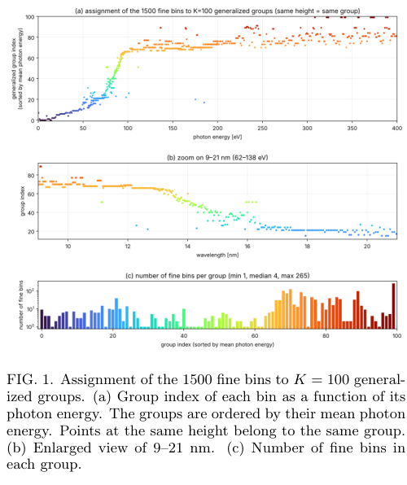
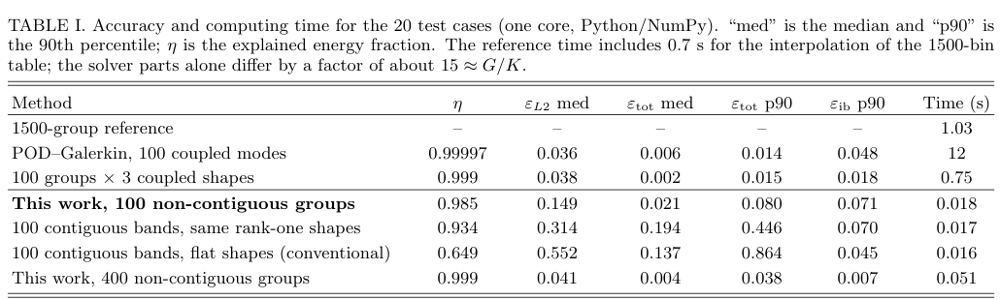
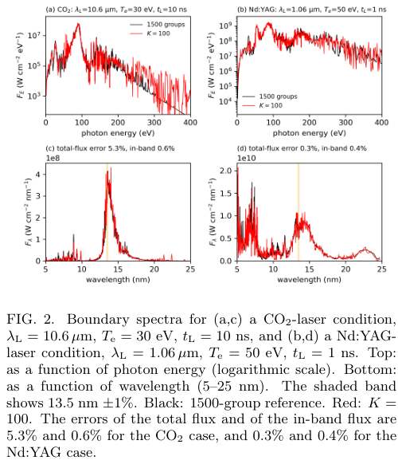

# 把谱线与透明窗口分开：非连续能群的辐射输运降阶

## 0. 论文与阅读证据

- **原题**：Data-driven non-contiguous photon-energy groups for fast multigroup radiation transport in line-dominated plasmas。
- **作者**：Shinsuke Fujioka、Yuji Takagi、Akira Sasaki、Yu Yamamoto、Nozomi Tanaka、Muhammad Fauzan Syahbana、Katsunobu Nishihara、Tomoyuki Johzaki、Atsushi Sunahara、Masashi Yoshimura。
- **版本**：[arXiv:2611.15095v1](https://arxiv.org/abs/2611.15095v1)，首投2026-11-11 06:11:48 UTC，11-13公告；PDF内署11-13。有限Crossref精确标题前三项未核实同作品期刊版，按作者预印本入库。
- **全文**：[本地PDF](../pdfs/fujioka-2026-radiation-groups.pdf)，10页，含第6–10页补充；SHA-256：`5402274bbc765438ed4443a188ede3c490990c9157b512c90eab743b286ddb80`。
- **实际工作**：通读全文与补充文本，目视第3、4、7页及三幅保留摘录。MinerU有已知过期认证记录，本轮未调用，使用本地布局文本和原页渲染。未取得作者程序、原始不透明度表，未复跑FLD、聚类或计时。
- **证据类型**：一维、等温、稳态锡等离子体的多群通量限制扩散（FLD）数值降阶；1500群模型是数值参照，不是实验真值。没有新激光实验、完整辐射流体耦合或多维生产验证。

## 1. 摘要与引言：群数少，为什么不一定省时

中高Z等离子体谱中，大量跃迁形成线核与透明窗口。同一窄能带中，不透明度可跨多个数量级。辐射能否离开等离子体，取决于发射与自吸收的共同作用；简单平均可能让模型兼有“线核的发射能力”和“窗口的透明度”，高估辐射逸出。

常规连续能群仍按相邻光子能量分段。POD则用跨越全谱的少量基函数描述主要变化，但空间传播与吸收会把基函数幅度互相耦合，形成稠密块系统。作者的目标是保留标准多群求解器的独立标量群结构，同时让不相邻、却一起变化的谱箱进入同群。

## 2. Reference problem：先固定精细模型的物理范围

参照为厚500 μm的平面锡等离子体，电子温度在一次计算中保持常数，离子密度沿深度指数下降。激光波长用于设定临界密度，所谓激光时间参数只设定密度尺度长度，并非真的推进激光加热过程。

$$
n_i(x)=n_{i,c}\exp(-x/L),\qquad
L=c_s t_L,\qquad c_s=\sqrt{\langle Z\rangle_c T_e/m_{\rm Sn}}.
$$

这里温度在声速式中按能量计；离子密度与电子密度不可互换，需电荷态。原子表给出非LTE吸收系数和发射率，因此不能自动使用局域Planck函数替代发射率。

对每个精细谱箱，能量密度满足

$$
-\frac{d}{dx}\left(D_g\frac{dU_g}{dx}\right)+c\kappa_g U_g
=\epsilon_g\Delta E_g,\qquad
D_g=\frac{c\lambda(R_g)}{\kappa_g},\qquad
R_g=\frac{|dU_g/dx|}{\kappa_g U_g}.
$$

吸收系数单位为cm⁻¹，发射率为erg cm⁻³ s⁻¹ eV⁻¹；谱箱宽度以eV计。扩散项的负散度、吸收项和体发射项分别对应输运、损失和源。Larsen限制器取参数2，使厚介质趋近扩散、薄介质限制通量。边界用Marshak真空条件，出口谱通量为比较量。

精细表1500箱，光子能量0–1500 eV，空间步长1 μm。参数窗口为电子温度5–250 eV、激光波长1–11 μm、尺度参数时间1–100 ns；作者列总网格11550例，577例训练、12例验证、20例测试。**20例测试不能代表整个参数域已验证**；“时间1–100、步长5”与总数隐含21个时间值的端点约定需作者网格清单澄清。

## 3. Mode expansion：低秩投影如何产生群间耦合

将每能量宽度的能量密度展开成固定形状与空间幅度：

$$
u_g(x)=U_g(x)/\Delta E_g\simeq\sum_k a_k(x)\phi_k(g),\qquad
\langle u,v\rangle=\sum_g u_gv_g\Delta E_g.
$$

把残差与每个形状正交，即得到Galerkin系统。吸收矩阵含

$$
K_{kl}=\sum_g\phi_k(g)\phi_l(g)\kappa_g\Delta E_g.
$$

一般POD模式在相同谱箱都有支撑，矩阵产生非对角元；扩散算子也被投影成稠密矩阵。故模式虽少，计算成本可能按模式数平方或立方增加。文中的100模POD即使算子预制表并对限制器做DEIM近似，仍需12 s/例；不能把“低秩”直接称为加速。

## 4. Uncoupled modes：非重叠支撑保留多群结构

作者要求在所有训练物态下吸收保持对角，并构造非负、互不重叠的模式支撑。每个精细箱只属于一个群，群内不必连续：

$$
\phi_k(g)=\begin{cases}w_k(g),&g\in S_k,\\0,&g\notin S_k,\end{cases}
\qquad w_k(g)\ge0,\qquad
\sum_{g\in S_k}w_k(g)^2\Delta E_g=1.
$$

对不同群，形状乘积逐箱为零，因此上式中的非对角吸收项消失。在此基底下，投影后每群只有一个幅度，得到独立FLD方程。吸收和发射的权重分别含形状平方和一次形状；厚介质扩散系数对应谐和平均：

$$
\bar\kappa_k=\sum_{g\in S_k}w_k^2\kappa_g\Delta E_g,\qquad
\bar\epsilon_k=\sum_{g\in S_k}w_k\epsilon_g\Delta E_g,\qquad
\kappa_{D,k}^{-1}=\sum_{g\in S_k}\frac{w_k^2\Delta E_g}{\kappa_g}.
$$

先给定支撑与固定谱形，再将这些量在原表物态网格上预制表；运行时按群计算限制器。这样保留了标量群求解的结构，但**群内固定谱形是新增近似**，不是精确消去所有谱信息。

## 5. Which bins change together：从Gram矩阵构群

训练谱先按总能量归一，再以能箱宽度加权构造半正定Gram矩阵：

$$
A=W^{1/2}\left[\frac1{n_s}\sum_su^{(s)}u^{(s)T}\right]W^{1/2},
\qquad W=\operatorname{diag}(\Delta E_g).
$$

矩阵元素衡量谱箱随物态和深度共同变亮、变暗的程度。若某组所有谱箱严格按比例变化，对应块为秩一，其首特征向量给出组内谱形。作者先做加权核k-means，再交替更新块的首特征向量与谱箱归属，通常不到10轮稳定；这是近似聚类优化，没有全局最优保证。

### 图1：非连续分组在什么谱段出现

来源PDF第3页Fig.1。上图横轴光子能量eV、纵轴按平均能量排序的群编号；相同高度表示同群。中图放大9–21 nm，下图统计各群箱数。50 eV以下接近连续分组，60–130 eV的UTA区把线与窗口细分，150 eV以上可把相隔较远的箱归并。100群中55群位于10–20 nm，群大小1–265箱、中位4。**群编号不是能量，也不是概率或辐射产额**。

## 6. Accuracy and speed：总通量、带内通量和逐谱误差不同

### 表I：保留原表，逐项读误差和成本

来源PDF第4页Table I，20个测试例，单核Python/NumPy。误差列是无量纲相对误差；例如0.080是8.0%。100非连续群的总通量误差中位2.1%、p90为8.0%，但谱加权L2误差中位14.9%、p90为33.9%（后者见Table S1）。不能写成全谱只有2%误差。

常规100平坦连续群总通量p90为86.4%，但13.5 nm±1%的带内通量p90为4.5%，优于新方法的7.1%。原因是该传统分组在强峰附近很细，窄带恰好被较独立地覆盖。新方法对总辐射输运的优势不等于每个应用指标都更好。

100非连续群每例0.018 s，对1500群1.03 s约58倍；其中精细参考约0.7 s花在表插值。单看求解器约15倍，与1500/100一致。**58倍不含训练数据生成、Gram矩阵、分组、制表和辐射流体其他模块，也不是多维端到端加速。**

### 图2：两类条件的出口谱对照

来源PDF第4页Fig.2。上排横轴光子能量eV、纵轴为每eV谱通量的对数；下排横轴波长nm、纵轴为每nm谱通量，不能直接比较两种纵轴的数值。黑线为1500群、红线为100群，阴影为13.5 nm±1%。CO₂条件取10.6 μm、30 eV、10 ns，图注总／带内误差5.3%／0.6%；Nd:YAG条件取1.06 μm、50 eV、1 ns，为0.3%／0.4%。这两幅例图不是独立实验光谱；弱线和尾部差别仍可很大。

## 7. Origin of remaining error与Outlook

把参照谱直接投影到固定谱形，误差与实际降阶求解相近，提示主要瓶颈是基底而非线性方程求解。随着光学厚度增加，线核先饱和而翼部、窗口继续增长，固定比例无法描述这种非局域历史。局域温度、密度依赖的谱形也不能完全解决上游辐射造成的变化。

每群增加2–3个谱形可减小误差，但重新引入群内耦合和逐精细箱限制器计算，成本优势明显缩小。400非连续群把带内p90降到0.7%，但20例测试总通量p90仍为3.8%；12例验证对应0.5%，二者不能混用。

作者提出把训练得到的表迁入多维辐射流体代码。该迁移在结构上可行，但本篇未实际展示多维、不等温、时变或耦合流体情况下的误差与守恒；不同材料、物态范围和谱形成机制仍需重新训练与验证。

## 8. Supplemental Material：复现必须保留的细节

- 参照空间500格；插值使用对数三次样条并限制到表的逐箱范围；吸收系数下限10⁻⁵ cm⁻¹，低于离子密度表下限10¹⁵ cm⁻³的区间按真空处理。低吸收尾部对这些处理的敏感性尚未独立验证。
- Picard相对容差10⁻⁵、通常6–8轮；耦合POD／块模型用不同容差，Table S1中POD收敛比例只有0.80或0.75，块模型另有重建密度floor。跨方法成本并非严格同容差、同误差比较。
- Table S2用于12例验证和选择群数；Table S1用于20例测试。两例／中位／最坏谱图不能替代独立参数域覆盖。
- 组内局域谱形回归使用56540样本，与正文57700训练谱口径需作者预处理记录解释；对数回归反而使总通量p90从8%增到34%。
- 10–20 nm加权或硬分配虽可改善局部谱形，却可能恶化13.5 nm窄带；目标函数必须与所需物理量对应。
- 原始不透明度／发射率表及生成群表不能公开；Python实现需合理请求。文中声明使用Claude辅助代码与数学表述，作者承担核验责任；本轮未得到代码或数据进行独立复现。

## 9. 开放问题与复习速记

优先取得准确参数列表、分组与样本选择随机性、完整离线成本、原子表版本、谱/能量守恒和多维耦合基准；再评估能否迁入HEDP项目。低秩模式的能量解释率不等于输出谱精度，积分通量小误差也不保证诊断线强或窄带效率准确。

核心直觉：把一起变化的谱箱并群，可以保持多群求解成本；收益来自避开线核与透明窗口的错误混合，代价是固定谱形无法完整表达输运历史。
