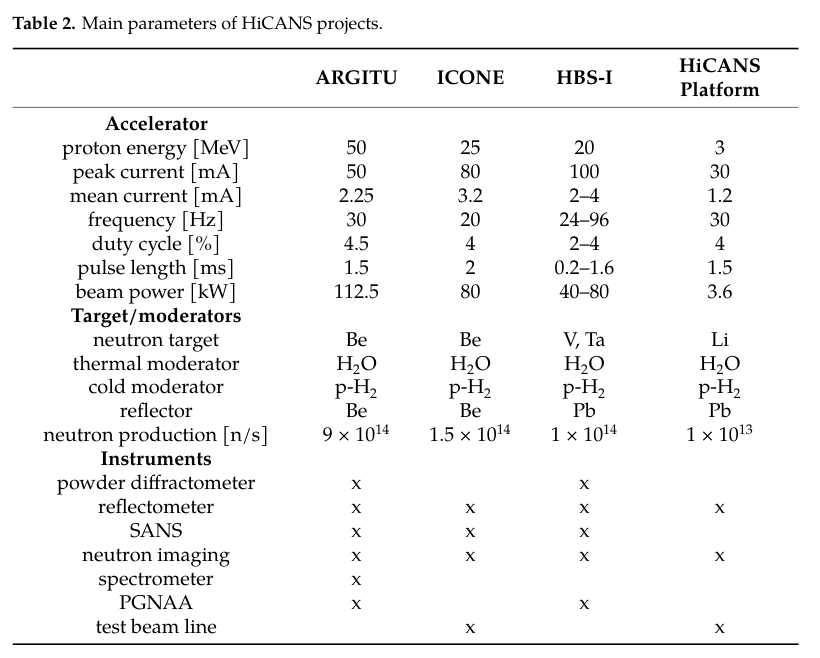
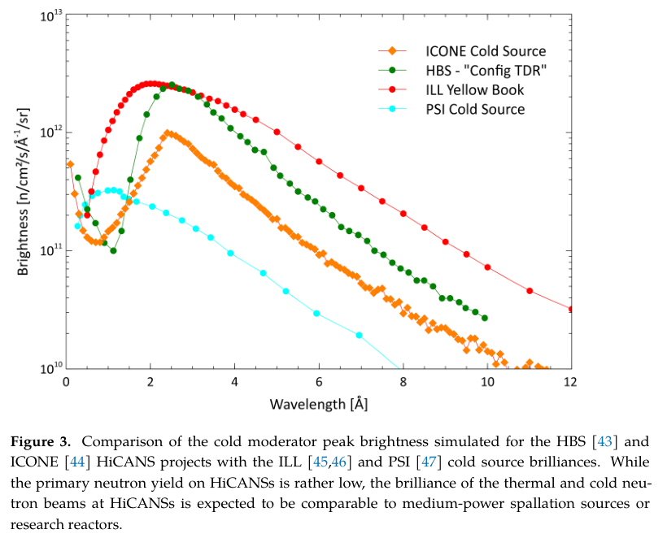
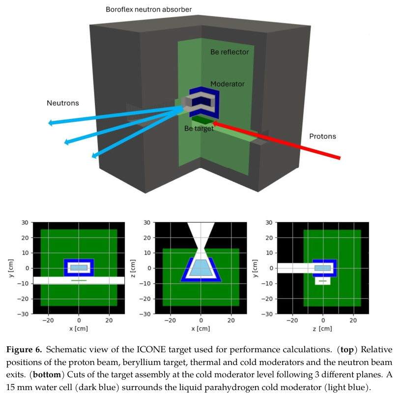

# 高流强加速器中子源：欧洲 ARGITU、ICONE 与 HBS-I 的工程方案和证据边界

## 0. 论文与阅读证据

- 原题：High-Current Accelerator-Driven Neutron Sources (HiCANSs): Current Projects and Perspectives in Europe。
- 作者：Thomas Gutberlet、Alain Menelle、Felix J. Villacorta、Frederic Ott、Jörg Voigt、Paul Zakalek、Ibon Bustinduy、Fernando Sordo、Mario Perez。
- 正式出处：*Quantum Beam Science* **10**, 26 (2026)；[DOI](https://doi.org/10.3390/qubs10040026)。2026-07-13收到、10-26修订、10-30接收、**11-12正式发表**。出版社将类型标为 Article；内容是跨设施技术与进展综述，不能当成一套新设施的联合性能实验。
- 实际全文：[21页出版社VOR本地副本](../pdfs/gutberlet-2026-hicans.pdf)，来自[官方MDPI资源CDN](https://mdpi-res.com/d_attachment/qubs/qubs-10-00026/article_deploy/qubs-10-00026.pdf)；常规MDPI下载入口返回403。SHA-256：`79a4e2920ef1419ae4e1805f64531721cafc7445cac8a48db0c1998382b1d380`。
- 阅读方式：全文布局文本通读至参考文献；渲染并目视核对PDF第3、6、7、12页，保留表2、图3、图6三个原文摘录，摘录又独立打开检查。MinerU此前认证失效，本轮不重复请求，采用本地文本与原页渲染回退。
- 本文涉及常规RF质子加速器、低能带电粒子核反应、靶—慢化器—反射体和中子仪器。**不是激光加速束转换靶光核实验，也没有给出激光光核核素生产、临床治疗或独立防护验收。** 本轮未运行MCNP、PHITS、VITESS或设施实验。

## 1. 摘要与引言：补充中等规模中子设施的容量

摘要先列举裂变、散裂、聚变和低能核反应等中子产生途径，再把HiCANS的机会归于高流强质子加速器。目标是科学和工业的可及性、灵活性及成本性能，而非仅追求最高一次中子产额。

引言第1组段落说明中子设施的层级：小设施承担方法开发和教育，中等设施提供较大容量，最高通量旗舰设施承担最苛刻实验。后续段落回顾欧洲研究堆关闭造成的机时损失，提出用数十MeV、高峰值流强、模块化束线的设施补充网络。ARGITU、ICONE、HBS-I是本篇的三个主要欧洲方案；SARAF、LvB及其他地区项目只是背景，不据此判定所有项目当前均已正式投运。

图1给出通用模块结构：一个低能质子加速器可连接多个靶站和各类仪器。它是体系结构示意，不能从图上读出已建成站数、传输效率或同时满功率运行能力。

## 2. 技术基础：源强只是第一层指标（原文第2节）

### 2.1 核过程、产额和热负荷

原文依次讨论D–T固体靶中子发生器、铀裂变、GeV质子重靶散裂及数十MeV带电粒子低能反应。最高总源强受到靶内热移除能力制约。表1的单位是**每入射带电粒子的初级中子数**以及每中子的热释放；不能把不同反应条件下的数字直接替代某一工程靶的有效产额。

从电流到一次中子源项的基础换算为

$$
\dot N_p=\frac{I}{e},\qquad
\dot N_n=\frac{I}{e}\,Y_n(E_p,\text{靶材、厚度、几何}).
$$

这里电流为安培、元电荷为库仑，质子数率和中子数率单位均为每秒，产额为每质子的中子数。这只是一次源项；慢化、泄漏、自吸收、束口固角、导管和仪器效率还要分别处理。厚靶产额还依赖能损积分，不等于在单一入射能量处取反应截面。

**表1需保留的排印疑点：**原文将铍反应写成 `9Be(d,n)10Be` 和 `9Be(p,n)10Be`。按核子数、电荷守恒，通常应分别对应硼-10和硼-9剩余核；这里指出守恒账本不符，不擅自把原表改写为已核实核数据库条目。表1的50 MeV质子铍靶产额0.026 n/p，与表2 ARGITU的2.25 mA和9×10¹⁴ n/s也不直接相容：后两者反推约0.064 n/p。不同来源、几何或归一化需要作者澄清，不能混用三者计算转换效率。

### 2.2 加速器与功率：必须区分峰值和平均值

原文的高流强LINAC由离子源、LEBT、RFQ、MEBT和常温DTL组成。脉冲中子散射依赖ToF，因此时序与仪器匹配同束流能量一样重要。常见占空比约1–4%，使常温DTL具有工程吸引力；这不是所有HiCANS一律不能用超导腔的定理。

对于单电荷质子，单粒子动能除以电荷相当于加速电压，因此

$$
D=f\tau_p,\qquad I_{\rm avg}=D I_{\rm peak},\qquad
P_{\rm avg}=\frac{E_p}{e}I_{\rm avg},\qquad
P_{\rm avg}[\mathrm{kW}]=E_p[\mathrm{MeV}]I_{\rm avg}[\mathrm{mA}].
$$

推导时先用电流除以电荷得到质子数率，再乘单粒子焦耳能量；MeV与mA的单位因子正好得到kW。它是**束功率**，不包含RF、低温、泵、辅助设备等墙插功耗。平均靶热负荷不能用峰值电流直接乘能量，也不能把中子束亮度当成束功率效率。

### 2.3 靶：抑制氢鼓泡与去热的联合约束

作者先指出HiCANS平均亮度通常较低、峰值可较接近其他设施，再说明低能源谱和较低总源强可能减小屏蔽体积，让斩波器和光学元件靠近源。这是比较性设计优势，不构成任何给定场址的剂量合格证明。

对固体靶，高中子产额之外还需高氢迁移率、良好导热和机械稳定性。文中举Be在550 °C提高氢迁移以减轻鼓泡、Be/V/Cu层状结构以及Ta/W/Pb重靶等路线；更高能质子下重靶更有利。液体Li和GaIn主要用于热负荷和氢积累问题的另一种工程解法。文中提到最高3.5 kW/cm²微通道去热能力属于所引技术研究，不是本篇各设施均已验证的连续工作点。

### 表2：项目参数应作为设计基线读取

**来源与单位：**PDF第6页表2，原图摘录；列依次为ARGITU、ICONE、HBS-I和HiCANS平台。表内分别列MeV、峰值/平均mA、Hz、%、ms、kW和n/s，下面的叉号是计划仪器配置。

**物理意义：**相同平均功率可以有不同峰值电流和脉冲结构；它们会改变靶热冲击、慢化时间卷积和ToF分辨率。ARGITU 50 MeV×2.25 mA=112.5 kW，ICONE 25×3.2=80 kW，HBS-I 20×(2–4)=40–80 kW；这些表内功率账本相符。

| 设计量 | ARGITU | ICONE（表2基线） | HBS-I | HiCANS平台 |
|---|---:|---:|---:|---:|
| 质子能量/MeV | 50 | 25 | 20 | 3 |
| 峰值电流/mA | 50 | 80 | 100 | 30 |
| 平均电流/mA | 2.25 | 3.2 | 2–4 | 1.2 |
| 平均束功率/kW | 112.5 | 80 | 40–80 | 3.6 |
| 标列一次中子源强/s⁻¹ | 9×10¹⁴ | 1.5×10¹⁴ | 1×10¹⁴ | 1×10¹³ |

**限制：**表2不是四套投运设施的同步实测对比。平台列的1.5 ms×30 Hz=4.5%，但同列占空比写4%、平均电流1.2 mA；正文又说脉宽“up to 1.5 ms”。这些量可能属于不同工作点或取整，不能当成一组严格同时成立的设置。HBS-I的频率、脉宽范围也必须成对取值，不能自由组合所有端点。

### 2.4 慢化：从MeV源项到meV可用束流

原文先区分一次中子MeV能量和散射所需meV–eV能量，再强调富氢材料的能量交换和短慢化体积。水中中子寿命约205 μs、冷慢化器逃逸时间约100–500 μs是时序设计的量级依据；不能简单把飞秒激光质子脉冲映射成同样短的冷中子脉冲。

对于质量接近的中子和氢，弹性碰撞可高效交换能量。输运后谱还取决于温度、吸收、反射和泄漏，因此“把中子慢下来”并不保证保留所有中子，也不保证高方向性。

### 图3：冷慢化器的峰值亮度比较

**坐标与归一化：**横轴波长Å，纵轴对数亮度，单位n/(cm²·s·Å·sr)。橙色为ICONE模拟，绿色标为HBS“Config TDR”，红色ILL Yellow Book，青色PSI冷源；它们是慢化器谱亮度，而非全空间总中子产额或样品通量。

**趋势与物理意义：**绿色HBS TDR曲线在约2–3 Å达到数10¹²量级并接近ILL曲线；ICONE峰值更低，长波端衰减明显。其机制是小型紧耦合靶—慢化器提升有用谱段峰值亮度，因此较低一次产额仍可能支撑某些仪器。

**限制：**图注明确HBS/ICONE是模拟峰值。绿色是所引TDR配置，不能自动当成本文20 MeV HBS-I的实测性能；图还混合引用资料与个人通讯，未给出统一不确定度。峰值接近ILL不等于平均通量、全谱亮度或单位时间样品计数相等。

## 3. 三个主设施与平台（原文第3节）

### 3.1 ARGITU：模块化50 MeV、Be靶与五台计划仪器

目标是在西班牙建立散射和成像设施，分阶段增加DTL、功率、靶站和仪器。参考脉冲是50 mA峰值、1.5 ms、30 Hz，故4.5%占空比和2.25 mA平均电流一致。ECR源采用2.7 GHz功率系统；352.2 MHz RFQ把45 keV束加速至3 MeV，随后DTL至50 MeV。这些是技术方案，不能用设计链长度推定已实现束流品质。

质子打Be靶，水和液态对氢慢化，Be反射体降低泄漏；TMR置于直径1.5 m铝容器，外围设计硼混凝土和铅层。9×10¹⁴ n/s是文中估算，前述跨表产额矛盾应保留。

五台计划仪器为粉末衍射、水平反射、SANS、成像/辐照和ToF背散射。衍射工作波长0.5–2.8 Å，反射2–12 Å、长13.8 m；SANS约10 m准直加10 m探测，最低Q约2×10⁻³ Å⁻¹。成像站还考虑PGNAA、Bragg-edge与电子器件辐照。背散射4.5–60 μeV属于设计覆盖，作者也承认通量会限制谱仪可行性，不能把这些规格写成已测量仪器指标。

### 3.2 ICONE：25 MeV双靶，成熟技术与时序取舍

法国方案试图在ESS/ILL之外恢复本地常规实验能力，优先复用IPHI、SILHI、RFQ与DTL技术。25 MeV Be靶旨在控制活化和成本，参考设计预留40 MeV升级；加速器最高占空比8%，表2的4%是单靶基线，不能据其80 kW直接断言整个最终双靶设施总功率。

长脉冲靶设计2 ms、20 Hz即4%；另一靶400 μs、50 Hz即2%，目的是在较短仪器上获得更高时间分辨率。作者认为再缩短有效脉宽需付出过大的慢化通量代价，故通过斩波器处理具体仪器需求。

Be块固定在带1.8 mm水冷通道的Cu背板上，设计约0.5 kW/cm²，靶与入射束约10°掠入射，兼顾热沉面积、入射孔和快中子泄漏。**可引用的实际试验证据是IPHI原型Be靶在0.6 kW/cm²下运行100 h，文中称积分注量约相当ICONE运行300 h；停机原因是运行成本。** 光学相机初期氧化后未见明显演变，不等同破坏性检查、全寿命、完整冷慢化器或设施验收。

### 图6：ICONE靶—慢化器—反射体几何

**来源与坐标：**PDF第12页图6，上图为束靶和出口的三维示意；下图三个截面分别用x/y/z、cm标尺寸。红箭头为质子入射，青箭头为中子束口，绿色Be反射体围绕靶与慢化组件。15 mm水层与液态对氢冷慢化器紧耦合。

**物理意义：**小入口和紧耦合使中子更多留在可慢化体积，同时需要设计吸收、反射及抽取通道；出口选择决定快中子背景与可用慢中子束之间的取舍。

**限制：**这是性能计算几何，不是剂量分布图。全靶站还设计约3 m直径的多层铅、重混凝土、B₄C和聚乙烯防护；图中的颜色与外形不能用于复制防护或推导公众剂量。

十二台仪器以两靶各六台部署，四台处于虚拟实验、四台设计评估、四台概念阶段。第一阶段预计5–7年，作者希望2027年得到开工资金。经费、工期和仪器套件都是论文发表时计划，不是本轮另行核实的项目当前进度。

### 3.3 HBS-I：20 MeV、100 mA峰值与40–80 kW设计

HBS-I是未来更大HBS的首期方案。RFQ到3 MeV，17个DTL单元到20 MeV；2–4%占空比给2–4 mA平均电流。靶站拟采用约1 m厚含硼聚乙烯/铅层，并置于1.1 m混凝土墙的掩体；文中小于5 μSv/h是设计目标，不能当作实测剂量合格结果。

Ta微通道靶设计承受80 kW、约10¹⁴ n/s。源项及水/液态对氢慢化性能由MCNP和PHITS评估，V/Ta/Be还用于材料比较。表2标V、Ta靶，不应和表1 70 MeV HBS Ta条目或图3 TDR配置混成同一工况。

五台仪器由解析与VITESS估算：可切换单晶/粉末/工程衍射、SANS、反射、成像、ToF-PGNAA。成像计划6.5 m和13 m两样品位置，L/D约217和433；13 m处4 Å波长分辨率约2%是设计规格。ToF-PGNAA计划12 m、24 Hz，以1 meV–80 eV入射能量进行能谱选择，脉冲前约10 ms窗口观测活化延迟γ。核素、电子器件及生物辐照是拟议应用，本篇没有给出比活度、剂量、临床效果或材料损伤的完成验证。

### 3.4 联合HiCANS平台：在较低功率验证组件

平台拟建于ESS Bilbao，由西班牙、德国和法国分担加速器、TMR和仪器。3 MeV、30 mA峰值、最高3.6 kW平均功率；转向磁铁把束送往束流终止器或dog-leg传输线。其任务是组件/输运模型和运行规程验证，不等于三套高功率主设施已成立。

Li靶约200 μm，Cu背板水冷、纳米Ti层抗氧化，背板设计热负荷可达5.8 kW；正文这里的热慢化器是**高密度聚乙烯**，与表2的平台H₂O不一致，需查最终工程版本。钢—聚乙烯屏蔽块约1 m厚、八束口。HERMES反射仪此前在JNP仅几瓦束功率下试验；未来平台数kW测试是计划，且质子能量不同，不能简单按功率比宣称仪器计数同比增益。

## 4. 结论、应用迁移与待核实点

作者把HiCANS定位为研究堆和散裂源之外的新一层设施，借脉冲、紧耦合慢化和仪器定制提高可用性。论文末尾的“最高性能”等总体评价属于项目比较性表述，缺少统一成本、运行率、误差和实测样品计数基线，不能据此替代设施采购或防护决策。

对激光束应用最可迁移的是账本：先记录一次角能谱源项，再记录靶热与寿命、慢化时间/谱、抽取固角、样品处通量、仪器背景与分辨率，最后才讨论核诊断或材料应用。不能仅凭n/s或峰值亮度跳到可用实验产率。至少应保留

$$
B(\lambda)=\frac{d^4N}{dA\,dt\,d\Omega\,d\lambda},\qquad
\Phi_{\rm sample}=\int B_{\rm sample}(\lambda,\Omega)\cos\theta\,d\Omega\,d\lambda.
$$

亮度是面积、时间、立体角、波长的微分量；样品处亮度需由源亮度经束口、导管、斩波器和接受度输运得到，角度θ是入射方向与样品面积法线的夹角。这里给出的是解释用的量纲与积分关系，没有复算作者输运或把它当成本文新测量公式。

后续核验重点为：表1反应标签和ARGITU产额归一化；平台占空因子与慢化材料版本；图3 TDR与HBS-I的参数对应；ICONE原型靶长期失效检验及最终双靶负荷；统一峰值/平均亮度、样品通量和成本；真实场址防护及泄漏剂量。当前笔记只覆盖已取得VOR的静态阅读，不声称这些工程问题已闭环。

**复习速记：**HiCANS靠常规高流强质子束与紧耦合靶—慢化—仪器设计，争取有限源强下的可用中子机时；现有原型证据、模拟性能与未来整设施计划必须分别保存。
