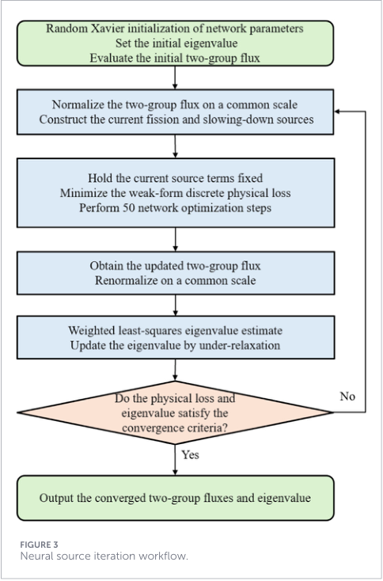
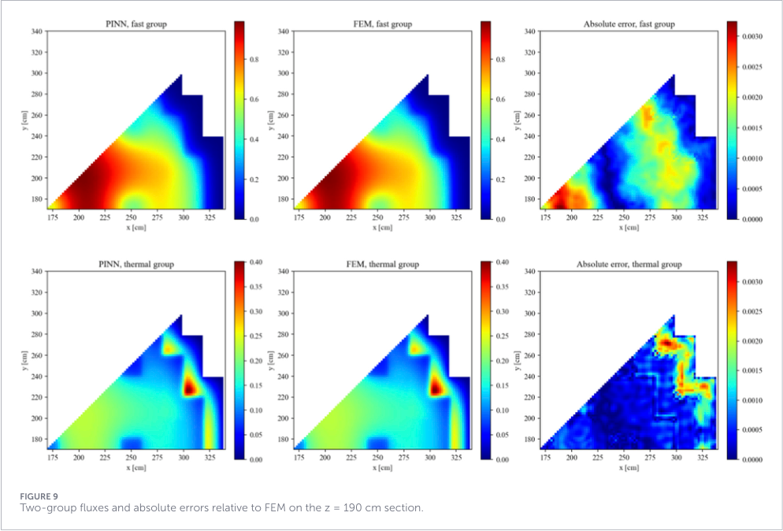
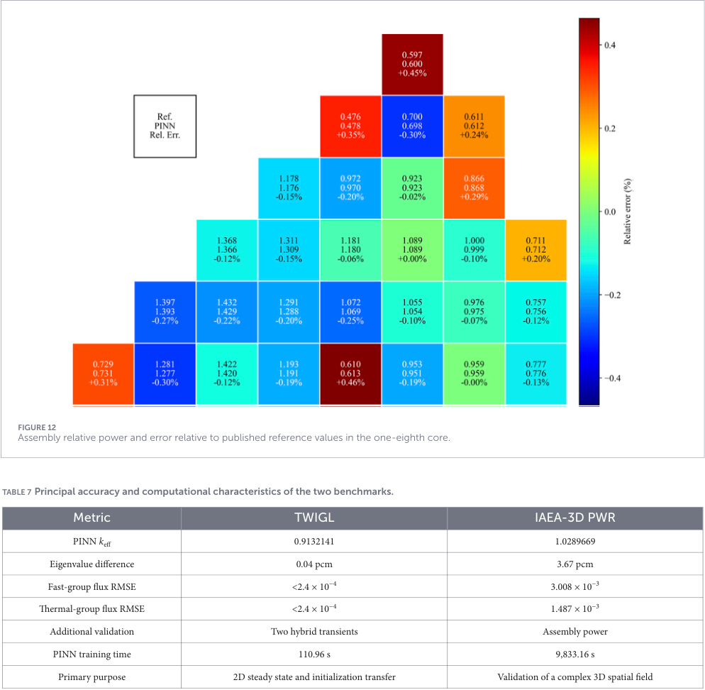

# 用有限元弱形式训练中子扩散PINN：稳态求解与瞬态初始化

## 0. 论文与阅读证据

- **原题**：A weak-form discrete physical-residual PINN method for solving multigroup neutron diffusion equations。
- **作者**：Kui Hu、Xiaoyu Wang、Peng Zhang、Yunhuang Zhang、Zhiyuan Feng、Xiang Xiao、Yuan Xu、Yuan Yuan。
- **正式版**：*Frontiers in Energy Research* 14:2005399，[DOI 10.3389/fenrg.2026.2005399](https://doi.org/10.3389/fenrg.2026.2005399)。2026-09-21收稿、10-20接收、11-12发表；阅读的是Frontiers官方PDF正式版。
- **全文**：[本地PDF](../pdfs/hu-2026-neutron-diffusion-pinn.pdf)，14页。SHA-256见[PDF核验报告](../pdf_validation.json)。
- **实际工作**：通读正文与参考文献文本；目视第4、5、6、10、12页及三幅保留摘录，核对印刷公式、图轴与成本表。MinerU有已知过期认证记录，本轮未请求，采用已验证本地文本与原页渲染。未取得代码、训练日志或原始数据，未复跑PINN/FEM。
- **证据类型**：TWIGL和IAEA-3D PWR标准反应堆数值基准。不是中子源实验、激光光核、快中子全输运或真实堆运行验收；标题“multigroup”的实际验证是**两能群、无上散射**。

## 1. 摘要与引言：弱形式解决哪一类训练困难

强形式PINN通常对网络通量求空间二阶导数。异质材料界面处系数不连续，通量梯度规则性下降，多个损失项尺度也可能相差很大。作者用传统有限元预装配物理算子，再让网络输出节点通量，将训练残差改成稀疏矩阵运算。

这种组合仍依赖物理网格和离散算子。网络是可连续求值的参数化表示，本文并不是完全无网格的中子求解器。作者也明确承认，单个正问题的训练通常比成熟FEM慢；参数扫描、逆问题和迁移学习是后续可能摊销成本的用途，尚未在本文验证。

本文集成弱形式算子、神经源迭代、边界/非负约束以及三维对称折叠和几何特征。界面通量在共享节点上连续，法向流平衡由弱形式积分约束施加，不能升级为逐点严格界面流连续。

## 2. Benchmark problems：两组数值场景

TWIGL为80×80 cm的四分之一堆芯、三种均匀化材料，两边反射、两边外真空条件。物理PINN网格2 cm；瞬态FEM网格1 cm、81×81节点。阶跃和斜坡只改变材料1的热群吸收截面，降低0.0035 cm⁻¹；斜坡在0–0.2 s完成，总模拟0.5 s、步长0.001 s。

IAEA-3D PWR全尺寸340×340×380 cm，组件节距20 cm；轴向活性区20–360 cm，上下各20 cm反射层，部分插棒尖端在280 cm。计算采用径向八分之一、轴向全高，2 cm Q1网格。给定均匀化材料表不等于实际堆芯细致输运数据。

### 2.3 稳态两群方程与单位

$$
-\nabla\!\cdot(D_1\nabla\phi_1)+\Sigma_{r,1}\phi_1
=\frac{\nu\Sigma_{f,2}\phi_2}{k_{\rm eff}},\qquad
-\nabla\!\cdot(D_2\nabla\phi_2)+\Sigma_{r,2}\phi_2
=\Sigma_{s,1\to2}\phi_1.
$$

通量的物理单位为cm⁻² s⁻¹，扩散系数单位cm，宏观截面cm⁻¹，有效增殖因子无量纲。裂变只由热群引起，裂变中子全进快群；无上散射。快群移除包含吸收与下散射，热群移除仅吸收。输出比较时，两群共同除以最大快群通量，保留群间相对幅度；各群分别归一会改变问题。

### 2.4 瞬态模型及原文排印问题

瞬态引入一个缓发先驱核群，速度为10⁷和2×10⁵ cm/s，缓发份额0.0075、衰变常数0.08 s⁻¹。作者将稳态裂变截面除以初始有效增殖因子，使初态满足临界平衡。

第4页式(5)实际印为先驱核方程后接“Sf = νΣf,2 and keff,0”，缺少清楚的通量因子及归一化表达；这不是单纯OCR问题，已打开原页核对。按前后文重建的**物理解释**应是

$$
S_f=\frac{\nu\Sigma_{f,2}^{\rm original}}{k_{{\rm eff},0}}\phi_2,
\qquad \frac{\partial C}{\partial t}=\beta S_f-\lambda C.
$$

该式是笔记为说明量纲而重建，不冒充原文印刷式，也不能据此判断作者代码错误。稳态先驱核由生成与衰变相等得到；源归一化与完整实现需代码澄清。

## 3. Weak-form residual：二阶空间导数如何退出训练

用在Dirichlet边界上为零的测试函数乘扩散方程并积分。对扩散项分部积分，得到

$$
a_g(\phi_g,\psi)=\int_\Omega
\left[D_g\nabla\phi_g\cdot\nabla\psi+
\Sigma_{r,g}\phi_g\psi\right]d\Omega.
$$

外边界测试函数为零，反射边界法向流为零，边界项消失。将通量和测试函数都展开在有限元形函数中，预装配扩散损失矩阵、裂变源矩阵和散射矩阵，就有

$$
\rho_1=A_1\Phi_1-\frac{F\Phi_2}{k_{\rm eff}},\qquad
\rho_2=A_2\Phi_2-S\Phi_1.
$$

网络只预测节点向量，训练以归一化的两群物理残差为目标，自动微分用于网络参数梯度，而非通量的空间二阶导数。没有FEM通量标签进入损失，但**FEM弱形式算子本身仍是方法组成部分**。与同网格FEM接近首先验证离散问题求解一致性，不能独自证明连续方程的网格收敛。

## 4. Network与source iteration：把通量优化和本征值更新分开

网络为3个64节点tanh隐藏层，以Softplus确保非负。TWIGL使用坐标、正余弦特征和余弦包络；原文称包络同时满足真空和反射边界，但未列完整试探函数，因而不能仅从“乘余弦”独立证明任意含原始坐标网络的反射导数严格为零。IAEA有32个几何特征，包括控制棒Gaussian和轴向界面tanh特征，对称条件通过算子折叠处理。

### 图3：神经源迭代工作流

来源PDF第5页Fig.3。流程为随机初始化→共同归一→固定当前源→50步网络优化→更新通量→加权最小二乘更新本征值→欠松弛→检查收敛。箭头是算法依赖，无空间坐标或实验时间轴；源迭代与内层训练步数必须分清。

令快群损失向量和裂变源向量分别为下式中的两个向量。固定通量后，对增殖因子倒数做一维加权最小二乘：

$$
d=A_1\Phi_1,\qquad q=F\Phi_2,\qquad
J(s)=(d-sq)^TW(d-sq),\quad s=1/k.
$$

求导置零给出

$$
\frac{dJ}{ds}=-2q^TWd+2s q^TWq=0,
\qquad \widehat k=\frac{q^TWq}{q^TWd}.
$$

再将新旧估计按松弛因子0.2混合。权重可含体积/积分与对称展开；八分之一域中心、轴/对角、内部节点分别代表1、4、8个全域节点。**误差RMSE没有沿用这些对称权重**，而是对有效域每个节点等权统计。

TWIGL用AdamW与余弦退火共16000步；IAEA用分阶段L-BFGS，24阶段、每阶段10次源迭代、每次50步，共12000优化步。原文说初始本征值设1.0，Table6第0步4.47116164是随机通量的最小二乘估计，不能当最终物理结果。

## 5. PINN–FEM/C–N：网络只提供瞬态初态

稳态训练完成后，在较细瞬态网格上求网络值；此后参数固定，通量随时间完全由FEM/C–N推进。先驱核采用产生项显式、衰变项隐式的更新：

$$
C^{n+1}=\frac{C^n+\beta\Delta t\,S_f^n}{1+\lambda\Delta t}.
$$

它来自前向离散时间导数、将衰变项取下一时刻后移项，不是网络学习到的时间推进。原文第7页式(9)后的变量说明也有不完整语句，复现应以完整算法为准。

## 6. Results：精度、归一化与成本分别看

TWIGL稳态的PINN增殖因子0.9132141、FEM0.9132137，两者绝对差乘10⁵为0.04 pcm。这里pcm采用**本征值绝对差**定义，不是反应性差，也不是相对百分误差。两群归一化通量RMSE均小于2.4×10⁻⁴。

瞬态阶跃/斜坡相对功率RMSE为5.27×10⁻⁴／4.57×10⁻⁴，相对纯FEM/C–N；对POLCA-T公布的5个时点，最大相对偏差约0.0835%／0.0885%。这是初态转接的稳定性验证，不是PINN独立解瞬态，且两个基线并非相互独立实验。

### 图9：三维算例的一个截面

来源PDF第10页Fig.9，z=190 cm的八分之一径向截面。横纵轴x、y单位cm；前两列是共同归一化的PINN和FEM通量，第三列为绝对差，颜色条尺度不同。快群和热群具有不同分布，控制棒邻域热群出现局部抑制。误差集中在材料或棒附近；单截面不能代表整个三维域最大值。全域快/热群RMSE为0.003008／0.001487，最大绝对差0.01121／0.02486。

IAEA最终增殖因子1.0289669，同网格Q1 FEM为1.0290036，绝对差3.67 pcm。末两个训练阶段的本征值变化0.0125 pcm小于最终与FEM的差，说明训练变化小不等于误差已经消失。

### 图12与表7：组件功率误差和实际训练成本

来源PDF第12页Fig.12/Table7。图中每格列参考值、PINN值与相对误差%，功率按燃料组件均值归一，颜色条是百分误差；不是剂量或绝对中子通量。组件功率按活性高度积分裂变源。相对文献参考，平均/最大绝对相对误差0.1779%／0.4647%。热群节点小误差与组件积分小误差分别受不同归一化影响。

成本为单CPU核、个人笔记本：TWIGL PINN训练110.96 s，对同2 cm网格稳态FEM0.665 s，约167倍更慢。IAEA训练9833.16 s约2.73 h；未给同样完整的IAEA FEM时间，不能推算其速度比。混合阶跃/斜坡瞬态64.56／64.76 s，纯FEM/C–N为51.52／53.46 s；混合计时含准备、初态网络求值与推进，**排除稳态训练**。

## 7. Discussion与Conclusion：已验证与仍需补做

弱形式免除空间高阶AD并自然集成异质材料，这是方法结构优势；本文没有同预算强形式PINN消融来量化各改进的独立贡献。边界约束、几何特征、本征值估计和欠松弛的消融被作者列为后续工作。

需要取得代码与随机种子、多次训练分布、网格加密、界面流误差、残差归一化的精确定义、硬边界试探函数及完整成本，才能形成可复现性能结论。原始数据仅声明可向作者索取，没有本轮可运行的公开复现包。

对本库的价值在于“有限元离散残差＋可微神经表示＋传统时域求解”的分工；迁移到激光中子源、防护、光核或强非扩散场景前，仍需更合适的输运方程、核数据和独立响应验证，不能把堆芯两群基准精度当成这些应用的验收。
