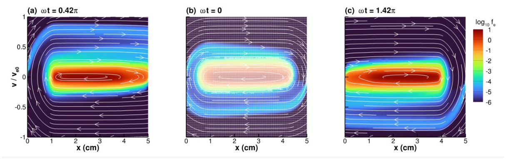
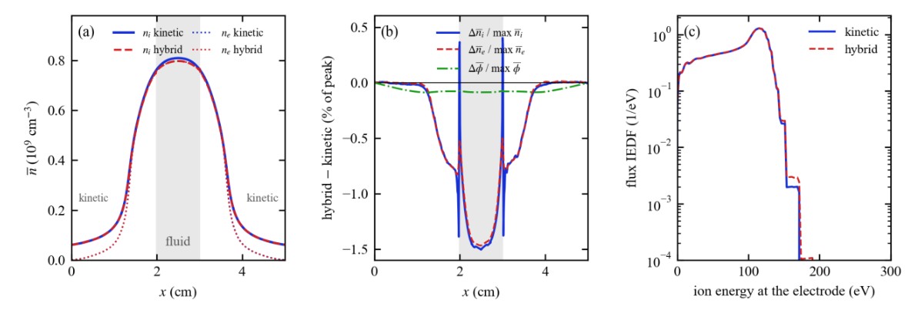
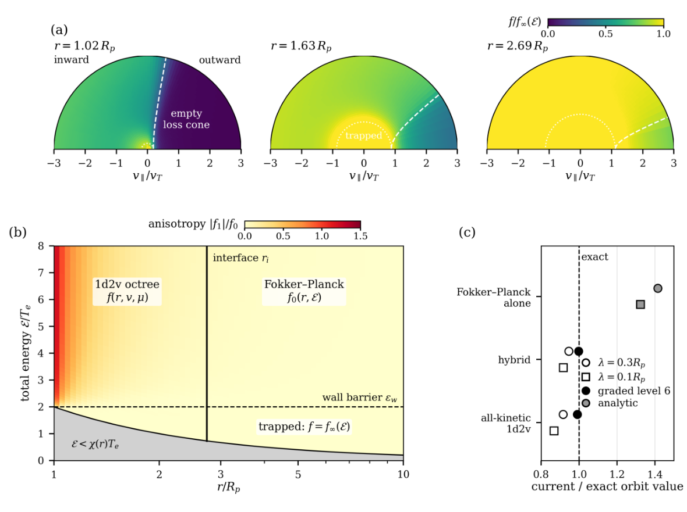

# PAMAR：为电子、离子和场分别分配自适应网格与物理模型

## 0. 论文、版本与本轮阅读证据

- **原题**：Plasma simulations with adaptive mesh and algorithm refinement。
- **作者**：Vladimir I. Kolobov、Robert R. Arslanbekov；The University of Alabama in Huntsville、CFD Research Corporation。
- **版本**：[arXiv:2611.14820v1](https://arxiv.org/abs/2611.14820v1)，首投2026-11-10 23:19:01 UTC，11-13公告；[arXiv DOI](https://doi.org/10.48550/arXiv.2611.14820)。本文按作者预印本阅读，稿件未给已核实的期刊正式版信息。
- **全文**：[官方PDF本地副本](../pdfs/kolobov-2026-pamar.pdf)，39页；SHA-256：`5002b89ac537f9736bcd9d1698edadf9390a6aba265a5540fca9355591194f0e`。
- **实际工作**：按原文顺序通读全文布局文本及图表说明，核对主要方程、Table 1–2与性能口径；打开PDF第12、23、30页和三幅最终原图裁图检查。MinerU凭据此前失效，本轮未请求；采用经验证本地文本与原页渲染回退。本轮未编译代码、运行PAMAR/MoC、复测性能或独立证明收敛。
- **证据类型**：弱电离低温等离子体的欧拉动理学／约化动理学／流体数值方法演示，电场由静电Poisson方程求解。这里的1d1v、1d2v指物理空间和速度空间维数；并非相对论激光PIC、三维电磁束流计算或新实验。

## 1. 摘要与引言：把“网格细化”和“模型细化”同时局域化

弱电离等离子体中，电子、离子和中性粒子的质量、速度及碰撞时间差异很大。若所有物种共享同一相空间网格和最小时间步，最轻物种决定时间步，最窄的冷离子分布决定速度分辨率，计算负担被相乘。AMAR的思路是同时选择哪里细化网格、哪里保留动理学，PAMAR将其扩展为每个物种具有独立网格和求解器。

引言按发展线索回顾UFS的稀薄—连续流耦合、气体混合物、相空间自适应、DSMC/PIC/LBM、Maxwell求解和CPU/GPU实现。这些旧工作的能力说明架构来源，不能算作本篇PAMAR已经完成的并行或电磁基准。本文当前的物种求解器在一个进程中顺序运行。

作者把方法定位在PIC-MCC与快速CCP模型之间：欧拉相空间网格没有宏粒子采样噪声，能分辨RF相位和稀少高能尾；但仍有角向闭合、网格离散、有限速度域与模型误差。“无噪声”不等于全速度维度的Boltzmann方程已精确求解。两个演示分别检验瞬态平板氩CCP和吸收球体周围稳态等离子体。

## 2. 架构与方程（原文第2节）

### 2.1 模型层级与固定接口

模型由全动理学，降至保留完整速率／能量分布但约化角向依赖的角矩模型，再降至速度矩流体模型。低能电子在充分弹性角散射下可使用位置—能量Fokker–Planck模型；若能量弛豫长度超过系统尺度，还应使用总能量描述非局域电子。离子应按其速度展宽来源选择模型：平板CCP中的电荷交换与球体周围的角动量／轨道不是同一类物理。

每个物种求解器独立编译，采用Basilisk四叉树／八叉树、有限体积输运和小波细化。场求解器通过固定接口要求物种推进至指定时刻、返回稳定步长、密度／通量，并把物种网格的矩保守汇总到场单元。固定接口使“整物种更换模型”成为编译选项；两个混合演示进一步选择每个场单元由哪一种模型供给空间电荷。本文仅实现静电耦合，其他耦合需要扩展接口。

### 2.2 平板双流模型：保留正反向速度，约化三维角分布

电子沿轴向的分布满足原文式(1)：

$$
\frac{\partial f}{\partial t}+v\frac{\partial f}{\partial x}
-\frac{eE}{m}\frac{\partial f}{\partial v}
=\beta(\varepsilon)\nu_m(v)[f(-v)-f(v)]+S_{\rm exc}+S_{\rm ion}.
$$

这里正电荷量为e，电子质量为m，中性数密度为N，碰撞频率由速度与动量转移截面给出。左侧由粒子轨迹的位置速度、加速度分别作用于分布得到；电子电荷为负，故加速项带负号。右侧第一项将粒子在两个方向之间交换，各向同性后向散射概率为1/2，作者用能量相关参数修正高能前向散射。它保留完整一维速度分布，却不等于三维速度角向解析。

原文式(2)–(3)把激发和等能分享电离写成速度上的移位源，分别出现速度加阈值速度、以及两倍速度加阈值速度的输入。作者说明采用非均匀速度网格上的粒子数守恒实现；本轮没有代码和离散源审计，**不能据该表述自行认定这些印刷移位式已经验证能量守恒**。若将此方法复现为具体Ar碰撞模块，应先明确其双流变量、阈值、Jacobian和增殖归一化，不能直接套用通常的三维能量移位核。

离子电荷交换采用BGK形式：

$$
S_{\rm CX}=\nu_{\rm CX}[n_i\varphi_M(v)-f_i(v)],\qquad
\int\varphi_M\,dv=1.
$$

在每单元使用同一频率时，速度积分立即给出源项为零，说明电荷交换不改变离子数；它将原有快离子替换为中性气体温度的慢离子。平板实现的频率使用热速度底限加局部漂移速度的绝对值，再除以平均自由程；恒定截面为3×10⁻¹⁵ cm²。电离产生的新离子按中性Maxwell分布注入。这个“局部特征速度率”与逐粒子速度率的精确碰撞算子有差别，比较不同模型时应维持同一实现。

流体离子为连续性方程加等温动量方程：

$$
\partial_t n_i+\partial_x(n_i u_i)=\langle S_{\rm ion}\rangle,
$$

$$
Mn_i(\partial_tu_i+u_i\partial_xu_i)
=en_iE-\partial_x(n_iT_g)-M\nu_{\rm CX}n_iu_i.
$$

由动理学方程取零阶、一阶速度矩可得到这两式；忽略惯性得到漂移—扩散极限。本文强行令离子温度等于气温，没有独立能量方程，因而不能携带鞘层中的多峰分布、热流或独立离子加热。

### 2.3 球面动理学、守恒变量与场耦合

球对称空间保留半径、速率和俯仰角余弦。其特征方程与输运式为

$$
\dot r=v\mu,\quad \dot v=a\mu,\quad
\dot\mu=(1-\mu^2)\left(\frac vr+\frac av\right),\quad a=\frac{q_sE_r}{m_s},
$$

$$
\partial_t f+v\mu\partial_r f+
(1-\mu^2)\left(\frac vr+\frac av\right)\partial_\mu f+
\mu a\partial_v f=C[f].
$$

第一项是径向运动；速率变化来自沿速度方向的电场投影；角向项同时反映球坐标几何和电场对轨道的偏转。这解释了为什么只保留径向流速的流体闭合会丢失绕过球体的轨道。速度体积元与球壳体积元分别带平方因子，故作者用以下有限体积变量守恒粒子数；径向映射还要纳入Jacobian：

$$
Y=fv^2r^2,\qquad Y_{\rm mapped}=fv^2r^2\frac{dr}{dx}.
$$

平板Poisson使用Gaussian单位；球面方程和输入采用归一化单位，不能把两者系数混用。球面壁电势可按净电流反馈而浮动，也可固定偏压。物种矩从各自叶单元保守汇总；时间上先推进物种、汇总电荷、解Poisson，再由物种读取新场。这是显式分裂耦合，并非完全隐式电磁更新。

### 2.4 网格、单位与时间步

作者分别归一化电子和离子速度，使两种分布在自己的网格上均为量级一。CCP中电子速度上限相当于392.5 eV，离子按自身热速度归一化；球面则以球半径和电子参考速率为基本单位。球面输入屏蔽参数与真正电子Debye长度相差系数0.424，和Laframboise结果对比时必须转换。

普通幅度小波细化会遗漏绝对幅度很小但物理重要的尾部。作者另讨论按反射／吸收分界面进行特征细化，以及用径向映射产生非等距网格，避免八叉树在三个方向同时减半的浪费。CCP瞬态全部采用电子步长锁步；球面只在适当稳态问题中给离子独立时钟。不能由后者推断瞬态离子轨迹或RF相位仍然真实。

## 3. 氩电容耦合放电（原文第3节）

### 3.1 三组计算及成本基线

| 组别 | 设置与用途 |
|---|---|
| 参考算例 | 5 cm间隙，10 MHz，50 mTorr，250 V振幅，723 K，真实Ar质量比约73000 |
| 频率扫描 | 5–25 MHz，20 mTorr，500 V，300 K，质量比65536；各1000–2000周期 |
| 文献基准点 | 22.5 mTorr，13.56 MHz，500 V，5 cm，真实Ar质量；Phelps截面 |

场网格保持512单元；电子、离子分别为二维相空间四叉树。参考动理学计算在共享工作站单核约6 min/RF周期、6400步；全流体离子约5 min/周期，文献点约6.5 min/周期。这里没有同误差、同硬件的端到端PIC性能表，不能写成已测得相对PIC若干倍加速。

### 3.2 三类电子及幅度细化的盲点

参考算例在880周期后，电离仅平衡98%的离子壁损失，中心密度仍每25周期漂移约0.3%。图像适合周期平均分析，但不表示所有慢时间尺度已完全收敛。

**图2，PDF第12页**：三面板分别为左鞘最宽、两鞘相等、右鞘最宽。横轴位置0–5 cm，纵轴为电子速度除以电子参考速度，色标为分布的十进对数；白曲线为特征线，中面板叠加网格边。色标来自作者归一化分布，不能直接当作绝对电子数密度。主体较稳，尾部随RF相位改变方向，说明仅看平均电子温度不足以判断电离电子。

**限制**：二次电子系数0.05、发射温度2 eV，形成200–250 eV束；但其分布仅为峰值的百万分之一到十万分之一，低于细化阈值万分之一，因此束宽没有被当前网格解析。作者估计按束带特征细化要增加4–12倍每周期成本。图中的平滑细线不能替代尾束收敛证据。

图3的电离率在双鞘相等时约为周期平均的2.5倍，鞘极值约为0.9倍；图4在中心区分约2 eV以下被俘获主体、约2–13 eV中间电子和能越过周期最低势垒的快电子。电子壁电流只在鞘塌缩附近短时爆发；大部分周期靠位移电流维持鞘层总电流。作者将约87 MHz纹波归因于等离子体串联共振，这是该模型中的机制解释，非独立实验识别。

### 3.3 离子与电子所见的势阱不同

全周期平均包含离子鞘空间电荷，约120 V电势降加速离子；只在局部近准中性的“等离子体相”平均，得到约5 V电子囚禁势阱。若更改准中性判据，后者约变成8 V，说明平均定义影响定量值。图5还显示体区RF场振幅近似反比于电子密度，向鞘边增大约700倍。读者应同时报告平均窗口和密度阈值。

### 3.4 离子能谱保存鞘振荡与电荷交换历史

图6的冷离子主体近零速度，进入鞘层后加速；图7的20 mTorr、500 V扫描点不是250 V参考算例。该点电极主峰约198 eV，次峰约20、67、117 eV；平均入射能量约137 eV，周期中126–150 eV，离子通量变化约±9%。峰列来自不同位置／相位产生的电荷交换离子，不能用一个漂移Maxwell分布还原。

### 3.5 文献基准点显示快速模型的时间平均何时失效

图8的慢电子密度近稳，快电子在每半周期由膨胀鞘发射并越过间隙。图9平均EEPF可拟合为约1.2 eV的冷体与约5.5–5.8 eV的高能部分；但在约30 eV处，周期内分布能变化约20倍，而3 eV、8 eV处峰峰变化约25%、35%。因此“平均谱拟合合理”不保证电离尾部可以时间平均。5 MHz时两鞘几乎相遇，失去准中性体区；作者没有给完整频率定量规律。

### 3.6 全流体离子的闭合误差通过场反馈影响全放电

只替换离子模型而保持电子、场、截面与初态后，全流体体区密度比全动理学低23%，电子温度高约10%，周期平均势差却在2%以内。鞘内拖曳闭合低估动量损失20–30%，缺失离子速度展宽／热流后改变鞘宽、电子加热和电离，误差最终遍及体区。

图11的“被动孪生”流体模型只读取动理学场与源，不反馈空间电荷，用来定位闭合误差；这不等于独立复现实验。其鞘层速度误差很快稳定，而体区密度差继续累积。该诊断有助于选择切换准则，但还不构成通用误差估计器。

### 3.7 每单元选择离子模型：准确性演示，没有可靠加速

初试以Bohm点划界失败：那里离子已约为气温五倍，等温Maxwell入流过窄，导致界面密度凸起及壁通量误差。最终按周期平均离子温度超过气温1.5倍选择动理学区，再向体区加16场单元缓冲；界面约在距各电极2.0 cm处，只有约21%的间隙为流体。

**图13，PDF第23页**：两条轨迹自同一晚期状态再推进100周期。(a)横轴位置cm，纵轴周期平均密度、单位10¹⁰ cm⁻³，灰区为流体；(b)纵轴为混合减动理学，除以各量最大值后的百分数，**不是逐点相对误差**，中心密度差约−1.5%；(c)横轴电极离子能量eV，纵轴通量加权IEDF、单位1/eV，对数刻度，两模型主峰约115 eV基本重合。此图说明温度准则保护鞘与电极可观测量；不证明尾部任意精度，170 eV以上仍有低至峰值万分之一的差别。

界面上，流体向动理学侧提供等温Maxwell半空间分布，动理学向流体侧提供矩及完整动量通量。**两侧仍各自计算数值通量，没有严格共享一条通量**；作者测得邻近单元离子通量中位差0.6%，与该单元电离源引起的变化相当，未分辨残差。严格守恒需共同界面通量／refluxing，且等温流体若要守恒能量还须能量方程。不能把球面电子界面的严格配平说法挪用于此处。

改变界面位置时，用已有动理学分布调整密度、漂移作为入流可去除Bohm界面伪影；电极通量在1%内，但若流体区深入预鞘，中心密度差仍约4–5%。两个对照都还在慢弛豫，应描述为等时轨迹比较。

作者明确说此处没有可报告的节省：流体区动理学树只是粗化，仍被扫描和覆盖；相对不同动理学基线，CPU从少8%到多15%。其成果是自动模型选择将密度差控制在约1.5%，并非已经获得混合求解通用加速。

### 3.8 连接快速CCP模型的尺度条件

只有电子屏蔽快、离子在RF周期内近稳、电子能量弛豫比RF慢，且电子反弹足够快时，主体可近似仅依赖总能量并对空间、RF相位平均。高能电子的非弹性碰撞频率升高后，时间平均失效，需保留总能量与时间的演化。本文的作用是用相位分辨动理学谱指出约化模型何处需要升级，没有在本篇给出最终快速混合电子模型的完整性能验证。

## 4. 吸收球体周围的动理学（原文第4节）

### 4.1 分物种网格与独立时钟的适用边界

真实Ar、约2 eV电子和冷离子的速度尺度可相差约2700倍，但主要完全动理学演示采用质量比100、等电子离子温度等可承受设置。冷离子网格达到约每热速度13单元时，自适应树只用共同均匀八叉树约10.7%的单元数；这是**单元数比较**，不是全部程序一律十倍加速。

稳态无碰撞分布在固定电势、温度下只依赖能量比，质量主要重新进入通量／浮动平衡。设电子和离子归一化电流分别为两种符号的量，浮动条件包含

$$
i_-=i_+\sqrt{\frac{mT_i}{MT_e}}.
$$

其平方根来自Maxwell热通量正比于热速度，而热速度正比于温度除以质量的平方根。固定偏压可先用便宜质量比和各自CFL时钟求稳态，再在真实质量比恢复电流平衡；不能从该过程读取真实瞬态。存在俘获轨道时稳态未必唯一，电荷交换填充还必须尊重真实离子碰撞时钟。

固定偏压、质量比100、温度比3的对照，独立时钟43 min达到稳态门限；锁步11 h仍略未达到，按单位墙钟推进的离子时间加速17.1倍，接近CFL比17.3。真实Ar约460倍是尺度外推，作者未运行。大域浮动壁时自由离子时钟产生增幅振荡，锁步才衰减，因此不能把固定偏压成功当成任意浮动问题无条件加速。

### 4.2 轨道MoC锚点与守恒审计

无碰撞时Liouville定理令分布沿轨道等于边界值。有效势包含静电势能和离心势垒：

$$
U_\ell(r)=q\phi(r)+\frac{M\ell^2}{2r^2}.
$$

这里角动量变量按作者定义对应比角动量，第二项恢复能量。外向／内向路径上的最大有效势决定粒子是否能从储库到达当前位置、能否碰壁或先转向。对允许区域积分，再以Newton法与Poisson耦合，得到MoC密度、收集电流与浮动势。它是无碰撞、指定轨道占据约定下的锚点，不适用于任意碰撞历史。

图14在特定质量比3、等温、球半径／电子Debye长度7.9等设置下，浮动势0.306对MoC的0.300，离子／电子电流分别差−0.5%、−1.2%，平均密度差约0.5%。不要把这个误差数值与质量比100、不同半径或含碰撞扫描混合。

### 4.3 正确的壁面、电零速边界和径向分级比单纯加密更关键

被排斥的无碰撞Maxwell电子，其收集通量满足势垒抑制上界；稳态径向总通量也必须守恒：

$$
\Gamma_e\leq\Gamma_{{\rm th},e}e^{-\chi},\qquad
r^2\Gamma(r)=\mathrm{constant},\quad \chi=-\frac{e\phi}{T_e}.
$$

指数因子来自只有高于势垒的Maxwell尾能到壁；球壳面积正比于半径平方，故相同总粒子流要求第二式。作者以实际输运面通量审计发现并修正壁／储库ghost通量及速度零边界漏粒子，之后径向净流可保持到约2×10⁻⁴。剩余误差主要来自首壁单元将体平均分布外推至壁面的离散误差。

均匀5、6、7级网格收集电流为精确值的0.71、0.93、0.98；径向分级后为0.92、0.98、0.995。细壁单元很重要，但一个级数不能代表各方向同样解析，更不能仅凭全域守恒确认局部壁通量准确。

### 4.4–4.5 流体轨道缺失与电荷交换俘获

球面径向流体没有角动量，不能让离子绕过球体，故无碰撞时过收集约50%，碰撞扫描末端约69%；浮动势偏移只有约0.39–0.53个电子温度，因电子电流随势垒指数变化，电势比电流不敏感。因此判断闭合必须检查电流，不能只看浮动势接近。

电荷交换一方面破坏离心势垒，让原本反射的轨道被收集；另一方面将快离子变成慢离子，降低收集流。扫描中后者占优。碰撞还能把离子放进无碰撞MoC按惯例置空的俘获岛，使预鞘电势低于储库，表明轨道占据和历史具有物理意义。详细两锥约化模型与扫描在参考文献[48]中被标为**准备中的伴随论文**，本篇材料不应当作该伴随工作已公开、已独立核验。

### 4.6 电子混合：动理学损失锥层与外侧Fokker–Planck

低于壁势垒的电子不能到壁，只有弹性散射时其稳态分布为储库的总能量函数；高于势垒的电子在近壁外向半空间形成损失锥，需保留角向分布。远离壁且分布近各向同性时，使用原文式(16)：

$$
v\frac{\partial f_0}{\partial t}=
\frac1{r^2}\frac{\partial}{\partial r}
\left(r^2v\mathcal D\frac{\partial f_0}{\partial r}\right),\qquad
\mathcal D=\frac{v^2}{3\nu_m},\quad
v=\sqrt{\frac{2[\mathcal E-\chi(r)T_e]}m}.
$$

扩散系数由一阶角矩在强散射下响应各向同性梯度得到，因三维角平均方向余弦平方为1/3而出现分母3。固定总能量下，将速度体积元换成能量体积元得到正比于速度的态密度权重，故该速度因子不能随意删去。稳态解能以单个能群电流及径向积分表示，适合与动理学层按组耦合。

**图15，PDF第30页**：规定Coulomb势、壁势垒为电子温度的两倍。(a)三个半径处，横轴径向速度／热速度、纵向为横向速度分量；色标为分布除以同总能量储库值，近壁出向损失锥由深紫显示，远处散射逐渐补满。(b)横轴半径／球半径，采用对数式径向间距；纵轴总能量／电子温度，色标为第一、零阶Legendre矩之比的绝对值。竖线2.74球半径以内保留1d2v，外侧用Fokker–Planck，水平势垒以下电子已知解析分布；下方灰区为该半径动力学不可达区域。(c)横轴收集电流／精确轨道值，竖虚线为1，区分5／6级网格及两种平均自由程。约化模型单独到壁明显过收集，增加动理学层并加密后接近精确值。

角向各向异性传感器要求所有逃逸能组均低于阈值，加两列缓冲，且界面不得离壁少于三个平均自由程。不过本轮实现的界面半径由先行全动理学计算选择后固定，因为Basilisk mask不能直接撤销；**尚非无需先行全计算、随解移动的界面算法**。

耦合按每个能量行执行：动理学输运面给出外向部分流，外区P1／Marshak半空间矩给出内向流，再代数求能组净流；两侧使用同一组流，故该界面按构造逐组粒子数配平。把低能俘获区直接mask成阶梯能量边界会产生1–12%假电流或约15%偏差，作者没有采用这种捷径。

Table 2中，5级规定势混合使用1.6–5.3倍更少的电子树单元、CPU省至1.2–3.3倍，但壁单元误差仍显著：部分全动理学电流比精确解低8.4%或13.2%，最厚层及小平均自由程算例还未完全稳态。6级、同一界面，电流差由全动理学−0.9%到混合−0.2%，两者差0.7%。自洽Poisson加离子时，电子单元少56%，**总CPU只省11%**（148到132 s/千步），不能把电子局部速度提升写成整场景三倍加速。逐能组界面配平也不自动证明全域能量守恒和所有外侧单元已经弛豫。

## 5. 讨论、展望与结论（原文第5–6节）

当前求解器是单进程顺序执行，MPI需补全局矩归约，GPU后端当前不支持所用自适应树；论文所引UFS旧GPU加速不代表PAMAR完成了GPU性能实测。高维相空间的配置—速度分裂、隐式电子—Poisson耦合和多相移动界面均是下一步。

CCP中，离子约占40%时间，真正限制步长的仍是电子。10周期短测试让离子按较大时间步、平均场与源推进，每周期CPU约省1/3、所列量变化低于1%；这不能替代几百到几千周期的稳态精度验证。图16从流体态切至动理学后，电极速度／能谱很快恢复，但100周期后体区密度仍低约21%，说明“最后几个周期动理学收尾”仅修正部分可观测量。

结论的可保留价值是独立物种网格、显式可审计接口、按闭合失效位置选模型，以及用轨道／通量锚点分开边界、分辨率和物理模型误差。本文数据声明为按请求提供；没有随文给出可固定SHA的公开复现资产，本轮未审计源代码，也未重新计算图中性能。

## 6. 开放问题与对本库方向的启发

1. **先定义可观测量，再决定降阶**：电极IEDF快速恢复不代表体区密度正确；浮动势接近不代表收集电流正确。用于诊断、壁通量或材料作用时应分别验收。
2. **把误差预算拆开**：普通细化漏掉百万分之一尾束；壁通量受首单元控制；混合模型受入流闭合控制。应同时记录尾部阈值、网格、接口通量和慢时间漂移。
3. **需要进一步取得**：固定代码版本、完整输入与计时硬件；两流非弹性移位核离散守恒；CCP共享界面通量与能量闭合；可动态重建的球面接口；含磁场／电磁波／相对论与多维非对称问题的独立验证。
4. **与激光/PIC的关系**：独立物种网格与模型选择可启发多尺度代码架构，但本篇没有LWFA、QED、转换靶、中子／同位素产额或临床／防护结果。不得把弱电离静电基准直接当作强激光PIC替代方案。

## 7. 复习速记

PAMAR把“每个物种独立网格”与“只在闭合失效区保留动理学”结合起来；最有用的证据是误差被定位、可观测量被分开验收。成本要逐场景读：CCP离子混合无可靠节省，球面电子局部加速到自洽全程序只省约11%，独立时钟仅对适当稳态有效。
