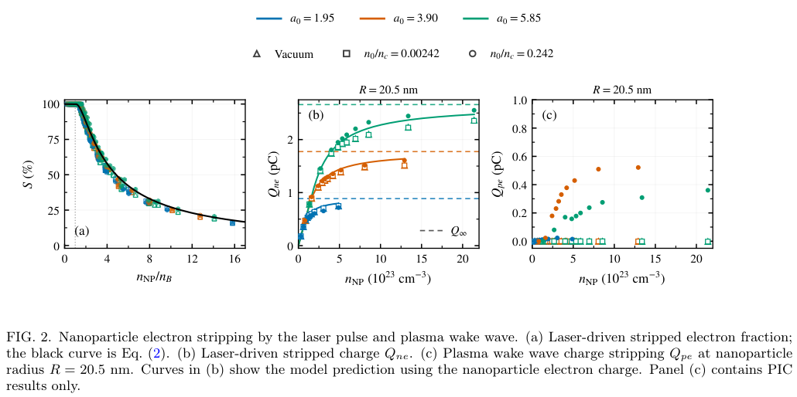
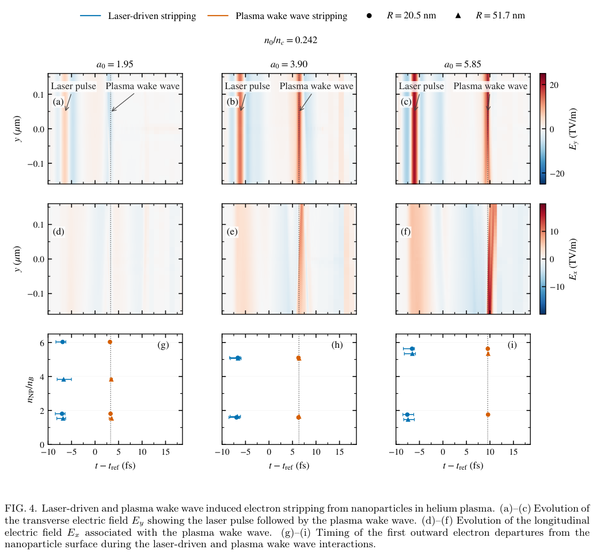
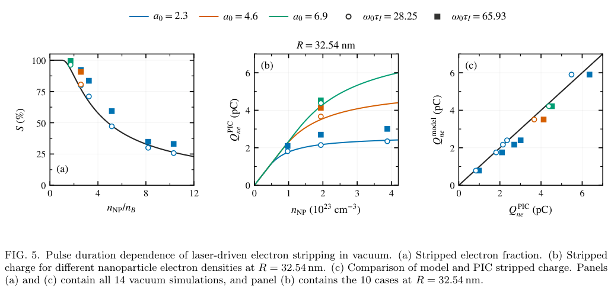

# 纳米颗粒被激光剥离的电子电荷：饱和密度、有限电荷极限与尾波修正

## 0. 论文信息与核验范围

- 原题：*Laser-Driven Electron Stripping from Nanoparticles in Plasma*。
- 作者：Alfred Mishi、Marcel Lamač、Dominik Čáp、Orsolya Morvai、Vojtěch Janota、Romain Caye、Antonia Morabito、Jaroslav Nejdl、Jan Psikal、Uddhab Chaulagain。
- 实际阅读版本：[arXiv:2611.16505v1](https://arxiv.org/abs/2611.16505v1)，2026-11-12 09:06:27 UTC 首投、11-13 公告；[官方 PDF](https://arxiv.org/pdf/2611.16505v1) · [本地9页全文](../pdfs/mishi-2026-nanoparticle-stripping.pdf)。这是作者预印本；本轮精确标题 Crossref 前3项未核实同作品期刊版，不代表期刊版绝对不存在。
- 证据类型：准静态静电模型与作者 Smilei 准三维 PIC 数值对照；引言所述300 pC、10 GeV等来自既有文献，不是本文新实验。
- 全文9页文本已读，9页渲染和3幅保留原图已查看。PDF SHA-256：`1340ae90ba929148395e20ec8a4a14b2eb7ee53c0dfb1e710e5f6f283a9e296f`。MinerU此前认证失效，本轮零请求，使用已验证本地布局文本和原页渲染回退；未复跑PIC或实验。

## 1. 摘要（原文第1页）

第一层问题是“颗粒有多少电子”与“激光能剥离多少电子”不同：提高初始电子密度既增加库存，也增强恢复场。模型给出完全剥离的最大密度，超过它后剥离比例下降，绝对剥离电荷逐渐接近有限值。

第二层问题是静态模型的边界。作者在真空与氦等离子体中对照PIC，发现多光学周期的电子动力学和后续等离子体尾波会带来额外剥离。论文可以指导注入源参数筛选，尚未建立“剥离电荷→俘获电荷→最终束流品质”的完整预测。

## 2. Introduction：为何先研究剥离而非直接预测束流（第1—2页）

引言首先回顾纳米颗粒电荷分离场扰动背景电子并触发尾波俘获的思路，以及Cho等的PIC饱和现象。随后列举既有纳米颗粒辅助LWFA实验和材料/尺寸研究，用来说明颗粒参数的重要性；这些成果属于背景引用，不能归到本文的实验交付。

作者接着强调两道独立条件：电子必须先离开颗粒，还必须进入尾波可俘获的加速相位。因此颗粒的全部电子电荷、被剥离的电荷、最终束团电荷都不能互换。

理论背景来自团簇外电离模型：保留电子仍近似构成均匀冷球，剥离对应其体积缩小。这不是从零提出全部团簇理论，而是将既有几何模型用于颗粒在等离子体中的激光响应。

引言最后列出近似：固定均匀离子球、冷电子瞬时力平衡；忽略电子惯性、加热、集体振荡、回流和已剥离电子的演化场，也不描述激光之后的尾波剥离。论文后半专门用PIC检查这些缺口。

## 3. Model：从力平衡推到密度阈值与电荷上限（第2页，式1—3）

### 3.1 保留电子密度不变，体积变小

初始半径R、电子数密度nNP的中性球，电子电荷量取正的绝对值；离子提供相反的正电荷。外加场在纳米尺度近似均匀。力平衡与高斯定律给出：

$$
\mathbf E+\mathbf E_i+\mathbf E_u=0,
\qquad
\nabla\cdot(\mathbf E_i+\mathbf E_u)=\frac{e(n_{\rm NP}-n_u)}{\epsilon_0}=0,
\qquad n_u=n_{\rm NP}.
$$

这里e为正的元电荷，ε₀为真空介电常数，nu为保留电子球的密度。结论是剥离不靠降低该冷平衡体的密度，而靠缩小其体积；这依赖均匀外场及所采用的静电平衡假设。

### 3.2 两均匀球的场给出位移

设保留电子球相对离子中心位移为δr。两球重叠区域内的均匀球电场为：

$$
\mathbf E_i=\frac{en_{\rm NP}}{3\epsilon_0}\mathbf r,
\qquad
\mathbf E_u=-\frac{en_{\rm NP}}{3\epsilon_0}(\mathbf r-\boldsymbol\delta_r),
\qquad
\boldsymbol\delta_r=-\frac{3\epsilon_0}{en_{\rm NP}}\mathbf E.
$$

相同的空间线性项相消，只留下均匀恢复场。电子位移方向与外场相反。随场上升，模型假定保留电子球内切于离子球，因此其半径为：

$$
r_u=R-\delta_r,
\qquad
\delta_r=\frac{3\epsilon_0 E}{en_{\rm NP}},
\qquad
S=1-\frac{N_u}{N_0}=1-\left(\frac{r_u}{R}\right)^3.
$$

S是剥离电子比例，不是俘获概率。内切球与不可逆逃离假设使峰值外场决定最小保留体积；下降场时电子回流不在模型中。

### 3.3 完全剥离的最大密度

峰值场E₀使位移达到R时，保留球半径为零，得到原文式2：

$$
n_B=\frac{3\epsilon_0 E_0}{eR}=\frac{3a_0n_c}{k_0R},
\qquad
S=\begin{cases}
1,&n_{\rm NP}\le n_B,\\
1-\left(1-\dfrac{n_B}{n_{\rm NP}}\right)^3,&n_{\rm NP}>n_B.
\end{cases}
$$

归一化振幅、临界密度及波数定义为：

$$
a_0=\frac{eE_0}{m_ec\omega_0},
\qquad n_c=\frac{\epsilon_0m_e\omega_0^2}{e^2},
\qquad k_0=\frac{\omega_0}{c}.
$$

nB单位为数密度；R为长度。更强激光允许完全剥离更高密度颗粒，更大颗粒需要更强场。这是模型内的完全剥离边界，不是等离子体传播截止密度。

### 3.4 比例下降，绝对电荷仍上升

把体积库存乘以剥离比例并展开三次项：

$$
Q_0=\frac{4\pi}{3}en_{\rm NP}R^3,
\qquad Q_{ne}=Q_0S,
$$

$$
Q_{ne}=Q_\infty\left[1-\frac{n_B}{n_{\rm NP}}+\frac13\left(\frac{n_B}{n_{\rm NP}}\right)^2\right],
\qquad
Q_\infty=12\pi\epsilon_0E_0R^2,
\qquad n_{\rm NP}>n_B.
$$

推导中三次展开的首项与初始电荷中的密度相消，留下与密度无关、正比于峰值场和半径平方的高密度极限。阈值处电荷只有该极限的三分之一：

$$
Q_{ne}(n_{\rm NP}=n_B)=\frac{Q_\infty}{3}.
$$

因此“已经完全剥离”不表示电荷最大；更大的、仅部分剥离的颗粒可能放出更多电子。Q∞是准静态模型极限，不是包含尾波或长脉冲动力学后的普适上限。

## 4. Simulations and methods：450个短脉冲基准与14个长脉冲算例（第3页）

第一组用Smilei柱坐标方位模m=0、1，代表轴对称响应和线偏振激光，属于准三维模式截断。3个振幅、5个半径、每组合10个电子密度形成150组；分别在真空和两种氦背景重复，共450个算例。

| 参数 | 论文设置 |
| --- | --- |
| 激光振幅 | a₀=1.95、3.90、5.85；对应峰值电场6.26、12.52、18.78 TV/m |
| 纳米颗粒半径 | 20.5、25.8、32.5、41.0、51.7 nm |
| 颗粒电子密度范围 | 4.81×10²¹—2.14×10²⁴ cm⁻³；每振幅/半径组合10点 |
| 背景电子密度 | 0、2.7×10¹⁸、2.7×10²⁰ cm⁻³；后两者分别为临界密度的0.00242、0.242 |
| 激光与几何 | 波长1 μm，沿x传播、y线偏振；原页写束腰为√3 μm；3.33 μm正弦平方入射坡度，颗粒位于x=3.35 μm |
| 时间包络 | 第一组场包络FWHM的ω₀τE=5.96，强度包络ω₀τI=4.22；两者相差√2 |
| 物种 | 颗粒初始冷、中性，颗粒离子固定；背景氦初始冷且全电离，背景离子可动 |
| 宏粒子 | 颗粒每占据网格每物种1000个；氦背景每物种每格8个 |

Table I表明，前四种半径的颗粒直径只有约7个纵向、8.4个横向网格宽度；最大颗粒为8.8个纵向网格、轴到表面5.3个径向网格。论文列了网格设置，但不能据此声称完成全三维、高方位模或系统网格收敛验证。

第二组在真空中对7种匹配配置分别使用ω₀τI=28.25与65.93，共14个算例。它们改变密度、半径或振幅以检验周期数效应：参考半径32.54 nm、参考密度1.940×10²³ cm⁻³、参考振幅2.3；振幅扫描为2.3、4.6、6.9。使用18176×11264静止网格，纵向/径向范围106.46/54.98 μm。该组网格细于部分第一组，比较长短脉冲时不应与第一组的450个亚周期脉冲混成同一扫描。

## 5. Stripped electron fraction and charge（第3—5页，Fig.1—2）

Fig.1展示激光前沿使电子偏移、颗粒周围产生双极电荷分离场，随后电子动量分布展宽。这也直接说明“保留电子始终冷”的模型近似不能刻画全部动力学。原图上排色条标为Ez/E₀，而方法采用y线偏振，具体分量/绘图约定需原始数据说明；本笔记不改原标，也不据此判定代码错误。

作者的PIC电荷诊断使用固定半径R球内的“颗粒电子”电荷量，不是远处屏幕上的累积电子计数：

$$
Q(t)=Q_0-Q_e(t),
\qquad
S_{\rm PIC}=\frac{Q(t)}{Q_0}.
$$

Qe为该球内颗粒电子电荷绝对值，回流会改变Q(t)。激光阶段取Qne；较密氦背景中的额外尾波剥离按式5定义：

$$
Q_{pe}=\overline Q-Q_{ne},
\qquad 14\le t-t_{\rm ref}\le18\ {\rm fs}.
$$

平均窗口在尾波作用之后，因此Qpe包含电子回流的净效应，不能简单解释成全部“第二次首次出球”电子的电荷总和。

**来源与坐标：**原文第5页Fig.2。(a)横轴是颗粒密度与模型阈值之比、纵轴是剥离比例%；黑线为式2。(b)(c)横轴均为颗粒密度，单位10²³ cm⁻³，纵轴分别为激光阶段Qne与尾波额外Qpe，单位pC。颜色区分振幅，符号区分真空/两种氦密度；(b)(c)固定半径20.5 nm。

**趋势与含义：**(a)450个短脉冲基准大致沿共同曲线从完全剥离过渡为部分剥离；(b)绝对电荷继续增加、增量逐渐变小，虚线标示各振幅的模型Q∞；这与比例下降并不矛盾。(c)高密氦背景产生额外电荷，较低密背景接近零；不同振幅下额外电荷并非简单单调排序。

**限制：**(c)只有PIC点，静电模型没有尾波剥离公式；有限密度扫描中的平台趋势不能证明普适极限。所有点是作者模拟，不是独立实验数据；论文没有给出覆盖这些点的统一误差统计或系统收敛序列。

## 6. Laser amplitude and radius scaling（第5—6页，Fig.3）

作者从450组中选取每个半径、振幅和介质组合的最高颗粒密度，共45组，专门检验部分剥离区。将式2反解为有效密度：

$$
\mathcal D_{\rm PIC}=n_{\rm NP}\left[1-(1-S_{\rm PIC})^{1/3}\right],
\qquad
\mathcal D_{\rm PIC}\simeq n_B=
\frac{3\epsilon_0m_ec\omega_0}{e^2}\frac{a_0}{R}.
$$

Fig.3(a)横轴a₀/R、单位nm⁻¹，纵轴有效密度、单位10²³ cm⁻³；不同半径/介质的点大体沿预测直线。(b)模型电荷与PIC电荷均以pC绘制，高电荷点偏离更明显。这检验的是所选部分剥离样本中的联合标度，并非独立45次实验，也不是对未采样尺寸、非球形颗粒或高阶方位不稳定性的验证。

## 7. Helium plasma effects：激光后还有第二阶段剥离（第6—7页，Fig.4）

对较密背景，作者把12个选定算例中电子首次离开颗粒表面的时间，与另做的“无纳米颗粒”背景场模拟比较。参考时间tref=21.1257 fs设在激光后、尾波峰到达前；激光剥离约发生在相对时间−6 fs，后续尾波场峰随振幅出现在3.31、6.38、9.53 fs。

**来源与坐标：**原文第7页Fig.4。三列为a₀=1.95、3.90、5.85，背景密度为临界密度的0.242。上两行横轴时间相对tref、单位fs，纵轴横向y、单位μm，色标分别为Ey、Ex，单位TV/m。下行横轴仍为相对时间，纵轴是颗粒密度/模型阈值；圆和三角对应20.5及51.7 nm半径，蓝/橙分别标激光阶段与尾波阶段的首次离球时间。

**趋势与含义：**蓝点位于激光经过时，橙点跟随后续尾波峰；这与Fig.2(c)的净额外电荷共同支持二阶段剥离的解释。参考场来自无颗粒模拟，时间关联和净电荷差是作者给出的机制证据。

**限制：**首次离球时刻不等于永久逃离或被尾波俘获；原文未说明图中时间误差棒的统计构造，不擅自称为标准差。场峰时序对照也不等于单独关闭某个分量的因果干预实验。

## 8. Limitations：长脉冲系统性超过静态预测（第6—8页，Fig.5）

固定离子、球形冷电子、瞬时力平衡均忽略历史。作者用第二组14个真空算例显示，多周期脉冲涉及颗粒核心电子持续剥离、回流和动量展宽；7组配置中较长脉冲均产生更多剥离电荷，且模型低估全部ω₀τI=65.93结果。

**来源与坐标：**原文第8页Fig.5。(a)横轴密度/阈值、纵轴剥离比例%；(b)横轴密度、单位10²³ cm⁻³，纵轴PIC剥离电荷、单位pC，固定R=32.54 nm；(c)横轴PIC电荷、纵轴模型电荷，均为pC，对角线表示两者相等。空心圆/实心方块分别表示两种脉宽，颜色区分振幅。(a)(c)含14组，(b)含其中半径相同的10组。

**趋势与含义：**长脉冲方块在(c)位于对角线下，显示模型低估，原因是模型没有光学周期之间的动力学记忆。不能把Fig.2的短脉冲吻合外推为任意脉冲长度都准确。

原文给出的两组定量例子如下，均为R=32.54 nm、a₀=2.3：

| 颗粒密度/cm⁻³ | 模型电荷/比例 | ω₀τI=28.25的PIC | ω₀τI=65.93的PIC |
| --- | --- | --- | --- |
| 0.97×10²³ | 1.75 pC / 77.07% | 1.81 pC / 79.90% | 2.10 pC / 92.31% |
| 3.88×10²³（文中四舍五入） | 2.39 pC / 26.36% | 2.35 pC / 25.79% | 3.01 pC / 33.07% |

高密度例子的绝对电荷增量更大，比例增量反而更小，说明设计时应同时报告电荷和比例。这些数字是原文报告值，未重算其宏粒子诊断。

## 9. Conclusion、数据与复习要点（第7—9页）

结论依次回到三点：阈值密度分开完全/部分剥离，增加密度最终只有很小的电荷收益；背景尾波提供额外阶段；长脉冲的电子动力学使静态模型失效。可据此筛选颗粒半径、密度和激光振幅，但还需另行评估俘获相位、最终能谱、发散、发射度和逐发稳定性。

数据声明为向通讯作者合理索取，正文没有提供可直接复现450+14个算例的公开输入文件/分析脚本链接。本轮仅阅读全文、核对公式代数和原图；没有运行Smilei、重做诊断或复现实验。

后续最有价值的核验是：给出激光阶段Qne的确切取样/平均窗口和回流处理；补网格、方位模数、颗粒噪声及可动颗粒离子的收敛；检查非球形、多颗粒、真实电离态和多周期激光；将剥离源项与可俘获电荷及最终束流品质闭合。Fig.1分量标记与Fig.4误差棒含义也需原始数据澄清。

复习时记住：**库存增加不保证剥离比例增加，剥离增加也不保证束流电荷增加。本文最可复用的是受近似约束的源项标度，而不是已验收的束流性能预测。**
