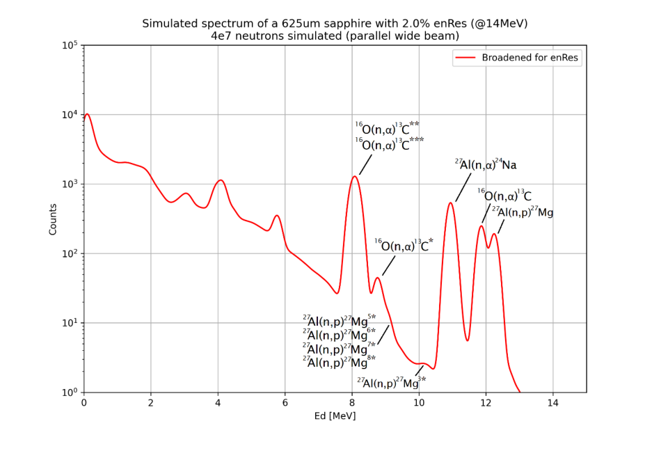
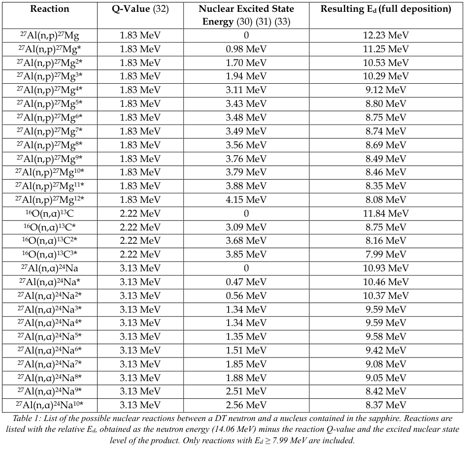
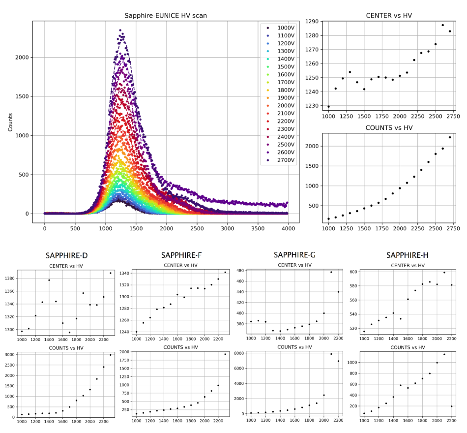

# 蓝宝石快中子探测器的第一步：α响应原型与DT响应模拟

## 0. 论文信息与核验范围

- 原题：*Development of Sapphire-Based Solid-State Neutron Detectors for Fusion Environments*。
- 作者：Matteo Hakeem Kushoro、Stephanie Cancelli、Gabriele Croci、Benno Margesin、Federica Mantegazzini、Enrico Perelli Cippo。首页Kushoro后的a,b为机构上标；arXiv姓名元数据误连为Kushoroa，本笔记与台账按PDF和通讯地址使用Kushoro。
- [arXiv:2611.14745v1](https://arxiv.org/abs/2611.14745v1)，2026-11-10 21:10:15 UTC首投、11-13公告；[本地11页PDF](../pdfs/sapphire-2026.pdf)。本轮精确标题Crossref前3项未核实同作品期刊版，这不是不存在期刊版的证明。
- 全文布局文本已读，1–9页及3幅保留原图/表已目视；SHA-256：`c1767b6effd041dba366f8455c29e1096463e0587a5f644d6d3b1dff53a58e07`。MinerU此前认证失效，本轮零请求，使用验证后的本地提取与原页渲染；未复跑Geant4或实验。
- 核心证据分两层：**八个原型在α源下有实测信号；14.06 MeV中子谱来自Geant4，本文没有DT中子实测。**

## 1. 摘要（第1页）

摘要先指出金刚石尺寸、制造成本与长期恶劣环境应用的限制，引出商业蓝宝石晶圆。作者制备4.5×4.5 mm²及9×9 mm²、厚625 μm的八个原型，使用Al–1%Si电极，验证α源照射下可产生信号。

信号约30–40 mV、峰峰噪声约8 mV，计数随偏压仍持续增加，没有稳定工作平台。摘要的DT前景依赖另行Geant4计算；它没有给出实测中子效率、2%中子能量分辨或高通量寿命。网页摘要Al₂O₂为元数据错误，实际PDF明确为Al₂O₃。

## 2. Introduction：材料动机与尚缺的验证（第1–2页）

第一段解释聚变中子计数与能谱如何关联功率、燃料比和离子温度；后续段落的JET、金刚石时间分辨与能谱性能来自既有文献，不是本文蓝宝石的性能。

随后列出金刚石尺寸、价格、温度与辐照稳定性约束，再说明蓝宝石晶圆容易获得较大面积。9.9 eV带隙、约10¹⁶ Ω·cm电阻率与位移能的比较提供材料筛选动机；较宽带隙也可能增加每对载流子所需能量，不能直接推出更高探测灵敏度。

作者明确蓝宝石中子谱学、长时稳定性、高通量与高温响应仍未系统验证。研究流程因此分为中子输运模拟、原型工艺、α偏压扫描，再提出DT场实验计划。

## 3. Nuclear Reaction Channels and Geant4 Simulation（第2–4页）

中子不直接电离，需在Al/O核上产生带电产物。Geant4追踪反应、产物输运和能量沉积，考虑逃逸及周围非有源部件的二次粒子；这一级输出仍不是包括电荷俘获、电子学、阈值后的真实探测信号。

设定为9×9 mm²、625 μm厚有源体，4×10⁷个14.06 MeV中子、9×9 mm²平行入射束。再人为施加280 keV高斯展宽，借鉴SiC的2%分辨。文本未明确280 keV是σ还是FWHM；不是本原型实测分辨，代码版本、物理表、所用核数据库、能箱与输运阈值也未充分列出。

**图1解读：**横轴Ed/MeV为沉积能，纵轴Counts为对数计数，归一化对应4×10⁷个模拟中子；没有按单位通量/面积/能宽转换为效率。~8、11–12 MeV多峰来自不同反应及激发态，质子逃逸与部分沉积贡献连续本底。峰分离与强度已受假设展宽影响，不能把较高峰当作已测高效率或由图推出中子/γ甄别率。

主要通道是²⁷Al(n,p)²⁷Mg、²⁷Al(n,α)²⁴Na与¹⁶O(n,α)¹³C。若所有带电产物停留、去激γ全部逃离，则运动学关系可按通常**带符号Q值**写成：

$$
Q_{\rm signed}=(m_n+m_A-m_b-m_B)c^2,
\qquad E_{d,\rm full}\simeq E_n+Q_{\rm signed}-E_x.
$$

变量En是入射中子能量、Ex是残核激发能，均为MeV。由能量守恒，反应前后静质量差加到最终动能；去激γ若逃逸，Ex不贡献沉积。若带电粒子逃逸还需减去其逃逸能；若γ部分再沉积则需另加该部分。

**表1解读与符号限制：**原表列Reaction、Q-Value、激发能与全沉积Ed，均为MeV；这里的“Q-Value”填的是1.83、2.22、3.13等正的能量亏损量，并用减法。例如14.06−1.83=12.23 MeV。应将其记作正的Δ而非直接代入上式的带符号Q。上式是本笔记为避免符号歧义所作的守恒解释，不是替作者修改核数据。原文用elastic/anelastic标签并讨论激发残核，实际为不同反应/残核激发通道；需与核数据库逐项比对，不据排版名称替换物理表。

作者以α更易在晶体内停下来解释(n,α)峰较清楚，并引用若干毫靶恩量级通道截面。论文未给反应逐类事件数与响应矩阵，因此截面、全沉积峰效率和实际触发效率仍需分开。²⁷Mg约9.46 min与²⁴Na约14.96 h延迟β衰变不与瞬发电荷收集同时发生，但这不等于长期活化本底或剂量已可忽略。

## 4. Detector Prototypes and Manufacturing（第4–7页）

作者用平行板电容布局制造蓝宝石有源体，前后500 nm Al–1%Si电极，经清洗、光刻、干法刻蚀、切割与封装。图2展示晶圆、圆角电极及裸片，证明工艺产物与布局；它没有电性能坐标或效率含义。电极距切边200 μm、圆角半径300 μm用于降低边缘放电。

晶圆可切为4.5、9、18、36 mm边长，但本文仅测试前两种；不能把36 mm算成已验收大面积中子器件。切缝实际120–130 μm，真实边长较名义小20–30 μm，后续绝对效率/有效面积归一化应使用真实几何。

图3展示两种PCB与硬币比例尺，图4展示八个封装原型；照片没有能量/效率归一化。表2列出不同面积、SMA/SHV及PCB组合。不同封装、电容、源距离和前端条件混在一起，样本八只不能视为一个严格控制变量的连接器对照实验。

偏压源为CAEN NDT1470，正偏压更容易识别信号。Ortec 142A与CAEN A422A配Ortec 672比较后，采用前者。原文明确142A标称保证范围仅±1 kV，且SMA段落提及±500 V，却报告更高偏压试验；这说明论文尚缺完整高压读出/隔离与连接器设计说明，不能据试验信噪比将超出其所述额定条件解释为工程认证。

## 5. Alpha Particle Irradiation and HV Scan（第7–9页）

使用²⁴¹Am源发射的5.47 MeV α粒子，源与器件间空气路径5–15 mm；到达晶体时作者估计约4–5 MeV、每个固定几何近似恒定。**5.47 MeV是发射能，不是所有器件的实际沉积能。**不同盒体距离限制了器件间绝对响应比较。

500 MHz CAEN 5730采样，通常从约1 kV开始可识别α信号，到微放电显著前停止。约30–40 mV信号与8 mV峰峰噪声不能直接当作RMS信噪比，也没有给出电子噪声电荷、能量标定与绝对电荷收集效率。

**图5解读：**左上横轴PH为未标定的脉冲高度/通道，纵轴Counts；右上centre是高斯峰位置的通道数、横轴为偏压V，counts是2 min采集窗统计；下部四只原型重复展示峰位与计数。计数随偏压显著增加，峰位变化相对较小；尚无稳定计数平台。不是绝对探测效率曲线，也不是中子谱或2%能量分辨测量。

高偏压可能改善电荷收集，使更多事件越过阈值，但阈值、噪声、微放电剔除及触发效率尚未完全分离。以625 μm厚度估算，2.5–2.7 kV约为4.0–4.32 V/μm的平均场；这是几何换算，非局部边缘场或可靠运行许可。

摘要/结论多用约2.5 kV，正文和图5上方示例到2.7 kV；需保留器件差异，不能给出统一最高工作电压。作者称大小器件结果一致，当前仅支持这批α响应的定性可重复性，不证明中子通量、线性、面积与寿命可直接扩展。

## 6. Conclusions and Perspectives（第9页）

八个原型都能看到α信号，闭合了材料—工艺—读出的初步可用性；未达计数平台与弱信号仍是当前限制。第二代500 nm氧化层钝化、扩大键合区和更粗键合线是正在进行的改进，之后才计划DT场测试。

用于本库的价值是提醒“核反应能量沉积→电荷输运→前端→阈值计数”必须分层闭合，可与碳反应/金刚石响应数据对读。接续应先取得模拟版本/物理表/展宽定义、逐通道响应与实际触发阈值，再做源距与前端一致的α能谱、偏压平台与泄漏电流检查，最后才讨论DT效率、γ甄别、高温/通量寿命。本文没有临床、辐射防护或激光中子设施验收。
