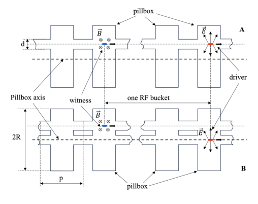
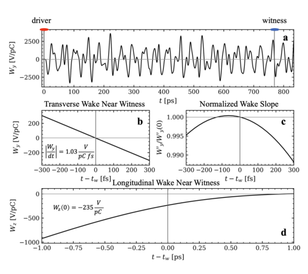
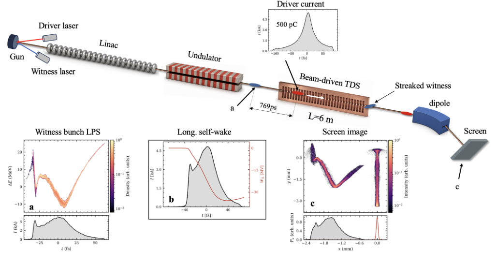

# 用前导束团激发长寿命尾场，实现飞秒电子束纵向相空间诊断

## 0. 论文信息与版本

- 原题：*Beam-Driven Transverse Deflecting Structure for Femtosecond Electron-Beam Diagnostics*。
- 作者：S. Tomin、D. Bazyl、W. Decking、I. Zagorodnov（DESY）。
- [Physical Review Applied DOI](https://doi.org/10.1103/ttzy-t1wy)；APS接收列表标明 **2026-11-13接收**。Crossref虽在published-online字段给出同日，本轮未核实VOR出版，不能以该字段替代接收/出版区分。
- 实际阅读全文为[arXiv:2605.13752v3](https://arxiv.org/abs/2605.13752v3)，首投2026-05-13 16:33:08 UTC，v3修订05-27 14:10:31 UTC，PDF首页印05-28；不是11月接收稿或VOR。[本地7页PDF](../pdfs/deflector-2026.pdf)，SHA-256：`b7addbca0d36fe574ba7e54100277c955fecc4b62d881f3f214b540533393d3f`。
- 证据为ECHO/CST电磁计算与Ocelot束流跟踪方案；没有本文装置实测。全文布局文本已读，关键页1–5及下列3幅原图已目视；MinerU历史凭据过期，本轮零请求，采用经核验本地文本/原页渲染。未复跑作者程序。

## 1. 摘要与引言（第1页）

摘要提出让前导driver束团在谐振腔阵列中激发长寿命横向尾场，后一RF桶的witness束团在尾场过零点附近接受与时间近似成正比的偏转。14 GeV、500 pC driver、6 m结构给出约1.6 fs的估计分辨率；这是指定光学与理想尾场下的模拟/解析性能。

引言先把束流纵向相空间与压缩、峰流、切片能散及FEL性能联系起来。已有有源TDS直接将时间映射到横向屏坐标，但需要高功率RF和相位控制；相干辐射/电光方法通常不能直接恢复完整相空间。

随后对比普通被动自尾场装置：单束团自偏转映射往往非线性，重建依赖模型。本方案把激发与诊断分给两个束团，使witness仅取长程振荡的局部线性片段；代价是必须产生、输运并校准一个相邻RF桶的额外driver。

## 2. 几何与尾场定义（第1–2页）

**图1解读：**原文第2页示意图，没有数据坐标或效率归一化。A为两束沿同一条偏离腔中心的通道传播，B为driver与witness分轴。箭头给出主要场/受力方向，“one RF bucket”是束间隔。本文实际选择A，避免亚纳秒尺度快速分束；B仅是可能更高效的几何，不能当作已实现装置。

基准几何周期2.78 mm、束管直径2.01 mm、pillbox外半径4.43 mm、束管相对腔轴偏移1.86 mm、腔长1.98 mm。铜电导率设为5.8×10⁷ S/m，几何由数值优化给出。

原文式(1)定义沿运动轨迹积分的单位源电荷尾势：

$$
\mathbf W(\mathbf r_w,\mathbf r_s,s)
=\frac{1}{q_s}\int[\mathbf E+\mathbf v_w\times\mathbf B],dz,
\qquad s=z_s-z_w>0.
$$

源电荷为qs，rs/rw是driver/witness横向位置，s为尾随距离。积分电场量纲为电压，除以源电荷后可用V/pC；横向冲量还要除以粒子速度，近光速电子偏角可写成横向积分电压与束能电压之比。纵向分量对应能量变化，横向分量对应偏转；不能把尾势直接当电场强度。

作者允许通过两路光阴极激光产生两束；局部诊断器不需要高功率RF，但整个加速器依然使用RF。双轴方案的高速束路切换尚未落实。

## 3. 模态、衰减与线性窗口（第2–4页）

原文式(2)–(3)将每个模态的横向尾势在witness处求时间导数，再按频率累加：

$$
D_m(s_w)=\left.\frac{dW_{y,m}}{dt}\right|_{s_w}
=\omega_m A_{y,m}\cos(\omega_m s_w/c+\phi_m),
\qquad D_\Sigma(f)=\sum_{f_m\le f}D_m.
$$

这里Am/φm为尾势振幅/相位，ωm为角频率；由正弦尾势直接微分可得。大振幅的模态若相位不合适也可能削弱总斜率，因此不能只最大化腔内场。图2的频率横轴为GHz，累积斜率纵轴按mV/(pC·fs)标示；圆点面积取单模贡献绝对值，累计值仍保留符号。下部场图分别按各自最大场归一化，不是绝对磁场测量。TM010-like与TM210-like占主要贡献，偏转以磁场作用为主，与常规有源TDS的TM110-like机制不同。

壁损耗估计Q为3.3–5.9×10³，振幅衰减时间Q/(πf)为13–41 ns。769 ps束间隔内衰减较小；以222 ns列内间隔估计最坏残幅上界约4.5×10⁻³。该界限依赖所列模态与标称Q，不是实测高重复频残场保证。

**图3解读：**(a)横轴t为ps、纵轴Wy为V/pC，展示1 m结构在769 ps处仍有尾场；(b)改用相对witness时间fs，局部斜率绝对值约1.03 V/(pC·fs)；(c)纵轴是斜率相对零延迟值的比，±300 fs内约1%变化，**不是1%测时误差**；(d)相对时间ps与纵向尾势V/pC，中心约−235 V/pC。计算用0.5 mm rms高斯pencil driver；其与实际driver长度、偏移、频谱和束载的相容性仍需独立验证。

500 pC对应约0.12 MeV/m的driver所激发长程能量损失。此处小量与后文witness自身短程尾场的21 MeV不是同一个来源，不能混写成“诊断器几乎不扰动能量”。

## 4. 从偏转到分辨率（第3–4页，式4–5）

将局部尾势在过零点线性化，乘driver电荷与结构长度得到横向电压斜率，再通过束线矩阵映射到屏上：

$$
V_\perp(t)\simeq q_dL W_y't,
\qquad \theta_y(t)\simeq \frac{q_dL W_y'}{E/e}t,
\qquad y_{\rm scr}(t)=R_{34}\theta_y(t),
$$

$$
R_{34}=\sqrt{\beta_{y,\rm str}\beta_{y,\rm scr}}\sin\Delta\psi_y,
\qquad S=\frac{dy_{\rm scr}}{dt}
=R_{34}\frac{q_dL W_y'}{E/e}.
$$

qd为driver电荷、L为长度、E/e为束能对应电压；Wy′按单位长度尾势求导，不能重复乘1 m归一化。β为两端Twiss函数，Δψ为相位推进。未偏转屏斑尺寸给出RMS时间分辨率：

$$
\sigma_t\simeq\frac{\sqrt{\varepsilon_y\beta_{y,\rm scr}}}{|S|}
=\frac{(E/e)\sqrt{\varepsilon_y}}
{\sqrt{\beta_{y,\rm str}}|\sin\Delta\psi_y|\,|q_dL W_y'|}.
$$

这一步消去屏处β，说明较小几何发射度、大结构处β与强斜率有利。代入14 GeV、归一化发射度0.5 μm·rad、结构处β=160 m、相位推进π/2，原文得到：

$$
\sigma_t\simeq\frac{4.7\ {\rm ps\,pC\,m}}{q_d[\mathrm{pC}]L[\mathrm m]},
\qquad \frac{4.7\ {\rm ps}}{500\times6}\simeq1.57\ {\rm fs}.
$$

本轮只核对印刷式的算术，不是独立束流模拟。式(5)电荷为一次幂，没有平方根；1 nC下亚飞秒是按该标度外推，不能排除对准、时序、屏分辨、driver涨落和非线性所形成的下限。

## 5. 端到端跟踪、扰动与校准（第4–5页）

过零点处witness平均偏角为零，屏上会与driver重叠。作者用50 fs束间隔失谐获得平均偏转，同时保持局部线性；Ocelot用500 pC driver、250 pC witness和6 m结构跟踪。

**图4解读：**(a)输入纵向相空间横轴t/fs、纵轴ΔE/MeV，色标密度为任意单位，下方电流为kA；(b)短程纵向自尾场与电流叠加，右纵轴为MeV，表示束团内相关能量变化；(c)横纵屏位置均为mm、色标强度为任意单位，竖直driver与斜展witness分离。这是模拟可分辨性展示，屏像不是实测，不能从色标积分得到绝对电荷。

250 pC witness的短程自尾场导致约21 MeV平均能损并改变尾部。作者称可用静态几何/已知电流进行解析反卷积；实际电流本身又是待测量，未展示含噪反演误差与联合不确定度，故“可精确去卷积且不损分辨率”应作为待验证主张。

校准可扫描两束相对延迟并测witness质心移动；引用的EuXFEL BAM单发约3 fs rms、平均后亚飞秒精度属于既有设备能力，不能把平均标定精度等同单发端到端1.6 fs绝对精度。

额外driver在上游1.3/3.9 GHz模块激发长程尾场，会使名义约5 kA witness的最终压缩改变15–25%；固定RF重调后，作者跟踪称可恢复到2%以内。该结果需要真机束荷/到达时间/束团形状扫描确认。正文同时称采用偏离腔中心的同轴几何，并在忽略短程横向尾场时使用“symmetric on-axis propagation”措辞，需澄清on-axis指束管轴还是腔轴及实际多极展开。

## 6. 结论、适用边界与接续

结论是利用高Q长程尾场为多GeV束流提供不需局部高功率RF的飞秒诊断概念；fresh-slice与CW束路分配为展望，未提供相应运行结果。它与PIC输出束长/相空间诊断有关，但没有验证适用于常见单束、低电荷且抖动较大的激光等离子体束，也不测转换靶γ产额或剂量。

后续优先取得11月接收稿/VOR并对照v3，补齐实际几何、模式谱/漏模、对准公差、driver电荷与时序联合抖动、屏与BAM误差，以及自尾场反演的独立真值检验。复习要点：**前导束激发，尾随束取过零点斜率；分辨率收益伴随额外束团和尾场扰动成本。**
