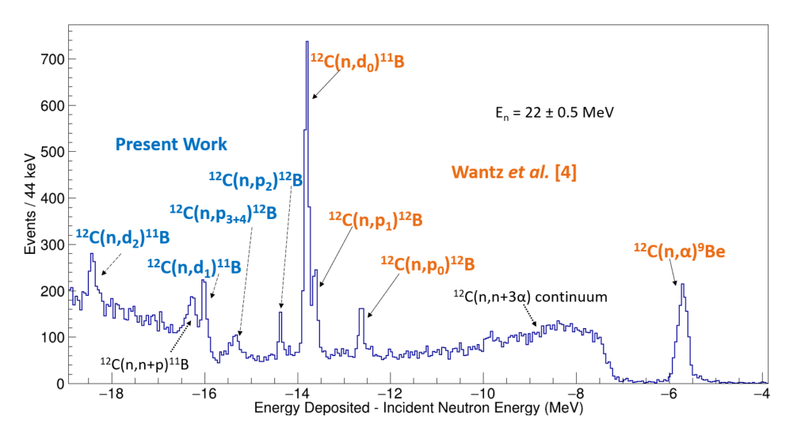
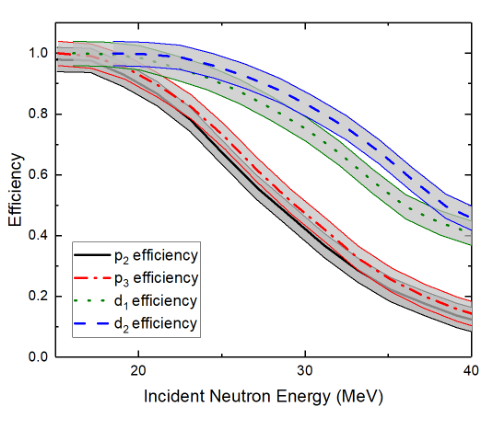
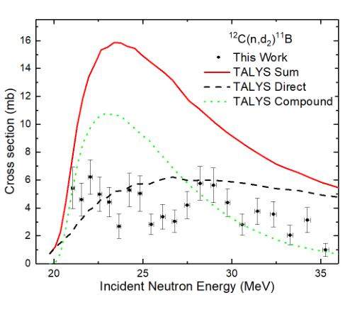

# 碳中子反应分道截面：金刚石活性靶、逃逸修正与“总截面”的比较边界

## 0. 论文信息与阅读范围

- 原题：*Exclusive cross section measurements of 12C(n,pn) and 12C(n,dn) reactions*；作者A. Wantz、A. N. Kuchera、W. F. Rogers、T. Baumann、C. Boothby、M. Devlin、N. Frank、P. Gueye、K. J. Kelly、S. A. Kuvin、A. LaRochelle、T. Redpath、T. Tran Nguyen、J. R. Winkelbauer。
- [Physical Review C正式记录](https://doi.org/10.1103/j2m6-v12v)：114, 034619，2026-09-17发表。本轮因11月作者全文公开而补收，**不是11月新发表实验**。
- 实际阅读：[arXiv:2611.16075v1](https://arxiv.org/abs/2611.16075v1)，2026-11-11 22:33:17 UTC首投、11-13公告，PDF印11-13。[官方PDF](https://arxiv.org/pdf/2611.16075v1) · [本地15页PDF](../pdfs/carbon-2026.pdf)。包含主文10页（含参考文献和主文表）及嵌入补充5页；不是另获出版社VOR。APS harvest返回401，未取得VOR。
- 证据：**LANSCE既有实验数据的新增分道分析**，结合Menate_r/Geant4效率修正与TALYS模型比较；并非激光驱动中子源新实验，也未测激光转换靶或同位素生产效率。
- 全部15页布局文本已读，目视核查PDF第1–7、10–15页，保留3幅原图。SHA-256：`d75dcbe134e3f9f41ae107918a2c0d0559d00160e61c7b464ff0702afb1affe0`。MinerU历史凭据失效，本次零请求且未复测，使用本地布局文本与原页渲染回退；未复跑拟合、TALYS、Geant4或实验。

## 1. 摘要：新增的是四条部分截面

作者从阈上至约26 MeV提取(n,p2)，至约23 MeV提取未分辨的(n,p3+4)，至约35 MeV提取(n,d1)和(n,d2)；最后一条是作者所述首次测量。下标表示**残核激发态编号**，不是出射轻离子的数量。

它们与此前同一实验的低激发态通道合并，形成指定终态集合的截面和。论文价值在于补充碳探测器/有机闪烁体响应所需的核数据，不能把部分通道上限35 MeV推广成所有轻带电粒子产生的全覆盖测量。

## 2. I. Introduction：数据缺口和既有实验的延伸

引言先指出20 MeV以上碳核非弹性反应的排他通道数据稀缺；许多开放通道通向粒子非束缚态，既增加测量困难，也削弱统计模型的可靠性。此前Pillon等提供部分激发态分辨截面，但能区较低。

随后说明本文**复用Ref.4（Wantz等，PRC 112,014620，2025）的数据集**，新增四条通道。因共享事件、通量及归一化，本论文不能与该旧论文当作完全独立数据做统计合并。

作者用默认TALYS计算作为代表性模型：对轻核及该能区，并不预设它是“真值”。其用途是定位直接反应与复合核贡献的尺度偏差，而不是靠总截面偶然接近便验证所有分道机制。

最后将应用指向Geant4、Menate_r、MCNP、neuSIM4等含碳探测器模拟。论文提供核数据约束，没有证明某个软件的全部物理列表已经修正或整体达到实验精度。

## 3. II. Experiment：TOF与Q值怎样辨认通道（PDF第2–4页）

800 MeV质子轰击LANSCE钨散裂靶，形成0至600 MeV以上的宽谱中子；脉冲间隔1.8 μs。90 m的15L飞行路径上，束斑约3 mm，Cividec B8单晶CVD金刚石活性区4×4 mm²、厚0.5 mm。信号经Cx整形、高增益后衰减10倍进入CAEN VX1730B；只保存波形积分而非完整波形。另一个下游C6读出探测器因能量分辨较差未用于本分析。

以质子pick-off为触发、prompt γ到达作时间零点，得到入射中子能。为解释其物理关系，以下是标准TOF重建式，**不是作者给出的新拟合公式**：

$$
t_n=\Delta t_{n-\gamma}+\frac{L}{c},\qquad
\beta_n=\frac{L}{ct_n},\qquad
E_n=m_nc^2\left[(1-\beta_n^2)^{-1/2}-1\right].
$$

L是飞行距离，Δt是中子相对prompt γ的延迟，mₙ是中子质量。先补回γ自身的飞行时间，再由速度求动能。低能时展开得到常用的半质量乘速度平方关系；不能直接把γ校时后的延迟当绝对中子飞行时间。Fig.1横轴TOF/ns、纵轴沉积能/MeV、色标事件数（对数），同时出现prompt γ、前一脉冲慢中子wraparound及带电产物反应带；它是原始响应图而非入射中子谱。

### 图2：22 MeV选能后的Q值峰

来源为PDF第4页Fig.2。横轴“沉积能−入射中子能”/MeV，纵轴每44 keV的事件数；选择中子能22±0.5 MeV。对所有反应产物均留在活性体的带电终态，能量守恒给出：

$$
Q_{\rm rec}=E_{\rm dep}-E_n\simeq Q_{\rm channel}.
$$

峰位因残核激发能而分开，故可识别通道。蓝色标注是本轮新增四通道，橙色为旧研究已提取的通道，**不是两次独立实验**。轻离子逃逸或出射中子带走能量会使重建Q偏低，形成连续本底；图中(n,n+p)看似有峰，但在其他入射能量上难与连续谱稳定分离，作者没有给它截面。峰面积未经通量和效率校正，不能直接比较反应概率。

## 4. III. Normalization：相对通量、全能峰效率与误差

### 4.1 A–B：先定尺度，再扣本底

裂变室给出相对中子通量分布，截面的绝对尺度锚定到14.1 MeV处既有(n,α0)数据。故“relative cross sections”指相对标准归一化后以mb报告，并不等于无量纲比例，也不是完全独立的绝对通量测量。

外部本底因探测器小而可忽略；内部本底来自含出射中子的反应、轻带电粒子逃逸以及不稳定核衰变。每个Q峰用高斯加局部线性本底拟合，假设峰宽内背景没有突变；用扣本底峰计数求截面，并由拟合峰宽误差添加保守拟合项。该做法依赖分峰和背景模型，未保存完整波形限制了事后脉冲级再分析。

为帮助追踪归一化，以下是与文中流程一致的计数恒等式说明，**未声称从公开信息恢复作者完整代码**：

$$
N_i(E)=N_C\,\Phi(E)\,\sigma_i(E)\,\epsilon_i(E),
$$

$$
\sigma_i(E)=\sigma_{\alpha}(E_*)
\frac{N_i(E)}{N_{\alpha}(E_*)}
\frac{\Phi(E_*)}{\Phi(E)}
\frac{\epsilon_{\alpha}(E_*)}{\epsilon_i(E)},\qquad E_*=14.1\ {\rm MeV}.
$$

N是扣本底计数，Nᶜ为受照靶核数，Φ为相应能箱的校正后积分注量，ε为全能峰存留概率，σ单位mb。第一式说明事件数同时依赖核反应和仪器；第二式由两通道计数相除消去Nᶜ。补充表还列出约80–85%的模拟中子transmission修正，但主文未完整给出它与裂变室谱的代码级组合方式，不能自行猜乘除方向或重复校正。

### 4.2 C：效率是“进入全能峰”的概率

来源为PDF第4页Fig.3。横轴入射中子能/MeV，纵轴无量纲全能峰效率；黑p2、红p3、绿d1、蓝d2，阴影为作者给出的±4%不确定性带。随入射能量升高，带电产物更易逃出0.5 mm探测器，曲线整体下降；这不是中子总探测效率、触发效率或电荷收集效率。

作者以Menate_r嵌入Geant4，假设CM系各向同性出射，计算全能峰存留；角分布近似的4%误差来自此前研究，不是本文逐通道实测角分布。补充表例如p2在26.11 MeV为61.0%，d1在35.08 MeV为53.1%，d2在35.26 MeV为64.0%；应从正式核对后的表读值，而非从示意曲线数字化替代表格。

### 4.3 D：误差及相关性

统计项通常10–30%，但稀少尾端更大；归一化系统项约4.9%，全能峰效率4%，通量谱误差从5%随能量上升；拟合项通常不足10%而在稀少尾端明显变大，能量重建误差最大0.49%。作者把各项平方和开根给单点总误差：

$$
u_{\rm tot}^2=\sum_k u_k^2,\qquad
{\rm Cov}(\sigma_i,\sigma_j)=\sum_k\rho_{ij}^{(k)}u_{i,k}u_{j,k}\sigma_i\sigma_j.
$$

第一式中u为相对标准不确定度；第二式展示由相对项构造协方差的通用关系，ρ为该误差源跨能点相关系数。主文称通量部分相关、拟合不相关、归一化/效率/能量重建全相关；没有给出完整协方差矩阵。补充中的共同(n,α)参考计数项2.96%同样共享尺度，拟合数据库时不能把每个能点都当作完全独立。将高能尾部全部称作“10–30%精度”不准确：p2末点总相对误差61.5%，d2末点48.6%。

## 5. IV. Results：分道先看终态，再比较模型

### 5.1 A：12C(n,p2)12B（Fig.4、Table I）

残核第二激发态能1.673 MeV、Jπ=2−，测量16.34–26.11 MeV。与此前低能数据大体相容，TALYS默认值一般偏高；18和21 MeV附近起伏与误差同量级，只能称可能结构。例：17.01 MeV为7.9±1.6 mb，26.11 MeV为1.1±0.7 mb；不能用末点形状认定新共振。Fig.4横轴入射能/MeV、纵轴截面/mb；图中旧数据、本文点、红TALYS线的比较均沿用相对标准的归一化。

### 5.2 B：12C(n,p3+4)12B（Fig.5、Table II）

第三、第四激发态分别2.621和2.723 MeV，分辨率不足，作者用一个高斯提取合峰；能区17.78–23.20 MeV。TALYS分别计算p3、p4后求和，整体高估和数据散布限制一致性。Fig.5横轴中子能/MeV、纵轴截面/mb；黑点为合峰截面，不支持实验上再拆成两个通道。

**原文内部待澄清：主文Table II与嵌入补充Table 4并不相同。**19.92 MeV主表为4.7±1.1 mb，补充为3.6±0.9 mb，Fig.5对应黑点目视约3.6 mb；不能据图自行更正文稿。17.78、18.28、18.81、19.35、20.52 MeV的中心值相同，但主表误差分别1.0、0.8、0.8、0.8、0.8 mb，补充为1.3、1.0、1.0、1.0、0.9 mb。用于评价库或蒙卡输入前，应确认最终VOR/作者勘误及完整协方差。

### 5.3 C：12C(n,d1)11B（Fig.6、Table III）

残核第一激发态2.125 MeV、Jπ=1/2−，测量18.41–35.08 MeV；正文简称35 MeV，表格给精确末点。22.31 MeV为12.0±1.6 mb。默认TALYS的直接加复合贡献约高一倍，25 MeV以上偏差主要来自直接项；24 MeV附近只是可能结构。图6横轴能量/MeV、纵轴截面/mb，模型两分量是理论分解，不是分别测到的两种反应机制。

### 5.4 D：12C(n,d2)11B（Fig.7、Table IV）

来源为PDF第6页Fig.7。横轴中子能/MeV，纵轴截面/mb；黑点为相对标准归一化的测量，红线是TALYS和，黑虚线直接项、绿点线复合项。残核第二激发态4.445 MeV、Jπ=5/2−，能区21.06–35.26 MeV。例：22.05 MeV为6.2±1.2 mb，35.26 MeV为1.0±0.5 mb。

作者称这是该通道首次测量。模型整体往往高出两倍以上；21–27 MeV复合项、29 MeV以上直接项的高估分别突出。24.5及28.5 MeV附近的起伏尚未构成统计确证共振。图把测量与模型区分得很清楚，也说明不能只依赖默认TALYS替代实验输入。

### 5.5 E：12C(n,p)12B的“总”是束缚态残核产生（Fig.8）

将旧p0、p1和新p2、p3+4加和；不同能箱先线性插值对齐。它包括12B全部**束缚态**，不含非束缚态；因此17.3 MeV以上与“所有质子产生”的n_TOF数据不是同一观测量，后者能纳入通向非束缚态并进一步衰变的反应。不能把“总质子产额”和“12B残核产生截面”互换。

图8横轴中子能/MeV、纵轴mb。本文束缚态和与TALYS总曲线大体接近，仍不能挽救各分道偏差。旧ENDF曲线较近早期Rimmer数据，作者据新旧实验差异建议更新；本文只是核数据比较，没有自行完成新评价。缺少p1的旧研究也不能直接当同定义总和比较。

### 5.6 F：12C(n,d)11B的“总”随开放通道改变（Fig.9）

本文将d0、d1插值到d2的较粗能箱，再作三通道和。19.3 MeV以下d2尚未打开，d0+d1可与早期研究直接比较；19.3 MeV以上仅测d0+d1的Pillon数据不再完整。21.6 MeV以上d3开启，本文d0+d1+d2也不再等于全氘核产生截面。

图9横轴能量/MeV、纵轴mb，图例明确分别列TALYS的d0+1+2与dtotal。n_TOF在20 MeV以下比本文低约一倍、21 MeV处反而更高，作者尚不能解释，不能用高能通道开放来解释阈值以下差异。高能数据可作分道和约束，但不能当完整氘产额进行归一化。

## 6. V. Conclusions及嵌入补充：可以取什么，暂缓什么

结论强调四条新分道数据可约束碳响应模拟和轻核反应模型；“改善模拟”的意义是提供候选核数据，并不表示已用独立探测器数据完成整链验证。全文与Ref.4共享实验，不构成独立复现。

PDF第10页为主文Table I–IV；第11–15页为五页完整嵌入补充，列峰/总计数、全能峰效率、transmission、截面和逐项误差。补充并非缺失；只是Ref.19仍保留出版社URL占位符。各表已读并目视复核。本轮只作文本/表间核对，没有把全部数值另行数字化或重算截面，也没有以图读值取代有冲突的表格。

## 7. 与本库方向的关系、接续问题

对激光光核中子源，这篇论文更直接影响**含碳探测器响应矩阵及核反应库**，而不是光子转换靶的源项。将它接入端到端模型时，应先固定入射中子谱，再应用同终态定义的σ和几何逃逸/光产额/读出响应；不能把金刚石全能峰效率直接搬到有机闪烁体。

优先事项是确认Table II/补充Table4的6个冲突点，获得作者最终数值和跨能点/跨通道协方差；随后核对通量transmission的计算、各向同性近似对本四通道是否足够，以及线性插值如何传播共同实验误差。任何“共振”拟合须先检验统计显著性和能量分辨卷积。本文没有给出激光驱动中子源产额、临床剂量、材料辐照损伤或屏蔽合格结论。

复习要点：**先确认残核态和通道和的定义，再谈数据是否一致；峰计数、相对标准截面、总轻离子产额和探测器响应是四个不同层次。**
