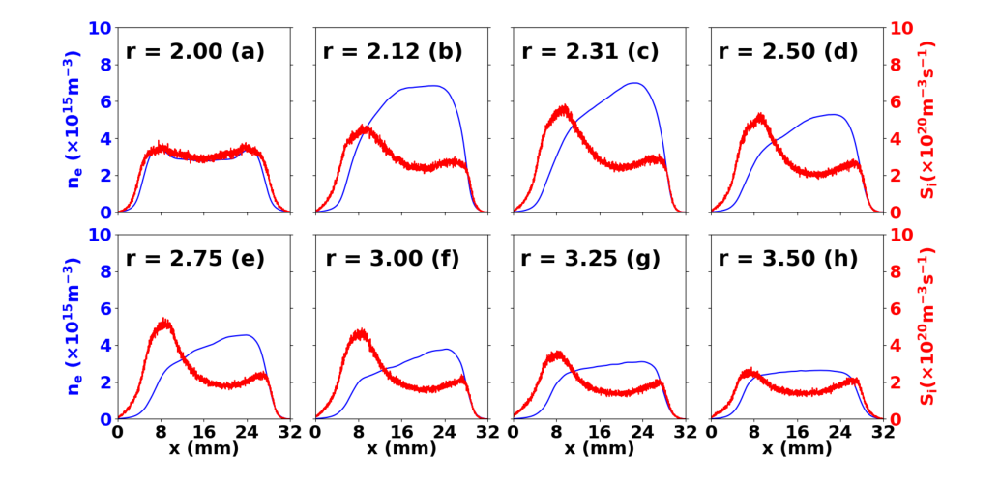
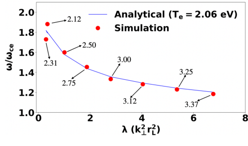
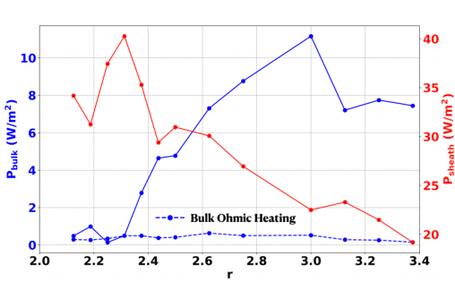

# 磁化电容放电中的 Bernstein 波：非对称鞘层、色散与体加热

## 0. 论文信息与实际阅读版本

- 原题：*Simulation Studies of Resonant Excitation of Electron Bernstein Waves in Capacitive Discharges*；Deepak Gautam、Sarveshwar Sharma、Igor Kaganovich、Bhooshan Paradkar。
- [正式 DOI：10.1103/cv7h-ghnk](https://doi.org/10.1103/cv7h-ghnk)，*Physical Review E* **114, 055206，2026-11-13发表**，以APS页面独立核实。
- 实际读的是[官方 arXiv:2508.15269v2](https://arxiv.org/abs/2508.15269v2)，2025-08-21首投、2026-05-19修订，PDF首页日期05-20；[本地16页PDF](../pdfs/ebw-2026.pdf)。**未取得11月出版社VOR，不宣称作者v2包含最终修订。**普通PDF返回403 HTML，harvest返回401 JSON。
- SHA-256：`33222dac96c5b4160be4f3af346236c010e66e06962332b63de3e066a567f6bc`。全文布局文本已读，11个首页/方法/关键结果页目视；3幅保留原图重开核对。MinerU此前认证过期、本轮零请求且未复测，采用本地文本与原页渲染。未运行EDIPIC或复现作者结果。
- 证据为**1D3V静电PIC–MCC及局域均匀Maxwell电子色散对比**，不是放电实验或激光靶实验。同作者伴随短文[10.1103/5hwk-fymz](https://doi.org/10.1103/5hwk-fymz)与本篇密切相关，本轮仅收长文，短文没有全文精读，不视作独立验证。

## 1. 摘要（第1页）

作者研究弱到中等磁化的低压电容耦合放电：随横向磁场增加，密度从对称变为非对称，再恢复对称。在有明显梯度的参数区，鞘层产生的高次谐波进入体等离子体，频率—波数谱接近电子Bernstein波（EBW）分支。

这里的“观察”指模拟诊断。波谱、局部电子功率和测试粒子相互印证，支持EBW解释，但没有把电离增强唯一归因于某个可开关的机制，也没有给出材料加工良率或离子能量/通量独立控制的实验验收。

## 2. Introduction：从EBCR第一峰到第二密度峰（第1–3页）

开头以刻蚀、离子注入及表面处理说明电容放电为何需要同时控制通量与能量，继而回顾双频、非正弦驱动、磁化等控制方式。VHF可提高密度，但也引入体区场与谐波；强磁场可能带来不均匀性，因此不能把密度提高直接视为工艺性能提高。

文献中的电子反弹回旋共振（EBCR）对应半回旋周期与RF周期匹配。本文采用的磁化参数为：

$$
r=\frac{2f_{ce}}{f_{rf}},\qquad f_{ce}=\frac{eB}{2\pi m_e}.
$$

其中频率单位Hz，磁场在SI公式中用T，e为正的元电荷，m_e为电子质量。半回旋周期等于一个RF周期意味着回旋频率为RF的一半，因而EBCR第一峰是r=1。**本文关注r=2至3.5的另一段，不是第一峰。**原图1重用Patil等既有扫描作背景，不能当本文新实验。

随后作者提出：较弱磁化下的第二密度峰与非对称性，可能关联鞘层驱动的EBW。EBW是垂直磁场传播的静电波，不能将其与穿透截止层的自由电磁波混称。关于磁聚变模转换的引用提供类比，不代表本文实现了O–X–B发射系统。

## 3. Simulation technique and parameters（第3–4页）

使用EDIPIC，虽然代码名称含direct implicit，**本篇计算采用显式模式**。平板间距32 mm；5 mTorr氩气、300 K静止背景；60 MHz、100 V峰值正弦电压直接施加在供电极，另一端接地；磁场平行极板。电子含弹性、激发、电离碰撞，离子含弹性及电荷交换，未追踪亚稳态。

初始电子温度2 eV、离子0.026 eV，参考密度5×10¹⁵ m⁻³；2436网格、约400宏粒子/格、步长3.916 ps。两端吸收，无二次电子发射或外接电路；运行超过6000 RF周期，主要剖面取最后1000周期平均。1D允许三维速度和回旋，**不允许沿极板方向的空间结构或真实横向E×B输运损失**。

原文参数有待澄清，不能直接照抄为已验证输入卡：

- 第4页将20–75 G对应r=2–3.5，但按其60 MHz与r定义应约21.43–37.51 G；图13的r=2.5、26.7 G却与定义一致。75 G确实对应文中约4.75 ns回旋周期，但r约7。这是稿件内部不一致，未据此判断实际代码用了错误磁场。
- 按其写出的Debye公式、2 eV与5×10¹⁵ m⁻³，Debye长度约148.68 μm，其1/16约9.29 μm，与给出的13.14 μm不符；后者与2436格/32 mm相符。仅作印刷参数算术核对，真实初始化温度/热速定义和网格需原始decks。
- 没有给出本文完整输入、固定代码SHA、种子及网格/宏粒子收敛序列。高空间/时间分辨率本身不能代替收敛证据。

## 4. Results 3.1：密度、粒子流与鞘层非对称（第4–7页）

**图2（PDF第5页）解读：**横轴x/mm由供电极0指向接地极32；蓝线左轴为电子密度，单位10¹⁵ m⁻³，红线右轴为电离率，单位10²⁰ m⁻³ s⁻¹；均为最后1000 RF周期平均。r=2.31附近密度约7×10¹⁵ m⁻³且不对称最明显。密度峰靠接地端，电离峰靠供电端，两者不是同一个位置；这是产生、输运和边界损失共同决定的稳态，不能只按局域电离率预测密度。

图3的接地/供电通量比显示：非对称区离子主要损失到接地端，电子主要到供电端。图4将两物种各自按最大值归一化，因此只支持剖面/方向比较，不能从蓝红线重合推出两者绝对通量相等。图4图注把r=2和3.5称为“asymmetric”，与正文对称端点不符，应保留为图注疑点。

图5在r=2.31下展示一个RF周期的电势和电子电流。供电鞘层在部分相位接近塌缩，允许电子流入；接地鞘层仍有势垒。电流正号指电子向供电端运动，这是电荷符号与坐标共同确定的约定，不应直接当成正粒子流向。

## 5. Results 3.2：波谱、色散与加热（第7–11页）

图6在两RF周期中看到体区倾斜条纹，场色标在±4×10³ V/m饱和，而鞘层峰场约2×10⁴ V/m。色标突出体区，不能用饱和后的图比较真实最大场。图7对8–24 mm体区逐点做一周期时间FFT，再空间积分；r约2.5时第二RF谐波占比约40%，r=3.5基频约60%。**FFT百分比不是吸收功率或转换效率。**幅值/平方功率归一化、窗与误差需原始处理程序核查。

图8在同一体区做二维FFT，沿第二RF谐波取波数。原稿给波数基准为体长倒数62.5 m⁻¹；色散公式中的角波数须与FFT周期波数区分，是否显式乘2π尚需脚本。不同r的峰点构成图9的比较，不是单一均匀背景中完整扫出的色散曲线。

**图9（PDF第10页）解读：**横轴为角波数与电子拉莫尔半径乘积的平方，无量纲；纵轴为波角频率除以电子回旋角频率。蓝线为约2.06 eV的解析近似，红点来自各r的第二RF谐波峰。曲线从接近第二回旋谐波向第一回旋谐波下降，支持后向波分支解释；红点贴线不证明非均匀分布处处Maxwell，也不验证无限项色散或所有波模。

对垂直传播、冷离子、均匀Maxwell电子，作者采用：

$$
1=\frac{2e^{-\lambda}}{\lambda}\sum_{n=1}^{\infty}
\frac{n^2\omega_{pe}^2 I_n(\lambda)}{\omega^2-n^2\omega_{ce}^2},
\qquad \lambda=k_\perp^2r_L^2.
$$

I_n为修正Bessel函数，频率为rad/s，角波数为rad/m，r_L为m。作者取前两项；定义s为波频率与回旋频率比的平方、A与B为两项系数，可把求根清楚写成：

$$
A=\frac{2e^{-\lambda}}{\lambda}\frac{\omega_{pe}^2}{\omega_{ce}^2}I_1,
\quad B=\frac{2e^{-\lambda}}{\lambda}\frac{\omega_{pe}^2}{\omega_{ce}^2}I_2,
\quad 1=\frac{A}{s-1}+\frac{4B}{s-4}.
$$

两边乘分母、展开并整理，得到：

$$
s^2-(5+\alpha)s+4+4\beta=0,
\quad \alpha=A+4B,\quad\beta=A+B,
$$

$$
s=\frac{5+\alpha-\sqrt{9+10\alpha+\alpha^2-16\beta}}{2}.
$$

这重现原式8选择的低分支；是对其截断模型的代数解释，**不是对无限项方程的独立数值复现**。密度梯度尺度远大于波长、近Maxwell及两项截断需分别检查，有限箱长不能单独保证这些条件。

图10展示平均电子功率密度的体区振荡；正负值分别表示局域净给电子能量或取回能量。作者把电流与电场乘积按RF时间平均后作空间积分：

$$
P_{\rm bulk}=\int_{x_{sp}}^{x_{sg}}\langle j_eE\rangle\,dx,
\qquad P_{\rm bulk,ohmic}=\int_{x_{sp}}^{x_{sg}}\sigma\langle E^2\rangle\,dx.
$$

电流密度A/m²乘场V/m为W/m³，沿x积分得到W/m²，**并非整台装置瓦数**。x_sp与x_sg为两鞘边界，体宽约16 mm；鞘功率为其余两段积分。波与粒子相位相关性进入真实平均功率；不能用单独的场谱强度替代。

**图11（PDF第11页）解读：**横轴r；蓝色左轴为体加热W/m²，红色右轴为鞘加热W/m²，蓝虚线为稳态磁化电导估计。体功率在中间区增大，鞘功率总体下降；两色采用不同轴，不可直接比较高度。作者概括体区占比约不超过30%，图上部分点可略超此量级，准确峰值需数值表。虚线使用最大电子—中性碰撞截面估计的稳态电导，真实RF动理学欧姆基线与波/随机加热分解仍未完全闭合；差值不能自动全算为可抽取EBW功率。

## 6. Results 3.3：测试电子与相速/群速（第11–13页）

图12的瞬时功率条纹与场条纹一致，支持波—粒子能量交换。图13在r=2.5下放入四个初能2 eV测试电子：供电侧5、6 mm，接地侧29、30 mm；轨迹展示10周期，FFT使用100周期。供电侧更强的第二RF谐波与局域场相关，支持激发源靠供电鞘层。四个示踪粒子不能代替全分布的共振功率诊断或因果消融。

条纹相位看似从接地走向供电，而作者推断能量从供电走向接地。二者可由后向波解释：

$$
v_\phi=\frac{\omega}{k},\qquad v_g=\frac{d\omega}{dk}.
$$

在正k而频率随k降低的分支上，相速正、群速负，方向相反；坐标符号可整体互换。条纹斜率只能确定相位传播，不能单独证明能流方向。本文以色散和加热包络作一致性解释，尚未给独立完整波能流预算。

作者最后借用磁聚变的密度梯度/模转换认识解释耦合增强。该段在CCP中的对应关系仍属物理类比，未独立扫描梯度、鞘层谐波和密度的因果贡献。

## 7. Conclusion与接续（第13–16页）

本篇最有价值的结论是：在该1D3V低压氩放电参数内，鞘层非对称、第二RF谐波、EBW近似色散和体加热形成一致诊断链。电离峰与密度峰分离、相速与能流相反，尤其适合提醒PIC后处理不能只看一张场图。

接续先取得最终VOR和完整输入/后处理，澄清B–r、Debye网格与FFT角波数定义；再做网格/宏粒子/取样窗、不同初态与电路/二次发射的敏感性，独立计算波能流及全局电子功率预算，并扩展横向空间/真实放电比较。本篇没有激光转换靶、光核中子或同位素产额实测，也未完成临床或辐射防护验证。
