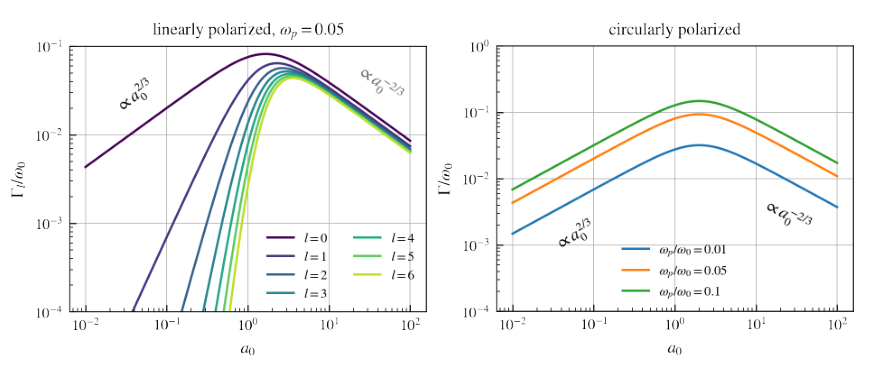
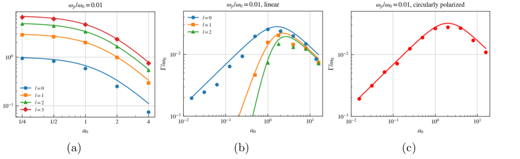
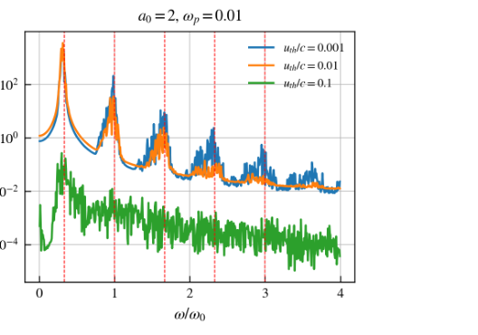

# 无磁化对等离子体的受激后散射：相对论漂移、奇次谐波与温度效应

## 0. 论文信息与核验范围

- 原题：*On stimulated scattering including harmonic generation in an unmagnetized pair plasma for arbitrary pump strengths*。
- 作者：Vijay Patel、Thomas Grismayer、Samuel Sebastian、Xinlu Xu、John Palastro、Paulo Alves、Warren B. Mori。
- [arXiv:2611.17279v1](https://arxiv.org/abs/2611.17279v1)，2026-11-12 18:50:51 UTC首投，11-13公告；PDF正文日期11-13。本轮Crossref精确标题前3项未核实同作品期刊版，不能据此断言不存在期刊版。
- [本地25页PDF](../pdfs/pair-2026.pdf)，SHA-256：`cfb472a8e98bb47445bcb79c03480ea1cb84be6e4e87e482619530dcd2623bb1`。全文布局文本（含参考）已读；1、3、5、6、8、9、11、12、14、16、18、19、22、23页及下列3幅原图实际目视。MinerU此前认证失效，本轮零请求，使用本地提取和原页渲染，未复跑OSIRIS。
- **证据类型：相对论双流体理论、有限温分布构造与一维PIC数值试验。**研究预先存在的电子—正电子等离子体，不计算QED造对，不是强场QED实验或FRB观测反演。

## 1. Abstract与Introduction（第1–2页）

摘要先给出主要机制：强电磁泵浦不只驱动横向摆动，还使初始静止的电子和正电子共同向前漂移，因此后散射基频被多普勒降频。线偏振（LP）的纵向二倍频运动进一步产生降频基频的奇数倍谐波。PIC支持冷等离子体涨率与温度抑制趋势。

引言先从磁星周围对等离子体的FRB传播问题出发，回顾弱泵浦和任意泵浦强度研究。作者避免把本过程直接称为传统SBS或SRS：对称电子—正电子体系中，质动力同时推动两种粒子，不形成电子—离子SRS那样的电荷分离恢复力。

参考文献[9]正是库内已有的Tangtartharakul、Arefiev、Lyutikov动态Bragg结构完全反射论文（[PRL DOI](https://doi.org/10.1103/g27z-2kd3)，[既有笔记](../../2026-09-10/notes/Tangtartharakul%20et%20al.%20-%202026%20-%20Complete%20reflection%20in%20underdense%20pair%20plasma.md)）。两文共享无磁化对等离子体、同向质动力压缩与后向波反馈的场景；本篇是不同作者的独立作品，重点为有限泵浦平衡上的解析涨率、LP奇次谐波及热效应，采用OSIRIS；旧文重点是移动密度plug/Bragg样spike及完全反射，采用EPOCH与传输矩阵。不能把本篇视为另一场新实验或对旧文完全反射结论的独立验收，也不能仅凭不同参数下“吸收”与“反射”的文字断定两篇相互否定。

接着建立与FEL的联系：在电子束共动系，磁摆动器可看作迎面电磁泵浦；忽略空间电荷恢复力的强耦合散射与FEL微聚束共享反馈结构。对等离子体由两种等质量电荷共同贡献横向电流，其等离子体频率定义中的物种因子必须保留。这是参考系与模型极限的联系，不等于给出实际FEL装置的增益或效率。

## 2. Derivation of the growth rate（第3–10页）

### 2.1 初态、守恒量与非线性平衡

本节先限制在一维平面波、无外磁场、低密度且泵浦与散射光均近似以真空光速传播。沿传播方向的密度扰动满足两物种对称性，因而模型忽略静电项；这个假设不能搬到磁化、非对称初态或电子—离子体系。

原文使用高斯单位的归一化矢势。下式同时写出其SI等价定义，便于避免单位混用：

$$
a=\frac{eA_{\rm Gaussian}}{m_ec^2}
=\frac{eA_{\rm SI}}{m_ec},\qquad
u_z=\frac{p_z}{m_ec},\qquad
\omega_p^2=\frac{n_0e^2}{\epsilon_0m_e}\quad({\rm SI}).
$$

这里电子电荷量e取正值，n₀是**单物种**初始本征数密度，ωₚ单位s⁻¹；对称两物种的冷横向响应涉及2ωₚ²。原文先用有量纲proper velocity，再除以c，因此阅读不同公式时应区分两种u记法。

由横向正则动量守恒、行波对称性及初始静止条件，电子和正电子的横向动量相反，纵向动量相同。以单个局部相位的矢势幅值写：

$$
\gamma-u_z=1,\qquad
\gamma^2=1+u_z^2+|a|^2
\quad\Longrightarrow\quad
u_z=\frac{|a|^2}{2},\qquad
\gamma=1+\frac{|a|^2}{2}.
$$

推导是将第一式代入能量—动量关系，平方项相消即得。它说明正负电荷虽然横向相反摆动，却因磁力/辐射压力同向前移。LP的矢势平方含直流与二倍频项；CP在恒定包络下的矢势平方恒定。比较LP与CP时论文固定功率，通过偏振分量平方和为1的约定，将CP各分量幅值降低到LP的1/√2。不能把单分量峰值相同误当作功率相同。

本征密度与实验室数密度不同：低密度平衡中前者保持n₀，后者随γ压缩。某个相位的γ、相位平均γ、实验室时间平均漂移和下文M₀并非可以随意互换的同一量。

### 2.2 光锥变量、微扰与共振条件

作者用沿前/后向光线的坐标，将流体量改写为γ减/加纵向动量，先求有限泵浦下的平衡，再对弱后向场作微扰；“任意泵浦强度”不表示任意强的散射场或完全非线性饱和理论。

椭圆偏振的参数为两个正交分量平方差：LP取1，CP取0。LP纵向二倍频振荡使积分相位含正弦项，使用贝塞尔展开后，每一个奇数阶共振形成一条散射支。保留共振分母最强的项，得到原文式(49)的三次色散式；丢弃非共振项和较低阶奇异项是推导近似的一部分。

将原文共振及式(50)以时间涨率的无量纲形式整理为：

$$
M_0=\frac{1}{1+a_0^2/2},\qquad
N=2l+1,\qquad
\omega_{s,l}\simeq NM_0\omega_0,\qquad
b_l=\frac{NM_0a_0^2}{4},
$$

$$
\frac{\Gamma_l}{\omega_0}
=\sqrt{3}\left[
\frac{\omega_p^2}{\omega_0^2}
\frac{M_0b_l}{(1+M_0)^2}
\bigl(J_l(\alpha b_l)-\alpha J_{l+1}(\alpha b_l)\bigr)^2
\right]^{1/3}.
$$

ω₀为泵浦角频率，ωₛ为实验室系散射角频率，Γ为**场/扰动幅度**的时间指数涨率，l为非负整数，J为第一类贝塞尔函数，α为偏振参数。原式写Γ/k₀并采用c=1；恢复物理单位时是Γ/(ck₀)=Γ/ω₀，不能将其直接理解成SI下的速度。

三次色散的复根提供虚部，场的时间依赖又带入原文所述因子2，得到前面的√3。CP时只有零阶贝塞尔项存活；LP则可有全部奇次支。M₀来自共振相位匹配，不能简单把任一时刻的γ倒数代入。

弱场时M₀近1、基频贝塞尔因子近1，因而：

$$
\frac{\Gamma}{\omega_0}
\simeq\sqrt{3}\left(\frac{\omega_p^2a_0^2}{16\omega_0^2}\right)^{1/3}
\propto a_0^{2/3}.
$$

强场下M₀按强度的倒数下降、贝塞尔自变量趋于有限值，冷稀薄理论给出涨率随a₀的−2/3次方下降。作者报告CP最大值在a₀=2，LP基频约a₀=1.662；强泵浦引起更强漂移与降频，因此“泵浦越强，涨率必越大”不成立。

**图1解读（PDF第9页）：**两轴均为对数；横轴a₀无量纲，纵轴Γ/ω₀为幅度涨率。左图LP取单物种ωₚ/ω₀=0.05，曲线为l=0–6；右图CP的三条曲线对应0.01、0.05、0.1。谐波在a₀接近1后更明显，高强度曲线转而下降。这是色散公式曲线，不是反射效率、谱线绝对强度或实验数据。

### 2.3 脉冲蚀刻和作用区长度

本节最后将粒子压缩后的动能密度与入射场能量密度比较，定义：

$$
\epsilon_p=a_0\frac{\omega_p}{\omega_0}.
$$

强场下粒子能量和实验室密度都随泵浦增加，若供给的场能流不足以维持这个平衡，脉冲前沿会蚀刻。作者以εₚ约1作为强场下显著/完全蚀刻的量级条件，强调这可能把场能转成粒子能量，**不是全反射阈值**。

此外，光在等离子体中传播的距离不等于有效增益长度：粒子被一起向前推，重叠区只按相对速度积累。原文先用真空光速估算，再讨论有限群速度可能追不上漂移粒子；这些是量级估计，尚不是有限脉冲、有限温度和任意密度的统一涨率公式。

## 3. Simulation Results（第10–19页）

### 3.1 Temporal Problem与Nonlinear effects

OSIRIS时间问题使用一维周期边界，直接把泵浦及相应非线性平衡初始化在盒中，用于检验时间涨率。盒长60–180个激光波长、6000–18000网格、每格64–128粒子，强度从2⁻⁴到2³；典型单物种ωₚ/ω₀=0.01。不同分辨率/粒子数范围不等于已有完整收敛研究，正文也未充分说明该粒子数是每物种还是合计。

图2给出后向组合场的傅里叶模功率随时间增长及饱和后的波数谱。泵浦沿正方向，后向场使用E₂−B₃（单位制须与c=1一致）；LP谐波满足降频后的奇数倍关系。图2(c)图内写时间1000，而图注笼统写约750，不能给全部面板统一时间。

涨率通过对数功率/密度模的线性区拟合得到：若幅度随exp(Γt)增长，平方模随exp(2Γt)增长，因此**半对数功率斜率需除以2**。拟合区间、早期瞬态和后期饱和会影响结果。

**图3解读（PDF第12页）：**左图横轴a₀、纵轴散射频率/ω₀，点为PIC谱峰、线为理论支；中/右图横轴a₀、纵轴Γ/ω₀，分别为LP与CP，均为单物种频率比0.01。数值点支持涨率先升后降，但大a₀基频的位置偏差可见，不能称为全范围精确验证。图注对曲线颜色及l阶数的描述并不完全统一，判读以面板图例为准。

图4转向饱和后的能流：0.01密度比的泵浦损失几个百分点，0.05时达到几十个百分点（限展示时段）。增加的粒子能量伴随反射饱和，场能损失大部分不进入后向光。作者提出反向波导致随机加热的可能性，但没有给轨道混沌指标或排他性机制检验，因此不能把“随机加热”升级为已唯一确认的原因。

### 3.2 Spatial Problem

空间问题从左边界把波送入初始静止的对等离子体，盒长600波长、60000–180000格、每格64–128粒子。作者称高阶谐波至少需20格/波长；泵浦上升时间用于尽量建立平衡。文字初列a₀=1、2、4，而图5实际为4与8，笔记按实际面板区分。

图5中波前的粒子密度先跟随平衡压缩，后方再失稳。实验室系a₀=4时基频约ω₀/9，a₀=8时约ω₀/33；相同物理后向场强可对应较大的归一化矢势，因为其频率已经变低。低反射能流不能被“大散射矢势”替换为高效率结论。

图6分别展示a₀=1、2、20（图注只写1、2），密度比0.1。前沿能流凹陷主要伴随粒子能流峰，后向光只占较少份额；强场例的入射波在前沿被吸收。不同面板分别用红、绿、蓝的**不同纵轴**，并有不同上升时间，不能直接按画面曲线高度比较能量守恒或跨面板反射比例。

### 3.3 Finite Temperature effects

先用运动常数构造有限温初始分布：沿粒子轨道不变的函数可满足Vlasov方程，利用入射前相对论热分布将其映射到波内。式(58)的密度压缩含第二类修正贝塞尔函数K₀/K₂；温度升高时该比值下降，压缩弱于冷极限。它不提供任意强泵浦的完整热动理学色散解，作者主要靠PIC考察温度。

时间问题选热proper velocity与c之比0.001、0.01、0.1，对应文中约0.0005、0.05、5 keV。图7的基频在所示温度范围都出现，较热时早期涨率降低、后期可能加速且饱和值接近；高阶谐波的饱和幅度明显降低。图8为时间问题的饱和波数谱，图9为正电子分布的初态与后态，冷、热初态都能出现显著加热。

论文后续段落把T=10⁻⁶、10⁻²等无量纲温标与前面的keV、热速度混用，并出现“T=10⁻³”的孤立描述。没有明确统一映射时，应以面板标出的热速度比为准，不自行把这些T值全部换成keV。

**图10解读（PDF第19页）：**横轴ω/ω₀，纵轴后向场平方模的对数谱；图内a₀=2、单物种频率比0.01，蓝/橙/绿分别对应热proper velocity比0.001、0.01、0.1。虚线示意谐波位置。高温例的基频和高阶谱都大幅减弱。纵轴没有给出用于绝对反射率的时间积分和入射谱归一化，不能从峰值直接读能量转换率；这是空间问题，与时间问题“基频最终饱和值近似”结论的边界不同。

## 4. Application to FRBs（第20–21页）

作者先讨论何处可能近似无磁化：磁星闭合磁力线区强回旋频率不满足模型，远处风区/条纹风才是讨论目标。场的时间平均接近零不自动证明局部动力学等同于无磁化，需要回旋频率、条纹尺度与脉冲时间尺度共同检验。

随后用各向同性等效光度、到源距离和频率估计局地a₀，讨论强泵浦区即使涨率下降仍可能有足够增长时间、εₚ较大时前沿蚀刻、LP奇次频梳和有限密度下有效本征密度降低。这些依赖假设风密度、温度、磁场和几何，**不是已拟合的FRB谱结构或观测证据**。论文明确把真实风模型、有限温度、磁化和三维传播留给未来。

## 5. Summary、Acknowledgements与Appendix（第21–25页）

总结回到理论和PIC一致的范围：冷稀薄对等离子体中LP奇次谐波、强泵浦下降的涨率，以及有限温度逐渐抑制高阶谱。致谢列出DOE/LLE与葡萄牙FCT支持，不包含额外实验验证。

附录仅在CP下扩展有限密度与非真空相速度。作者由行波连续方程、动量关系与波动方程求平衡，再对泵浦/散射拍频扰动推导实验室系色散式(75)，数值找最大增长根。图11给有效色散随εₚ下降，图12比较全色散根与稀薄近似；LP的有限密度和任意温度未在此解决。

### 5.1 原页核实的印刷/定义疑点

1. 第5页一面强调正负粒子纵向同向，一面印成纵向动量互为负值；同时密度关系的两边重复写正物种。按前文守恒与对称性应是同向，但本笔记不据此擅改作者代码。
2. 原式(29)波方程的系数，到式(35)印为4倍频率平方、到式(38)又印为四分之一倍，不能直接顺推；式(23)还缺少矢势平方。第3页式(5)空间导数记为x，而同页传播取z。以上都在原页存在，不只是文本提取损失。
3. 附录式(66)印刷根式在零泵浦时不能回到静止初态。以其式(65)及能量—动量关系独立作代数检查，应满足：

$$
(v_{\rm ph}^2-1)u_x^2+2v_{\rm ph}u_x-a_0^2=0
\qquad(c=1).
$$

与静止初态相连的根应在a₀趋零时趋零；原页“负号乘以相速度加正根”的形式不满足这一条件。此处只给出检查方法，不替论文选定或发布修正版色散式。

4. 主文把ωₚ定义为单物种，波动方程含物种因子2，附录式(63)、(67)、(71)不再明显保留该因子，且没有清楚重定义。需向作者核对密度、CP幅值和频率归一化后再复现式(75)/图12。
5. 原文对M₀、平均γ/漂移的文字及不同段落的LP/CP幅值约定需进一步统一。这里按明确写出的共振式核读，不把其“γ倒数”的简称扩展为所有平均定义。

这些问题限制按印刷公式直接复现的可靠性；它们**不证明作者OSIRIS计算有同样错误**。本轮没有获取并审计对应输入文件、代码提交、种子或原始谱。

## 6. 本库用途与接续重点

对强激光/PIC工作的可迁移价值，是用有限泵浦下的自洽漂移平衡建立散射诊断，再分别比较频率、幅度涨率、饱和能量和有限脉冲增益。它提醒分析后向谱时先核对参考系、物种密度因子、幅度/功率的2倍关系以及压缩区长度。

优先接续应取得原始OSIRIS输入、谐波分辨率/盒长/粒子数收敛、滤波与拟合窗口，并澄清上述印刷和归一化问题；随后才扩展二维/三维、局部磁化、非对称分布、有限焦斑和真实风模型。本文没有实验造对、γ源转换、光核中子/核素产额、临床或防护验收。
