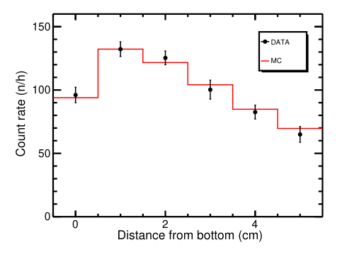
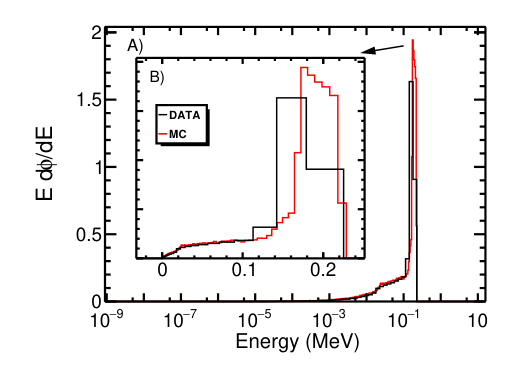
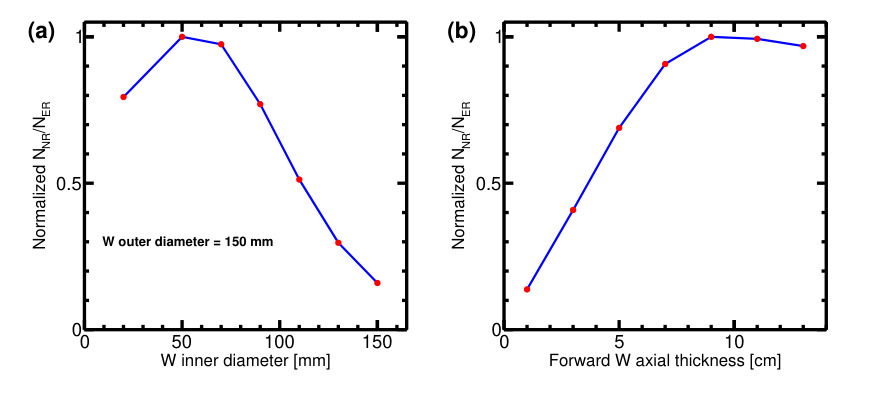

# 钍–重水光中子标定源：实测净计数、模型辅助发射率与未来PandaX标定

## 0. 论文信息与核验范围

- 原题：*Development and Experimental Characterization of a Compact ²²⁸Th–D₂O Photoneutron Source for Low-Energy Nuclear Recoil Calibration*。
- 实际PDF作者按首页顺序：Yueqiang Tian、Chen Cheng、Yuxin Cui、Xunan Guo、Zichao Guo、Yao Tong、Pingquan Wang、Hailun Yuan、Hui Zhang、Xiaopeng Zhou。**PDF为10作者；arXiv网页元数据只有8人，漏Yao Tong/Hailun Yuan且Chen Cheng顺序不同。**本笔记依实际全文，原始网页元数据另存，不擅自视作正式期刊作者表。
- [arXiv:2611.16415v1](https://arxiv.org/abs/2611.16415v1)，2026-11-12 07:25:56 UTC首投，11-13公告；[实际25页PDF](../pdfs/photoneutron-2026.pdf)，含1页Highlights及正文/参考文献。Crossref精确标题前3项未核实同作品期刊版；实际阅读的是作者v1，不是出版社VOR。
- SHA-256：`a3af16c3ca0206b817088120285dd52ef6ffdb0c6488c921d9297604cffdddea`。全文布局文本已读，PDF第2、7、10–14、17–22页实际渲染目视，3幅保留原图已重开；页码均按PDF物理页计，通常比印刷页码多1。
- MinerU历史认证失效，本轮零请求、未复测凭据；使用验证后的本地全文和原页渲染，未运行作者Geant4、MAXED或PandaX模拟。本笔记仅做印刷数字的算术核对。
- 证据层次：**氦管净计数有实测；前端面中子发射率需MC效率；能谱需响应矩阵和先验展开；PandaX事件率、屏蔽和220 h样本量全部为未来模拟。**

## 1. 摘要与Highlights（PDF第1–2页）

作者以²⁰⁸Tl衰变的2.615 MeV γ照射重水，通过氘光分解产生低能中子。摘要报告前向发射率1734±76(stat.)±65(sys.) h⁻¹，展开谱的主要峰区0.17–0.22 MeV，并预测PandaX-20T约220 h可收集1000个经选择的核反冲事件。

这些量不能互换：1734 h⁻¹不是氦管直接计数、也不是4π总源强；峰区不是全部中子能量或平均能量；1000事件没有在PandaX中实际观测。Highlights的“同时进行ER标定”是能力设想，正文明确ER与NR标定可能使用不同屏蔽配置。

## 2. Introduction：为何需要亚MeV标定中子（PDF第2–4页）

前几段从暗物质和相干中微子散射引出液氙TPC低能响应标定。S1闪烁与S2电离信号能够统计区分电子反冲ER和核反冲NR，前提是低能光/电荷产额与选择效率经过校准。文中XENON、PandaX、LZ的既有结果属于引用背景，不能当作本文新测量。

随后分开ER和NR难题：放射源可以提供低能ER标定，但²⁵²Cf、AmBe及D–D源的中子较宽或较高能，产生的反冲范围很大。近阈值光中子源有助于将NR限制在几个keV；已有⁸⁸Y–Be方案提供比较基线，但⁸⁸Y半衰期较短。

最后引出²²⁸Th约1.91年半衰期和2.615 MeV γ的双重用途：可产生低能中子，也可单独为¹³⁶Xe双β区域附近的高能ER响应提供参考。本文的方法链依次是几何MC、源制作、氦管净计数、Bonner展开和PandaX部署MC。

## 3. ²²⁸Th–D₂O Photoneutron Source（PDF第4–8页）

### 3.1 反应及两体运动学

原文式(1)为直接光分解：

$$
\gamma+{}^2\mathrm H\longrightarrow p+n,\qquad
E_\gamma=2.615\ \mathrm{MeV},\qquad Q\simeq-2.224\ \mathrm{MeV}.
$$

能量守恒先给出两核子总动能约0.391 MeV，而非每个中子0.391 MeV：

$$
T_n+T_p=E_\gamma+Q\simeq0.391\ \mathrm{MeV}.
$$

这里能量以MeV计，Q是带符号反应Q值。质心系两核子动量相反，质量近似相等，因此各分得约一半；实验室系还叠加入射光子的质心漂移，能量随发射方向变化。此为近阈值两体运动学的直觉解释，未重新拟合核截面或复跑角分布。严格阈值还含反冲修正，原文2.224 MeV按结合能近似。

原图1（PDF第5页）为无定量坐标的反应示意。作者引述2.615 MeV处截面约1.38 mb，强调此方案追求稳定低能谱而非高通量；Compton散射本身不产生该光分解通道中子。

伴随γ对NR标定构成本底，对专门ER标定则是信号，不能由同一张谱同时推导两种运行模式的性能。

### 3.2 Simulation and Optimization：产额与逃逸的竞争

Geant4配LEND，在直径8 cm石英圆筒内装D₂O，源盘半径1.25 cm。先扫描水柱长度，再扫描源轴向位置；“forward”定义为**从靠近探测器的前端面逃逸**，不是所有空间半球、固定小立体角或4π总产额。扫描中约距前端面1 cm最佳，取决于生成位置、散射和逃逸路径。

原图2（PDF第7页）以XZ动量投影的方位角作玫瑰图，0°朝探测器，每1°分箱，0–0.1及0.1–0.3 MeV两组用同一最大分箱归一为相对产额。**图注明确说模拟截面经过修改，只有相对角形有意义。**正文未充分交代修改倍数、偏倚权重或在哪些计算中恢复物理截面；不能把图2积分当真实中子/衰变，也需在复现绝对效率和部署输运前澄清此设置。

### 3.3 Source fabrication：源强时间与封装

原文源盘厚1 mm、半径1.25 cm，**72 kBq是2025年7月的²²⁸Th母核活度**。约35.9%衰变链分支对应²⁰⁸Tl活度约25.9 kBq，需假设相应子链平衡；不能把所有子核活度都设为母核活度。文中未明确给每项测量的日历日期与统一衰变修正时点，不能将72 kBq直接作为2026年11月活度。

封装意在阻止α进入D₂O并抑制额外(α,n)中子；这不是测得污染通道为零的上限。石英瓶外径80 mm、总高150 mm，用CF16手动馈通调节源位。原图3（PDF第8页）是装配示意，无产额坐标；其几何是源测试装置，后文PandaX钨环会改变D₂O空间，需重新核对谱形和绝对归一化的一致性。

## 4. Neutron yield measurement：计数如何变成前向发射率（PDF第8–12页）

原文式(2)利用³He(n,p)³H的764 keV释放能探测慢化中子。氦管直径5 cm、有效长170 mm、1 bar，外覆4 cm PE，+1200 V读出。每个源位置分别用D₂O和H₂O、每次约20 h，装置高于地面1.5 m以减少房间返照。原图4（PDF第9页）展示实物排列，瓶前端与PE接触。

在1 cm处，毛计数285.0±4.2 h⁻¹、H₂O对照152.7±4.0 h⁻¹。两个独立计数相减，方差相加：

$$
R_{\rm net}=R_{\rm D_2O}-R_{\rm H_2O}=132.3\pm5.8\ \mathrm{h}^{-1},
\qquad
\sigma_{\rm net}=\sqrt{\sigma_{\rm D_2O}^2+\sigma_{\rm H_2O}^2}.
$$

R为每小时计数率，σ为统计标准差。H₂O对照有助于扣除γ、环境和装置背景，但更换慢化/散射介质及顺序采集仍需控制漂移，不能仅凭这种扣除认定所有背景完全相同。

**图5解读（PDF第12页／印刷第11页）：**横轴距瓶底cm，纵轴净计数n/h；黑点为数据和误差，红线为MC，**MC在1 cm处按数据归一**。约1 cm处最高，此后下降，支持扫描形状与选定位置；峰点本身已参与归一，不能作为MC绝对产额的独立验证。

MC效率定义为氦管敏感体内俘获数除以前端面逃逸、朝探测器的中子数，包含输运、慢化和俘获，1 cm处为7.63%。于是：

$$
R_{n,\rm forward}=\frac{R_{\rm net}}{\epsilon_{\rm MC}},\qquad
\epsilon_{\rm MC}=0.0763,
\qquad
R_{n,\rm forward}=1734\pm76_{\rm stat}\pm65_{\rm sys}\ \mathrm{h}^{-1}.
$$

推导是计数率等于端面发射率乘探测效率，先除效率，再用同一比例传播统计误差；132.3/0.0763=1733.94、5.8/0.0763=76.02与印刷数相符。**1734不是4π源强、不是单位面积通量，且绝对值依赖模型效率。**

表1（PDF第11页）给效率系统项：残留1 cm空气隙3.27%、D₂O密度1.24%、源位0.51%、PE厚0.99%、管壁0.52%、氦压0.51%、有效长0.39%、PE密度0.06%，其余<0.01%。平方和开根约3.763%，与3.76%相符，对应约65 h⁻¹。最大空气隙是制造/灌装极限差值，不自动具有高斯1σ含义；表中也未覆盖核截面/物理表、房间返照、读出阈值等完整模型误差。源活度不进入“俘获/端面中子”的效率比，因此不计其误差可以理解，但这不消除后续γ归一化的源强误差。

## 5. Neutron energy measurement：九响应的先验约束展开（PDF第11–15页）

作者先解释Bonner球不是逐粒子测能，而是不同PE直径将同一入射谱映射到不同俘获计数。中心球形³He管2.5 bar，九种配置为裸管及3、3.5、4、4.5、5、6、7、8英寸球；源/探测器中心距13 cm，D₂O和H₂O依次测量后相减。

原图6（PDF第13页）右图横轴球径inch、纵轴cps，毛计数/对照/净计数分开，净计数约6英寸最高。左图明确为作者用Gemini生成并对照装置检查的示意图，**不是实验照片或独立几何证据**。

响应关系可为理解展开写成下式；这是本笔记补充的测量模型，不是声称原文提供了完整响应矩阵：

$$
c_i=\int R_i(E)\,\phi(E)\,dE,\qquad i=1,\ldots,9.
$$

c为对应配置计数率，R为能量依赖响应，φ为入射谱通量密度；单位必须按R是否含面积统一。九个计数约束不能唯一恢复任意多能箱。作者使用UMG3.1的MXD_FC31/MAXED最大熵展开，**响应由Geant4重建，默认先验也是Geant4源谱**；解需回代九计数，但局部细结构和峰宽仍受先验与响应约束。

**图7解读（PDF第14页／印刷第13页）：**横轴E/MeV，主图对数、插图线性0–0.24 MeV；纵轴为E dφ/dE，两谱分别按dφ/dE对E积分为1归一。黑线DATA是展开结果，红线MC为模型，**没有绝对通量信息，也没有展开置信带**。0.17–0.22 MeV为峰区，低能连续部分使全谱平均值降为0.125(DATA)、0.128(MC) MeV；不能把峰区当全谱窄单能性或用二者相似证明独立验证。

作者用MC逐轨迹解释：D弹性散射产生较宽低能连续谱，O反冲较小而保留高能肩，多次散射主要贡献<0.02 MeV。两体弹性散射上限为：

$$
E_{R,\max}=\frac{4A}{(A+1)^2}E_n.
$$

A为靶核/中子质量比、Eₙ为入射中子动能，Eᵣ为反冲能；它来自弹性碰撞质心系反向散射时最大动量传递。代入0.22 MeV，D约0.196 MeV、O约0.049 MeV，与原文量级一致。这支持运动学解释，尚不是对每一谱分量的独立实验分离。

BSS校准响应被写为(3.21±0.3) cm²，其相对误差约9.3%，同时正文把压力引入的响应误差写约1%；两者可能是不同误差分量，**不可合并为整个BSS响应仅1%**。后续应索取完整校准/响应协方差、原始九计数、能箱、先验扰动和回代残差；论文未给展开谱误差带，也未量化谱差显著性。

## 6. Simulation of the PandaX-20T calibration（PDF第15–20页）

该部分是BambooMC/Geant4部署研究。文中TPC直径约2 m、高约2.5 m、液氙约20 t，2027年运行是作者计划而非当前验收。比较顶部/侧部后选顶部，原图8（PDF第16页）给标定口、PMT和TPC关系，无定量性能坐标。

随后对钨屏蔽进行有限几何扫描：外径固定150 mm、钨环内径扫描，再在选定侧屏蔽上扫描前向厚度，以NR/ER事件比最大为目标。扫描最佳为内径50 mm、外径150 mm钨环及直径150 mm、厚9 cm前屏蔽。

**图9解读（PDF第17页／印刷第16页）：**左横轴钨环内径mm，右横轴前向钨厚cm；纵轴均为按各自最大值归一的NR/ER。内径约50 mm、厚约9 cm较优，曲线说明γ抑制和中子损失存在折衷。它没有绝对计数率、误差条或工程约束，不证明所有材料/几何中的全局最佳，也不是屏蔽剂量验收。钨环内径50 mm与台架瓶外径80 mm不同，应确认D₂O改变后的源谱/角谱及端面定义如何传递。

部署输入将**BSS展开提供的谱形**与**氦管/MC得到的绝对前向率**分开；γ率则按母核活度和²⁰⁸Tl分支归一。原文主动强调两项测量的绝对定义不同。尚需公开位置—能量—角度联合分布及边界面注入规则，才能确认从台架向新屏蔽几何转移时没有重复或遗漏散射。

原图10（PDF第19页）显示纯模拟能量沉积与R²–Z分布。NR图横轴keV、纵轴Probability Density；1 keV边缘来自**选取阈值**，约6 keV截止来自低能中子—Xe反冲运动学，不是硬件测得阈值或分辨。将0.22 MeV与A=131直接代入上式得到6.62 keV，原文“约6”是量级近似，实际谱形/末端仍需按真实输入核对。空间图横轴重建R²/cm²、纵轴栅下距离cm，色标计数的绝对曝光归一未在图中给出。

ER图横轴keV，展示2.615 MeV γ的Compton连续谱、511 keV峰及约1.59/2.10/2.615 MeV逃逸/全能峰。相对概率谱不能直接作为每小时低能ER污染率。原文声称几乎无直接低能沉积且低能ER需特殊符合过程；**Compton单次小角散射本身可以产生低能电子，是否被几何/选择排除须事件级量化**，不能仅凭该图或文字认定低能泄漏可忽略。

NR选择为大于1 keVnr且单沉积点，预测4.60 events/h，220 h约1012事件，与“约1000”相符。γ诱发事件约30 Hz，即NR率的约2.35万倍；“兼容DAQ”是作者按预期带宽的判断，没有真实采数验收。完整S1/S2光电产额、重建/触发、fiducial选择及接受度不充分公开，理想单沉积点不等于实机单散射识别。

作者明确**未评价伴随γ在同一事件窗污染选定NR的概率**；ER单独标定需另调屏蔽，当前也未量化。未来必须做衰变链逐事件关联、符合窗/堆积与真实探测响应，才能给出NR样本纯度；不能用分开模拟的NR与ER率代替此项。

## 7. Results and discussion、数据与接续（PDF第20–25页）

讨论依次重述源位扫描、净计数和模型效率、MAXED谱形以及PandaX模拟。与⁸⁸Y–Be相比寿命较长、没有其约0.95 MeV中子分量是作者论点；表2把本源写成0.17–0.22 MeV，应结合图7的低能尾和0.125 MeV平均能理解，不能当作全谱支持区。

作者贡献与首页一致为10人；数据为合理请求后提供，没有公开原始计数、MC输入或代码SHA。AI声明说使用ChatGPT/DeepSeek改善语言，图6(a)由Gemini生成，作者承担核验责任；声明不能替代几何和数值复现证据。参考文献是研究背景，本笔记未重新验证其中每篇论文。

本工作的可复用价值是“源项—端面输运—计数效率—展开—部署”分层标定。优先接续为：明确截面修改/权重与物理表版本；给测量日期、源活度衰变与子链平衡；开放九计数/响应矩阵/先验敏感性/协方差；核查新钨几何的联合角谱和绝对归一；最后验证事件级γ符合及真实光电响应。**这是放射性γ驱动的光核源实验，非激光加速束流转换靶的新实验，也未完成PandaX现场标定、医疗或辐射防护验收。**
