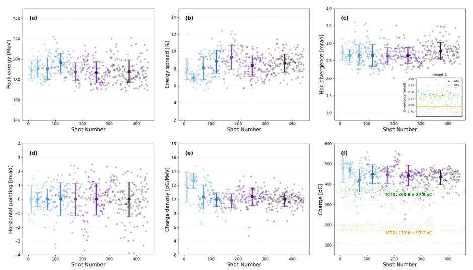
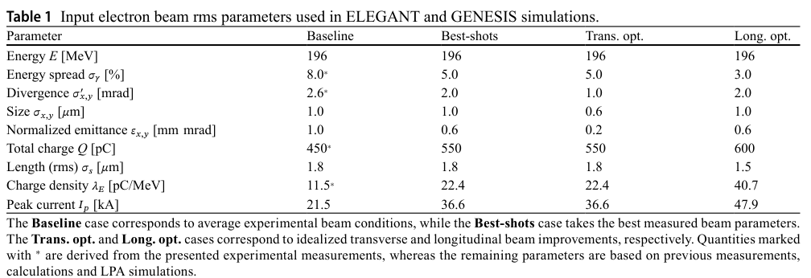
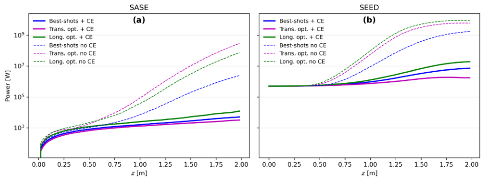

# LPA电子束通往FEL：实测输运、集体效应和条件化增益

## 基本信息与版本

- 原题：Qualifying LPA generated electron beams to free electron laser applications。
- 作者：Amin Ghaith、Marie Labat、Driss Oumbarek Espinos等14人，完整顺序见台账和PDF。
- [正式来源／DOI](https://doi.org/10.1038/s41598-026-80539-5)：Scientific Reports，2026-11-14在线，2026-11-09接收。
- 实际阅读：[出版社14页PDF](../pdfs/fel-2026.pdf)，明确标为 **Article in Press**，待最终编辑版替换；不能按Crossref的`vor`许可证字段将实际文件认定为最终VOR。
- 核验：全文布局文本、关键页渲染及三幅原图表；公式在文本层多被提取成`inline-eq-IEq...`，下述关键数值按渲染页补核。本地未运行ELEGANT、GENESIS或新实验。

## 研究问题与证据层次

高电流LPA束同时具有大能散、发散和逐发抖动，输送到波荡器后是否仍满足FEL的切片亮度要求？本文直接测量COXINEL束线的电子束参数和输运，再用ELEGANT传递六维相空间、GENESIS预测FEL。既有270 nm激光放大的历史实验在引言被引用；本篇的参数扫描和短波长输出属于模拟，不能另计一次激光实验实现。

## 装置、模型和参数

DRACO的100 TW级800 nm激光提供2.1 J、30 fs FWHM，采用整形自截断离化注入；名义束能196 MeV。源后4 cm放置QUAPEVA永磁四极三联组及指向补偿，磁压缩器在此用于拉长束团、降低切片能散，其硬件R56约限于1.5 mm。波荡器100周期、周期20 mm，实物长2 m。

实验束线讨论色差匹配；后续系统扫描明确换用源到波荡器中心成像光学，R12=R34=0，不能把两套配置视为完全相同。模型使用Gaussian源分布，并按有／无空间电荷SC、相干同步辐射CSR比较；切片长度0.5 μm，中心峰流附近±1σ范围平均。

| 源端输入（rms口径） | Baseline | Best-shots | 横向优化 | 纵向优化 |
| --- | ---: | ---: | ---: | ---: |
| 束能／MeV | 196 | 196 | 196 | 196 |
| 相对能散／% | 8 | 5 | 5 | 3 |
| 发散／mrad | 2.6 | 2 | 1 | 2 |
| 束斑／μm | 1 | 1 | 0.6 | 1 |
| 归一化发射度／mm mrad | 1 | 0.6 | 0.2 | 0.6 |
| 总电荷／pC | 450 | 550 | 550 | 600 |
| 束长σs／μm | 1.8 | 1.8 | 1.8 | 1.5 |

Baseline也混合了本次测量、旧测量、计算及LPA模拟。**Best-shots从多次测量挑选各项有利值，并非同一实测炮次**；另两列为理想化改善。预测复现应取得完整六维分布及参数相关性，不能仅拼接最好标量。

## 主要结果与口径

1. PDF第4页统计给出峰能190±10.5 MeV、rms能散8.0±1.3%、水平发散2.6±0.3 mrad、谱电荷密度10.3±1.4 pC/MeV。模型基准196 MeV、11.5 pC/MeV和结论概述不等于这组逐发平均值。
2. 光谱仪电荷442±48 pC；ICT1为360±28 pC、ICT2为174±54 pC。作者约40%传输效率对应相对源端总电荷（174/442≈39%）；若以ICT1作分母则约48%。模型约60%，仅属合理趋势比较，不能称绝对传输已精确验证。
3. 增大R56降低切片能散，同时牺牲峰流；本参数区SC主要恶化横向切片发射度，CSR在R56<2 mm时较弱，但两者可共同显著削弱FEL功率。
4. 270 nm的SASE五个随机种子取平均；加SC/CSR后相对理想输运下降数个数量级。外种子500 kW、270 nm、腰斑660 μm、200–300 nJ等为设定，不是本轮测得光源输出。
5. 在单参数扫描范围内，电荷增大并不持续提高FEL；270 nm发散约3–4 mrad出现折中最优，降低源端能散至2–3%以下较有效。这是指定输运模型的扫描结果，不是全局最优或普遍推荐发散。
6. 64、41、28 nm分别按400、500、600 MeV预测，并把波荡器延至4 m、重新匹配；其参考源参数能散5%、束斑1 μm、发散1 mrad、σs=1 μm、400 pC。不能用这些预测认定现有2 m束线已实现XUV输出。

## 原图表逐项阅读

**Fig.2，PDF第4页**：横轴为shot number，纵轴依次为峰能MeV、rms能散%、水平发散mrad、水平指向mrad、谱电荷pC/MeV和电荷pC；颜色对应不同实验日，误差棒为标准差。能散和电荷的散布说明“平均可输运”仍有逐发波动，未给出同一束的全部六维测量。

**Table 1，PDF第6页**：各列是不同假设源；带星号量来自本次实验，其余涉及旧测量和计算。表内峰流、束长和电荷需结合作者实际分布定义核验，不应在忽略相关性时直接作为一束Gaussian粒子输入。

**Fig.6，PDF第9页**：横轴z为波荡器内距离m，纵轴功率W、对数标尺；左SASE、右外种子，实线含CE、虚线不含。虚实差异展示输运后的切片亮度损失；这些曲线是GENESIS预测，不能换算成未测量的平均光功率、临床剂量或光核产额。

## 局限与可接续检查

需取得原始逐发参数协方差、SC/CSR模型配置、宏粒子数及收敛、源端束长／发射度实测和传输归一化，才能把“匹配趋势”推进到定量预测。原文数据按合理请求提供，未取得作者输入。源能190与196、谱密度10.3与11.5、测量约40%与模拟60%均分别保留。本篇有束诊断实测，无新增γ转换靶、光核核素、辐照剂量或防护验收。对转换靶任务的借鉴是先明确**到靶电荷、能谱和角度分布**，不能只凭源端总电荷估计产额。
