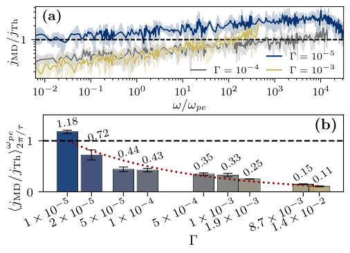
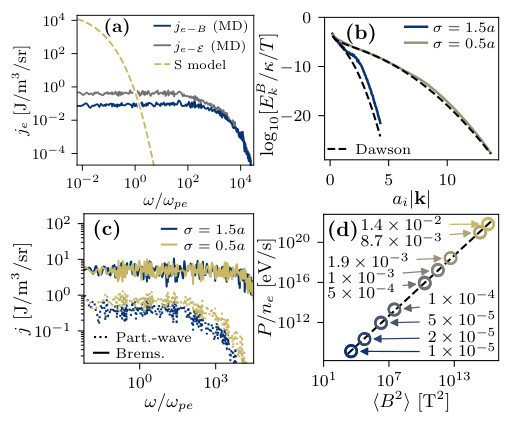
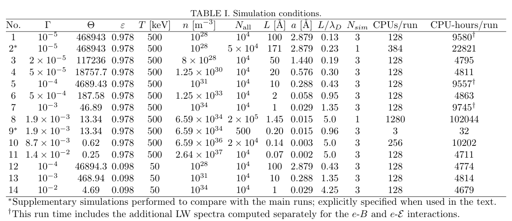

# 相对论等离子体辐射MD：韧致抑制与微尺度jitter

## 基本信息与版本

- 原题：Radiation in relativistic plasmas via particle simulations。
- 作者：Efstratios M. Kritikos、Pontus Svensson、Daniel Plummer、Brian Reville、Bob Bingham、Gianluca Gregori。
- [arXiv:2611.18332v1](https://arxiv.org/abs/2611.18332v1)，11-13 15:45:58 UTC首投，11-16公告。PDF首页内部日期为**August 25, 2026**，不是新的发表日。
- 实际阅读：[25页作者稿](../pdfs/radiation-2026.pdf)，前8页主文／End Matter，后17页嵌入补充材料。Crossref精确标题前三项未核实同作品期刊版；这是有界检查，不证明不存在期刊版。
- 证据为模型、数值模拟和解析比较；未运行作者LAMMPS扩展或pyRelBrem，未进行束靶或光子实验。

## 研究问题与物理定义

常规PIC以宏粒子和网格平滑微尺度相互作用，往往用独立碰撞截面随机发射韧致光子，不能自动包含连续散射的相干抑制及高k场涨落。本文在热平衡、各向同性电子–质子体系中显式计算近邻碰撞和延迟长程场，再由粒子轨迹的Liénard–Wiechert（LW）辐射比较Bethe–Heitler电子–离子和Haug电子–电子基准。

耦合Γ=e²/(4πε0 a kBT)，a=[3/(4πn)]^(1/3)，**n是总数密度**；相对论温度ε=kBT/(mec²)，简并指标Θ=kBT/EF。j=2π(d²I/dΩdω)/(Vτ)按论文归一化，图中标J m⁻³ sr⁻¹；它是体积与采样时间归一化后的谱量，不是探测器计数或有限立体角束流亮度。

## 数值方法和条件

LAMMPS基础上，短程直接粒子作用采用非相对论推导的Improved Kelbg Potential（IKP）加入量子衍射；长程用Gaussian电荷、默认σ=1.5a及PPPM式谱网格求解。短程电磁剩余采用静电近似，i–i仍Coulomb，长程含相对论运动学与延迟；**并非全量子、全相对论散射理论**。

立方周期边界不让场自由逃逸，尚无吸收边界。初始化MJ速度、热化100/ωpe后关闭温度重标，采样τ=1000/ωpe，步长10⁻⁴/ωpe；可抽取角频率范围[2π/τ,π/Δt]。常见Nall=10⁴、三次独立初始化及±x/y/z六观察方向平均。Γ从10⁻⁵到约1.4×10⁻²，温度50或500 keV，表中部分极高密度并非通常实验固体条件。

近场pair力和长程Lorentz力分别代入LW求谱；拆分谱有助于诊断机制，但LW对振幅求和再平方，不能未经交叉项检查把不同分力谱简单相加当作严格总谱。

## 主要结果及有效区间

- ε≈1、Γ=10⁻⁵时，低频韧致MD与BH+H模型约20%内一致。Fig.2在ω∈[2π/τ,ωpe]区间平均的比值随Γ约为1.18、0.72、0.44、0.43……降至0.11。经验拟合约0.5(10⁴Γ)^(-0.3)，适用于本文体系和区间；不是任意高能电子打高Z转换靶的通用LPM修正。
- “Γ≈10⁻²、抑制约90%”针对**低频带平均谱比**。不能解读为总γ能量、MeV以上光子或光中子产额降低90%。ε≈0.1的有限三点平均比约0.87、0.81、0.58，温度效应不能由ε≈1拟合替代。
- Γ=10⁻⁵时粒子–波谱在ω≈ωpe约比韧致弱6倍；Γ≈10⁻³二者可相当。磁场辐射的谱较经典同步模型偏向高频，ζ(k)=2πeB(k)/(meck)<1及总功率随ne〈B²〉变化支持jitter解释；与同步模型积分功率差约39%，不代表全谱精确一致。
- 将σ从1.5a缩到0.5a，磁场谱更接近Dawson模型，成本超过翻倍；韧致积分功率比约1.0，但粒子–波约2.3。故“谱形近似”与“绝对功率已收敛”应分开。
- 比较盒长与粒子数对部分谱有稳定性支持；作者仍承认高Γ低频jitter的形成长度未被盒长覆盖、缺失低k。不能据局部收敛宣称所有集体过程已解析。

## 原图表逐项阅读

**Fig.2，PDF第3页**：上图横轴ω/ωpe，对数坐标，纵轴jMD/jTh；下图横轴Γ、纵轴指定低频窗口平均，虚线为1。比值下降对应连续散射下韧致低频抑制，不是整个能谱或总源效率。阴影／误差来自有限样本统计。

**Fig.3，PDF第4页**：(a)横轴ω/ωpe，纵轴电子分力辐射谱；(b)横轴ai|k|、纵轴磁能对温度归一化的log10；(c)σ改变时粒子–波和韧致谱；(d)横轴〈B²〉T²、纵轴P/ne eV/s，均对数。它把“高频谱形、场能分布、σ敏感性、功率标度”分成不同检验，单一幂律不足以排除所有数值效应。

**Table I，PDF第8页**：列明Γ、Θ、ε、T keV、总密度m⁻³、粒子数、L与a（Å）、L/λD、样本次数、核数及CPU-hours/run。最高两密度点Θ=0.62和0.25已不满足Θ≫1的非简并条件。该表直接限制经典MJ／IKP解释的可靠范围，不能将最强抑制端点当成充分验证的量子简并等离子体结论。最长例约102044 CPU小时是作者核时，非本轮运行或墙钟。

## 局限、复现线索和仓库关联

高频经典LW允许电子辐射超过其初始动能的光子，作者以ωphys=〈E〉/ℏ标记边界，未施加临时量子截断；高能尾有限碰撞统计也可使谱偏差达约5倍。RR的补充估计仅检查有限代表Γ点且使用MJ矩，不能等同覆盖每粒子极值或全部高密度点。补充中的部分单位／记号需结合代码澄清，未据印刷式认定代码错误。

[公开pyRelBrem](https://github.com/ekritikos/pyRelBrem)只明确为解析韧致计算工具；本轮未审计其版本、MD输入或执行结果。后续应对齐物理密度与简并、非相对论IKP适用性、力谱交叉项、σ／盒长／采样收敛和量子高频端，再考虑写入PIC辐射模块。本文可为碰撞辐射模型提供基准，但没有激光电子束转换靶、γ输运、光核反应、探测器响应或实验产额闭环。
