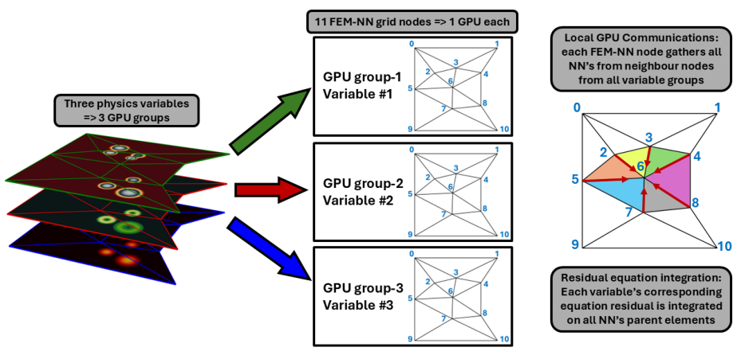
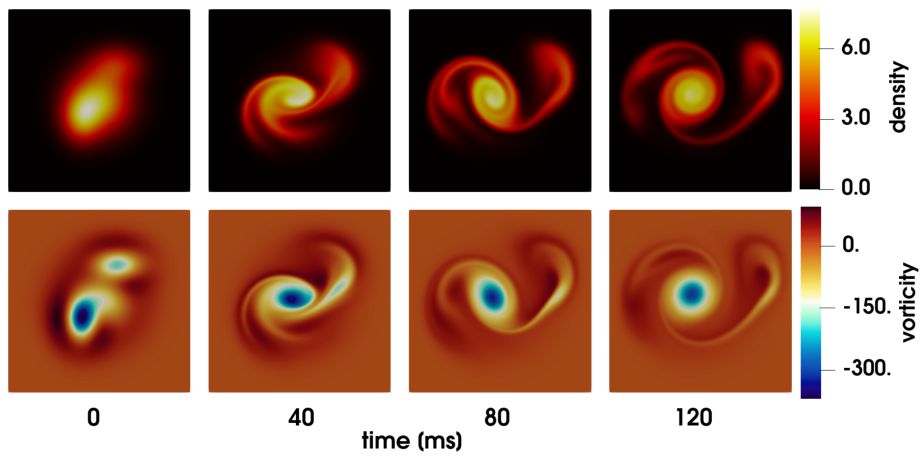
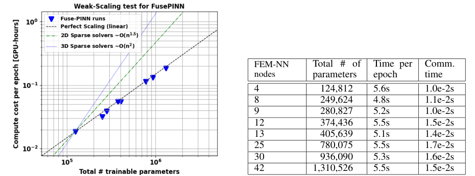

# Fuse-PINN：局部神经有限元的多GPU扩展与成本边界

## 基本信息与版本

- 原题：Fuse-PINN: Combining Finite Element Methods and Physics-Informed Neural Networks to enable massively parallel simulations of non-linear PDEs。
- 作者：Stanislas Pamela、Nicolas Pailliez、Emmanuel Franck、Victor Michel-Dansac、Laurent Navoret、Vignesh Gopakumar。
- [arXiv:2611.18409v1](https://arxiv.org/abs/2611.18409v1)，2026-11-13 16:55:03 UTC首投，11-16公告；[实际27页PDF](../pdfs/fuse-2026.pdf)，正文9页、引用后附完整方法及模型。
- arXiv备注为“Rejected at ICLR”，不是ICLR已接收论文。Crossref精确标题前三项未核实同作品期刊版；作为预印本收录。
- 本轮阅读正文与附录，检查关键原页和三幅图；没有运行Fuse-PINN、JOREK、PyTorch训练或HPC扩展测试。

## 研究问题

PINN能否以局部通信部署到多节点、多GPU，并在非线性对流与Poisson耦合中持续演化？本文强调**可分布计算的结构**，不能把弱扩展的单epoch近恒时直接当成比成熟PDE求解器更快。文中模型是二维约化流体，未求解五维陀螺动理学或全PIC，也没有真实装置反馈控制实验。

## 方法：从时间步到局部网络

1. 每个时间步重新优化，以前一步网络热启动，使用Crank–Nicolson残差：u(n+1)−u(n)−Δt[F(u(n+1))+F(u(n))]/2。隐式格式本身不保证非线性训练充分收敛或任意大步长精度。
2. 三角网格的每个节点、每个物理变量单独一张网络；元素内u=ΣwiNi、Σwi=1。权函数为局部bump式平滑过渡，导数用乘积链式法则；这有网格结构，不能当完全无网格算法。
3. 残差损失在节点所属元素的随机点上以MSE计算，边界以惩罚项软约束。虽借用了FEM几何，不能直接等同守恒Galerkin弱形式或已证明的离散能量守恒。
4. 对流问题引入central equaliser：时间导数项用中心网络、其余项保留组合场，避免先接触结构的网络独占并压制邻居。Poisson等全局隐式关系仍保留global表示。这是复现关键，不能只复制ΣwiNi而省略该处理。
5. ENGD构造参数／空间导数和Gram矩阵，再伪逆／最小二乘、正则化及线搜索。Gram导数图是主要内存与时间成本；变量残差归一化、方程对被训练变量的线性化、邻居缓存都会影响收敛。
6. 默认每个节点–变量网络分配一张GPU，每epoch交换近邻所有变量的网络；另有全局loss日志、作图和检查点聚集。因此局部通信小不等于端到端I/O和训练成本可忽略。

## 模型、规模与结果

| 项目 | 已展示内容 | 限制 |
| --- | --- | --- |
| Poisson | sin(πx)sin(πy)解析解，对ENGD／Adam／L-BFGS及JAX实现比较 | 简单静态问题，非湍流全局误差证明 |
| Hasegawa–Wakatani | ρ、Φ、辅助w；13节点×3变量，640²采样；240步×0.5 ms，D⊥=μ⊥=10⁻⁴ | 39 GPU、约300 epochs/步；本文二维Dirichlet边界 |
| 另一HW例 | 25节点、3变量、75 GPU，多blob混合 | 网络2251参数／节点／变量，不同于扩展测试网络 |
| 静电reduced-MHD | ρ、T、Φ、w；25节点、640²，140步×0.75 μs | blob到外壁后涡量噪声、精度下降；非完整电磁MHD |
| 弱扩展 | 4→42 FEM-NN节点，3变量即12→126 GPU；约0.125→1.31M参数 | 固定每网络10401参数，采样与问题规模同时增加 |

扩展测试每epoch约4.8–5.6 s，通信约0.010–0.017 s。**节点数不是GPU总数**。其近线性GPU核时曲线来自资源和问题一同放大；图中O(n^1.5)、O(n²)是参考趋势，未实测比较所有传统稀疏求解器，也不能排除多重网格等其他复杂度。

在HW示例，PINN约300 s/时间步，作者JOREK约1.15 s/时间步，墙钟约260倍差距；按所用资源折算节点时约0.8对0.0006，约千倍量级。两硬件不同、精度／收敛未统一，因此既不能当严格公平性能榜，也不能称PINN已加速传统求解。强扩展尚未做；“预计也很好”只是作者推断。

## 原图逐项阅读

**Fig.2，PDF第4页**：示意3个变量组，每组11节点／11 GPU，展示节点近邻交换及在父元素上组装残差。此图是架构映射，无时间或物理单位；不能凭箭头数量估计实测通信量。

**Fig.4，PDF第6页**：列为0、40、80、120 ms；上排密度、下排涡量，颜色对应模型变量幅值，图中无可直接认定为SI密度的单位或空间刻度。blob卷绕与薄层表现持续非线性演化，不等于已定量复现tokamak湍流输运。文中另在第80步对JOREK及w与∇²Φ作定性比较，未给出完整动态误差范数。

**Fig.7及Table 1，PDF第8页**：横轴总可训练参数，对数；纵轴每epoch GPU-hours，对数；表列节点数、参数量、每epoch秒和通信秒。参数从124812到1310526时epoch秒基本保持，说明弱扩展有效。它不报告达同一误差所需epoch总数、完整时间步或整段轨迹成本，不能据此得出实际科研time-to-solution已线性可扩展。

## 局限与可接续工作

应优先取得固定源码版本、输入与完整时间步日志，统一方程、空间误差、容差、物理模拟时长和CPU/GPU资源后比较。核查central equaliser与残差线性化的实际实现、权函数跨边导数、Gram正则化敏感性、边界触碰及物理量正性。当前仅软边界；正性网络使优化变慢；3D网格、强扩展、多节点网络／GPU、动态hp及局部采样尚未完成。本文是数值框架证明概念；不会自动为激光PIC、QED、光核转换靶或实验诊断提供可用替代求解器。
