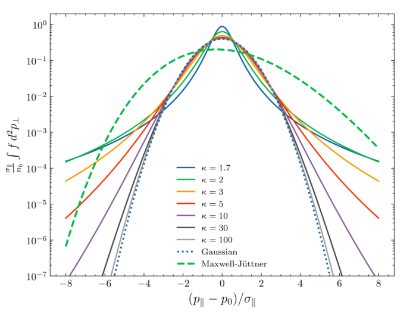
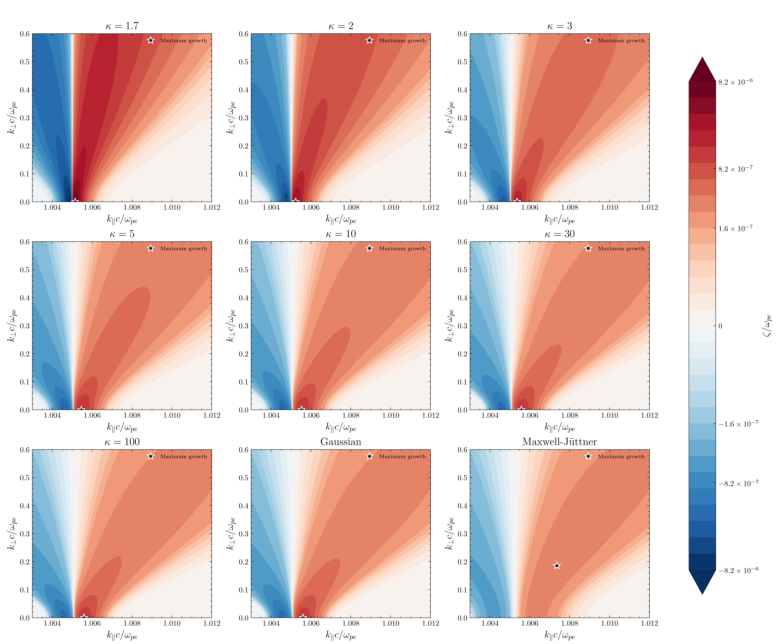
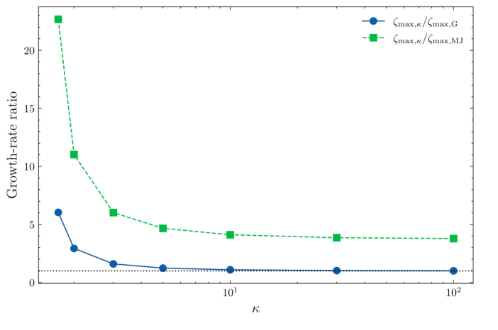
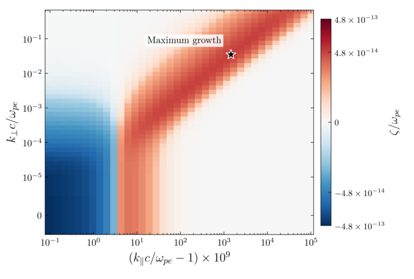
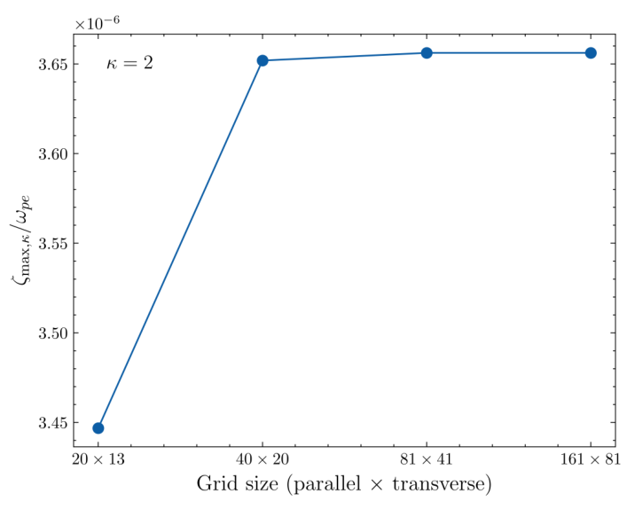

# 相对论非麦克斯韦电子–正电子束的线性静电不稳定性

## 0. 论文、版本与阅读证据

- 原题：*Linear Electrostatic Instabilities Driven by Relativistic Non-Maxwellian Pair Beams*。
- 作者：Suman Dey，Technische Universität Braunschweig。
- 正式来源：[Plasma 2026, 9(4), 49](https://doi.org/10.3390/plasma9040049)，2026-10-15投稿、11-08修订、11-14接收、**11-17发表**；本地读取19页出版社VOR，非仅根据arXiv“accepted”备注推断发表。
- 对应作者稿：[arXiv:2611.21041v1](https://arxiv.org/abs/2611.21041v1)，同一作品只收录一次。本次笔记以正式版为准，未逐字比较作者稿。
- 全文：[本地PDF](../pdfs/dey-2026-pair-beams.pdf)；[官方MDPI CDN全文](https://mdpi-res.com/d_attachment/plasma/plasma-09-00049/article_deploy/plasma-09-00049.pdf)。常规MDPI PDF入口403，官方CDN取得有效PDF。
- 通读主文、附录A/B与参考文献目录；渲染目视第1、4、7、9、10、12、13、14、16、17、18页，5幅保留原图重开检查，图源见[阅读/裁图记录](../research/dey_reading.json)。文件头、MIME、SHA、三路页数及逐页文本验证见[PDF验证](../pdf_validation.json)。MinerU历史认证过期未复测，本轮零请求，采用明确记录的本地布局文本与页面渲染回退。
- **研究类型**：解析线性动理学＋共振积分与有限波矢域数值优化；不是本文新做PIC实验，也不是γ源、对产生、束流冷却率或能量沉积实测。本地未复跑作者积分或模拟。

## 1. 摘要：回答分布形状怎样改变线性增长

作者研究均匀、无磁、冷电子背景中的稀薄相对论电子–正电子束。现实耀变体对束流缺少唯一公认的解析动量分布，故用具有可调幂律尾的各向异性κ型分布，与Gaussian及漂移Maxwell–Jüttner（MJ）参考分布比较。

关键受控比较是κ与Gaussian：固定平均纵向动量、纵向RMS展宽和**单个横向分量**RMS展宽，仍能得到不同增长率。主参数下，较小κ对应更大的最大静电增长率，增大κ后趋近Gaussian。主参数的最快模近似平行；另一组极高动量、极低密度的κ=2参数反而给出斜向最快模。因此“κ束流最快模总平行”不成立。

MJ参考只匹配平均纵向动量和横向展宽，纵向展宽约为其他分布两倍。它的增长率和传播角差异同时含有形状与纵向展宽影响，不能当成只改变尾部形状的消融。线性增长率说明初始扰动的增幅速度，不能单独给出最终束流能损。

## 2. 引言：天体背景与本文问题的边界

VHE γ光子与EBL作用产生对束流，后者可通过逆Compton作用形成GeV级联。某些源没有观测到预期级联，有多种可能原因，包括星际磁场偏转和集体等离子体过程。论文把这作为动机，没有对观测级联重新拟合，也没有用“未见pair halo”直接测量不稳定性增长率。

前人使用Gaussian、MJ、Cauchy类分布，不同分布在共振面上的梯度不同。本文的贡献是用一致的线性响应表达式比较κ尾部、匹配矩及波矢依赖；它没有求解级联随时间演化、准线性角扩散或非线性饱和。已知天体源的历史活动和磁场也未在本文闭合。

## 3. 物理模型与束流分布（原文第2节）

### 3.1 密度、相对论速度与归一化

背景电子密度为nₚ，离子在电子等离子体时标上固定。束流沿z方向，nᵦ定义为电子和正电子的**总**数密度：

$$
n_b=n_{e^-,b}+n_{e^+,b},\qquad
\omega_{pe}=\sqrt{\frac{n_p e^2}{\epsilon_0m_e}}.
$$

束流两物种具有相同的动量形状。电荷相反不使线性极化率抵消，因为每个物种的响应含电荷平方；使用总密度时不能再额外乘2。

动量和速度满足：

$$
p_\perp=\sqrt{p_x^2+p_y^2},\quad p_\parallel=p_z,\quad
\gamma(\mathbf p)=\sqrt{1+\frac{p_\perp^2+p_\parallel^2}{m_e^2c^2}},\quad
\mathbf v=\frac{\mathbf p}{\gamma m_e}.
$$

这里动量单位为kg·m/s，文中通常用mₑc归一化。轴对称性允许波矢写成横向x与纵向z两个分量。背景红移标度只说明给定电离比例和均匀宇宙背景下nₚ及ωₚₑ的变化，不能决定束流密度与分布的红移演化。

### 3.2 κ分布：归一化与有限二阶矩

原文式(3)、(6)为：

$$
f_\kappa(p_\perp,p_\parallel)=C_\kappa
\left[1+\frac{p_\perp^2}{\kappa a_\perp^2}
+\frac{(p_\parallel-p_0)^2}{\kappa a_\parallel^2}\right]^{-(\kappa+1)},
$$

$$
C_\kappa=\frac{n_b\Gamma(\kappa+1)}
{\pi^{3/2}\kappa^{3/2}a_\perp^2a_\parallel\Gamma(\kappa-1/2)},
\qquad \int f_\kappa\,d^3p=n_b.
$$

p₀是平均纵向动量，a⊥、a∥是尺度参数，不能直接当RMS展宽；Γ是Euler Gamma函数。对归一化的理解可按如下步骤展开：先平移纵向动量，再把三个分量分别除以各自尺度，Jacobian给出a⊥²a∥；球坐标积分成为下式，使用Beta函数即可得到Cκ：

$$
4\pi\int_0^\infty q^2\left(1+\frac{q^2}{\kappa}\right)^{-(\kappa+1)}dq
=2\pi\kappa^{3/2}B\left(\frac32,\kappa-\frac12\right).
$$

大动量处的径向被积函数按负2κ次幂衰减，因此归一化只需κ>1/2；一阶绝对矩需κ>1；二阶矩需κ>3/2。本研究要求固定RMS展宽，故只用**κ>3/2**。作者过去κ=1的Cauchy类选择不能直接用来做本次“相同有限RMS”比较。

对二阶矩，在同一无量纲径向积分中再乘一个分量平方，利用球对称角平均和Beta函数之比，得到原文式(8)–(9)：

$$
\sigma_\parallel^2=\left\langle(p_\parallel-p_0)^2\right\rangle
=\frac{\kappa a_\parallel^2}{2\kappa-3},\qquad
\sigma_\perp^2=\langle p_x^2\rangle=\langle p_y^2\rangle
=\frac{\kappa a_\perp^2}{2\kappa-3}.
$$

$$
\langle p_\perp^2\rangle=2\sigma_\perp^2,\qquad
a_j=\sigma_j\sqrt{\frac{2\kappa-3}{\kappa}}\quad(j=\parallel,\perp).
$$

物理上，固定二阶矩再降低κ，会同时改变核心和尾部；不能仅想成在同一个Gaussian核心外“加一点尾粒子”。横向总动量模的RMS是单分量σ⊥的√2倍，初始化PIC或比较发散角时必须统一口径。

### 3.3 Gaussian极限与MJ参考

固定尺度时，κ趋于无穷的极限为：

$$
f_G=\frac{n_b}{\pi^{3/2}a_\perp^2a_\parallel}
\exp\left[-\frac{p_\perp^2}{a_\perp^2}
-\frac{(p_\parallel-p_0)^2}{a_\parallel^2}\right],\qquad
a_j=\sqrt2\,\sigma_j.
$$

推导用到幂函数趋于指数及Gamma函数之比的渐近式；相同RMS比较时则对每个κ重新选择尺度，极限仍趋于上述相同σ的Gaussian。

MJ在自身静止系按相对论能量指数衰减，经过沿束轴boost后在实验系各向异性。令无量纲动量u为p/(mₑc)，静止系温度Θ为kBT/(mₑc²)，则原文式(11)为：

$$
F_{MJ}(\mathbf u)=\frac{1}{4\pi\gamma_d\Theta K_2(1/\Theta)}
\exp\left[-\frac{\gamma_d(\gamma-\beta_du_\parallel)}{\Theta}\right],
\qquad f_{MJ}=\frac{n_b}{(m_ec)^3}F_{MJ},\qquad \int F_{MJ}\,d^3u=1.
$$

K₁、K₂为第二类修正Bessel函数，γd、βd描述整体漂移。作者用Θ和漂移匹配p₀、σ⊥两个条件；σ∥随后由该分布决定，不能再独立匹配第三个条件。主参数下Θ=9.76×10⁻³、βd≈0.99、γd=9.81，MJ纵向RMS约1.0 mₑc，而κ/Gaussian为0.5 mₑc。

**图1解读（PDF第7页）**：横轴为纵向动量相对均值的偏移除以参考σ∥；纵轴为对两维横向动量积分后的纵向边缘密度，再乘σ∥/nᵦ，无量纲且使用对数刻度。较小κ同时呈较尖核心和更重远尾；大κ趋近Gaussian。MJ的宽核心与尾部不能视为只改变分布家族，因为其纵向RMS未匹配。图不提供束流加速后实测能谱。

### 3.4 动量导数：共振真正读取的量

定义κ分布方括号中的量为Qκ，直接用链式法则得到：

$$
\partial_{p_\perp}f_\kappa=-\frac{2(\kappa+1)p_\perp}{\kappa a_\perp^2}
C_\kappa Q_\kappa^{-(\kappa+2)},\qquad
\partial_{p_\parallel}f_\kappa=-\frac{2(\kappa+1)(p_\parallel-p_0)}{\kappa a_\parallel^2}
C_\kappa Q_\kappa^{-(\kappa+2)}.
$$

$$
\mathbf k\cdot\nabla_p f_b
=k_\parallel\partial_{p_\parallel}f_b
+k_\perp\cos\phi\,\partial_{p_\perp}f_b.
$$

σ相同并不使这些局部导数相同。波粒共振只在特定速度面读取梯度，因此总束能、平均动量或展宽相同并不足以确定线性增长率。Gaussian导数同样由指数链式法则获得；MJ还需对相对论γ求导。

## 4. 静电色散与弱束流增长率（原文第3节）

### 4.1 从Vlasov–Poisson响应到介电函数

取平面波时间约定后，电场平行波矢，磁扰动为零。冷背景的介电响应与束流极化率为：

$$
\delta f,\delta\mathbf E\propto e^{i(\mathbf k\cdot\mathbf x-\omega t)},\qquad
\epsilon_L=1-\frac{\omega_{pe}^2}{\omega^2}+\chi_b=0,
$$

$$
\chi_b(\omega,\mathbf k)=\frac{e^2}{\epsilon_0 k^2}
\int\frac{\mathbf k\cdot\nabla_p f_b}{\omega-\mathbf k\cdot\mathbf v}\,d^3p.
$$

分母用Landau解析延拓。若要把梯度转移到共振分母，必须保留相对论速度对动量的导数：

$$
\frac{\partial v_i}{\partial p_j}=\frac{1}{\gamma m_e}
\left(\delta_{ij}-\frac{v_iv_j}{c^2}\right).
$$

在动量无穷远边界项消失时，分部积分便得到原文式(21)：

$$
\chi_b=-\frac{e^2}{\epsilon_0}\int f_b
\frac{1-(\widehat{\mathbf k}\cdot\mathbf v)^2/c^2}
{\gamma m_e(\omega-\mathbf k\cdot\mathbf v)^2}\,d^3p.
$$

这一步解释了纵向与斜向响应受到不同的相对论惯性权重，不能用统一常数γ直接替换整个分布。

### 4.2 弱束流展开与正负增长

束流对背景Langmuir根只是小扰动，令复频率实部近似ωₚₑ、虚部为ζ，且ζ远小于实部。把介电函数在背景实根处一阶展开：

$$
\omega=\omega_r+i\zeta,\quad \omega_r\simeq\omega_{pe},\qquad
\zeta\simeq-\frac{\operatorname{Im}\chi_b(\omega_r,\mathbf k)}
{\epsilon'_{bg}(\omega_r)},\qquad
\epsilon'_{bg}(\omega_{pe})=\frac{2}{\omega_{pe}}.
$$

用Landau恒等式提取共振虚部，两个负号相消：

$$
\frac{1}{x+i0^+}=\mathcal P\frac1x-i\pi\delta(x),
$$

$$
\boxed{\zeta(\mathbf k)\simeq
\frac{\pi e^2\omega_{pe}}{2\epsilon_0k^2}
\int d^3p\,\mathbf k\cdot\nabla_p f_b\,
\delta(\omega_{pe}-\mathbf k\cdot\mathbf v)}.
$$

ζ单位为s⁻¹；正值代表该时间约定下的场幅指数增长，负值代表阻尼。δ函数选出共振粒子，投影梯度决定共振粒子是给波供能还是吸收波能。这里的冷背景没有热Landau阻尼，实际有温背景不能直接照搬图中正增长区。若束流不再是小扰动，须求解完整复色散关系，不能继续使用上述一阶式。

固定分布形状及背景后，增长率随束流总密度线性变化；但改变平均动量、展宽或温度会移动共振面，不能仅靠密度倍率外推。

### 4.3 降维积分、共振根与平行支

在给定横纵动量处设A为实频率减纵向多普勒项，B为横向多普勒幅度，共振条件成为：

$$
A=\omega_r-k_\parallel v_\parallel,\qquad B=k_\perp v_\perp,
\qquad A-B\cos\phi=0.
$$

只在绝对A小于绝对B时存在两支旋转相位根。用δ函数换元，分母来自共振函数对相位的导数绝对值，两根之和给因子2：

$$
\int_0^{2\pi}g(\cos\phi)\delta(A-B\cos\phi)d\phi
=\frac{2g(A/B)}{|B|\sqrt{1-(A/B)^2}}.
$$

这给出二维动量积分，但在共振边界有可积的平方根奇点。作者实际数值计算采用另一种顺序：先解析消掉纵向动量的δ函数，在共振面上对横向无量纲动量r与相位积分。原文在K∥>1时使用的前向共振根为：

$$
K_j=\frac{k_jc}{\omega_{pe}},\quad r=\frac{p_\perp}{m_ec},\quad b=K_\perp r\cos\phi,
$$

$$
u_{\parallel,\mathrm{res}}=
\frac{-K_\parallel b+\sqrt{b^2+(K_\parallel^2-1)(1+r^2)}}{K_\parallel^2-1},
\qquad
\left|\frac{\partial h}{\partial u_\parallel}\right|^{-1}_{res}
=\frac{\gamma_{res}}{|K_\parallel-\beta_{\parallel,res}|}.
$$

其来源是先写无量纲共振式，再平方得到关于纵向动量的二次式，并按前向共振条件选根；Jacobian由未平方的共振式求导。正文只给上述适用分支，本地未验证其他波矢分支或重写积分实现。

主计算使用180个径向、80个角向Gauss–Legendre点，初始径向上限为2（即20倍主参数σ⊥）。严格平行时B=0，不能把前述含B的相位公式直接代零，作者单独处理不依赖相位的平行支。这也是与斜向优化比较最快模时必须补的支路。

## 5. 主参数扫描：受控比较及数值结果（原文第4节）

主参数不是完整的自洽耀变体对束流模型，而是受控理论测试：

$$
\frac{p_0}{m_ec}=10,\quad
\frac{\sigma_\parallel}{m_ec}=0.5,\quad
\frac{\sigma_\perp}{m_ec}=0.1,\quad
\frac{n_b}{n_p}=10^{-9}.
$$

作者在有限域内优化，并独立优化严格平行支：

$$
1.003\le K_\parallel\le1.030,\qquad0\le K_\perp\le0.6,
\qquad\theta=\tan^{-1}\left(\frac{K_\perp}{K_\parallel}\right).
$$

**图2解读（PDF第12页）**：横轴K∥、纵轴K⊥均以ωₚₑ/c归一化；颜色是ζ/ωₚₑ，红色增长、蓝色阻尼。九个面板分别对应七个κ、Gaussian与MJ，共用色标。图中上方“Maximum growth”星形是各面板图例；不能把其图例位置读成最快模。实际离散网格星标与Table 2的连续数值优化也不是同一种取极值操作。κ越大时图形趋近Gaussian；结论限定于相同矩、冷背景、所扫波矢域。

原文Table 2的优化值如下；κ/Gaussian的K⊥约10⁻⁹，按数值残差归为平行，并非可测的微小斜角：

| 分布 | K∥最大值位置 | K⊥最大值位置 | ζ最大值/ωₚₑ | 传播方向 |
| --- | ---: | ---: | ---: | --- |
| κ=1.7 | 1.005148 | 1.62×10⁻⁹ | 7.51×10⁻⁶ | 平行 |
| κ=2 | 1.005233 | 4.13×10⁻⁹ | 3.65×10⁻⁶ | 平行 |
| κ=3 | 1.005362 | 3.53×10⁻⁹ | 1.99×10⁻⁶ | 平行 |
| κ=5 | 1.005457 | 4.77×10⁻⁹ | 1.54×10⁻⁶ | 平行 |
| κ=10 | 1.005526 | 2.68×10⁻⁹ | 1.36×10⁻⁶ | 平行 |
| κ=30 | 1.005573 | 2.15×10⁻⁹ | 1.27×10⁻⁶ | 平行 |
| κ=100 | 1.005589 | 1.24×10⁻⁹ | 1.25×10⁻⁶ | 平行 |
| Gaussian | 1.005597 | 1.26×10⁻⁹ | 1.24×10⁻⁶ | 平行 |
| MJ | 1.007353 | 0.186 | 3.31×10⁻⁷ | 约10.45°斜向 |

MJ的斜向最大值仅比其自身平行支大约6.07%；这不是相对Gaussian增益。κ=1.7对Gaussian约6.1倍，κ=2约2.9倍，是增长率的比，不能写成辐射效率或能损比例。

原文Table 1还把平均动量改为10、20、50 mₑc，同时保持纵横分数展宽0.05与0.01。其**严格平行支**κ=2/Gaussian增长率比分别为2.93、3.36、7.38。这不证明高动量下全波矢最优模仍平行；它只是在同一限定支路上的灵敏度检查。

**图3解读（PDF第13页）**：横轴κ为对数坐标；纵轴为每个分布各自最大增长率之比，无量纲。蓝色对Gaussian的比趋于1，与Gaussian极限一致；绿色对MJ的比趋于大于1，因大κ极限不是MJ且MJ纵向展宽不同。低κ的高比值也包含核心变尖后共振梯度的改变，不能只凭尾部粒子总量解释。此处“最大”仍指论文给定数值域与方法中的数值估计。

## 6. 极高动量天体示例（原文第5节）

作者另选κ=2，参数为：

$$
\frac{p_0}{m_ec}=10^5,\quad
\frac{\sigma_\parallel}{m_ec}=5\times10^4,\quad
\frac{\sigma_\perp}{m_ec}=10,\quad
n_p=2\times10^{-7}\ \mathrm{cm}^{-3},\quad
\frac{n_b}{n_p}=5\times10^{-17}.
$$

这里纵向分数展宽为0.5，横向为10⁻⁴，与主参数扫描同时改变了动量、相对展宽和密度，不能把两个例子的差异归因于单一变量。

**图4解读（PDF第14页）**：横轴是纵向归一化波数相对1的偏移再乘10⁹，纵轴是K⊥，均使用跨数量级显示；色标为ζ/ωₚₑ。原文报告所考察域中的数值优化点为：

$$
\frac{\zeta_{max}}{\omega_{pe}}\simeq5.06\times10^{-14},\qquad
K_\parallel-1\simeq1.46\times10^{-6},\quad K_\perp\simeq0.0348,\quad
\theta\simeq2^\circ.
$$

其物理意义是同一κ家族在另一组参数可支持斜向最快静电模，主例的平行结论不普适。仅报告κ=2的这个实例，没有在该参数下系统比较全部κ/Gaussian/MJ。星标是论文报告的优化点，图中色标刻度也不能替代完整数值数组检验全域最大值；本地没有重跑窄共振积分或验证全域最优性。此图不证明集体能损已压倒逆Compton冷却。

## 7. 结论与作者明确的限制（原文第6节）

均值与方差无法唯一确定共振梯度，故分布形状会改变线性增长和偏好传播方向。低κ在主参数下增长更快，大κ回到Gaussian；MJ对比需保留纵向矩不匹配的限制。

作者明确要求后续研究非线性波粒作用、饱和和级联传播；并指出有限背景温度可能引入Landau阻尼、改变增长率。论文没有电磁细丝化竞争、有限束头传播、碰撞或磁场效应的完整处理。因此与全电磁、有限束长或准静态PIC框架关联时，应把本文作为**分布依赖的静电线性基准候选**，不能当作相同实验或完整算法验收。

## 8. 附录A：哪些量已做作者收敛，哪些尚未

**图A1解读（PDF第16页）**：横轴为纵向×横向波矢网格点数，纵轴为κ=2的最大ζ/ωₚₑ，带10⁻⁶倍率。20×13网格明显低估峰值；到81×41后变化约0.1%，161×81在所报精度内相同。这只说明这一案例的网格检查，不自动覆盖其他κ、MJ或极高动量窄共振算例。

动量积分的检查与波矢搜索分开：在**固定的离散网格最大值位置**把径向/角向阶数由(180,80)提高到(360,240)，结果几乎不变；再对κ=1.7、2、Gaussian、MJ把径向上限2增至4和8，径向阶数相应180、360、720，角向160。Table A1给κ两例径向截断差异小于10⁻⁴%，Gaussian/MJ远小于此量。该表数值精度较粗，和Table 2优化极值也不是同一个取样口径。

作者还比较两种共振Jacobian表述在选定点的数值一致性。上述检查支持选定点的积分稳定，不建立整个波矢域、所有分支或高动量图4的全面收敛。本地只审核这些报告和公式，没有独立复算其误差量级。

## 9. 附录B：为什么MJ纵向展宽不能任意再指定

在束流静止系，MJ分布各向同性。沿束轴Lorentz变换不仅改变动量，也改变三维动量积分测度：

$$
u_\parallel=\gamma_d(u'_\parallel+\beta_d\gamma'),\qquad
\gamma=\gamma_d(\gamma'+\beta_du'_\parallel),\qquad
d^3u=\frac{\gamma}{\gamma'}d^3u'.
$$

把该测度与实验系归一化因子相乘，任意矩的权重为：

$$
\langle g\rangle_{MJ}=\int d^3u'F'(\mathbf u')
\left(1+\beta_d\frac{u'_\parallel}{\gamma'}\right)g(\mathbf u(\mathbf u')).
$$

奇数静止系矩由各向同性消失；对静止系归一化积分分部积分，得到纵向二次矩除以γ′的平均为Θ，进而得到：

$$
\langle u_\parallel\rangle_{MJ}
=\gamma_d\beta_d(\langle\gamma'\rangle+\Theta),\qquad
\langle\gamma'\rangle=\frac{K_1(1/\Theta)}{K_2(1/\Theta)}+3\Theta.
$$

$$
\langle u_\parallel^2\rangle_{MJ}
=\gamma_d^2\left[(1+2\beta_d^2)\langle u_\parallel'^2\rangle
+\beta_d^2\langle\gamma'^2\rangle\right],\qquad
\langle u_x^2\rangle_{MJ}=\frac{\langle\gamma'^2\rangle-1}{3}.
$$

先用均值和横向矩决定Θ、βd，再由纵向二阶矩减均值平方得到纵向方差；自由参数已用完，故第三个矩通常不再匹配。这是比较口径的结构性限制，不是MJ算例的实验误差。

## 10. 对本库工作的用途、待核查与复习速记

对PIC研究，最直接的用途是检查加载分布的**总密度、单分量展宽、尾部截断及共振梯度**是否与目标解析模型一致；不能仅比较平均能量后把不同加载器视为等价。若要移植为实验室基准，需另行检验实际密度比、背景温度、离子响应、有限束长与电磁模竞争。

后续可索取作者的积分/优化脚本、波矢域及窄共振变量变换，明确离散星标、连续优化与独立平行支的取样关系；对图4还需公开完整增长数组及覆盖该窄共振案例的误差检查。数据声明为按需索取，本轮未联系作者或下载未核实源码。

复习时抓住三点：κ/Gaussian在相同一、二阶矩下仍有不同共振增长；MJ纵向展宽未匹配；最快线性增长、实际非线性能损和γ级联抑制是三个不同层级，本文只直接计算第一层。无新γ源、光核/中子产额、剂量、防护或临床结论。
