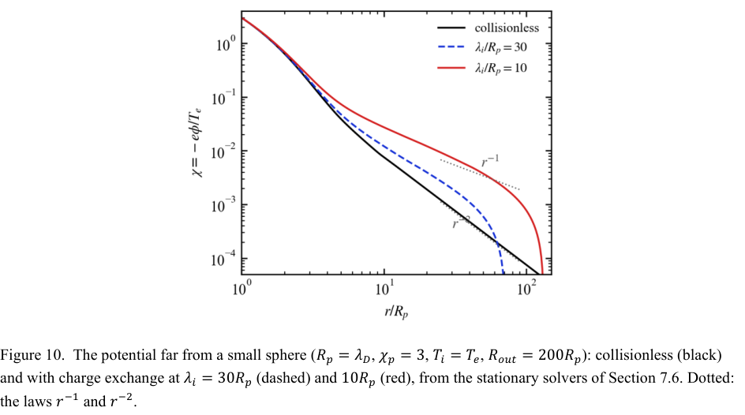
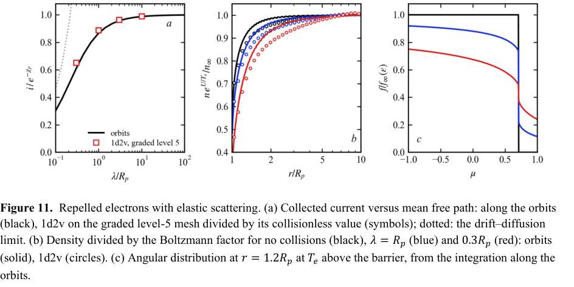
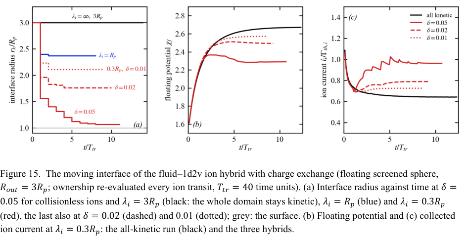

# PAMAR球形吸收体：用精确轨道解审查动理学与流体的切换

## 0. 论文、版本和阅读证据

- **原题**：A spherical body in plasma simulated with adaptive mesh and algorithm refinement。
- **作者**：Vladimir I. Kolobov、Robert R. Arslanbekov。
- **版本**：[arXiv:2611.21466v1](https://arxiv.org/abs/2611.21466v1)，2026-11-16首投、11-17公告；本次读取32页官方作者预印本，未取得同作品正式期刊版。[本地PDF](../pdfs/kolobov-2026-sphere.pdf)。
- **全文SHA-256**：`20e06e72ddf99acde7ee28fd6e9ec6c749b12cbe7b3265546f0cb993720142b8`。
- **与既有条目的关系**：本文是2611.14820《Plasma simulations with adaptive mesh and algorithm refinement》的球形探针伴随文，详述轨道参考解、电流—电压曲线、碰撞远场和逐单元模型选择。框架、部分球体算例及电子混合演示共享，不能把同一结果当两项独立验证；新增具体分析足以单独索引。仅查阅[旧框架笔记的定位](../../2026-11-14/notes/kolobov-2026-pamar.md)，未重新阅读或认证旧PDF。
- **本轮工作**：按原文顺序通读32页布局文本、图1–15说明、表1–3和参考文献；实际渲染目视第1、3、6、8、14、17、23、24、25、26、28、29页，并重开三幅保留原图。MinerU历史认证失效，本轮未复测、零请求，明确采用本地文本和原页渲染回退。[阅读与裁图证据](../research/kolobov_reading.json)。未运行作者PAMAR/MoC/轨道积分、复测性能或独立证明收敛。
- **证据类型**：无磁场、球对称、弱电离等离子体的欧拉动理学／约化模型数值基准；电场由静电Poisson方程给出。不是相对论电磁PIC、激光束实验或真实探针标定。

## 1. 摘要与引言：球体把“便宜模型是否足够”变成可检验问题

吸收球体的电荷由电子、离子收集电流共同决定。OML描述轨道运动限制电流，Laframboise理论求稳态无碰撞Vlasov–Poisson解，径向运动模型则适合冷离子无角动量极限。探针、尘粒和小型航天器共享部分数学结构，但具体磁场、发射、流动和碰撞条件不能互相代入。

引言首先提出**离子俘获**：静电吸引和离心势垒形成不通向远方或表面的闭合轨道。仅给远方Maxwell分布，不能确定这些轨道的占据数；电荷交换和势阱形成历史会决定它。把闭轨道留空是一项边界／历史约定，不是由无碰撞稳态方程证明真实等离子体中没有俘获离子。

其次是**电子弹性散射**：当平均自由程接近探针尺寸时，电子电流受到能量相关抑制，经典Druyvesteyn二阶导数反演所用的无碰撞假设会失效。本文只计算电流核的改变，完整碰撞探针EEDF反演留待另文。

PAMAR让电子、离子各自采用相空间网格和足够精确的模型。框架文先介绍架构；本文从可积球面轨道出发审查这些模型，并诚实报告接口传感器和混合模型的失败点。

## 2. 基本方程：保留角动量，区分两种碰撞

### 2.1 球面对称动理学及守恒变量

独立变量为半径、速率和径向速度与速率的比值。对物种质量、电荷和径向加速度，记

$$
\mu=\frac{v_r}{v},\qquad a=\frac{q_sE_r}{m_s}.
$$

沿粒子特征线，径向运动、速率变化和方向变化分别为

$$
\dot r=v\mu,\qquad \dot v=a\mu,\qquad
\dot\mu=(1-\mu^2)\left(\frac vr+\frac av\right).
$$

最后一式的第一项来自球坐标几何：即使直线运动，局部径向方向也会变化；第二项来自电场改变速度方向。把分布沿特征线的全导数展开，即得原文式(1)：

$$
\partial_t f+v\mu\partial_r f+a\mu\partial_v f
+(1-\mu^2)\left(\frac vr+\frac av\right)\partial_\mu f=C_s[f].
$$

球壳体积和速度体积分别含半径平方和速率平方，因此有限体积求解守恒变量

$$
Y=f r^2v^2,
\qquad
Y_{\rm mapped}=f r^2v^2\frac{dr}{dx}
$$

而不是只对分布函数做普通平流；后一式用于径向映射。作者的“粒子精确保守”指这个离散输运和接口通量结构，不能自动升级为任意碰撞、浮动反馈和全系统能量均已精确守恒。

### 2.2 能量、角动量与碰撞算子

无碰撞静态电场中的两个不变量为

$$
\varepsilon=\frac{m_sv^2}{2}+q_s\phi(r),\qquad
\ell=rv\sqrt{1-\mu^2},\qquad
U_\ell(r)=q_s\phi(r)+\frac{m_s\ell^2}{2r^2}.
$$

其中角动量按质量归一化。径向动能是总能量减去有效势；转向点由两者相等决定。纯径向模型删除第二项，因而无法表示绕过球体、离心反射或闭合轨道。

电子—原子弹性碰撞忽略质量比量级的能量交换，只使同一速率的方向趋于各向同性：

$$
C_e[f]=\nu_m(v)(f_0-f),\qquad
f_0=\frac12\int_{-1}^{1}f\,d\mu,
\qquad \lambda=\frac{v_T}{\nu_m},\quad v_T=\sqrt{\frac{2T_e}{m}}.
$$

对角度积分，散射源为零；它改变俯仰角、保留每个电子的能量。第8节基准取**恒定碰撞频率**，所以实际自由程随速率增长；不能把它误读成对所有速率恒定自由程。

离子电荷交换用BGK型出生—损失算子：

$$
C_i[f]=-\nu_{\rm CX}(v)f+S_{\rm CX}(r)\varphi_M(v),
\qquad
S_{\rm CX}=\int\nu_{\rm CX}f\,d^3v,
\qquad
\nu_{\rm CX}(v)=\frac{v_{{\rm th},i}+v}{\lambda_i}.
$$

这里气体Maxwell分布归一化为一。速度积分后，损失和出生严格抵消，说明每个壳层离子数守恒；但原来的快离子被气温慢离子替换，动量和能量并不对离子子系统守恒。慢离子可能落入闭轨道，因此再稀少的碰撞也可能改变稳态占据，不能只把碰撞当小幅电流修正。

### 2.3 Poisson方程、单位和质量比

原文以Gaussian形式写径向Poisson方程：

$$
\frac1{r^2}\frac{d}{dr}\left(r^2\frac{d\phi}{dr}\right)
=-4\pi e(n_i-n_e),\qquad
\chi_p=-\frac{e\phi_p}{T_e}.
$$

温度作为能量使用；转为SI输入时须一致处理电势能、电荷和介电常数。控制量是球半径与Debye长度之比、温度比、偏压，以及两种平均自由程与半径之比。作者特别说明代码屏蔽输入参数与电子Debye长度相差系数0.424，不应把文中不同Debye记号静默视为完全相同。

固定偏压的无碰撞稳态密度只依赖电势能与各物种温度之比，质量比在比较两物种收集电流时才出现。因此可以用人工质量比求某个固定偏压的稳态，再由电流平衡定位真实质量比的浮动点；这不保证真实瞬态、俘获建立时间或有历史依赖的稳态仍可如此替代。

## 3. 模型层级及两个“精确”参考的适用条件

**全动理学1d2v**在各物种自己的半径—速率—俯仰角八叉树上推进，可保留角动量、瞬态和显式碰撞。代价较大：表1所列单核无碰撞稳态，三个均匀层级约18分钟、3.7小时和54小时；这些数值是指定算例成本，不能泛化为与所有PIC程序的性能比较。

**电子Fokker–Planck层级**保留半径与总能量，约化角度。在充分角散射且损失锥之外，近各向同性分布满足稳态扩散结构

$$
\partial_r\left[r^2\frac{v^3}{3\nu_m}\partial_r f_0\right]=0,
\qquad
v=\sqrt{\frac{2[\varepsilon-U(r)]}{m}}.
$$

它来自前两个角矩加Lorentz闭合：第一角矩与各向同性部分的径向梯度成正比，代回连续性即得扩散式。外边界是远方分布，吸收壁使用半空间Marshak条件。它不能把一个尖锐空损失锥装进“各向同性加小梯度”中。

**两种双流模型**不同。1d1v(FB)把运动放在正反径向直线上，没有角动量，对平板原位产生的离子有用；1d1v(S)按到达、反射、吸收影和束缚轨道划分角区，每区取阶跃常数。无碰撞时这种轨道分类可精确；碰撞后区内均匀是闭合近似，不能再称完整动理学精确解。它用一个显式“俘获浴”变量记录闭轨道的出生与排空。

**离子流体模型**是连续性加等温动量方程，压力固定为气温乘密度，电荷交换以阻力出现。忽略惯性进一步得到漂移—扩散。该层级没有独立能量方程，也没有闭轨道占据或角动量分布。

第一个参考是稳态无碰撞的**特征线方法MoC**，适用于给定势形并采用明确轨道占据约定。第二个是**沿轨道积分**：对弹性散射，把时间乘碰撞频率作为光学深度，动理学方程变为一阶线性常微分式：

$$
\frac{df}{d\tau}=\langle f\rangle-f
\quad\Longrightarrow\quad
f(\tau)=f(0)e^{-\tau}
+\int_0^\tau\langle f\rangle(\tau')e^{-(\tau-\tau')}d\tau'.
$$

推导只需乘积分因子再积分；它表示未散射入流和沿途散射补给之和。在每个能量组中，自洽角平均形成稠密线性系统，转向点的平方根奇异可解析积分。**此处电子参考要求轨道函数随半径向外单调增长，适用于受排斥物种；低能受吸引物种不满足该条件。**另外，远场电荷交换离子使用包含束缚轨道及自洽出生率的另一个稳态轨道求解器。三者不是无条件适用于任意时空电磁场的统一精确解。

## 4. 场、吸收边界和浮动电势

场在独立径向壳层上用三对角算法求解，物种叶单元按其球壳体积与场壳层的重叠保守分配矩。物种网格聚焦壁面损失锥，场网格分辨鞘层／预鞘；两套径向网格服务不同误差目标。

壁面没有发射，外储库按包括外边界电势的Liouville分布注入。速率零边界还需专门闭合，否则减速粒子会从相空间漏走而不正确转向。三个边界处理使径向电流跨面一致到约二乘十的负四次方，但剩余壁面面值外推仍是一阶误差。径向分级能以更少单元改善此误差，不能据“保守”二字忽略绝对电流偏差。

每种电流按该物种自己的Maxwell随机热流归一化。真实浮动条件由两种热流之比得到原文式(10)：

$$
i_e(\chi_f)=i_i(\chi_f)\sqrt{\frac{mT_i}{MT_e}}.
$$

推导是先令电子与离子绝对电荷流相等，再使用Maxwell平均速率与温度除以质量之平方根成正比。人工质量比只移动曲线上的浮动交点。

作者建议固定偏压，因为数值电流误差会直接显露；浮动反馈会把误差部分吸收到电势变化中。独立物种时钟只适于唯一稳态；有俘获和浮动历史的大域算例后来改为锁步，不能用固定偏压捷径证明瞬态也可信。

## 5. 无碰撞参考与离子“空穴”

### 5.1 轨道占据规则和参考门槛（图1）

MoC沿无碰撞轨道保持分布。对给定角动量，计算当前位置外侧和内侧有效势的最大值，分别记外、内势垒。入射支必须越过外势垒；出射支只有越过外势垒且被内侧离心势反射时才被远储库填充。击中表面的轨道，其出射支为空；不碰表面、不通储库的闭轨道也按约定留空。

无电场时，球体在速度空间只投一个几何阴影。它遮掉的外向立体角除以总立体角，立即得到原文式(12)：

$$
\frac{n(r)}{n_\infty}
=\frac12\left(1+\sqrt{1-\frac{R_p^2}{r^2}}\right),\qquad i=1.
$$

表面向外半球完全为空，故密度恰为远方的一半；远方阴影消失，密度趋于远方值。图1(a)检验此密度而非新实验；(b)显示排斥支的Boltzmann指数及不同质量比浮动点；(c)显示有限外边界使吸引电流低于OML上限，并随域扩大收敛。

作者还对照Laframboise表5c、冷离子表5b和OML极限，给出四类独立解析／历史数值门槛。MoC可达很小残差，并不意味着同一网格上的全动理学绝对电流已达到相同精度。

### 5.2 四类相空间与闭轨道（图2–3）

图2把速率—俯仰角平面分成到达、反射、吸收影／返回表面和束缚区。排斥单调势没有吸引阱；受吸引并有屏蔽时，离心势可同时形成O点与X点，闭轨道区在给定切片中很大。文中的区面积百分数是特定相空间平面面积，**不是按分布加权的真实离子数比例**。

图3以鞘降速率归一化速度，绘制四个半径的分布和同一势中的轨道。径向聚焦与加速并不会让离子俯仰角必然很窄：角动量守恒使横向速率向内增长，反射轨道还会填充出射支。红色闭环在所画无碰撞态为空，仅标出电荷交换能够填充的位置；不能从红轨道线本身读出已存在的俘获密度。

### 5.3 碰撞与数值扩散都能填“空穴”（图4）

真实碰撞和势阱形成历史能填充闭轨道。作者从空闭轨道的MoC状态启动，以便随后增长有明确来源。但即使没有物理碰撞，速度数值扩散也会把通过轨道上的粒子漏进束缚区，使受吸引电流长期漂移；只有势形或密度看似收敛不足以发现这个错误。

固定偏压电荷交换扫描的图4显示：慢离子占据闭轨道会改变预鞘空间电荷，使势相对远储库出现小幅反转；屏蔽算例中离子电流从无碰撞到自由程等于球半径下降约1.96倍。该趋势依赖本算例温度比、碰撞算子和边界，不能泛化为稀碰撞总使探针电流下降。

### 5.4 吸引物种密度的局部峰与冷离子迭代（图5）

壁面出射支严格为空，稍离壁面后离心反射支开始增长；若其增长超过入射密度下降，出现局部密度峰。图5分解两支并扫描温度比；冷离子更接近径向下落，反射减弱，峰也减小。

作者报告冷离子自洽固定点迭代可能振荡，需Anderson混合及两套径向网格相符才接受。温度比0.1时，两网格峰高可差五倍，而单次未收敛解仍然平滑。这是本文有用的诊断原则：**曲线平滑不等于选到正确分支或完成收敛**。

## 6. 电子与离子需要不同的约化模型

### 6.1 无碰撞电子：壁格误差和束缚区误差不能混为一谈

固定Coulomb势、外边界为十个球半径的基准剥离了自洽场影响。表2排斥偏压为2的精确电流为0.13534；均匀level5为0.0958，分级level5为0.1239、level6为0.1328、level7为0.1347，即后者约为精确值的99.5%。分级每个方向一起细化的八叉树，改善主要来自缩小壁格，而不是单纯增加角向损失锥分辨率。

受吸引电流在level5反而高出约14%–16%，径向分级只略改：其主要误差在数值扩散填充闭轨道，不是同一个壁面亏损机制。远处净电流是两个各大约450倍的相反通量之差，解释了边界面通量精确性为何必要。

### 6.2 损失锥与碰撞补充（图6）

图6(a–c)是MoC无碰撞分布，以零能处远方Maxwell值归一化；其余碰撞组(d–l)以每个总能量自己的远方值归一化，两个色标口径不能直接比较。散射一面填损失锥，一面消耗其他轨道补给，所以锥外分布也降低。受吸引电子另有负总能闭轨道空区；弹性散射守能，不能把它填满。

### 6.3 Fokker–Planck和电子混合（图7）

图7显示把各向同性模型一直用到壁面会多收电子：自由程为0.1、0.3和1个半径时约多5%、18%、51%，自由飞行极限约多一倍。密度误差可比电流误差小，因此只核密度会漏掉收集率问题。

电子混合在损失锥层用1d2v，外侧用位置—总能量Fokker–Planck，逐速度行按部分电流连接。引用框架文的level6例在相同条件下电流距精确值约0.2%、电子单元减少56%；自洽例总时间减少11%。这是共享伴随结果，不是本文独立实验，也不是56%单元节省即56%总加速。

### 6.4 离子：表3必须同时看电流、浮动电势和振荡

下表转录PDF第17页表3。电流按离子热流归一化；两列自由程是无碰撞和0.3个半径，屏蔽参数8、等温、外边界3个半径，并采用无碰撞远场尾条件。

| 离子模型 | 无碰撞浮动电势 | 无碰撞电流 | 碰撞浮动电势 | 碰撞电流 |
| --- | ---: | ---: | ---: | ---: |
| MoC | 1.545 | 2.134 | — | — |
| 1d2v | 1.504 | 2.09 | 2.671 | 0.66 |
| 1d1v(S) | 1.554 | 2.03 | 2.59 | 0.69 |
| 等温流体 | 1.114 | 3.13 | 2.142 | 1.11 |

径向流体缺少角动量，收集电流比动理学高约50%–69%，而电势变化看起来较小。1d1v(S)保留轨道势垒，所列误差较小，等墙钟时间可推进约40倍物理时间；但其碰撞浮动态存在全动理学未见的持续振荡，表值是平均值。

两锥闭合也不能正确描述远方碰撞离子的逃逸出生轨道。它的预鞘外电势与全动理学明显不同，故“电流近似正确”不等于完整空间状态正确；需要外部碰撞模型，而不是把它当全域通用替代。

## 7. 无碰撞电流—电压曲线与远场

### 7.1 排斥支、OML和Druyvesteyn（图1）

单调阻滞势中的各向同性无碰撞入流，使排斥支精确跟随指数律；吸引支在小球、远边界极限趋于OML。有限外边界为十个半径时仍有约0.7%的OML亏损，作者发现按外域半径平方的倒数下降，因此引用OML数值必须注明域长。

原文式(14)可写为

$$
j_e(V)=\frac{2\pi e}{m^2}\int_{eV}^{\infty}(\varepsilon-eV)f(\varepsilon)d\varepsilon,
\qquad
\frac{d^2j_e}{dV^2}=\frac{2\pi e^3}{m^2}f(eV).
$$

第一次求导时，下限项因括号为零消失，只剩积分内对偏压的导数；第二次对下限求导得到阈值能量的分布。正是守能无碰撞入流使势垒以上粒子保持储库值。加入探针扰动区内的碰撞后，电流多了轨道散射核，不能继续把同一二阶导数视为未修正EEDF。

### 7.2–7.4 吸引支、冷离子、屏蔽与质量比

电子收集支受到受排斥离子温度的间接影响：离子空间电荷改变自洽电子鞘。在深偏压算例，电子电流可因温度比改变约20%。吸引支存在闭轨道势阱时，仍采用空占据约定，不能当任意真实历史的唯一电流。

冷离子与Laframboise表对比，首先要统一按电子还是离子温度定义的热流单位；温度比0.1会出现平方根十的换算因子。冷离子还需要更远域：20半径时残差停在约百分之一，40半径以上才能降至万分之一以下。

屏蔽从薄鞘过渡到接近Coulomb场时，吸引电流接近OML。给定特性曲线后，质量比只通过前述电流平衡移动浮动点；不同人工质量比的数值状态不能直接标成氢或氩真实浮动电势。

### 7.5 自洽求解器给出的曲线和矩（图8–9）

十二个固定偏压分别由时间依赖电子／离子与Poisson自洽推进。图8的level5全动理学吸引电流多数较接近MoC，排斥支仍低7%–13%，正是已知壁格误差；自洽场没有使这一误差消失。

图9除电势和密度，还比较漂移及平行／横向温度。离子角动量使两种温度显著分离并延续到几个球半径；电子各向异性更快衰减。图8虚线漂移—扩散曲线按其**自己的零场流**归一化，与无碰撞热流口径不同，不能逐点直接当绝对电流倍率。

### 7.6 远场：无碰撞平方倒数，有碰撞在自由程之外才近一次倒数

**图10来源和坐标**：PDF第23页原图／原图注摘录。横轴为距球心半径除以球半径，纵轴为负电子电势能除以电子温度，均为对数；球半径等于所用Debye长度，壁面归一化偏压3，等温，域长200个球半径。黑色无碰撞，红色和蓝虚线分别为离子自由程10和30个球半径；灰点线仅标斜率参考。

**趋势与含义**：无碰撞球体损失的出射立体角随半径平方倒数衰减，维持准中性所需势也随之衰减。有电荷交换时，自由程以内仍接近无碰撞势，自由程以外转向漂移—扩散尾，衰减较慢。指定算例无碰撞10–30个Debye长度的斜率约−2；自由程10半径时10–40个Debye长度约−1.2，尚非处处精确−1。

$$
\phi_{\rm collisionless}\propto r^{-2},
\qquad
\phi_{\rm collisional}\propto r^{-1}\quad(r\gtrsim\lambda_i).
$$

**推导直觉与限制**：无碰撞几何损失为球吸收截面除以球面面积，因而给出平方倒数；碰撞极限稳态粒子流的球面积守恒使驱动场近平方倒数，积分成一次倒数势，有效电荷由收集通量决定。这里是两种不同输运闭合下的渐近论证，不是孤立裸球的真空Coulomb定律。

**证据边界**：这些尾由不含速度网格的稳态轨道／两锥参考计算。作者明确说耦合时间依赖1d2v短域仍在屏蔽区，而长域百分之一的密度不平衡就会淹没很小的尾势；不能写成全动理学长域已经验证了两种渐近律。接近外储库时曲线被钉到边界而下弯，也不能拿那部分拟合物理远场指数。

## 8. 弹性电子散射：“1%”属于归一化趋势

**图11来源和坐标**：PDF第24页。受排斥偏压2、预设Coulomb势。图(a)横轴为电子参考平均自由程除以球半径，纵轴按无碰撞Boltzmann电流比较；黑线沿轨道参考，红符号是1d2v分级level5电流再除以**该网格自己的无碰撞值**。图(b)横轴半径比、纵轴密度除以当地Boltzmann因子和远方密度；图(c)横轴俯仰角余弦、纵轴分布除以相应总能量的储库值。

**趋势**：自由程缩短使净收集电流下降，等于1和0.3半径时分别降低约13%和39%；更强碰撞接近正比于自由程的漂移—扩散极限。角分布显示散射给损失锥补给，同时耗损入射群。密度变化小于电流变化。

**关键限制**：level5绝对无碰撞电流只有精确值的0.915。把这一固定壁格误差除掉后，碰撞依赖在自由程不小于0.3半径的计算点与参考相符到1%。因此可以报告“归一化碰撞趋势1%”，不能报告“全域绝对探针电流1%”。真正绝对精度仍需更细壁格和独立收敛检查。

## 9. 逐单元算法选择：传感器既是加速器，也是可证伪假设

### 9.1–9.2 四种传感器与电子／离子不同的区域（图12）

每个物种、每个场壳层分别检查：压力各向异性、离子漂移相对Bohm速率、束缚轨道占据机会，以及距吸收壁面若干平均自由程内的Knudsen层。其中各向异性定义为

$$
\delta_A=\left|\frac{T_\parallel}{T_\perp}-1\right|,
\qquad
M_i=\frac{|u_i|}{\sqrt{T_e/M}}.
$$

流体等温各向同性闭合删除了两温度之差，故第一个量直接测其缺失的信息；漂移传感器只测是否接近声速，不能检测轨道角动量。屏蔽算例中Bohm判据只标记约1.15半径以内，离子各向异性0.05却延伸到5.2半径；电子约在2.1半径外低于同阈值。图12因此表明不能为两物种套同一个动理学区域。

俘获传感器以当时势的内外势垒求CX新生离子落入闭轨道的概率。它必须随演化势重算：无碰撞起点几乎没有俘获区，不代表电荷交换建立的空间电荷以后不会挖出势阱。**后面的实际离子混合运行尚未实现这个传感器。**

### 9.3 电子混合：不能简单删除低能八叉树单元（图13）

图13(a)显示低于壁势垒的电子守能且各向同性，超过壁势垒的电子在近壁仍各向异性，区域随能量而异；(b)比较不同阈值和径向网格的动理学占比；(c)再次比较离子俘获、各向异性与漂移尺度。

理论上低于壁势垒的态可解析处理，但碰撞时若直接在八叉树上掩掉该区域，阶梯边界不能自动满足保守条件。因此实际实现对全部速度行，包括所谓被势垒困住的行，都用部分电流耦合Fokker–Planck。这里“低能被壁势垒挡回”与“受吸引物种不通任何边界的闭合轨道空穴”是不同的分组，不宜仅用同一个“trapped”字样混在一起。

### 9.4 离子混合的准稳成功、长时振荡与碰撞失败（图14–15）

流体—1d2v在界面用由流体密度、漂移和气温组成的Maxwell分布供给动理学入流。它把外向损失锥造成的分布差别也投影到入射半球，因此阈值本身控制接口误差；本文这组算例没有用框架文另一种矩匹配入流。

大域屏蔽浮动球的自由运行物种时钟会漂移，作者改锁步运行2500时间单位。图14仅在500–1000的准稳窗口比较：阈值0.02时电流、电势距全动理学约2%–3%；离子单元可分别减少33%、17%、6%，但每离子穿越时间的墙钟节省**最多11%**。掩去外侧单元仍需扫描传感器和覆盖缓冲壳，开销吃掉了多数节省。

1300之后所有浮动态，包括全动理学参考，均出现约一个全域离子穿越周期的驻波并增长；粗阈值放大更多，0.1运行约2280停止。固定偏压重启后停止增长，说明浮动反馈参与该模态。此观察支持“不是混合接口独有”，却不足以独立判定它是物理不稳定性还是边界／反馈算法效应；不能称大域浮动解已长时稳定收敛。

**图15来源和坐标**：PDF第29页。域长3个球半径，横轴为时间除以离子穿越时间，每穿越重选界面；(a)纵轴界面半径比，黑色保持全动理学，蓝色为自由程1半径，红色为0.3半径；(b)归一化浮动电势；(c)离子收集电流除以离子热流。实线、虚线、点线对应各向异性阈值0.05、0.02、0.01。

**趋势与含义**：强CX使二阶温度矩接近各向同性，阈值0.05把界面移到1.07半径，错误地把尚不具漂移Maxwell形的近壁离子交给流体。终态电势约2.29，对照同版本全动理学2.67；电流0.96，对照0.64，约高50%。表3的0.66来自另一个被引用版本／运行，不能用它替换此处同版本0.64而悄悄更换比较基线。

把阈值收紧至0.02和0.01，电流仍高23%和13%，且动理学单元已几乎与全域一样多，没有省下单元。作者认为主要原因是传感器漏掉近各向同性的CX俘获离子，这个解释与空间电荷机制一致；**加入俘获传感器后的修复尚未运行验证**。

作者提出外侧流体加内侧1d1v(S)：后者有角动量和俘获浴，前者补给远方碰撞等离子体。但需要把两锥模型当前的远储库边界改成界面漂移Maxwell分布，并在相同算例验证。它是有根据的下一步，不能写成现已完成且获得加速的混合求解器。

### 9.5 接口与性能边界

当前两套模型在全径向域持有数组：约化模型拥有的壳层覆盖动理学分布，动理学拥有的壳层回填低阶矩，界面保持与壁面连通。电子碰撞混合则按速度行部分电流耦合。粒子接口保守与分布形状准确是两个检查；即使守恒，错误的入射分布仍能改变收集电流。

球面对称1d2v中的离子收益有限；作者预期更大域、长CX填充时间或更高相空间维度会更有利，目前没有这些条件的独立成本数据。框架文所报电子八叉树缩小1.6–5.3倍，亦不能等同完整求解加速倍数。

## 10. 讨论、可用认识与待闭环

本文最有价值的是把“模型在哪些壳层够用”具体化为能失败的传感器，并把绝对电流、归一化趋势、空间矩、浮动反馈和性能分开核查。它提供轨道可积、弱电离球体的一组数值参考，而非对一般激光／强场电磁模拟的通用验收。

- **可直接借鉴**：先固定偏压审计面通量；同时看收集电流与电势；以几何阴影、排斥支上界、OML域长收敛和矩各向异性作为独立检查；每个物种选择自己的模型／网格区域。
- **物理限制**：球对称、无磁场、静电、远方Maxwell分布、理想吸收表面、指定弹性／BGK电荷交换；没有二次电子发射、化学、三维磁化轨道、实验探针或辐射测量。
- **数值限制**：壁面一阶亏损与速度数值扩散需要分开收敛；冷离子解分支需跨网格检查；远场微小电荷差不适于直接由当前粗速度网格认证；大域浮动长时反馈模态未闭环。
- **实施下一步**：实现并验证演化势上的俘获传感器、保守且形状可靠的界面入流；再测试流体—两锥混合，报告相同误差、相同物理时长和完整墙钟成本。作者数据注明按需提供，本轮没有获取固定源码版本、输入、收敛序列或硬件性能记录。

**复习速记**：压力近各向同性并不保证离子接近流体假设的漂移Maxwell分布；闭轨道占据是独立信息。本文电子1%是除去固定壁格亏损后的碰撞趋势，离子混合在强CX下反而暴露了各向异性传感器的明确失效。
